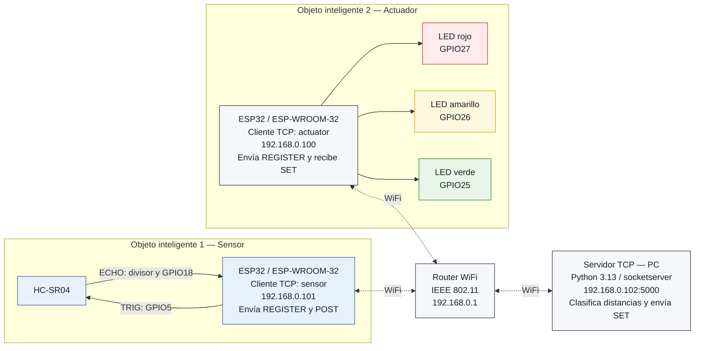
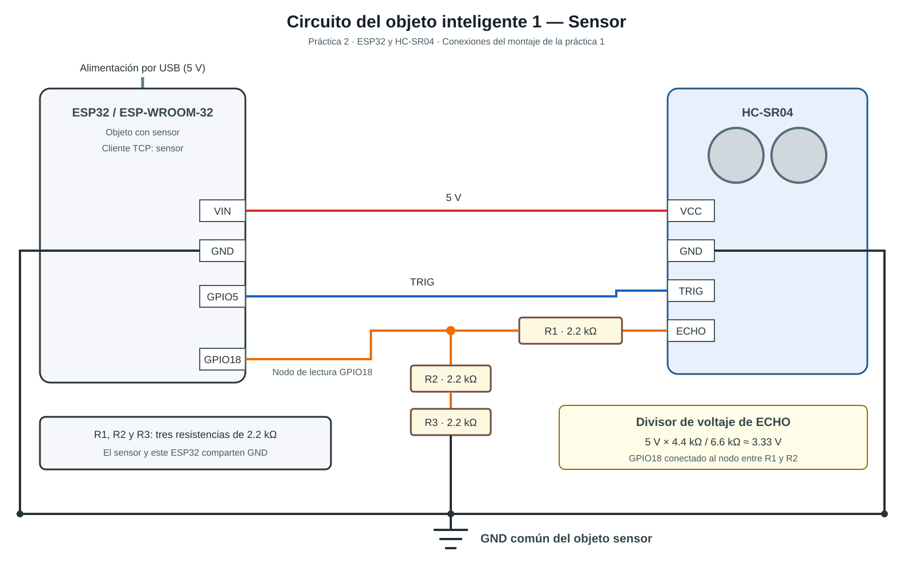
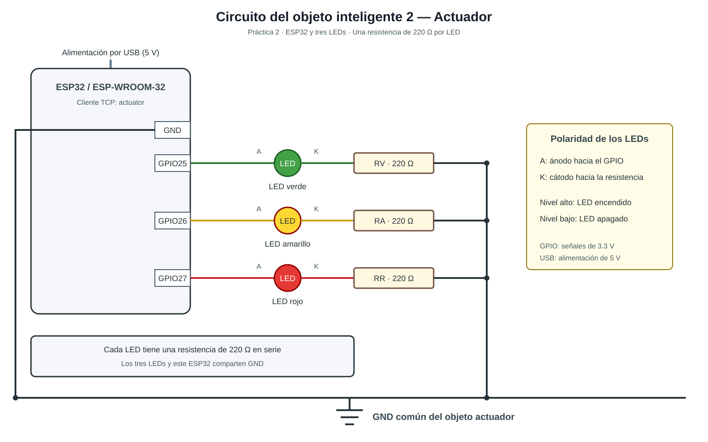
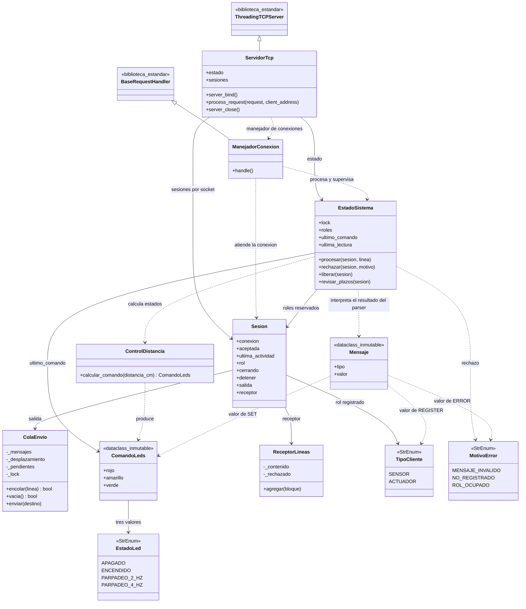
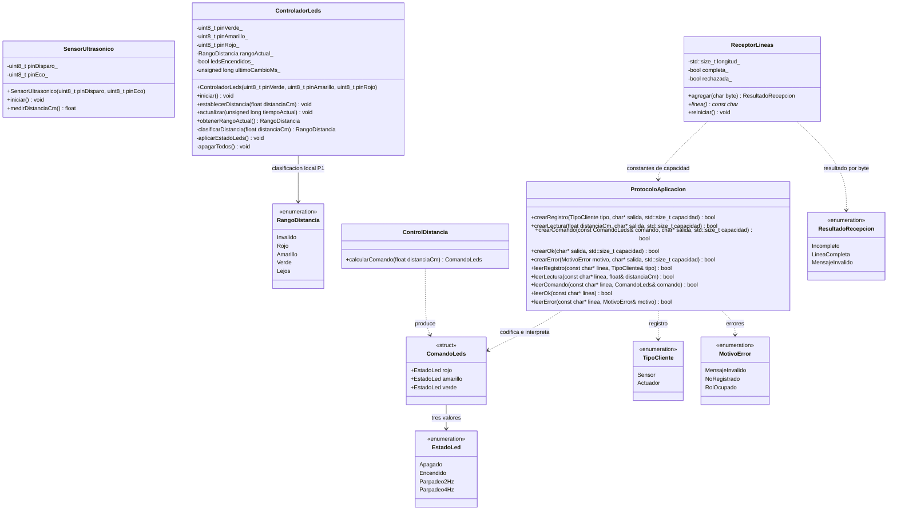
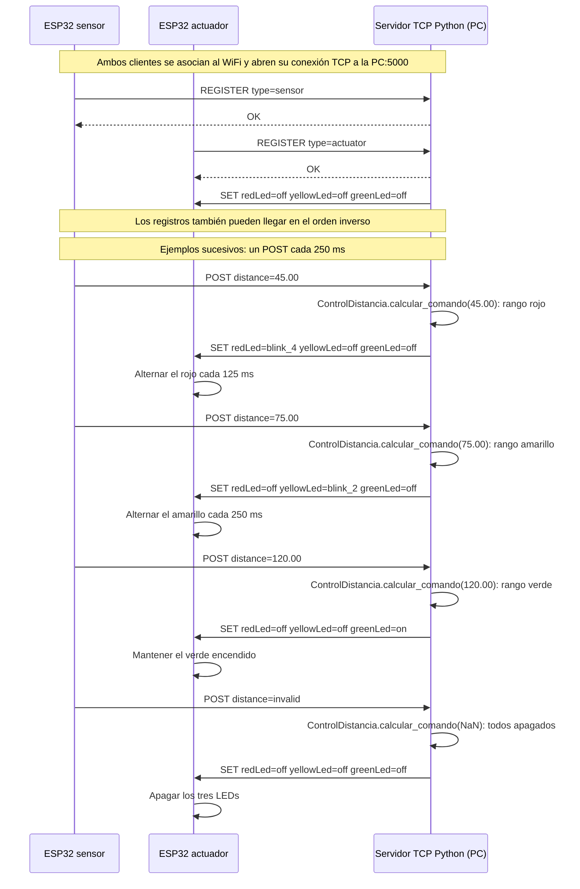
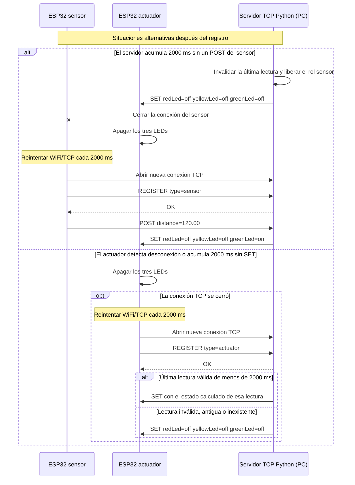

# Informe técnico — Práctica 2

**Actividad:** Integración de Objetos Inteligentes con TCP/IP

**Asignatura:** SIS-234 — Internet de las Cosas

**Grupo:** 8

**Integrantes:** Santiago Javier Torres Vacaflores y Ariel Adrian Mercado Alegre

**Plataformas del proyecto:** firmware para dos ESP32 / ESP-WROOM-32 y servidor para una PC Windows

**Estado del proyecto:** componentes principales del sistema distribuido implementados; montaje, integración y validación física pendientes

## Introducción

La [consigna de la Práctica 2](docs/consigna/Práctica_2.md) exige integrar un objeto inteligente con sensor ultrasónico, otro con actuadores y un servidor TCP central mediante WiFi (IEEE 802.11). El [diseño propuesto](docs/diagramas/Diseno_del_sistema.md) contempla un HC-SR04, tres LEDs y una PC que clasifica las distancias y envía comandos de actuación.

El proyecto dispone de dos programas ESP32 independientes: [PrincipalSensor.cpp](apps/firmware/src/PrincipalSensor.cpp) adquiere y publica la distancia, y [PrincipalActuador.cpp](apps/firmware/src/PrincipalActuador.cpp) recibe órdenes y controla los LEDs. Ambos utilizan [ClienteTcp](apps/firmware/src/ClienteTcp.cpp) para la conexión WiFi/TCP y el registro. La biblioteca C++ común, ubicada en [apps/firmware/lib/Compartido/](apps/firmware/lib/Compartido/), reúne los tipos, el protocolo y el receptor de líneas. El [servidor TCP Python](apps/servidor/servidor.py) concentra la recepción, clasificación y generación de comandos. La estructura vigente corresponde a la simplificación descrita en el [plan de implementación](docs/PLAN_IMPLEMENTACION.md#simplificación-del-código).

Existen [pruebas automatizadas C++](tests/native/) con hardware y red simulados y [pruebas Python](tests/python/) del dominio, protocolo, servidor y simuladores. El [resumen del equipo](docs/RESUMEN_PARA_INFORME.md) informa ejecuciones previas; su incorporación como resultados requiere registros verificables asociados a la versión evaluada. Esta revisión documental constata la implementación y la disponibilidad de pruebas, sin ejecutarlas ni equipararlas con el cumplimiento físico. El montaje, la comunicación sobre WiFi real y las mediciones y evidencias de desempeño permanecen pendientes, conforme a la [guía de montaje](docs/GUIA_MONTAJE.md) y las [pruebas físicas previstas](docs/PRUEBAS_FISICAS.md).

Los resultados de la Práctica 1 se conservan en [INFORME_P1.md](docs/historico/INFORME_P1.md) como referencia de organización y profundidad; no acreditan el funcionamiento del sistema distribuido de la Práctica 2. Los apartados aún no actualizados deberán contrastarse con el código vigente en iteraciones posteriores.

Los marcadores indican información por incorporar: `[PENDIENTE DE IMPLEMENTACIÓN]` para desarrollo y revisión del código, `[PENDIENTE DE MEDICIÓN]` para datos experimentales y `[PENDIENTE DE EVIDENCIA]` para registros verificables. Un resultado esperado es un criterio de prueba, no un resultado obtenido.

## Objetivo general

Diseñar, implementar y validar un sistema distribuido que mida distancias con un sensor ultrasónico, las procese en un servidor TCP y controle tres LEDs en un objeto inteligente independiente, mediante sockets TCP sobre WiFi y un protocolo de aplicación definido por el grupo.

## 1. Requerimientos Funcionales y No Funcionales

Esta sección establece las condiciones que deberá satisfacer el sistema distribuido. Los requerimientos funcionales RF1–RF4 mantienen la numeración y el alcance de la [consigna oficial](docs/consigna/Práctica_2.md); los criterios de aceptación concretan las decisiones del [diseño del equipo](docs/diagramas/Diseno_del_sistema.md). Los requerimientos no funcionales RNF1–RNF5 declaran los atributos de calidad y sus métodos de verificación.

La adquisición y el envío de distancia corresponden al ESP32 sensor; la recepción, clasificación y generación de comandos corresponden al servidor TCP en la PC; la recepción y ejecución de esos comandos corresponden al ESP32 actuador. Esta distribución sitúa el algoritmo de control en el servidor, conforme a la consigna. Los dos programas ESP32, su cliente de red compartido y el servidor Python están implementados. Los estados siguientes identifican el código disponible; ningún requisito se declara plenamente validado sin las evidencias correspondientes.

### 1.1 Requerimientos funcionales y criterios de aceptación

| ID | Funcionalidad requerida | Criterio de aceptación | Componente responsable | Estado de implementación |
|---|---|---|---|---|
| RF1 | Medir la distancia entre el sensor ultrasónico HC-SR04 y un objeto. | Obtener lecturas finitas positivas expresadas en centímetros y contrastarlas con una referencia física mediante PN-02. Ante timeout de ECHO o valor no válido, identificar la lectura como inválida, según PV-04; la tolerancia de medición se evalúa en RNF2. | ESP32 sensor: [SensorUltrasonico](apps/firmware/src/SensorUltrasonico.cpp) adquiere la distancia; [PrincipalSensor.cpp](apps/firmware/src/PrincipalSensor.cpp) planifica la adquisición y publicación mediante `ClienteTcp`. | Adquisición y publicación periódica implementadas. Exactitud y frecuencia físicas: [PENDIENTE DE MEDICIÓN] / [PENDIENTE DE EVIDENCIA]. |
| RF2 | Interpretar cada distancia válida y clasificarla en tres rangos contiguos y sin solapamiento. | Asignar cada distancia finita positiva a exactamente un rango de §1.2. Las entradas de PV-01 a PV-03, incluidos 49.99, 50, 99.99 y 100 cm, deben producir la clasificación prevista y el comando correspondiente. | PC: `ControlDistancia.calcular_comando()` de [dominio.py](apps/servidor/dominio.py), invocado por `EstadoSistema.nueva_lectura()` tras el procesamiento de `POST` en `ManejadorConexion.procesar()`. | Clasificación centralizada implementada exclusivamente en Python; no existe `ControlDistancia` C++. Validación del recorrido con ambas placas: [PENDIENTE DE EVIDENCIA]. |
| RF3 | Activar los tres LEDs del objeto actuador en función del rango, con un comportamiento distinto por rango. | Aplicar el comando completo según §1.2: rojo a 4 Hz, amarillo a 2 Hz o verde fijo, con los demás LEDs apagados; una lectura inválida debe producir todos apagados. Verificar estos estados mediante PV-01 a PV-04 y la continuidad de fase ante comandos idénticos mediante PV-05. | PC: generación de `ComandoLeds` y `SET`; ESP32 actuador: [PrincipalActuador.cpp](apps/firmware/src/PrincipalActuador.cpp) entrega los estados recibidos a [ControladorLeds](apps/firmware/src/ControladorLeds.cpp). | Recepción, ejecución de `ComandoLeds`, parpadeos y conservación de fase implementados. Actuación física y tiempos reales: [PENDIENTE DE MEDICIÓN] / [PENDIENTE DE EVIDENCIA]. |
| RF4 | Enviar lecturas desde el objeto sensor al servidor y comandos desde el servidor al objeto actuador mediante sockets TCP sobre WiFi (IEEE 802.11), utilizando un protocolo de aplicación definido por el grupo. | Establecer una conexión de cada ESP32 hacia la PC, completar `REGISTER` / `OK` y comprobar con registros el recorrido integrado `POST` → clasificación en servidor → `SET` → actuación física. Los mensajes deben respetar la especificación de §2.6; PV-06 a PV-16 verificarán registro, delimitación, rechazo de errores y recuperación previstos. | PC: `ServidorTcp`, `ManejadorConexion`, `Cliente`, `EstadoSistema` y funciones de `protocolo.py`; ambos ESP32: [ClienteTcp](apps/firmware/src/ClienteTcp.cpp), programas principales, `ProtocoloAplicacion` y `ReceptorLineas` C++. | Clientes ESP32, servidor y protocolo implementados. Comunicación TCP sobre WiFi real e integración física: [PENDIENTE DE EVIDENCIA]. Revisión de la diferencia de plazos indicada en §1.3: [PENDIENTE DE EVIDENCIA]. |

Los criterios se relacionan con el diseño y las validaciones mediante la matriz de §2.7. Las pruebas disponibles con entradas controladas al servidor permiten evaluar los límites exactos de RF2 sin confundirlos con el error físico del sensor; las pruebas del recorrido integrado deberán comprobar conjuntamente adquisición, comunicación y actuación. La revisión del código y las evidencias de §4 serán necesarias para declarar el cumplimiento de cada requisito. La matriz, las tablas de pruebas y la descripción detallada de §2.6 conservan su contenido en esta iteración y deberán actualizarse frente a la simplificación del código.

### 1.2 Rangos y lógica de control

Para la clasificación, se considera válida una distancia finita mayor que cero, expresada en centímetros. El dominio Python implementa la siguiente lógica de generación de estados y el firmware actuador incluye su ejecución; la comprobación física permanece pendiente:

| Distancia recibida | LED rojo | LED amarillo | LED verde |
|---|---|---|---|
| Lectura inválida | Apagado | Apagado | Apagado |
| 0 < distancia < 50 cm | Parpadeo a 4 Hz | Apagado | Apagado |
| 50 ≤ distancia < 100 cm | Apagado | Parpadeo a 2 Hz | Apagado |
| distancia ≥ 100 cm | Apagado | Apagado | Encendido fijo |

Los intervalos válidos son `(0, 50)`, `[50, 100)` y `[100, +∞)`. El valor 50 cm pertenece únicamente al rango amarillo y 100 cm únicamente al verde: cada límite se excluye del intervalo anterior y se incluye en el siguiente. De esta forma, no existen huecos ni solapamientos para las distancias finitas positivas. La lectura inválida constituye un estado de tratamiento de error, no un cuarto rango de distancia.

En el protocolo, `off` representa apagado y `on` encendido fijo. `blink_4` representa cuatro ciclos completos por segundo: un período de 250 ms, con 125 ms encendido y 125 ms apagado. `blink_2` representa dos ciclos completos por segundo: un período de 500 ms, con 250 ms encendido y 250 ms apagado. Estas frecuencias describen ciclos completos, no el número de alternancias del GPIO. `ControladorLeds` implementa esas alternancias mediante `millis()`: un modo nuevo comienza encendido y un modo repetido conserva su fase y temporización. Esto evita que el envío periódico de comandos reinicie el patrón; las frecuencias efectivas deberán medirse con el montaje.

Un timeout de ECHO produce una lectura no finita en `SensorUltrasonico`. El codificador C++ transforma las lecturas no finitas, cero o negativas en `POST distance=invalid`; también normaliza como inválidas las distancias inferiores a 0.01 cm, según el umbral implementado para la representación decimal. El servidor interpreta `invalid` como una lectura inválida y genera `SET` con los tres estados `off`. El token `invalid` es válido dentro del protocolo; un mensaje mal formado o una distancia numérica cero o negativa recibida directamente se rechazan conforme a sus reglas. Esta distinción evita tratar un fallo de comunicación como una medición válida.

El diseño también prevé el apagado al iniciar el actuador, ante una desconexión detectada y tras 2000 ms de ausencia de lecturas en el servidor o de comandos en el actuador, según corresponda. El firmware implementa el apagado inicial, el apagado ante pérdida de registro y el temporizador de 2000 ms sin `SET` completo consumido por el programa actuador, conservando la conexión en este último caso. `ClienteTcp` implementa los reintentos de ambos ESP32. El servidor registra roles, rechaza mensajes e invalida los datos y ordena apagar al liberar el sensor, incluido el cierre por timeout de recepción. Ese timeout difiere del plazo desde el último mensaje completo del diseño, como se explica en §1.3. Son comportamientos complementarios de RF3 y RF4, relacionados con PV-06 a PV-16; su validación integrada permanece [PENDIENTE DE EVIDENCIA].

El dominio de clasificación no impone un límite superior de 150 cm ni excluye valores positivos inferiores a 3 cm. En cambio, **3 a 150 cm es el intervalo previsto para validar físicamente la exactitud** de RNF2. La cobertura lógica de los rangos no demuestra que el sensor cumpla la tolerancia fuera de ese intervalo ni que ya la cumpla dentro de él. Su cobertura experimental y sus resultados permanecen `[PENDIENTE DE MEDICIÓN]` y `[PENDIENTE DE EVIDENCIA]`.

### 1.3 Requerimientos no funcionales

Los cuatro atributos cuantitativos adoptan los valores de referencia de la consigna como objetivos del equipo y mantienen pendiente su validación física para la Práctica 2. RNF5 concreta la exigencia de código legible, modular, orientado a objetos y documentado mediante una revisión verificable. Su alcance incluye el servidor Python, ambos firmwares C++ y la biblioteca C++ de tipos, protocolo y recepción de líneas; las reglas de distancia pertenecen exclusivamente al dominio Python.

| ID | Atributo de calidad | Criterio de aceptación | Método de verificación | Componente o alcance afectado | Estado de validación |
|---|---|---|---|---|---|
| RNF1 | Estabilidad | Operar durante al menos 10 minutos continuos, con cero reinicios y cero bloqueos, manteniendo la adquisición, el intercambio TCP y la respuesta de los LEDs. | PN-01: registrar inicio, fin y eventos de los tres equipos; observar continuidad de lecturas y actuación, y documentar cualquier interrupción. | Sistema distribuido completo: ESP32 sensor, servidor TCP y ESP32 actuador. | [PENDIENTE DE MEDICIÓN] / [PENDIENTE DE EVIDENCIA] |
| RNF2 | Exactitud de medición | Mantener un error absoluto máximo ≤ 3 cm respecto de una referencia física dentro del intervalo previsto de 3 a 150 cm. | PN-02: comparar lecturas individuales con una regla o cinta métrica en posiciones que cubran los tres rangos y los extremos del intervalo; calcular el valor absoluto de cada diferencia y su máximo. Registrar referencias, repeticiones y condiciones del ensayo. | HC-SR04, circuito y adquisición del ESP32 sensor; comprobar la conservación del valor comunicado al servidor. | [PENDIENTE DE MEDICIÓN] / [PENDIENTE DE EVIDENCIA] |
| RNF3 | Tiempo de respuesta extremo a extremo | Reflejar cada cambio de rango ensayado en el estado visible del actuador en un tiempo máximo de 1 s desde el cambio físico de distancia. | PN-03: registrar el cambio físico y la actuación con una grabación o instrumento de tiempo común; calcular la diferencia temporal por ensayo y el máximo observado, indicando resolución y transiciones evaluadas. | Recorrido completo sensor → servidor → actuador, incluidos adquisición, red, procesamiento y ejecución del comando. | [PENDIENTE DE MEDICIÓN] / [PENDIENTE DE EVIDENCIA] |
| RNF4 | Frecuencia de muestreo | Obtener al menos 2 lecturas/s durante la operación registrada del sensor. | PN-04: contar lecturas obtenidas durante una ventana de duración conocida y calcular cantidad/duración; contabilizar por separado lecturas inválidas y `POST` recibidos en el servidor para contrastar adquisición y recepción. | Planificación de adquisición en ESP32 sensor; recepción en servidor como comprobación del envío. | [PENDIENTE DE MEDICIÓN] / [PENDIENTE DE EVIDENCIA] |
| RNF5 | Calidad del código | Presentar módulos con responsabilidades delimitadas, clases que encapsulen estado y operaciones, interfaces documentadas, nombres y convenciones consistentes en Python y C++, y reglas de control separadas del hardware y los sockets. | Revisión de §3.4 sobre una versión identificada del código final: inspeccionar módulos, clases, interfaces y dependencias en ambos lenguajes; registrar por criterio el cumplimiento, el archivo o fragmento que lo respalda y los ajustes pendientes. | Servidor Python, firmware C++ de ambos ESP32 y biblioteca C++ de tipos, protocolo y recepción de líneas. | Separación de responsabilidades identificada en el código disponible. Revisión integral documentada: [PENDIENTE DE EVIDENCIA]. |

Para RNF2, la aceptación se basará en el **máximo de los errores absolutos individuales**, no únicamente en el promedio; este último podría ocultar lecturas que excedan la tolerancia. Las lecturas inválidas se registrarán por separado y no se usarán como errores numéricos. La conclusión experimental deberá indicar las posiciones realmente ensayadas y sus condiciones, sin generalizar a distancias no probadas.

Para RNF3, el origen temporal será el cambio físico de distancia y el final el cambio visible correspondiente del LED. Así se incluirá la espera hasta la siguiente adquisición y todo el recorrido de comunicación y control. No se restarán directamente timestamps de relojes de equipos distintos sin una referencia temporal común. El análisis de temporización del diseño podrá apoyar la explicación, pero no sustituirá la medición extremo a extremo exigida por la consigna.

La revisión de RNF5 deberá comprobar, en particular, que el sensor adquiere y comunica, el servidor clasifica y produce comandos, y el actuador ejecuta los estados recibidos. También verificará la encapsulación de pines y conexiones, la coherencia entre declaraciones y uso de interfaces, constantes con nombres descriptivos y comentarios que expliquen unidades, temporización y tratamiento de errores. En Python se revisarán `ServidorTcp`, `ManejadorConexion`, `Cliente` y `EstadoSistema` de [servidor.py](apps/servidor/servidor.py), el dominio y el protocolo. En C++ se revisarán `SensorUltrasonico`, `ControladorLeds` y `ClienteTcp`, la biblioteca común y los programas principales, que contienen `setup()` y `loop()` y no son clases. La lista de revisión deberá contrastar cada interfaz con sus declaraciones y llamadas, comprobar la sincronización del estado y los envíos del servidor y registrar por criterio un enlace al código, el hallazgo y cualquier ajuste pendiente. Las convenciones se evaluarán de acuerdo con cada lenguaje; la disponibilidad de módulos separados no basta para aprobar toda la revisión.

Los **valores objetivo** son los límites de aceptación de la tabla. Los **parámetros implementados** incluyen 250 ms entre adquisiciones del sensor registrado y con capacidad de envío, un timeout de ECHO de 30000 µs y 2000 ms sin comandos en el actuador. `ClienteTcp` configura 2000 ms para recibir `OK` desde la apertura TCP completada, 2000 ms para un envío pendiente y 2000 ms entre reintentos TCP; la apertura TCP puede esperar hasta 1000 ms. Tras perder WiFi espera 2000 ms para reintentar y luego deja 10000 ms entre intentos de asociación. La adquisición se omite mientras no hay registro o existe un envío pendiente, sin acumular lecturas para una conexión futura. Los 250 ms equivalen nominalmente a 4 lecturas/s; no garantizan la frecuencia observada, la estabilidad ni la respuesta extremo a extremo.

En el servidor, `PLAZO = 2.0` configura el timeout de las operaciones del socket mediante `settimeout()`. La espera de `recv()` vence si no recibe datos durante esa operación; un fragmento recibido permite iniciar otra espera, aunque todavía no haya una línea completa. **No equivale al plazo de 2000 ms desde la apertura sin registro completo o desde el último `POST` completo descrito por el diseño.** El código sí comprueba por separado la antigüedad de la última lectura al registrar un actuador. La diferencia de supervisión queda pendiente de revisión técnica y evidencia, especialmente para PV-12 y PV-13 con mensajes incompletos; no se modifican sus objetivos ni se declara satisfecho ese comportamiento.

Los **resultados medidos** se incorporarán en §4 y §5 con la versión de software y sus evidencias. La ejecución automatizada documentada por el equipo deberá respaldarse con registros; no sustituye las mediciones físicas de RNF1–RNF4 ni la revisión integral de RNF5. Los resultados de la Práctica 1 no acreditan estos requisitos de la Práctica 2.

## 2. Análisis y Diseño

Los diagramas enlazados en esta sección representan la propuesta de la Práctica 2. Su correspondencia con el montaje y el software finales deberá revisarse tras la implementación.

### 2.1 Arquitectura distribuida del sistema

La arquitectura separa la adquisición de distancia, el procesamiento de las lecturas y la actuación física en tres equipos: **ESP32 sensor → servidor TCP Python → ESP32 actuador**. Esta distribución responde al sistema exigido por la consigna y delimita las responsabilidades de RF1–RF4: el sensor obtiene los datos, la PC toma la decisión de control y el actuador ejecuta sus órdenes. Los dos programas ESP32 están implementados de forma independiente; el programa local de la Práctica 1 ya no forma parte de los entornos activos. La correspondencia con el montaje definitivo permanece pendiente de evidencia.

El firmware utiliza C++ con Arduino y los entornos definidos en [platformio.ini](platformio.ini). `sensor`, predeterminado, selecciona `PrincipalSensor.cpp`, `ClienteTcp.cpp` y `SensorUltrasonico.cpp` para la placa `esp32doit-devkit-v1`; `actuador` selecciona `PrincipalActuador.cpp`, `ClienteTcp.cpp` y `ControladorLeds.cpp` para `esp32dev`. Cada selección incluye únicamente el programa principal de su rol y ambos reutilizan la biblioteca de `apps/firmware/lib/Compartido/`.

En el flujo implementado, [PrincipalSensor.cpp](apps/firmware/src/PrincipalSensor.cpp) mide con `SensorUltrasonico` después del registro y cuando el intervalo y la disponibilidad de envío lo permiten. `ProtocoloAplicacion` genera `POST` y `ClienteTcp` lo transmite. En la PC, `ManejadorConexion.procesar()` interpreta la línea mediante [protocolo.py](apps/servidor/protocolo.py) y llama a `EstadoSistema.nueva_lectura()`. La clasificación corresponde exclusivamente a `ControlDistancia.calcular_comando()` de [dominio.py](apps/servidor/dominio.py); el estado del servidor conserva el último comando y su tiempo de recepción y envía `SET` al actuador registrado.

En el otro ESP32, `ClienteTcp` valida las líneas recibidas y conserva el último `SET` completo para el programa principal; un comando aún no consumido puede ser reemplazado por otro más reciente. [PrincipalActuador.cpp](apps/firmware/src/PrincipalActuador.cpp) convierte ese contenido en `ComandoLeds`, lo entrega a `ControladorLeds` y actualiza las salidas y los parpadeos. El actuador no clasifica distancias. La biblioteca común contiene [Tipos.h](apps/firmware/lib/Compartido/Tipos.h), [ProtocoloAplicacion](apps/firmware/lib/Compartido/ProtocoloAplicacion.h) y [ReceptorLineas](apps/firmware/lib/Compartido/ReceptorLineas.h); Python tiene sus propios tipos y funciones y no ejecuta código de esa biblioteca C++. La interoperabilidad depende del protocolo ASCII delimitado por LF, no de compartir un binario entre lenguajes.

El [servidor simplificado](apps/servidor/servidor.py) utiliza `socketserver.ThreadingTCPServer`, con un hilo por conexión aceptada. `ManejadorConexion` recibe mediante sockets bloqueantes con timeout y `Cliente.enviar()` utiliza `sendall`; no emplea `Sesion`, `ColaEnvio` ni `select`. `EstadoSistema` protege los roles y la última lectura con un `threading.Lock`, y cada `Cliente` serializa sus envíos con otro bloqueo porque el hilo del sensor puede escribir en la conexión del actuador. Los envíos de registro y actuación también se realizan con el bloqueo del estado tomado; un envío lento puede retrasar otras operaciones. Este modelo de concurrencia no demuestra por sí mismo el cumplimiento del tiempo de respuesta de RNF3. `time.monotonic()` permite evaluar la antigüedad de la lectura y `logging` registra los intercambios.

El siguiente diagrama conserva el [despliegue del diseño del equipo](docs/diagramas/Diseno_del_sistema.md#11-diagrama-de-despliegue), coherente con la distribución implementada. Los enlaces y equipos del montaje físico deben verificarse. **Todas las direcciones IP son ilustrativas.** El puerto TCP `5000` es el valor predeterminado comprobado en el código, no una configuración del montaje ya verificada.



Las líneas discontinuas representan los enlaces WiFi bidireccionales previstos a través del router, que proporciona conectividad IP entre los equipos de la red local. El router transporta el tráfico y no participa en la clasificación ni en la generación de comandos. Los enlaces de red deben distinguirse del flujo de aplicación: las lecturas se dirigen del sensor al servidor y las órdenes del servidor al actuador; comprobar ese recorrido con las placas permanece pendiente.

En el modelo cliente-servidor implementado, **ambos ESP32 inician su propia conexión TCP persistente hacia la PC** mediante una instancia de `ClienteTcp` por placa. El servidor escucha, acepta conexiones, responde al registro y envía órdenes por el socket del actuador; la PC no abre una conexión nueva hacia este objeto. `REGISTER` identifica el rol y ambos programas esperan `OK` antes de operar. El firmware configura WiFi en modo estación y permite obtener la dirección local mediante DHCP; las direcciones efectivas aún deben registrarse durante el montaje.

En los ESP32, `ClienteTcp.actualizar()` atiende envío y recepción con `send` y `recv` de lwIP y `MSG_DONTWAIT`, conserva fragmentos y el progreso del único envío pendiente y gestiona los reintentos. Esto no hace que todo el firmware sea no bloqueante: `connect` puede esperar hasta 1000 ms y la adquisición de ECHO hasta 30000 µs. El actuador supervisa localmente la ausencia de comandos. En la PC, el timeout de 2 s se aplica a las operaciones del socket; la llegada de fragmentos puede prolongar la espera de una línea completa. La diferencia respecto del plazo del diseño queda pendiente de revisión técnica conforme a §1.3.

La entrada de consola de [__main__.py](apps/servidor/__main__.py) define `--ip` con valor predeterminado `0.0.0.0` y `--puerto` con valor predeterminado `5000`, coincidentes con el constructor de `ServidorTcp`. `0.0.0.0` indica escucha en las interfaces IPv4 locales; no es una dirección de destino para los ESP32. Los clientes deberán utilizar la IPv4 real de la PC y el puerto efectivo. Esa configuración y la conectividad WiFi deberán comprobarse durante la integración física.

La configuración de ejemplo [ConfiguracionRed.example.h](apps/firmware/include/ConfiguracionRed.example.h) contiene SSID vacío e IP `0.0.0.0`; con esos valores, `ClienteTcp` deshabilita los intentos de conexión. El archivo local y la carga de cada entorno deberán prepararse según la guía de montaje; la existencia del ejemplo no acredita una configuración de red operativa.

| Componente | Responsabilidad | Intercambio principal | Estado actual |
|---|---|---|---|
| ESP32 sensor y HC-SR04 | Adquirir distancia con intervalo nominal de 250 ms, condicionado al registro y la disponibilidad de envío; comunicar lecturas válidas o inválidas. | Enviar `REGISTER type=sensor` y `POST`; recibir `OK` o `ERROR`. | `PrincipalSensor`, `SensorUltrasonico` y `ClienteTcp` implementados. Exactitud y cadencia físicas: [PENDIENTE DE MEDICIÓN]. Integración: [PENDIENTE DE EVIDENCIA]. |
| PC / servidor TCP Python | Registrar clientes, clasificar lecturas, generar comandos y atender la ausencia de datos con el timeout implementado. | Recibir `REGISTER` y `POST`; enviar `OK`, `ERROR` y `SET`. | Servidor, dominio y protocolo implementados; diferencia de plazos pendiente de revisión técnica. Integración con las placas: [PENDIENTE DE EVIDENCIA]. |
| ESP32 actuador y tres LEDs | Ejecutar el último comando recibido, conservar la fase de modos repetidos y supervisar la ausencia de comandos. | Enviar `REGISTER type=actuator`; recibir `OK`, `ERROR` y `SET`. | `PrincipalActuador`, `ControladorLeds` y `ClienteTcp` implementados. Actuación y tiempos físicos: [PENDIENTE DE MEDICIÓN] / [PENDIENTE DE EVIDENCIA]. |
| Router WiFi | Proporcionar conectividad IP entre los tres equipos. | Previsto: transportar el tráfico de las dos conexiones TCP sobre IEEE 802.11. | Configuración y conectividad del montaje: [PENDIENTE DE EVIDENCIA]. |

La comunicación se organiza en las cuatro capas del modelo TCP/IP utilizado en la práctica:

| Capa | Elemento del diseño y estado actual | Función en el sistema |
|---|---|---|
| Aplicación | Protocolo de texto del grupo, descrito en §2.6; implementaciones independientes Python y C++. | Definir los mensajes de registro, lectura, actuación y error, así como su delimitación. |
| Transporte | TCP y sockets; servidor Python y clientes ESP32 implementados, con puerto predeterminado `5000`. | Mantener las conexiones de los clientes y transportar el flujo ordenado de bytes. |
| Internet | IPv4; configuración real de la red local pendiente. | Identificar los equipos mediante direcciones IP. |
| Acceso a la red | WiFi, IEEE 802.11; gestión de conectividad implementada en `ClienteTcp`, asociación real pendiente de evidencia. | Proporcionar el enlace de los equipos con el router. |

Los componentes principales de adquisición, transporte, clasificación y actuación están implementados y cuentan con pruebas automatizadas disponibles. La ejecución de esas pruebas y sus registros deben distinguirse de la integración con hardware. La identificación de la red, las IP reales, el puerto utilizado y la comprobación del recorrido completo permanecen `[PENDIENTE DE EVIDENCIA]`; las mediciones físicas de desempeño permanecen `[PENDIENTE DE MEDICIÓN]`.

### 2.2 Circuito del objeto sensor

El objeto sensor diseñado comprende un ESP32 / ESP-WROOM-32, un HC-SR04 y tres resistencias de 2.2 kΩ que forman el divisor resistivo de ECHO. El ESP32 se alimentará por USB de 5 V y suministrará la alimentación del sensor desde VIN / 5 V. El siguiente esquema corresponde exclusivamente al objeto de adquisición de la Práctica 2:



Las conexiones conservan la asignación del [diseño del objeto sensor](docs/diagramas/Diseno_del_sistema.md#31-objeto-inteligente-con-sensor):

| Elemento o señal | Conexión prevista | Función |
|---|---|---|
| Alimentación del ESP32 | USB de 5 V. | Alimentar la placa del objeto sensor. |
| HC-SR04 VCC | VIN / 5 V del ESP32. | Alimentar el sensor ultrasónico. |
| HC-SR04 GND | GND del ESP32. | Establecer una referencia eléctrica común para alimentación y señales. |
| HC-SR04 TRIG | GPIO5 del ESP32. | Recibir el pulso de disparo generado por el microcontrolador. |
| HC-SR04 ECHO | ECHO → R1 de 2.2 kΩ → nodo conectado a GPIO18. | Conducir el pulso de eco hacia la entrada mediante el divisor. |
| Retorno del divisor | Nodo GPIO18 → R2 de 2.2 kΩ → R3 de 2.2 kΩ → GND. | Formar la rama inferior de 4.4 kΩ del divisor. |

El pulso enviado por GPIO5 a TRIG iniciará la medición. El ESP32 medirá en GPIO18 la duración de ECHO para obtener la distancia. El diseño conserva un pulso TRIG de 10 µs y un timeout de ECHO de 30000 µs; estos valores son parámetros previstos, cuya aplicación deberá comprobarse al revisar el firmware. La detección de una lectura inválida seguirá el comportamiento definido en §1.2.

El divisor es necesario porque ECHO utiliza una señal de 5 V, superior al nivel lógico de 3.3 V del ESP32. El diseño evita conectar ECHO directamente a GPIO18: R1 se sitúa entre ECHO y el nodo de lectura, mientras R2 y R3 están en serie entre ese nodo y GND. La tensión ideal en el nodo se obtiene mediante:

```text
Rsuperior = R1 = 2.2 kΩ
Rinferior = R2 + R3 = 2.2 kΩ + 2.2 kΩ = 4.4 kΩ
VGPIO18 = VECHO × Rinferior / (Rsuperior + Rinferior)
VGPIO18 = 5 V × 4.4 kΩ / (2.2 kΩ + 4.4 kΩ)
VGPIO18 ≈ 3.33 V
```

Este resultado es un cálculo ideal con los valores nominales del diseño, no una tensión medida ni una validación eléctrica del montaje. La tierra común une el ESP32, el HC-SR04 y el retorno del divisor dentro de este objeto. El segundo ESP32 tendrá su propio circuito de actuación; la comunicación prevista entre ambos objetos se realizará por WiFi.

**Aplicación de los parámetros de adquisición en el firmware:** [PENDIENTE DE IMPLEMENTACIÓN]

**Montaje final, lista de componentes y correspondencia con el esquema:** [PENDIENTE DE EVIDENCIA]

**Comprobación de la alimentación y tensión real del nodo ECHO:** [PENDIENTE DE MEDICIÓN]

### 2.3 Circuito del objeto actuador

El objeto actuador diseñado comprende un segundo ESP32 / ESP-WROOM-32, tres LEDs —rojo, amarillo y verde— y tres resistencias de 220 Ω, una por LED. La placa se alimentará mediante USB de 5 V. Los LEDs serán controlados por señales GPIO de 3.3 V, según el esquema; la alimentación USB no equivale a aplicar 5 V a estas salidas.



Las tres ramas conservan la polaridad y las conexiones del [diseño del objeto actuador](docs/diagramas/Diseno_del_sistema.md#32-objeto-inteligente-con-actuadores):

| Elemento | Conexión prevista |
|---|---|
| Alimentación del ESP32 | USB de 5 V. |
| LED verde | GPIO25 → ánodo del LED → cátodo → resistencia RV de 220 Ω → GND. |
| LED amarillo | GPIO26 → ánodo del LED → cátodo → resistencia RA de 220 Ω → GND. |
| LED rojo | GPIO27 → ánodo del LED → cátodo → resistencia RR de 220 Ω → GND. |
| Retorno común | Las tres resistencias retornan al GND de este ESP32. |

Cada resistencia se conecta en serie con su LED para limitar la corriente de su rama. El retorno compartido proporciona la referencia eléctrica común del objeto actuador. Con esta polaridad, un nivel alto en el GPIO encenderá el LED y un nivel bajo lo apagará; la alternancia temporizada producirá el parpadeo. El esquema no incluye el HC-SR04, que pertenece al objeto sensor independiente.

La PC deberá generar el comando `SET` con los estados de los tres LEDs después de clasificar la lectura. El ESP32 actuador deberá interpretar el comando completo y entregarlo al controlador de salidas, que mantendrá los modos recibidos y actualizará el parpadeo mediante `millis()`. Esta separación distingue la decisión de control, ejecutada en el servidor, de la ejecución física y su temporización, realizadas en el actuador. Los rangos y frecuencias se mantienen definidos en §1.2; el circuito aporta las salidas necesarias para representarlos.

**Recepción de comandos y control de salidas conforme al diseño:** [PENDIENTE DE IMPLEMENTACIÓN]

**Montaje final, lista de componentes y correspondencia con el esquema:** [PENDIENTE DE EVIDENCIA]

### 2.4 Diagrama de clases

Este apartado representa los componentes existentes en el código y distingue sus responsabilidades de las adaptaciones futuras del [diseño del equipo](docs/diagramas/Diseno_del_sistema.md#4-diagrama-de-clases-propuesto). Se utilizan dos diagramas porque Python y C++ tienen implementaciones independientes del dominio y del protocolo: **el servidor Python no invoca las clases de la biblioteca C++**. Los diagramas seleccionan atributos y operaciones principales; las firmas completas se conservan en los archivos enlazados.

#### 2.4.1 Servidor Python

La implementación se organiza en `servidor.py`, `dominio.py` y `protocolo.py`; `__main__.py` contiene las funciones de validación de argumentos y el inicio del servicio. Las clases externas del diagrama pertenecen a la biblioteca estándar y permiten mostrar las dos herencias que declara el código.



`ServidorTcp` hereda de `socketserver.ThreadingTCPServer`, crea `EstadoSistema` y registra una `Sesion` por socket aceptado. `ManejadorConexion`, derivado de `BaseRequestHandler`, ejecuta `handle()` en el contexto de atención de cada conexión: supervisa plazos, recibe bloques, entrega líneas al estado del sistema y atiende la cola de salida. `serve_forever()` y `shutdown()` son operaciones heredadas utilizadas por la entrada de consola; no sustituyen los métodos propios representados.

Cada `Sesion` conserva el socket, el rol, los tiempos y el evento de detención, y crea su propia `ColaEnvio` y su propio `ReceptorLineas`. `EstadoSistema` administra los roles reservados y el último comando, y almacena en `ultima_lectura` el instante de recepción, no un historial de distancias. Su `RLock` protege el estado compartido. `ColaEnvio` dispone de un bloqueo propio y conserva el desplazamiento de escrituras parciales; el manejador envía bytes fuera del bloqueo global de estado. En el diagrama, el signo `-` de los atributos Python con prefijo `_` expresa su uso interno por convención, no una restricción de acceso impuesta por el lenguaje.

`ControlDistancia.calcular_comando()` es un método estático que produce una instancia inmutable de `ComandoLeds`. `EstadoLed`, `TipoCliente` y `MotivoError` son enumeraciones `StrEnum`; `Mensaje` y `ComandoLeds` son clases de datos declaradas con `dataclass(frozen=True)`. `Mensaje.tipo` identifica el comando y `valor` contiene el rol, la distancia, el comando de LEDs, el motivo de error o `None`, según corresponda. `ReceptorLineas.agregar()` es un generador: conserva fragmentos y entrega contenido completo sin LF.

La interpretación y construcción del protocolo Python son **funciones de módulo**, no métodos de una clase `ProtocoloAplicacion`: `leer_mensaje()` devuelve `Mensaje`, `crear_comando()` y `crear_error()` construyen contenidos y `codificar()` valida y añade LF. `EstadoSistema.procesar()` utiliza `leer_mensaje()` y el dominio Python; la cola utiliza `codificar()`. Los errores de contenido o delimitación se notifican mediante `MensajeInvalido`, una excepción derivada de `ValueError`, que el manejador traduce a la política de rechazo. Estas funciones y la excepción se documentan en la tabla sin crear clases artificiales para representarlas.

#### 2.4.2 Firmware y biblioteca C++

El firmware existente conserva las clases de hardware de P1. La biblioteca C++ incorpora el dominio de P2, el protocolo y la recepción de líneas, sin depender de sockets. El diagrama siguiente representa ese código; **no incluye `ClienteTcp` ni los programas independientes de sensor y actuador, porque todavía no existen**.



`SensorUltrasonico` encapsula TRIG y ECHO y proporciona la adquisición heredada. `ControladorLeds` recibe una distancia mediante `establecerDistancia()`, la clasifica en `RangoDistancia` y controla los GPIO. Su `apagarTodos()` es privado; no tiene `establecerEstados()` ni `comandoActual_`, y no depende de `ComandoLeds`. Mantiene los límites de 5, 15 y 25 cm y la alternancia de 150 ms de P1. El programa local `main.cpp` coordina sensor y controlador, pero es un conjunto de funciones Arduino, no una clase adicional.

`ControlDistancia` C++ sí aplica los límites de 50 y 100 cm y devuelve `ComandoLeds`; permanece como referencia de prueba, no como clasificador ejecutado por el servidor Python. `ComandoLeds` inicializa los tres valores en `EstadoLed::Apagado`. `TipoCliente`, `MotivoError`, `EstadoLed` y `ResultadoRecepcion` son enumeraciones con tipo subyacente `std::uint8_t`; `RangoDistancia` es la enumeración propia del firmware heredado.

Todas las operaciones de `ProtocoloAplicacion` son estáticas y devuelven `bool`. Las operaciones de construcción reciben la capacidad real del buffer; las de interpretación mantienen sus parámetros de salida sin cambios si fallan. `ReceptorLineas` usa un buffer fijo de 128 bytes y devuelve `ResultadoRecepcion` por byte. Debe consumirse `linea()` después de `LineaCompleta` y antes del siguiente byte; `reiniciar()` descarta fragmentos y errores para una conexión nueva. El diagrama omite algunos atributos auxiliares para conservar legibilidad; `calcularComando()`, `obtenerRangoActual()`, `clasificarDistancia()` y `linea()` están declarados `const` en las cabeceras.

#### 2.4.3 Responsabilidades, archivos y estado

| Componente | Lenguaje | Archivo o módulo | Responsabilidad | Estado de implementación |
|---|---|---|---|---|
| `ServidorTcp` | Python | [servidor.py](apps/servidor/servidor.py) | Configurar y administrar el servicio TCP y las sesiones. | Implementado en código; integración física pendiente. |
| `ManejadorConexion` | Python | [servidor.py](apps/servidor/servidor.py) | Atender recepción, envíos, errores y plazos de cada conexión. | Implementado en código. |
| `Sesion` | Python | [servidor.py](apps/servidor/servidor.py) | Conservar socket, rol, tiempos, receptor y cola por conexión. | Implementado en código. |
| `EstadoSistema` | Python | [servidor.py](apps/servidor/servidor.py) | Reservar/liberar roles, clasificar lecturas y coordinar comandos. | Implementado en código. |
| `ColaEnvio` | Python | [servidor.py](apps/servidor/servidor.py) | Encolar mensajes y conservar el progreso de escrituras parciales. | Implementado en código. |
| `ControlDistancia`, `ComandoLeds`, `EstadoLed` | Python | [dominio.py](apps/servidor/dominio.py) | Ejecutar la clasificación y representar los estados de actuación. | Implementados en código; actuación física pendiente. |
| `Mensaje`, `ReceptorLineas`, `TipoCliente`, `MotivoError` | Python | [protocolo.py](apps/servidor/protocolo.py) | Representar mensajes, delimitar líneas y definir roles y errores. | Implementados en código. |
| `leer_mensaje`, `crear_comando`, `crear_error`, `codificar`, `MensajeInvalido` | Python | [protocolo.py](apps/servidor/protocolo.py) | Interpretar/codificar mediante funciones de módulo y notificar errores mediante una excepción. | Implementados en código. |
| `main`, `puerto_valido`, `ipv4_valida` | Python | [__main__.py](apps/servidor/__main__.py) | Validar argumentos e iniciar y detener el servicio. | Funciones implementadas en código. |
| `SensorUltrasonico` | C++ | [SensorUltrasonico.h](apps/firmware/include/SensorUltrasonico.h), [implementación](apps/firmware/src/SensorUltrasonico.cpp) | Adquirir distancias con el HC-SR04. | Heredado de P1; integración con el cliente pendiente. |
| `ControladorLeds`, `RangoDistancia` | C++ | [ControladorLeds.h](apps/firmware/include/ControladorLeds.h), [implementación](apps/firmware/src/ControladorLeds.cpp) | Clasificar y actuar localmente en el programa P1. | Heredados; adaptación a comandos P2 pendiente. |
| `ControlDistancia` | C++ | [ControlDistancia.h](packages/Compartido/src/ControlDistancia.h), [implementación](packages/Compartido/src/ControlDistancia.cpp) | Aplicar las reglas P2 como referencia de prueba. | Implementado; no invocado por Python. |
| `ProtocoloAplicacion` | C++ | [ProtocoloAplicacion.h](packages/Compartido/src/ProtocoloAplicacion.h), [implementación](packages/Compartido/src/ProtocoloAplicacion.cpp) | Construir e interpretar los cinco mensajes de aplicación. | Implementado; uso por clientes pendiente. |
| `ReceptorLineas`, `ResultadoRecepcion` | C++ | [ReceptorLineas.h](packages/Compartido/src/ReceptorLineas.h), [implementación](packages/Compartido/src/ReceptorLineas.cpp) | Reconstruir líneas y comunicar el resultado de recepción por byte. | Implementados; adaptador TCP pendiente. |
| `EstadoLed`, `ComandoLeds`, `TipoCliente`, `MotivoError` | C++ | [EstadoLed.h](packages/Compartido/src/EstadoLed.h), [ComandoLeds.h](packages/Compartido/src/ComandoLeds.h), [TipoCliente.h](packages/Compartido/src/TipoCliente.h), [MotivoError.h](packages/Compartido/src/MotivoError.h) | Representar modos, comandos, roles y errores. | Tipos implementados. |

La adquisición y la actuación física permanecen encapsuladas en las clases de hardware C++. La comunicación y la administración de sesiones del lado PC corresponden a `ServidorTcp`, `ManejadorConexion`, `Sesion`, `EstadoSistema` y `ColaEnvio`; la interpretación del protocolo Python se mantiene en funciones de módulo y su receptor. El dominio Python clasifica sin depender de GPIO, y los componentes C++ de protocolo y dominio no administran sockets. Esta separación permite revisar cada responsabilidad y comparar el contrato entre lenguajes sin confundir sus implementaciones.

Para completar el diseño objetivo se requiere `ClienteTcp`, los programas principales independientes de ambos ESP32 y la adaptación de `ControladorLeds` para ejecutar conjuntamente los estados recibidos. Se conservan como decisiones futuras del diseño y del [plan de implementación](docs/PLAN_IMPLEMENTACION.md), sin representarlos como clases existentes.

**Clientes ESP32, adaptación del actuador y correspondencia con las interfaces finales:** [PENDIENTE DE IMPLEMENTACIÓN]

**Validación de la integración de los componentes y evidencias de ejecución:** [PENDIENTE DE EVIDENCIA]

### 2.5 Diagramas de secuencia

Los dos diagramas representan **escenarios objetivo del recorrido completo**. Las operaciones internas de la PC están implementadas en Python; la asociación WiFi, el transporte de los ESP32 y la actuación física corresponden a los clientes todavía pendientes. Los mensajes son ejemplos del contrato, no registros de ejecución. Cada mensaje de aplicación termina en LF (`\n`), omitido en las etiquetas; `5000` es el puerto predeterminado del servidor, sin afirmar una configuración física comprobada.

#### 2.5.1 Registro y funcionamiento normal

Se conserva la [secuencia normal del diseño](docs/diagramas/Diseno_del_sistema.md#51-registro-y-funcionamiento-normal), actualizando la identificación del servidor y la llamada de clasificación a Python.



En el escenario completo, ambos ESP32 deberán asociarse a WiFi, abrir su conexión TCP hacia la PC y enviar `REGISTER type=sensor` o `REGISTER type=actuator`. Ese comportamiento y la espera de `OK` aún no existen en los clientes. El servidor Python sí acepta conexiones mediante `ServidorTcp`; `process_request()` crea la sesión y `ManejadorConexion.handle()` recibe bloques, utiliza el `ReceptorLineas` Python y entrega líneas completas a `EstadoSistema.procesar()`.

`leer_mensaje()` interpreta la línea y `EstadoSistema` reserva el rol si está disponible, actualiza la actividad y encola `OK`. La confirmación corresponde exclusivamente al registro. Al registrar el actuador, encola después un `SET` con el último comando si la lectura tiene menos de 2000 ms, o todos apagados si es antigua o inexistente. Una lectura reciente inválida también produce apagado porque su comando almacenado contiene los tres estados `off`. Ambos órdenes de registro están contemplados en el código.

El sensor deberá publicar nominalmente cada 250 ms cuando esté registrado. Para cada `POST` completo y válido, `EstadoSistema.procesar()` actualiza los tiempos y llama a `ControlDistancia.calcular_comando()` de `dominio.py`. En los ejemplos de 45.00, 75.00 y 120.00 cm produce rojo `blink_4`, amarillo `blink_2` y verde `on`, respectivamente; `distance=invalid` se interpreta como `math.nan` y produce todos apagados. `_actuar()` utiliza la función Python `crear_comando()` y encola `SET` si hay un actuador registrado. La cola añade LF mediante `codificar()` y conserva el progreso del envío parcial, que atiende el hilo de la conexión del actuador.

El servidor genera y encola un comando por lectura incluso si coincide con el anterior. Cuando no existe actuador registrado, conserva el último comando y el instante de la última lectura, sin acumular su historial. La aplicación de `SET`, la actualización local del parpadeo y la conservación de fase ante modos idénticos permanecen previstas para el ESP32 actuador. La PC decide el modo; no envía una orden por cada alternancia del GPIO. El protocolo no contempla una confirmación del actuador por cada lectura.

#### 2.5.2 Ausencia de datos, desconexión y recuperación

Se conserva la [secuencia de recuperación del diseño](docs/diagramas/Diseno_del_sistema.md#52-ausencia-de-datos-y-recuperación). La rama del sensor presupone un actuador registrado. El apagado dibujado en el ESP32 es una acción física prevista; en el servidor existe la generación y el envío del comando correspondiente.



**Registro incompleto y errores, implementados en la PC.** `EstadoSistema.revisar_plazos()` rechaza con `not_registered` la sesión que no completa el registro en 2000 ms desde su aceptación. Un mensaje operativo válido antes del registro produce el mismo motivo; sintaxis inválida, segundo registro o mensaje incompatible con el rol producen `invalid_message`; un rol ocupado produce `role_busy` sin liberar al cliente original. `rechazar()` libera el rol de la sesión rechazada, encola `ERROR` y marca el cierre. El manejador deja de recibir nuevos mensajes y conserva la salida hasta enviarla o agotar el plazo de cierre de 2000 ms. Este plazo adicional de cierre no es un reintento de conexión.

**Ausencia de lecturas, implementada en la PC.** La actividad del sensor se mide desde el último `POST` completo y válido, incluido `distance=invalid`; si no ha publicado después del registro, se mide desde su aceptación como sensor. Los fragmentos incompletos no renuevan ese tiempo. Al alcanzar 2000 ms, `revisar_plazos()` llama a `liberar()` y señala la detención de la sesión. `liberar()` elimina el rol sensor, establece `ultima_lectura = None`, sustituye `ultimo_comando` por todos apagados y encola ese comando al actuador registrado. La conexión del sensor se cierra y el servidor puede aceptar posteriormente un registro nuevo.

**Desconexión detectada, implementada en la PC.** Cuando `recv()` devuelve ausencia de datos por cierre, o se produce un error del socket, el manejador finaliza y libera la sesión. Si era el sensor, invalida el estado y encola apagado sin esperar el plazo de ausencia de lecturas. Si era el actuador, libera su rol y conserva la información reciente del sensor. Encolar o enviar apagado no demuestra que un LED físico se haya apagado: depende de una conexión disponible y del futuro firmware. Una cola saturada detiene y libera su sesión; un fallo durante el envío también conduce al cierre.

**Ausencia de comandos y desconexión local, pendientes en el actuador.** El ESP32 deberá apagar sus tres LEDs ante la pérdida detectada de conexión o tras 2000 ms sin un `SET` completo y válido. Si únicamente faltan comandos y el socket permanece abierto, deberá mantenerse conectado y apagado hasta recibir uno válido. Este watchdog y el apagado físico son responsabilidades futuras del actuador; no los ejecuta el servidor Python.

**Reintentos y nuevo registro, pendientes en ambos ESP32.** Los clientes deberán reintentar WiFi/TCP cada 2000 ms, abrir un socket nuevo, descartar fragmentos y repetir `REGISTER` / `OK`. También deberán cerrar y reintentar si no reciben `OK` dentro de su plazo de registro. El servidor implementa la aceptación y el registro posterior, pero no realiza los reintentos locales de los clientes. Cada sesión nueva en Python crea un receptor y una cola nuevos; en el futuro cliente C++, `ReceptorLineas.reiniciar()` permitirá descartar el estado de la conexión anterior.

**Restauración del comando, implementada en la PC; restauración física pendiente.** Un sensor nuevamente registrado puede publicar una lectura y producir el `SET` mostrado en el diagrama. Un actuador nuevamente registrado recibe `OK` y el último comando si su lectura tiene menos de 2000 ms; recibe todos apagados cuando la lectura es inválida, antigua o inexistente. La caducidad se calcula con tiempo monótono del servidor. El ESP32 todavía deberá ejecutar el comando válido y, tras un apagado por ausencia de datos, comenzar los parpadeos desde encendido, según el diseño. Los plazos son constantes del código y del comportamiento objetivo, no mediciones obtenidas en esta iteración.

Las secuencias conservan la separación entre interpretación, clasificación, administración de sesión y ejecución física. PV-01 a PV-06 y PV-12 a PV-16 siguen como referencias para validar los recorridos; PV-07 a PV-11 cubren roles ocupados, delimitación y rechazo. La presencia de las operaciones del servidor no implica que estos casos ya estén aprobados ni que los componentes ESP32 pendientes funcionen.

**Correspondencia de las secuencias con los registros reales de intercambio:** [PENDIENTE DE EVIDENCIA]

**Mecanismos locales de registro, supervisión, apagado y recuperación de los ESP32:** [PENDIENTE DE IMPLEMENTACIÓN]

### 2.6 Protocolo de aplicación TCP

TCP transporta un flujo ordenado de bytes; una recepción del socket no equivale necesariamente a un mensaje completo. El protocolo del grupo define el contenido, la delimitación y el significado de los mensajes que satisfacen RF4. Su [especificación de diseño](docs/diagramas/Diseno_del_sistema.md#6-especificación-del-protocolo-de-aplicación) se concreta en implementaciones independientes: [protocolo.py](apps/servidor/protocolo.py) para el servidor y [ProtocoloAplicacion.cpp](packages/Compartido/src/ProtocoloAplicacion.cpp) para la biblioteca C++. La integración de esta última en los clientes TCP de los ESP32 sigue pendiente.

#### 2.6.1 Codificación, delimitación y tamaño

| Propiedad | Regla implementada |
|---|---|
| Codificación del contenido | ASCII imprimible: bytes de `0x20` a `0x7E`. La sintaxis restringe además los caracteres de cada campo. |
| Delimitador transmitido | Un byte LF, `0x0A`, al finalizar cada mensaje. |
| Longitud máxima | 127 bytes de contenido más LF: 128 bytes por línea transmitida, sin incluir cabeceras de TCP/IP. |
| Longitud mínima | Contenido no vacío; un LF aislado se rechaza. |
| Separación y campos | Un espacio ASCII entre comando y argumentos y entre argumentos; formato `clave=valor`, con nombres y orden exactos. |
| Mayúsculas | Comandos, claves y valores sensibles a mayúsculas; `REGISTER`, `distance` y `invalid` deben conservar su escritura. |
| Caracteres rechazados | CR, NUL, tabuladores, otros controles, DEL y bytes fuera del ASCII imprimible. No se admite CRLF. |
| Buffer C++ | Hasta 127 bytes de contenido y un terminador local NUL (`\0`): capacidad de 128 bytes, sin LF. |

No se admiten espacios iniciales o finales, campos adicionales, claves repetidas ni cambios de orden. Un carácter imprimible puede superar la validación de delimitación y aun así ser inválido para un comando: por ejemplo, `UNKNOWN` es contenido ASCII, pero no un mensaje del protocolo.

**Contenido y transmisión son representaciones distintas.** El contenido `OK` tiene dos bytes; en el cable se transmiten esos bytes seguidos de LF, tres en total. El buffer C++ almacena `O`, `K` y `\0`; ese NUL no se transmite. El receptor retira LF antes de entregar el contenido al intérprete. En los ejemplos escritos, `\n` representa un único byte LF, no los caracteres barra invertida y letra `n`. El límite de 128 bytes en el cable y la capacidad local de 128 bytes coinciden numéricamente, pero reservan su último byte para delimitadores diferentes.

#### 2.6.2 Reconstrucción del flujo recibido

Cada conexión mantiene su propio receptor. El [ReceptorLineas Python](apps/servidor/protocolo.py) conserva bytes entre bloques y entrega cada línea mediante un generador; el [ReceptorLineas C++](packages/Compartido/src/ReceptorLineas.cpp) recibe un byte por llamada y señala `Incompleto`, `LineaCompleta` o `MensajeInvalido`.

Un mensaje fragmentado, como `REGI` seguido de `STER type=sensor\n`, se interpreta una sola vez después de recibir LF. Si un bloque contiene `OK\nSET redLed=off yellowLed=off greenLed=on\nPOST dist`, se entregan las dos líneas completas en orden y se conserva `POST dist` para la recepción siguiente. Una línea de 127 bytes puede esperar LF; un byte adicional de contenido provoca rechazo inmediato. Los mensajes completos anteriores a un error posterior del mismo bloque no se deshacen ni se procesan de nuevo.

Una línea incompleta no se entrega al intérprete ni renueva por sí sola los plazos de registro o de actividad del sensor. El servidor continúa atendiendo sockets y temporizadores; si la conexión se cierra, descarta su fragmento. Un error de delimitación deja el receptor en estado rechazado. Python crea uno nuevo para otra sesión; C++ dispone de `reiniciar()`. La sintaxis se comprueba después de delimitar: un error sintáctico no constituye un resultado de distancia y el servidor aplica la política de rechazo de §2.6.5. En C++, `linea()` debe leerse después de `LineaCompleta` y antes de agregar el siguiente byte, porque el almacenamiento pertenece al receptor.

#### 2.6.3 Mensajes y ejemplos de intercambio

La dirección expresa el uso permitido por la aplicación. Reconocer sintácticamente una línea no autoriza su recepción en cualquier rol o estado de sesión.

| Mensaje | Dirección | Sintaxis del contenido | Parámetros | Finalidad | Condición de aceptación o emisión |
|---|---|---|---|---|---|
| `REGISTER` | Cliente → servidor | `REGISTER type=<tipo>` | `tipo`: `sensor` o `actuator`. | Solicitar la reserva de un rol. | Primer mensaje de aplicación de una conexión no registrada, dentro del plazo y con el rol disponible. |
| `OK` | Servidor → cliente | `OK` | Ninguno. | Confirmar exclusivamente el registro. | El servidor lo emite al reservar el rol; los futuros clientes deben esperar esta confirmación antes de operar. |
| `POST` | Sensor → servidor | `POST distance=<valor>` | Decimal aceptado en cm o token `invalid`. | Comunicar una medición o su invalidez. | Solo desde la conexión registrada como sensor; línea completa y valor válido para el protocolo. |
| `SET` | Servidor → actuador | `SET redLed=<estado> yellowLed=<estado> greenLed=<estado>` | Cada estado: `off`, `on`, `blink_2` o `blink_4`. | Comunicar conjuntamente los estados de los tres LEDs. | El servidor lo emite para un actuador registrado. Su aceptación y ejecución en el ESP32 siguen pendientes; el servidor rechaza un `SET` enviado por sus clientes. |
| `ERROR` | Servidor → cliente | `ERROR reason=<motivo>` | `invalid_message`, `not_registered` o `role_busy`. | Notificar el rechazo de un mensaje o registro. | El servidor encola la respuesta y cierra la conexión rechazada conforme a su política de sesión. |

Los textos entre `< >` son variables descriptivas, no caracteres transmitidos. `sensor` identifica al objeto que publica lecturas y `actuator` al que recibe órdenes. Los estados representan apagado, encendido fijo y parpadeo de dos o cuatro ciclos completos por segundo, respectivamente. La generación de estados está implementada en el servidor; la temporización física del actuador permanece prevista según §1.2.

El ejemplo siguiente muestra líneas válidas de un recorrido objetivo. Los registros y `POST` proceden de las conexiones correspondientes; `OK` y `SET` proceden del servidor. No es una transcripción de una prueba realizada:

```text
REGISTER type=sensor\n
OK\n
REGISTER type=actuator\n
OK\n
SET redLed=off yellowLed=off greenLed=off\n
POST distance=45.00\n
SET redLed=blink_4 yellowLed=off greenLed=off\n
POST distance=invalid\n
SET redLed=off yellowLed=off greenLed=off\n
```

Si otro cliente solicita un rol ocupado, el servidor emite, por ejemplo, `ERROR reason=role_busy\n` en esa conexión nueva y conserva el registro original.

Debe distinguirse la invalidez de una medición del rechazo de un mensaje:

| Situación | Ejemplo de contenido | Interpretación y efecto en el servidor |
|---|---|---|
| Lectura numérica válida | `POST distance=45.00` | Interpreta una distancia positiva y genera el comando del rango correspondiente. |
| Lectura física inválida comunicada correctamente | `POST distance=invalid` | Mensaje válido: entrega NaN al dominio, genera todos apagados y renueva la actividad del sensor. |
| Valor numérico no aceptado | `POST distance=0` | Mensaje inválido: cero no pertenece al dominio numérico del protocolo; no se normaliza automáticamente a `invalid` al recibirlo. |
| Mensaje mal formado | `POST distance=45,00` o `SET redLed=off` | Sintaxis inválida: no entrega una lectura ni un comando parcial y aplica `invalid_message`. |

#### 2.6.4 Representación decimal y conversión numérica

La gramática numérica es `[0-9]+(?:\.[0-9]+)?`: una parte entera obligatoria y una fracción opcional con al menos un dígito. Se aceptan `45`, `45.00`, `00045.50` y `0.01`; se rechazan signos, coma, notación científica, `.5`, `1.`, `NaN` e `Infinity`. El resultado debe permanecer finito y estrictamente positivo tras la conversión, sin exceder el máximo permitido.

El contrato adopta **float32** para conservar la representación de distancia de los clientes C++ previstos. Python interpreta primero con `float()`, comprueba el máximo binario32 definido en `MAX_FLOAT32` y convierte mediante `struct.pack("!f", valor)` y `struct.unpack("!f", ...)`. Rechaza un valor que se convierta en cero. C++ acumula los dígitos en `double`, verifica el máximo de `std::numeric_limits<float>::max()` y convierte a `float`, comprobando nuevamente finitud y positividad. El dominio clasifica el valor convertido, no el decimal escrito considerado con precisión ilimitada.

Los siguientes resultados son **expectativas del [contrato JSON](tests/contratos/protocolo.json)**, no mediciones ni pruebas declaradas aprobadas:

| Contenido de `POST` | Interpretación o resultado esperado |
|---|---|
| `distance=49.99` | Rango rojo. |
| `distance=50` | Rango amarillo; el límite pertenece al intervalo que comienza en 50 cm. |
| `distance=49.99999999999999999` | Rango amarillo tras el redondeo al límite de 50 cm. |
| `distance=99.99` | Rango amarillo. |
| `distance=100` | Rango verde; el límite pertenece al intervalo que comienza en 100 cm. |
| `distance=99.99999999999999999` | Rango verde tras el redondeo al límite de 100 cm. |

Las entradas demasiado grandes o tan pequeñas que se convierten en cero se rechazan, aunque tengan gramática decimal correcta. Un número pequeño representable no se rechaza únicamente por estar debajo de 3 cm: el dominio del protocolo se distingue del intervalo físico de exactitud de §1.3. Estos controles y el redondeo precisan la condición general de distancia finita positiva del diseño inicial; no cambian los límites de clasificación ni los objetivos de validación.

El emisor C++ `crearLectura()` construye dos decimales mediante `snprintf()` y asegura el punto decimal, independientemente del separador del locale. Las expectativas de [protocolo_aplicacion.cpp](tests/native/protocolo_aplicacion.cpp) incluyen `45.126F` → `POST distance=45.13` y `0.001F` → `POST distance=invalid`, porque este último redondea a `0.00`. Cero, negativos y valores no finitos también se normalizan a `invalid` al construir la lectura. La recepción, en cambio, rechaza el texto numérico `0.00`. La reducción a dos decimales al emitir y la conversión a float32 al recibir son etapas diferentes de representación.

Python y C++ usan procedimientos de interpretación distintos y no se presupone equivalencia numérica absoluta para todos los decimales. Los vectores permiten comparar decisiones de aceptación y comandos resultantes en entradas concretas; no demuestran igualdad exhaustiva de los valores internos ni exactitud física del sensor.

#### 2.6.5 Implementaciones y políticas de sesión

**Python.** `leer_mensaje()` devuelve la clase de datos inmutable `Mensaje`, con `tipo` y `valor`; una invalidez produce la excepción `MensajeInvalido`. `crear_comando()` y `crear_error()` construyen contenidos sin LF. `codificar()` valida ese contenido, lo codifica como ASCII y añade LF. El receptor retira LF y conserva fragmentos. En [servidor.py](apps/servidor/servidor.py), `EstadoSistema.procesar()` aplica las reglas de sesión y llama a `ControlDistancia.calcular_comando()` de [dominio.py](apps/servidor/dominio.py). `ColaEnvio` conserva el progreso de las escrituras parciales. Ninguna de estas funciones de protocolo se presenta como una clase Python `ProtocoloAplicacion`.

**C++.** La [cabecera ProtocoloAplicacion.h](packages/Compartido/src/ProtocoloAplicacion.h) declara los métodos estáticos `crearRegistro`, `crearLectura`, `crearComando`, `crearOk`, `crearError` y sus métodos `leer...`. Devuelven `bool`; las operaciones de construcción reciben el buffer y su capacidad, incluido NUL, y no modifican la salida si fallan. Las de interpretación requieren una cadena terminada en NUL y conservan los datos de salida ante un fallo. `leerComando()` asigna `ComandoLeds` solo después de validar los tres campos. El [receptor C++](packages/Compartido/src/ReceptorLineas.h) delimita sin administrar sockets. El adaptador TCP futuro deberá incorporar LF al enviar y no transmitir NUL; ese adaptador y los programas ESP32 están [PENDIENTE DE IMPLEMENTACIÓN].

La sintaxis define qué significa una línea; **el servidor decide si está permitida en la sesión**. Sus políticas implementadas, relacionadas con las secuencias de §2.5, son:

- Cada conexión comienza sin rol y tiene 2000 ms para completar `REGISTER`. Solo se reserva un sensor y un actuador a la vez; `OK` confirma la reserva.
- Después del registro, el servidor solo acepta `POST` desde el sensor. Un segundo `REGISTER`, mensajes de rol incompatible o `OK`, `SET` y `ERROR` recibidos desde clientes se rechazan como `invalid_message`.
- La interpretación sintáctica precede a la comprobación de sesión: un `POST` válido sin registro produce `not_registered`, pero `POST distance=0` produce `invalid_message` aun antes del registro. Un registro correcto para un rol ya reservado produce `role_busy`.
- El rechazo libera únicamente el rol de la sesión afectada, encola `ERROR` y permite terminar su envío antes de cerrar, con un plazo máximo adicional de cierre de 2000 ms. Si se libera el sensor, se invalidan sus datos y se encola apagado al actuador disponible. Un fallo de socket o saturación de recursos puede provocar cierre sin completar una respuesta de error.
- Tras 2000 ms sin `POST` completo y válido, el servidor libera y cierra el sensor, invalida la lectura y encola apagado. `distance=invalid` renueva la actividad; los fragmentos no. Al registrar el actuador, envía el comando de una lectura de menos de 2000 ms o todos apagados si es inválida, antigua o inexistente.

La recuperación prevista exige que los ESP32 reintenten WiFi/TCP, abran una conexión nueva y repitan el registro. El servidor ya puede aceptar ese registro posterior; no ejecuta los reintentos ni el watchdog local del actuador. Tampoco la existencia o el envío de `SET` acredita su aplicación física. El protocolo no incluye un acuse del actuador por cada comando.

#### 2.6.6 Contrato común y verificación pendiente

[tests/contratos/protocolo.json](tests/contratos/protocolo.json) contiene **127 vectores**, cada uno con `contenido` y `esperado`: **89 válidos**, cuyo resultado esperado es distinto de `INVALID`, y **38 inválidos**, cuyo resultado es `INVALID`. Incluye registros, respuestas, lecturas, límites numéricos, combinaciones de LEDs y rechazos de contenido. `INVALID` es una etiqueta del verificador, no un mensaje transmitido; tampoco equivale al token válido `distance=invalid`.

En [test_protocolo.py](tests/python/test_protocolo.py), `test_contrato_documentado()` interpreta cada contenido y compara su resultado canónico con el esperado. Para `POST`, ese resultado es el `SET` generado por el dominio; para `SET`, la representación reconstruida; las otras líneas válidas conservan su contenido. `test_contrato_entre_python_y_cpp()` localiza [verificar_contrato](tests/native/verificar_contrato.cpp) mediante `IOT_CONTRACT_EXE` o las rutas de construcción previstas. Si no encuentra el ejecutable, omite la comparación cruzada mediante `skipTest`.

Cuando el ejecutable está disponible, la prueba envía los contenidos codificados en hexadecimal al verificador C++; este reconstruye los bytes, añade LF para comprobar la recepción e interpreta y canoniza el mensaje. Se compara cada salida con el resultado esperado y con Python. Esta prueba verifica los vectores definidos, no todas las interacciones posibles de una sesión TCP ni la integración con placas.

Las pruebas C++ de [protocolo_aplicacion.cpp](tests/native/protocolo_aplicacion.cpp) cubren construcción, interpretación, capacidades de buffer y rechazo sin cambios parciales; [receptor_lineas.cpp](tests/native/receptor_lineas.cpp) cubre fragmentos, mensajes consecutivos, longitud y estado de rechazo. La prueba de locale con coma puede omitirse si no existe uno instalado. Su presencia y la del contrato documentan el alcance disponible, sin declarar ejecución satisfactoria.

**Resultados verificables de ejecución y comparación cruzada:** [PENDIENTE DE EVIDENCIA]

**Integración del protocolo en ambos clientes ESP32:** [PENDIENTE DE IMPLEMENTACIÓN]

**Intercambio real del sistema distribuido y mediciones físicas relacionadas:** [PENDIENTE DE EVIDENCIA] / [PENDIENTE DE MEDICIÓN]

### 2.7 Matriz de trazabilidad

| Requisito | Diseño relacionado | Implementación prevista | Validación prevista | Evidencia |
|---|---|---|---|---|
| RF1 | Circuito sensor y protocolo `POST`. | `SensorUltrasonico`, programa sensor: [PENDIENTE DE IMPLEMENTACIÓN]. | PV-04 y PN-02. | [PENDIENTE DE EVIDENCIA] |
| RF2 | Rangos de §1.2. | `ControlDistancia`: [PENDIENTE DE IMPLEMENTACIÓN]. | PV-01 a PV-03, incluidos límites. | [PENDIENTE DE EVIDENCIA] |
| RF3 | Circuito actuador y comandos `SET`. | `ControladorLeds`: [PENDIENTE DE IMPLEMENTACIÓN]. | PV-01 a PV-05. | [PENDIENTE DE EVIDENCIA] |
| RF4 | Arquitectura, secuencias y protocolo. | `ClienteTcp`, `ServidorTcp`, `ProtocoloAplicacion`: [PENDIENTE DE IMPLEMENTACIÓN]. | Flujo integrado y PV-06 a PV-16. | [PENDIENTE DE EVIDENCIA] |
| RNF1 | Operación distribuida y recuperación. | Sistema completo: [PENDIENTE DE IMPLEMENTACIÓN]. | PN-01. | [PENDIENTE DE EVIDENCIA] |
| RNF2 | Medición ultrasónica. | Módulo sensor: [PENDIENTE DE IMPLEMENTACIÓN]. | PN-02. | [PENDIENTE DE EVIDENCIA] |
| RNF3 | Flujo sensor → servidor → actuador. | Sistema completo: [PENDIENTE DE IMPLEMENTACIÓN]. | PN-03. | [PENDIENTE DE EVIDENCIA] |
| RNF4 | Medición y envío nominal cada 250 ms. | Programa sensor y recepción TCP: [PENDIENTE DE IMPLEMENTACIÓN]. | PN-04. | [PENDIENTE DE EVIDENCIA] |
| RNF5 | Clases y separación de responsabilidades. | Módulos y tipos de §3.2: [PENDIENTE DE IMPLEMENTACIÓN]. | Revisión de §3.4. | [PENDIENTE DE EVIDENCIA] |

## 3. Desarrollo e Implementación

Esta sección queda reservada para describir el desarrollo de la Práctica 2 con enlaces al código y a fragmentos clave, sin copiar archivos completos. Las clases del diseño no se presentan como implementadas.

### 3.1 Entorno de desarrollo y configuración

| Elemento | Base prevista | Versión o configuración utilizada |
|---|---|---|
| Firmware de ambos ESP32 | C++ / Arduino / PlatformIO. | [PENDIENTE DE IMPLEMENTACIÓN] |
| Servidor PC | C++ / Windows / Winsock. | [PENDIENTE DE IMPLEMENTACIÓN] |
| Red y servicio | WiFi local / IPv4 / puerto propuesto 5000. | [PENDIENTE DE IMPLEMENTACIÓN] |
| Compilación y ejecución | Documentar herramientas y pasos reproducibles. | [PENDIENTE DE IMPLEMENTACIÓN] |

### 3.2 Implementación de módulos y clases

| Módulo previsto | Clases o tipos propuestos | Responsabilidad | Archivo y enlace al código P2 | Estado |
|---|---|---|---|---|
| Sensor | `SensorUltrasonico`, programa principal sensor. | Medir y coordinar envío de lecturas. | [PENDIENTE DE IMPLEMENTACIÓN] | Reutilización prevista; por verificar. |
| Actuador | `ControladorLeds`, programa principal actuador. | Aplicar comandos y temporizar parpadeos. | [PENDIENTE DE IMPLEMENTACIÓN] | Adaptación prevista; por verificar. |
| Cliente de red | `ClienteTcp`. | Conectar, registrar, enviar, recibir y reintentar. | [PENDIENTE DE IMPLEMENTACIÓN] | Desarrollo propuesto. |
| Servidor de red | `ServidorTcp`. | Atender sockets, roles y ausencia de lecturas. | [PENDIENTE DE IMPLEMENTACIÓN] | Desarrollo propuesto. |
| Control en PC | `ControlDistancia`. | Convertir distancias en estados de LEDs. | [PENDIENTE DE IMPLEMENTACIÓN] | Desarrollo propuesto. |
| Dominio compartido | `EstadoLed`, `ComandoLeds`. | Representar la actuación. | [PENDIENTE DE IMPLEMENTACIÓN] | Tipos propuestos. |
| Protocolo compartido | `ProtocoloAplicacion`, `TipoCliente`. | Codificar y validar mensajes y roles. | [PENDIENTE DE IMPLEMENTACIÓN] | Desarrollo propuesto. |

### 3.3 Fragmentos clave y decisiones técnicas

| Aspecto por documentar | Explicación y decisión final | Enlace al fragmento |
|---|---|---|
| Medición, periodicidad y lectura inválida. | [PENDIENTE DE IMPLEMENTACIÓN] | [PENDIENTE DE IMPLEMENTACIÓN] |
| Registro, sockets y delimitación del flujo TCP. | [PENDIENTE DE IMPLEMENTACIÓN] | [PENDIENTE DE IMPLEMENTACIÓN] |
| Clasificación en servidor y actuación no bloqueante. | [PENDIENTE DE IMPLEMENTACIÓN] | [PENDIENTE DE IMPLEMENTACIÓN] |
| Errores, apagado y recuperación. | [PENDIENTE DE IMPLEMENTACIÓN] | [PENDIENTE DE IMPLEMENTACIÓN] |

### 3.4 Revisión de calidad del código

| Criterio RNF5 | Hallazgos y ajustes | Evidencia de revisión |
|---|---|---|
| POO, modularidad, nombres, convenciones, comentarios y separación de hardware/red/control. | [PENDIENTE DE IMPLEMENTACIÓN] | [PENDIENTE DE EVIDENCIA] |

## 4. Pruebas y Validaciones

El plan toma como referencia las [validaciones previstas del diseño](docs/diagramas/Diseno_del_sistema.md#7-trazabilidad-y-validaciones-previstas). No se registra ninguna prueba como ejecutada o aprobada en esta iteración.

### 4.1 Datos de la sesión y procedimiento

| Campo | Registro |
|---|---|
| Fecha, hora e integrantes responsables | [PENDIENTE DE EVIDENCIA] |
| Versiones o commits de ambos firmwares y del servidor | [PENDIENTE DE IMPLEMENTACIÓN] |
| Montaje, alimentación, red, IP y puerto reales | [PENDIENTE DE EVIDENCIA] |
| Instrumento de referencia y condiciones ambientales | [PENDIENTE DE EVIDENCIA] |
| Método, repeticiones y resolución temporal de las mediciones | [PENDIENTE DE MEDICIÓN] |

### 4.2 Casos de prueba funcionales

Para los límites exactos, distinguir pruebas con entradas controladas al servidor de pruebas físicas sujetas al error del sensor. Registrar el método empleado y verificar además el recorrido integrado sensor → servidor → actuador.

| ID | Requisitos | Entrada o situación prevista | Resultado esperado según el diseño | Resultado y evaluación | Evidencia |
|---|---|---|---|---|---|
| PV-01 | RF2, RF3 | 45 y 49.99 cm. | Solo rojo a 4 Hz. | [PENDIENTE DE MEDICIÓN] | [PENDIENTE DE EVIDENCIA] |
| PV-02 | RF2, RF3 | 50, 75 y 99.99 cm. | Solo amarillo a 2 Hz. | [PENDIENTE DE MEDICIÓN] | [PENDIENTE DE EVIDENCIA] |
| PV-03 | RF2, RF3 | 100 y 120 cm. | Solo verde fijo. | [PENDIENTE DE MEDICIÓN] | [PENDIENTE DE EVIDENCIA] |
| PV-04 | RF1, RF3, RF4 | Timeout de ECHO o lectura inválida. | `POST distance=invalid`; `SET` con todos apagados. | [PENDIENTE DE MEDICIÓN] | [PENDIENTE DE EVIDENCIA] |
| PV-05 | RF3, RF4 | Comandos idénticos cada 250 ms. | Conservar fase; ciclos de 500 o 250 ms. | [PENDIENTE DE MEDICIÓN] | [PENDIENTE DE EVIDENCIA] |
| PV-06 | RF4 | Registrar primero sensor y luego actuador; repetir en orden inverso. | Ambos órdenes funcionan; estado reciente o apagado inicial. | [PENDIENTE DE MEDICIÓN] | [PENDIENTE DE EVIDENCIA] |
| PV-07 | RF4 | Solicitar un rol ocupado desde un cliente nuevo. | `ERROR reason=role_busy`; conservar al cliente original. | [PENDIENTE DE MEDICIÓN] | [PENDIENTE DE EVIDENCIA] |
| PV-08 | RF4 | Fragmentar un `POST` o `SET` en TCP. | Procesarlo una sola vez tras recibir LF. | [PENDIENTE DE MEDICIÓN] | [PENDIENTE DE EVIDENCIA] |
| PV-09 | RF4 | Agrupar mensajes en una lectura TCP. | Procesarlos en orden y conservar el fragmento final. | [PENDIENTE DE MEDICIÓN] | [PENDIENTE DE EVIDENCIA] |
| PV-10 | RF4 | Líneas de 127 y 128 bytes de contenido antes de LF. | 127 cumple longitud, sujeto a sintaxis; 128 se rechaza. | [PENDIENTE DE MEDICIÓN] | [PENDIENTE DE EVIDENCIA] |
| PV-11 | RF3, RF4 | Comando desconocido, argumentos incompletos, coma decimal, cero o rol incompatible. | Rechazo sin actuación parcial; cierre y apagado según corresponda. | [PENDIENTE DE MEDICIÓN] | [PENDIENTE DE EVIDENCIA] |
| PV-12 | RF4 | Socket abierto sin completar registro en 2000 ms. | Cierre por plazo de registro y posterior reintento. | [PENDIENTE DE MEDICIÓN] | [PENDIENTE DE EVIDENCIA] |
| PV-13 | RF3, RF4 | Sensor deja de enviar; servidor activo. | Tras 2000 ms: invalidar datos, apagar LEDs y liberar sensor. | [PENDIENTE DE MEDICIÓN] | [PENDIENTE DE EVIDENCIA] |
| PV-14 | RF3, RF4 | Actuador no recibe comandos; desconexión aún no detectada. | Apagado local tras 2000 ms sin `SET`. | [PENDIENTE DE MEDICIÓN] | [PENDIENTE DE EVIDENCIA] |
| PV-15 | RF3, RF4 | Desconexión detectada y recuperación. | Apagado, reintentos cada 2000 ms, nuevo registro y restauración válida. | [PENDIENTE DE MEDICIÓN] | [PENDIENTE DE EVIDENCIA] |
| PV-16 | RF3, RF4 | Actuador se conecta con lectura reciente, inválida, antigua o inexistente. | Último estado reciente o todos apagados, según el protocolo. | [PENDIENTE DE MEDICIÓN] | [PENDIENTE DE EVIDENCIA] |

### 4.3 PN-01 — Estabilidad del sistema completo

**Criterio:** RNF1, ≥ 10 minutos sin reinicios ni bloqueos. Conservar eventos de los tres equipos y verificar continuidad de lecturas y actuación.

| Inicio | Fin | Duración | Reinicios por equipo | Bloqueos | Continuidad y fallos | Evaluación | Evidencia |
|---|---|---|---|---|---|---|---|
| [PENDIENTE DE MEDICIÓN] | [PENDIENTE DE MEDICIÓN] | [PENDIENTE DE MEDICIÓN] | [PENDIENTE DE MEDICIÓN] | [PENDIENTE DE MEDICIÓN] | [PENDIENTE DE MEDICIÓN] | [PENDIENTE DE MEDICIÓN] | [PENDIENTE DE EVIDENCIA] |

### 4.4 PN-02 — Exactitud de medición

**Criterio:** RNF2, error absoluto máximo ≤ 3 cm en el intervalo previsto de 3 a 150 cm. Agregar filas para referencias que cubran los tres rangos. Calcular `error absoluto = |lectura − referencia|` y conservar las lecturas individuales.

| Referencia física (cm) | Lecturas (cm) y cantidad | Mínimo / máximo / promedio (cm) | Error absoluto máximo (cm) | Evaluación | Evidencia |
|---|---|---|---|---|---|
| [PENDIENTE DE MEDICIÓN] | [PENDIENTE DE MEDICIÓN] | [PENDIENTE DE MEDICIÓN] | [PENDIENTE DE MEDICIÓN] | [PENDIENTE DE MEDICIÓN] | [PENDIENTE DE EVIDENCIA] |

**Cobertura real del intervalo y análisis de errores:** [PENDIENTE DE MEDICIÓN]

### 4.5 PN-03 — Tiempo de respuesta extremo a extremo

**Criterio:** RNF3, ≤ 1 s desde el cambio físico de distancia hasta el cambio visible del actuador. Registrar ambos eventos con una referencia temporal común; los relojes locales no sincronizados no permiten restar timestamps de equipos distintos directamente.

| Ensayo y transición de rango | Método y resolución temporal | Instante del cambio físico | Instante de actuación | Tiempo extremo a extremo | Evaluación | Evidencia |
|---|---|---|---|---|---|---|
| [PENDIENTE DE MEDICIÓN] | [PENDIENTE DE EVIDENCIA] | [PENDIENTE DE MEDICIÓN] | [PENDIENTE DE MEDICIÓN] | [PENDIENTE DE MEDICIÓN] | [PENDIENTE DE MEDICIÓN] | [PENDIENTE DE EVIDENCIA] |

**Repeticiones, máximo observado y análisis de demoras:** [PENDIENTE DE MEDICIÓN]

### 4.6 PN-04 — Frecuencia de muestreo

**Criterio:** RNF4, ≥ 2 lecturas/s. El intervalo propuesto de 250 ms equivale nominalmente a 4 lecturas/s, pero no constituye una medición. Contar por separado las lecturas obtenidas y los `POST` recibidos, indicando lecturas inválidas. Calcular `frecuencia = cantidad / duración en segundos`.

| Ventana de observación | Duración (s) | Lecturas obtenidas / inválidas | POST recibidos | Frecuencia sensor (lecturas/s) | Frecuencia recepción (POST/s) | Evaluación | Evidencia |
|---|---|---|---|---|---|---|---|
| [PENDIENTE DE MEDICIÓN] | [PENDIENTE DE MEDICIÓN] | [PENDIENTE DE MEDICIÓN] | [PENDIENTE DE MEDICIÓN] | [PENDIENTE DE MEDICIÓN] | [PENDIENTE DE MEDICIÓN] | [PENDIENTE DE MEDICIÓN] | [PENDIENTE DE EVIDENCIA] |

### 4.7 Incidencias y control de evidencias

| Caso o requisito | Incidencia observada | Causa y acción correctiva | Repetición y resultado | Evidencia |
|---|---|---|---|---|
| [PENDIENTE DE MEDICIÓN] | [PENDIENTE DE MEDICIÓN] | [PENDIENTE DE IMPLEMENTACIÓN] | [PENDIENTE DE MEDICIÓN] | [PENDIENTE DE EVIDENCIA] |

Relacionar cada registro con el índice de §8.2. Las fotografías estáticas documentarán el montaje y los estados visibles; la frecuencia de parpadeo y las mediciones temporales requieren registros adecuados.

## 5. Resultados

### 5.1 Cumplimiento de requisitos

| Requisito | Criterio de referencia | Resultado obtenido | Cumplimiento | Evidencia |
|---|---|---|---|---|
| RF1 | Medición ultrasónica y tratamiento de invalidez. | [PENDIENTE DE MEDICIÓN] | [PENDIENTE DE EVIDENCIA] | [PENDIENTE DE EVIDENCIA] |
| RF2 | Tres rangos y límites de 50 y 100 cm. | [PENDIENTE DE MEDICIÓN] | [PENDIENTE DE EVIDENCIA] | [PENDIENTE DE EVIDENCIA] |
| RF3 | Modos de LEDs y apagado según §1.2. | [PENDIENTE DE MEDICIÓN] | [PENDIENTE DE EVIDENCIA] | [PENDIENTE DE EVIDENCIA] |
| RF4 | Comunicación TCP/WiFi y protocolo. | [PENDIENTE DE MEDICIÓN] | [PENDIENTE DE EVIDENCIA] | [PENDIENTE DE EVIDENCIA] |
| RNF1 | ≥ 10 minutos sin reinicios ni bloqueos. | [PENDIENTE DE MEDICIÓN] | [PENDIENTE DE EVIDENCIA] | [PENDIENTE DE EVIDENCIA] |
| RNF2 | Error máximo ≤ 3 cm en 3 a 150 cm. | [PENDIENTE DE MEDICIÓN] | [PENDIENTE DE EVIDENCIA] | [PENDIENTE DE EVIDENCIA] |
| RNF3 | Respuesta extremo a extremo ≤ 1 s. | [PENDIENTE DE MEDICIÓN] | [PENDIENTE DE EVIDENCIA] | [PENDIENTE DE EVIDENCIA] |
| RNF4 | ≥ 2 lecturas/s. | [PENDIENTE DE MEDICIÓN] | [PENDIENTE DE EVIDENCIA] | [PENDIENTE DE EVIDENCIA] |
| RNF5 | Calidad del código según §3.4. | [PENDIENTE DE IMPLEMENTACIÓN] | [PENDIENTE DE EVIDENCIA] | [PENDIENTE DE EVIDENCIA] |

### 5.2 Análisis crítico y limitaciones

**Comparación de objetivos y resultados, errores, cobertura y restricciones del montaje distribuido:** [PENDIENTE DE MEDICIÓN] / [PENDIENTE DE EVIDENCIA]

## 6. Conclusiones

**Conclusiones sobre el objetivo general y el cumplimiento de requisitos, fundamentadas en §4 y §5:** [PENDIENTE DE MEDICIÓN] / [PENDIENTE DE EVIDENCIA]

## 7. Recomendaciones

| Hallazgo que sustenta la recomendación | Recomendación técnica | Prioridad y validación propuesta |
|---|---|---|
| [PENDIENTE DE EVIDENCIA] | [PENDIENTE DE MEDICIÓN] | [PENDIENTE DE MEDICIÓN] |

## 8. Anexos

### 8.1 Documentación y diagramas de referencia

| Anexo | Documento existente | Uso |
|---|---|---|
| A | [Consigna oficial P2](docs/consigna/Práctica_2.md). | Requisitos, entregables y rúbrica. |
| B | [Diseño del sistema P2](docs/diagramas/Diseno_del_sistema.md). | Arquitectura, clases, secuencias y protocolo propuestos. |
| C | [Circuito sensor](docs/diagramas/circuito-sensor.svg) y [circuito actuador](docs/diagramas/circuito-actuador.svg). | Esquemas del diseño previo. |
| D | [Informe P1 conservado](docs/historico/INFORME_P1.md). | Referencia histórica; sus evidencias corresponden a P1. |

### 8.2 Índice de evidencias de la Práctica 2

No se reutilizan las evidencias de la Práctica 1 como pruebas del sistema distribuido.

| ID reservado | Evidencia por incorporar | Prueba o sección relacionada | Archivo / enlace | Fecha, responsable y versión |
|---|---|---|---|---|
| EV-P2-01 | Fotografías de ambos objetos y del montaje distribuido. | §2.2, §2.3 y §4.1. | [PENDIENTE DE EVIDENCIA] | [PENDIENTE DE EVIDENCIA] |
| EV-P2-02 | Registros de mensajes, roles, errores y recuperación. | RF4; PV-06 a PV-16. | [PENDIENTE DE EVIDENCIA] | [PENDIENTE DE EVIDENCIA] |
| EV-P2-03 | Registros funcionales, límites y parpadeo. | PV-01 a PV-05. | [PENDIENTE DE EVIDENCIA] | [PENDIENTE DE EVIDENCIA] |
| EV-P2-04 | Registro continuo de estabilidad de los tres equipos. | PN-01. | [PENDIENTE DE EVIDENCIA] | [PENDIENTE DE EVIDENCIA] |
| EV-P2-05 | Lecturas originales y referencia física. | PN-02. | [PENDIENTE DE EVIDENCIA] | [PENDIENTE DE EVIDENCIA] |
| EV-P2-06 | Grabación o registro temporal extremo a extremo. | PN-03. | [PENDIENTE DE EVIDENCIA] | [PENDIENTE DE EVIDENCIA] |
| EV-P2-07 | Conteos y ventanas de muestreo y recepción. | PN-04. | [PENDIENTE DE EVIDENCIA] | [PENDIENTE DE EVIDENCIA] |
| EV-P2-08 | Registro de revisión de calidad del código. | RNF5 y §3.4. | [PENDIENTE DE EVIDENCIA] | [PENDIENTE DE EVIDENCIA] |

### 8.3 Código y reproducción de la Práctica 2

**Enlaces a versiones finales del código, instrucciones de compilación, configuración y ejecución de los tres equipos:** [PENDIENTE DE IMPLEMENTACIÓN]

### 8.4 Aportes del grupo

| Integrante | Aporte documentado | Commits o evidencia |
|---|---|---|
| Santiago Javier Torres Vacaflores | [PENDIENTE DE EVIDENCIA] | [PENDIENTE DE EVIDENCIA] |
| Ariel Adrian Mercado Alegre | [PENDIENTE DE EVIDENCIA] | [PENDIENTE DE EVIDENCIA] |
