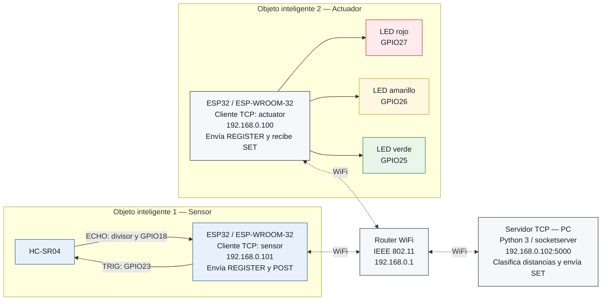
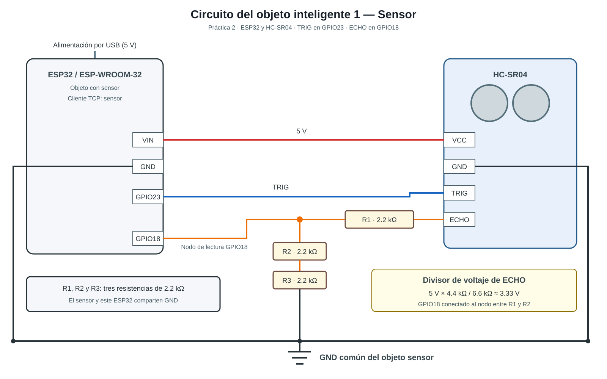
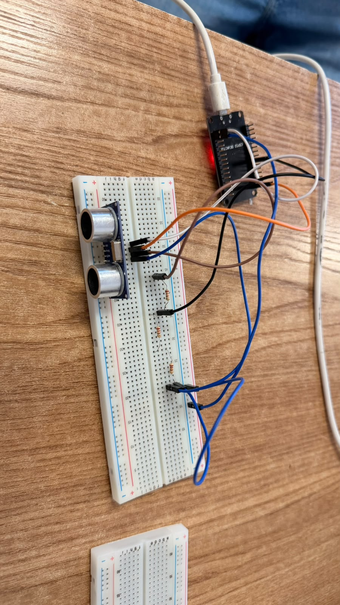
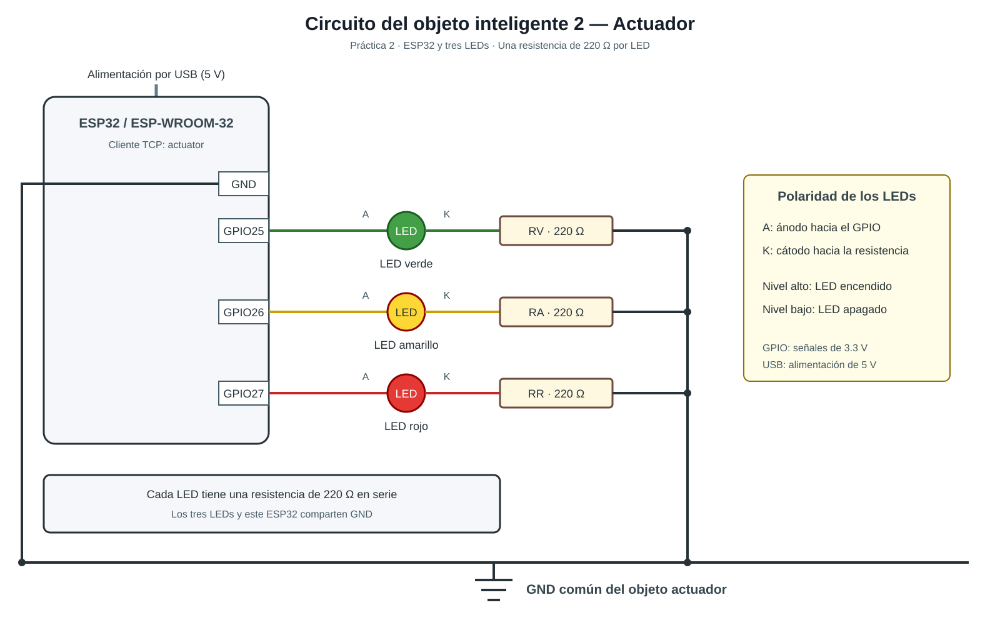
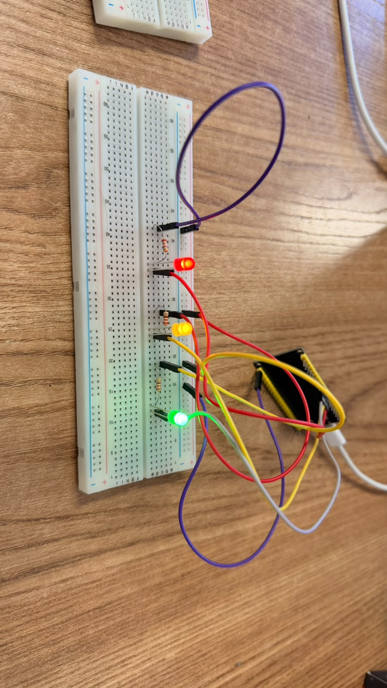
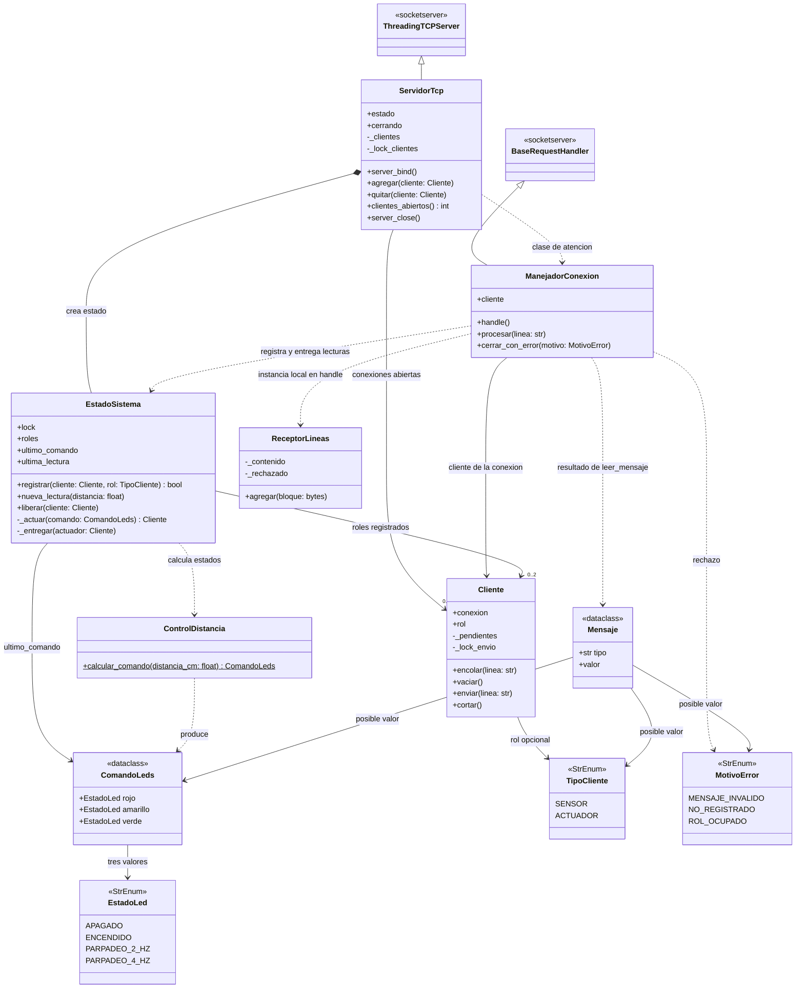
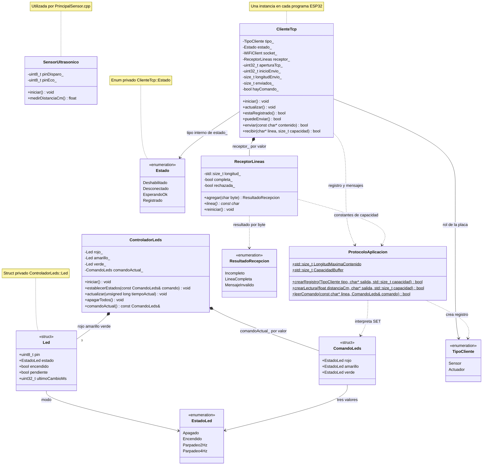
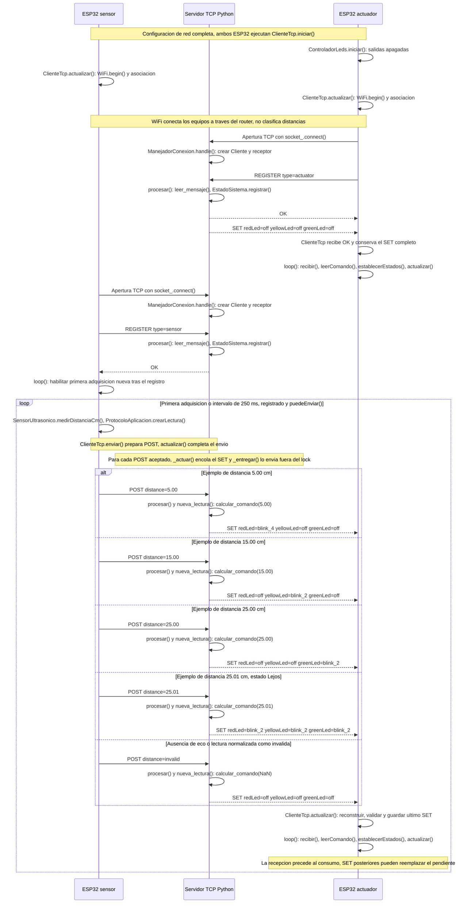
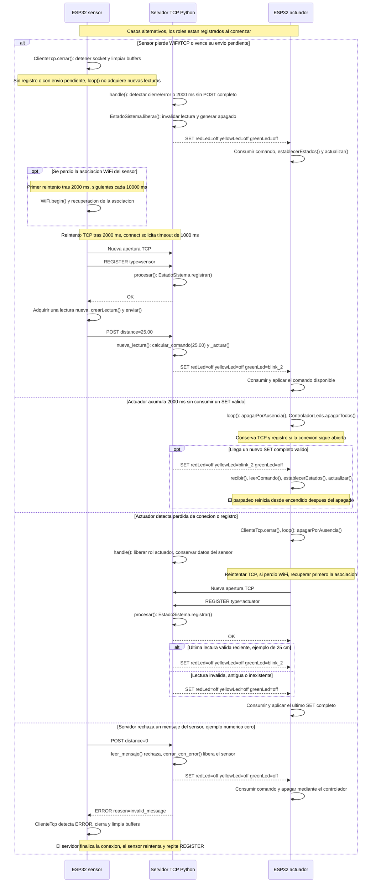

# Informe técnico — Práctica 2

**Actividad:** Integración de Objetos Inteligentes con TCP/IP

**Asignatura:** SIS-234 — Internet de las Cosas

**Grupo:** 8

**Integrantes:** Santiago Javier Torres Vacaflores y Ariel Adrian Mercado Alegre

**Plataformas del proyecto:** firmware para dos ESP32 / ESP-WROOM-32 y servidor para una PC Windows

**Estado del proyecto:** prototipo distribuido operativo, validado con pruebas físicas y automatizadas. Fecha: 17/11/2026.

## Introducción

La [consigna de la Práctica 2](docs/consigna/Práctica_2.md) exige integrar un objeto inteligente con sensor ultrasónico, otro con actuadores y un servidor TCP central mediante WiFi (IEEE 802.11). Nuestro [diseño](docs/diagramas/Diseno_del_sistema.md) contempla un HC-SR04, tres LEDs y una PC que clasifica las distancias y envía comandos de actuación.

El proyecto dispone de dos programas ESP32 independientes: [PrincipalSensor.cpp](apps/firmware/src/PrincipalSensor.cpp) adquiere y publica la distancia, y [PrincipalActuador.cpp](apps/firmware/src/PrincipalActuador.cpp) recibe órdenes y controla los LEDs. Ambos utilizan [ClienteTcp](apps/firmware/src/ClienteTcp.cpp) para la conexión WiFi/TCP y el registro. La biblioteca C++ común, ubicada en [apps/firmware/lib/Compartido/](apps/firmware/lib/Compartido/), reúne los tipos, el protocolo y el receptor de líneas. El [servidor TCP Python](apps/servidor/servidor.py) concentra la recepción, clasificación y generación de comandos.

Validamos el sistema con pruebas automatizadas y ensayos físicos. El [registro de pruebas de seis páginas](<docs/evidencias/Registro de Pruebas RF y RFN.pdf>), las fotografías y el [video de LEDs](docs/evidencias/leds.mp4) documentan medición, clasificación, actuación y comunicación, además de estabilidad, exactitud, respuesta y frecuencia de lecturas.

El informe relaciona cada requisito con su diseño, su implementación y su evidencia.

## Objetivo general

Diseñar, implementar y validar un sistema distribuido que mida distancias con un sensor ultrasónico, las procese en un servidor TCP y controle tres LEDs en un objeto inteligente independiente, mediante sockets TCP sobre WiFi y un protocolo de aplicación definido por el grupo.

## 1. Requerimientos Funcionales y No Funcionales

Esta sección establece las condiciones utilizadas para evaluar el sistema distribuido. Los requerimientos funcionales RF1–RF4 mantienen la numeración y el alcance de la [consigna oficial](docs/consigna/Práctica_2.md); los criterios de aceptación concretan las decisiones del [diseño del equipo](docs/diagramas/Diseno_del_sistema.md). Los requerimientos no funcionales RNF1–RNF5 declaran los atributos de calidad y sus métodos de verificación.

La adquisición y el envío de distancia corresponden al ESP32 sensor; la recepción, clasificación y generación de comandos corresponden al servidor TCP en la PC; la recepción y ejecución de esos comandos corresponden al ESP32 actuador. Esta distribución sitúa el algoritmo de control en el servidor, conforme a la consigna. Los dos programas ESP32, su cliente de red compartido y el servidor Python están implementados; la columna de estado remite a los resultados de §4 y §5.

### 1.1 Requerimientos funcionales y criterios de aceptación

| ID | Funcionalidad requerida | Criterio de aceptación | Componente responsable | Estado de implementación |
|---|---|---|---|---|
| RF1 | Medir la distancia entre el sensor ultrasónico HC-SR04 y un objeto. | Obtener lecturas finitas positivas expresadas en centímetros y contrastarlas con una referencia física mediante PN-02. Ante timeout de ECHO o valor no válido, identificar la lectura como inválida, según PV-04; la tolerancia de medición se evalúa en RNF2. | ESP32 sensor: [SensorUltrasonico](apps/firmware/src/SensorUltrasonico.cpp) adquiere la distancia; [PrincipalSensor.cpp](apps/firmware/src/PrincipalSensor.cpp) planifica la adquisición y publicación mediante `ClienteTcp`. | Verificado físicamente con regla y publicaciones serie; exactitud y cadencia en PN-02/PN-04. |
| RF2 | Interpretar cada distancia válida y clasificarla en cuatro rangos contiguos y sin solapamiento. | Asignar cada distancia finita positiva a exactamente un rango de §1.2. Las entradas de PV-01 a PV-03, incluidos 5, 5.01, 15, 15.01, 25, 25.01, 50 y 100 cm, deben producir la clasificación prevista y el comando correspondiente. | PC: `ControlDistancia.calcular_comando()` de [dominio.py](apps/servidor/dominio.py), invocado por `EstadoSistema.nueva_lectura()` tras el procesamiento de `POST` en `ManejadorConexion.procesar()`. | Cuatro rangos implementados; muestras físicas interiores y límites con entradas controladas (§4.2). |
| RF3 | Activar los tres LEDs del objeto actuador en función del rango, con un comportamiento distinto por rango. | Aplicar el comando completo según §1.2: rojo a 4 Hz, amarillo o verde a 2 Hz con los demás LEDs apagados, o Lejos con los tres simultáneos a 2 Hz; una lectura inválida debe producir todos apagados. Verificar estos estados mediante PV-01 a PV-04 y la continuidad de fase ante comandos idénticos mediante PV-05. | PC: generación de `ComandoLeds` y `SET`; ESP32 actuador: [PrincipalActuador.cpp](apps/firmware/src/PrincipalActuador.cpp) entrega los estados recibidos a [ControladorLeds](apps/firmware/src/ControladorLeds.cpp). | Actuación e invalidez verificadas físicamente; frecuencias y fase verificadas con pruebas automatizadas (§4.2.2). |
| RF4 | Enviar lecturas desde el objeto sensor al servidor y comandos desde el servidor al objeto actuador mediante sockets TCP sobre WiFi (IEEE 802.11), utilizando un protocolo de aplicación definido por el grupo. | Establecer una conexión de cada ESP32 hacia la PC, completar `REGISTER` / `OK` y comprobar con registros el recorrido integrado `POST` → clasificación en servidor → `SET` → actuación física. Los mensajes deben respetar la especificación de §2.6; PV-06 a PV-16 verifican registro, delimitación, rechazo de errores y recuperación. | PC: `ServidorTcp`, `ManejadorConexion`, `Cliente`, `EstadoSistema` y funciones de `protocolo.py`; ambos ESP32: [ClienteTcp](apps/firmware/src/ClienteTcp.cpp), programas principales, `ProtocoloAplicacion` y `ReceptorLineas` C++. | Intercambio WiFi/TCP y recuperación del registro verificados (PDF p. 4). |

La matriz de §2.7 relaciona cada criterio con el diseño, el código y las pruebas. Los límites exactos de RF2 se prueban con entradas controladas, para no confundirlos con el error del sensor. §4 presenta lo comprobado y §5 resume el cumplimiento.

### 1.2 Rangos y lógica de control

Para la clasificación, se considera válida una distancia finita mayor que cero, expresada en centímetros. El dominio Python implementa la siguiente lógica y el firmware actuador ejecuta sus comandos; la evidencia física y las pruebas de límites se presentan en §4.2:

| Distancia recibida | LED rojo | LED amarillo | LED verde |
|---|---|---|---|
| Lectura inválida | Apagado | Apagado | Apagado |
| 0 < distancia ≤ 5 cm (Rojo) | Parpadeo a 4 Hz | Apagado | Apagado |
| 5 < distancia ≤ 15 cm (Amarillo) | Apagado | Parpadeo a 2 Hz | Apagado |
| 15 < distancia ≤ 25 cm (Verde) | Apagado | Apagado | Parpadeo a 2 Hz |
| distancia > 25 cm (Lejos) | Parpadeo a 2 Hz | Parpadeo a 2 Hz | Parpadeo a 2 Hz |

Los intervalos son `(0, 5]`, `(5, 15]`, `(15, 25]` y `(25, +∞)`. Los valores 5, 15 y 25 cm pertenecen respectivamente a rojo, amarillo y verde; el intervalo siguiente excluye su límite inferior. No existen huecos ni solapamientos para las distancias finitas positivas. La lectura inválida es un estado de tratamiento de error, separado de los cuatro rangos válidos.

En el protocolo, `off` representa apagado y `on` encendido fijo. `blink_4` representa cuatro ciclos completos por segundo: un período de 250 ms, con 125 ms encendido y 125 ms apagado. `blink_2` representa dos ciclos completos por segundo: un período de 500 ms, con 250 ms encendido y 250 ms apagado. Estas frecuencias describen ciclos completos, no el número de alternancias del GPIO. `ControladorLeds` implementa esas alternancias mediante `millis()`: un modo nuevo comienza encendido y un modo repetido conserva su fase y temporización. Al entrar en Lejos, el controlador sincroniza los tres LEDs desde encendido en el siguiente `actualizar()`; repetir ese `SET` conserva su fase común. `on` sigue admitido por el protocolo, aunque no se genera en estos rangos. Esto evita que el envío periódico de comandos reinicie el patrón; la evidencia visual del parpadeo se analiza en §4.2.2.

Un timeout de ECHO produce una lectura no finita en `SensorUltrasonico`. El codificador C++ transforma las lecturas no finitas, cero o negativas en `POST distance=invalid`; también normaliza como inválidas las distancias inferiores a 0.01 cm, según el umbral implementado para la representación decimal. El servidor interpreta `invalid` como una lectura inválida y genera `SET` con los tres estados `off`. El token `invalid` es válido dentro del protocolo; un mensaje mal formado o una distancia numérica cero o negativa recibida directamente se rechazan conforme a sus reglas. Esta distinción evita tratar un fallo de comunicación como una medición válida.

El diseño define también el apagado al iniciar el actuador, ante una desconexión detectada y tras 2000 ms de ausencia de lecturas en el servidor o de comandos en el actuador, según corresponda. El firmware implementa el apagado inicial, el apagado ante pérdida de registro y el temporizador de 2000 ms sin `SET` completo consumido por el programa actuador, conservando la conexión en este último caso. `ClienteTcp` implementa los reintentos de ambos ESP32. El servidor registra roles y rechaza mensajes inválidos. Aplica el plazo de 2000 ms desde la apertura sin registro o desde el último `POST` completo; al vencer, o al liberar el sensor por cualquier motivo, invalida los datos y ordena apagar. Son comportamientos complementarios de RF3 y RF4, relacionados con PV-06 a PV-16; su evidencia física y automatizada está en §4.2.4.

Elegimos que la lectura inválida use el mismo estado que la falta de datos: todos apagados. En todos esos casos el sistema no tiene una distancia confiable, y la señal para quien observa es la misma: no actuar según los LEDs. El apagado es además el estado seguro, porque no muestra una cercanía que ya no se puede comprobar. La causa concreta (eco perdido, sensor desconectado o plazo vencido) queda registrada en el monitor serie del actuador y en el registro del servidor.

El dominio de clasificación no impone un límite superior de 150 cm ni excluye valores positivos inferiores a 3 cm. En cambio, **3 a 150 cm es el intervalo de trabajo declarado para la exactitud** de RNF2. La serie cuantitativa de §4.4 demuestra el cumplimiento de la tolerancia en las posiciones ensayadas de 5–40 cm; las capturas de 3 cm la complementan.

### 1.3 Requerimientos no funcionales

Los cuatro atributos cuantitativos adoptan los valores de referencia de la consigna como objetivos del equipo. Los resultados físicos se contrastan con esos objetivos en PN-01 a PN-04. RNF5 concreta la exigencia de código legible, modular, orientado a objetos y documentado mediante una revisión verificable. Su alcance incluye el servidor Python, ambos firmwares C++ y la biblioteca C++ de tipos, protocolo y recepción de líneas; las reglas de distancia pertenecen exclusivamente al dominio Python.

| ID | Atributo de calidad | Criterio de aceptación | Método de verificación | Componente o alcance afectado | Estado de validación |
|---|---|---|---|---|---|
| RNF1 | Estabilidad | Operar durante al menos 10 minutos continuos, con cero reinicios y cero bloqueos, manteniendo la adquisición, el intercambio TCP y la respuesta de los LEDs. | PN-01: registrar inicio, fin y eventos de los tres equipos; observar continuidad de lecturas y actuación, y documentar cualquier interrupción. | Sistema distribuido completo: ESP32 sensor, servidor TCP y ESP32 actuador. | Cumple en la sesión física de 24 min (§4.3). |
| RNF2 | Exactitud de medición | Mantener un error absoluto máximo ≤ 3 cm respecto de una referencia física dentro del intervalo de trabajo de 3 a 150 cm. | PN-02: comparar lecturas individuales con una regla o cinta métrica en posiciones que cubran los cuatro rangos y los extremos del intervalo; calcular el valor absoluto de cada diferencia y su máximo. Registrar referencias, repeticiones y condiciones del ensayo. | HC-SR04, circuito y adquisición del ESP32 sensor; comprobar la conservación del valor comunicado al servidor. | Cumple en las posiciones ensayadas de 5–40 cm: máximo individual 0.90 cm (§4.4). |
| RNF3 | Tiempo de respuesta extremo a extremo | Reflejar cada cambio de rango ensayado en el estado visible del actuador en un tiempo máximo de 1 s desde el cambio físico de distancia. | PN-03: registrar el cambio físico y la actuación con una grabación o instrumento de tiempo común; calcular la diferencia temporal por ensayo y el máximo observado, indicando resolución y transiciones evaluadas. | Recorrido completo sensor → servidor → actuador, incluidos adquisición, red, procesamiento y ejecución del comando. | Cinco ensayos: promedio 0.526 s y máximo 0.62 s; todos dentro del límite de 1 s (§4.5). |
| RNF4 | Frecuencia de muestreo | Obtener al menos 2 lecturas/s durante la operación registrada del sensor. | PN-04: contar lecturas obtenidas durante una ventana de duración conocida y calcular cantidad/duración; contabilizar por separado lecturas inválidas y `POST` recibidos en el servidor para contrastar adquisición y recepción. | Planificación de adquisición en ESP32 sensor; recepción en servidor como comprobación del envío. | 39 lecturas/10 s = 3.9 lecturas/s, por encima del mínimo de 2 lecturas/s (§4.6). |
| RNF5 | Calidad del código | Presentar módulos con responsabilidades delimitadas, clases que encapsulen estado y operaciones, interfaces documentadas, nombres y convenciones consistentes en Python y C++, y reglas de control separadas del hardware y los sockets. | Revisión de §3.4 sobre una versión identificada del código final: inspeccionar módulos, clases, interfaces y dependencias en ambos lenguajes; registrar por criterio el cumplimiento, el archivo o fragmento que lo respalda y los hallazgos y limitaciones. | Servidor Python, firmware C++ de ambos ESP32 y biblioteca C++ de tipos, protocolo y recepción de líneas. | Revisión del código final documentada en §3.4. |

Para RNF2, la aceptación se basará en el **máximo de los errores absolutos individuales**, no únicamente en el promedio; este último podría ocultar lecturas que excedan la tolerancia. Las lecturas inválidas se registran por separado y no se usan como errores numéricos. La conclusión indica las posiciones ensayadas, sin generalizar a distancias no probadas.

Para RNF3, el criterio toma como origen temporal el cambio físico de distancia y como final el cambio visible correspondiente del LED. Así se incluye la espera hasta la siguiente adquisición y todo el recorrido de comunicación y control. No se restan timestamps de relojes de equipos distintos, porque no están sincronizados. Los cinco tiempos registrados se comparan con el límite de 1 s en §4.5.

RNF5 se verifica mediante la revisión documentada en §3.4: responsabilidades de cada objeto, declaraciones y uso de interfaces, encapsulación, dependencias, convenciones de cada lenguaje, sincronización y errores. Revisamos los módulos Python, las clases C++, los programas principales y los filtros de compilación.

Los **valores objetivo** son los límites de aceptación de la tabla. Los **parámetros implementados** incluyen 250 ms entre adquisiciones del sensor registrado y con capacidad de envío, un timeout de ECHO de 30000 µs y 2000 ms sin comandos en el actuador. `ClienteTcp` configura 2000 ms para recibir `OK` desde la apertura TCP completada, 2000 ms para un envío pendiente y 2000 ms entre reintentos TCP; la apertura TCP puede esperar hasta 1000 ms. Tras perder WiFi espera 2000 ms para reintentar y luego deja 10000 ms entre intentos de asociación. La adquisición se omite mientras no hay registro o existe un envío pendiente, sin acumular lecturas para una conexión futura. Los 250 ms equivalen nominalmente a 4 lecturas/s; la frecuencia observada se mide en PN-04.

En el servidor, `PLAZO = 2.0` define el plazo de registro y de ausencia de lecturas, contado desde la apertura de la conexión o desde la **última línea completa** recibida, como establece el diseño. El manejador espera datos con `select()` usando el tiempo que queda de ese plazo, de modo que los fragmentos sin LF no lo renuevan. `settimeout(PLAZO)` queda solo como límite de los envíos. El mismo valor se usa para decidir si la última lectura es reciente al registrar un actuador.

Los **resultados medidos** y sus fuentes se presentan en §4 y §5.

## 2. Análisis y Diseño

Esta sección integra los circuitos diseñados y los diagramas de arquitectura, clases y secuencias del software implementado. Las fotografías y capturas de §4 documentan el montaje y la operación; el modelo eléctrico y la temporización nominal explican su funcionamiento.

### 2.1 Arquitectura distribuida del sistema

La arquitectura separa la adquisición de distancia, el procesamiento de las lecturas y la actuación física en tres equipos: **ESP32 sensor → servidor TCP Python → ESP32 actuador**. Esta distribución responde al sistema exigido por la consigna y delimita las responsabilidades de RF1–RF4: el sensor obtiene los datos, la PC toma la decisión de control y el actuador ejecuta sus órdenes. Los dos programas ESP32 están implementados de forma independiente. La correspondencia con el montaje se documenta con fotografías y capturas en §4 y §8.

El firmware utiliza C++ con Arduino y los entornos definidos en [platformio.ini](platformio.ini). `sensor`, predeterminado, selecciona `PrincipalSensor.cpp`, `ClienteTcp.cpp` y `SensorUltrasonico.cpp` para la placa `esp32doit-devkit-v1`; `actuador` selecciona `PrincipalActuador.cpp`, `ClienteTcp.cpp` y `ControladorLeds.cpp` para `esp32dev`. Cada selección incluye únicamente el programa principal de su rol y ambos reutilizan la biblioteca de `apps/firmware/lib/Compartido/`.

En el flujo implementado, [PrincipalSensor.cpp](apps/firmware/src/PrincipalSensor.cpp) mide con `SensorUltrasonico` después del registro y cuando el intervalo y la disponibilidad de envío lo permiten. `ProtocoloAplicacion` genera `POST` y `ClienteTcp` lo transmite. En la PC, `ManejadorConexion.procesar()` interpreta la línea mediante [protocolo.py](apps/servidor/protocolo.py) y llama a `EstadoSistema.nueva_lectura()`. La clasificación corresponde exclusivamente a `ControlDistancia.calcular_comando()` de [dominio.py](apps/servidor/dominio.py); el estado del servidor conserva el último comando y su tiempo de recepción y envía `SET` al actuador registrado.

En el otro ESP32, `ClienteTcp` valida las líneas recibidas y conserva el último `SET` completo para el programa principal; un comando aún no consumido puede ser reemplazado por otro más reciente. [PrincipalActuador.cpp](apps/firmware/src/PrincipalActuador.cpp) convierte ese contenido en `ComandoLeds`, lo entrega a `ControladorLeds` y actualiza las salidas y los parpadeos. El actuador no clasifica distancias. La biblioteca común contiene [Tipos.h](apps/firmware/lib/Compartido/Tipos.h), [ProtocoloAplicacion](apps/firmware/lib/Compartido/ProtocoloAplicacion.h) y [ReceptorLineas](apps/firmware/lib/Compartido/ReceptorLineas.h); Python tiene sus propios tipos y funciones y no ejecuta código de esa biblioteca C++. La interoperabilidad depende del protocolo ASCII delimitado por LF, no de compartir un binario entre lenguajes.

El [servidor](apps/servidor/servidor.py) utiliza `socketserver.ThreadingTCPServer`, con un hilo por conexión aceptada. `ManejadorConexion` espera datos con `select()` y el plazo restante, y `Cliente` envía con `sendall()`. `EstadoSistema` protege los roles y la última lectura con un `threading.Lock`. Con ese bloqueo tomado solo se actualiza el estado y se **encolan** los mensajes en la cola de cada `Cliente`; el envío se hace después de soltarlo, bajo el bloqueo propio del cliente, que vacía la cola en orden. Así, un actuador lento solo demora al hilo que le escribe y no frena los registros ni las lecturas. `time.monotonic()` permite evaluar la antigüedad de la lectura y `logging` registra los intercambios.

El siguiente diagrama muestra el [despliegue del diseño](docs/diagramas/Diseno_del_sistema.md#11-diagrama-de-despliegue). El montaje físico se documenta en §3.1 y §4. Las direcciones IP del diagrama son de ejemplo; las de la sesión de pruebas figuran en §4.1. El puerto `5000` es el predeterminado del servidor y el que usamos en las pruebas.



Las líneas discontinuas representan los enlaces WiFi bidireccionales a través del router, que proporciona conectividad IP entre los equipos de la red local. El router transporta el tráfico y no participa en la clasificación ni en la generación de comandos. Los enlaces de red deben distinguirse del flujo de aplicación: las lecturas se dirigen del sensor al servidor y las órdenes del servidor al actuador; ese recorrido con las placas se respalda en §4.2.3.

En el modelo cliente-servidor implementado, **ambos ESP32 inician su propia conexión TCP persistente hacia la PC** mediante una instancia de `ClienteTcp` por placa. El servidor escucha, acepta conexiones, responde al registro y envía órdenes por el socket del actuador; la PC no abre una conexión nueva hacia este objeto. `REGISTER` identifica el rol y ambos programas esperan `OK` antes de operar. El firmware configura WiFi en modo estación y obtiene la dirección local mediante DHCP; las direcciones de la sesión de pruebas figuran en §4.1.

En los ESP32, `ClienteTcp.actualizar()` atiende envío y recepción con `send` y `recv` de lwIP y `MSG_DONTWAIT`, conserva fragmentos y el progreso del único envío pendiente y gestiona los reintentos. Esto no hace que todo el firmware sea no bloqueante: `connect` puede esperar hasta 1000 ms y la adquisición de ECHO hasta 30000 µs. El actuador supervisa localmente la ausencia de comandos. En la PC, el plazo de 2 s se cuenta desde la última línea completa, como se explica en §1.3.

La entrada de consola de [__main__.py](apps/servidor/__main__.py) define `--ip` con valor predeterminado `0.0.0.0` y `--puerto` con valor predeterminado `5000`, coincidentes con el constructor de `ServidorTcp`. `0.0.0.0` indica escucha en las interfaces IPv4 locales; no es una dirección de destino para los ESP32. Los clientes utilizan la IPv4 real de la PC y el puerto del servicio. En la sesión de la página 4, la PC usó 172.20.10.2:5000 y el actuador 172.20.10.3.

La configuración de ejemplo [ConfiguracionRed.example.h](apps/firmware/include/ConfiguracionRed.example.h) contiene SSID vacío e IP `0.0.0.0`; con esos valores, `ClienteTcp` deshabilita los intentos de conexión. Para reproducir el montaje se prepara el archivo local y se carga cada entorno según la guía. La configuración operativa utilizada en las pruebas está respaldada por las capturas de §4.1.

| Componente | Responsabilidad | Intercambio principal | Estado actual |
|---|---|---|---|
| ESP32 sensor y HC-SR04 | Adquirir distancia con intervalo nominal de 250 ms, condicionado al registro y la disponibilidad de envío; comunicar lecturas válidas o inválidas. | Enviar `REGISTER type=sensor` y `POST`; recibir `OK` o `ERROR`. | Adquisición y publicación verificadas; exactitud y cadencia con alcance de PN-02/PN-04. |
| PC / servidor TCP Python | Registrar clientes, clasificar lecturas, generar comandos y atender la ausencia de datos con el timeout implementado. | Recibir `REGISTER` y `POST`; enviar `OK`, `ERROR` y `SET`. | POST/SET visibles en el registro físico, p. 4; plazo desde la última línea completa. |
| ESP32 actuador y tres LEDs | Ejecutar el último comando recibido, conservar la fase de modos repetidos y supervisar la ausencia de comandos. | Enviar `REGISTER type=actuator`; recibir `OK`, `ERROR` y `SET`. | Registro y actuación documentados; observación del parpadeo en §4.2.2. |
| Router WiFi | Proporcionar conectividad IP entre los tres equipos. | Transportar el tráfico de las dos conexiones TCP sobre IEEE 802.11. | Conectividad verificada en la sesión de pruebas (§4.1). |

La comunicación se organiza en las cuatro capas del modelo TCP/IP utilizado en la práctica:

| Capa | Elemento del diseño y estado actual | Función en el sistema |
|---|---|---|
| Aplicación | Protocolo de texto del grupo, descrito en §2.6; implementaciones independientes Python y C++. | Definir los mensajes de registro, lectura, actuación y error, así como su delimitación. |
| Transporte | TCP y sockets; servidor Python y clientes ESP32 implementados, con puerto predeterminado `5000`. | Mantener las conexiones de los clientes y transportar el flujo ordenado de bytes. |
| Internet | IPv4; direcciones observadas de una sesión en §4.1. | Identificar los equipos mediante direcciones IP. |
| Acceso a la red | WiFi, IEEE 802.11; gestión de conectividad implementada en `ClienteTcp`, asociación real documentada en PDF p. 4. | Proporcionar el enlace de los equipos con el router. |

Los componentes de adquisición, transporte, clasificación y actuación están implementados y cubiertos por pruebas automatizadas (§4.1.1); los ensayos físicos de desempeño se presentan en PN-01 a PN-04.

### 2.2 Circuito del objeto sensor

El objeto sensor comprende un ESP32 / ESP-WROOM-32 con conector Micro-USB, un HC-SR04 y tres resistencias de 2.2 kΩ que forman el divisor resistivo de ECHO. El ESP32 se alimenta por USB de 5 V y suministra la alimentación del sensor desde VIN / 5 V. El siguiente esquema corresponde exclusivamente al objeto de adquisición de la Práctica 2:



Las conexiones conservan la asignación del [diseño del objeto sensor](docs/diagramas/Diseno_del_sistema.md#31-objeto-inteligente-con-sensor):

| Elemento o señal | Conexión | Función |
|---|---|---|
| Alimentación del ESP32 | USB de 5 V. | Alimentar la placa del objeto sensor. |
| HC-SR04 VCC | VIN / 5 V del ESP32. | Alimentar el sensor ultrasónico. |
| HC-SR04 GND | GND del ESP32. | Establecer una referencia eléctrica común para alimentación y señales. |
| HC-SR04 TRIG | GPIO23 (D23) del ESP32. | Recibir el pulso de disparo generado por el microcontrolador. |
| HC-SR04 ECHO | ECHO → R1 de 2.2 kΩ → nodo conectado a GPIO18 (D18). | Conducir el pulso de eco hacia la entrada mediante el divisor. |
| Retorno del divisor | Nodo GPIO18 → R2 de 2.2 kΩ → R3 de 2.2 kΩ → GND. | Formar la rama inferior de 4.4 kΩ del divisor. |

El firmware utiliza GPIO23 para generar TRIG y GPIO18 para medir la duración de ECHO. [SensorUltrasonico.cpp](apps/firmware/src/SensorUltrasonico.cpp) implementa el pulso de 10 µs y el timeout de 30000 µs definidos en el diseño. Estos parámetros definen la adquisición; la exactitud obtenida se evalúa en PN-02. La lectura inválida se trata conforme a §1.2.

El divisor es necesario porque ECHO utiliza una señal de 5 V, superior al nivel lógico de 3.3 V del ESP32. El diseño evita conectar ECHO directamente a GPIO18: R1 se sitúa entre ECHO y el nodo de lectura, mientras R2 y R3 están en serie entre ese nodo y GND. La tensión ideal en el nodo se obtiene mediante:

```text
Rsuperior = R1 = 2.2 kΩ
Rinferior = R2 + R3 = 2.2 kΩ + 2.2 kΩ = 4.4 kΩ
VGPIO18 = VECHO × Rinferior / (Rsuperior + Rinferior)
VGPIO18 = 5 V × 4.4 kΩ / (2.2 kΩ + 4.4 kΩ)
VGPIO18 ≈ 3.33 V
```

La tensión de 3.33 V es un cálculo ideal con los valores nominales del divisor. La tierra común une el ESP32, el HC-SR04 y el retorno del divisor dentro del objeto sensor; el segundo ESP32 pertenece al circuito independiente de actuación. Las fotografías respaldan el montaje y las capturas, la comunicación WiFi/TCP.




La fotografía muestra el montaje del objeto sensor; el esquema detalla la asignación GPIO23/18.

### 2.3 Circuito del objeto actuador

El objeto actuador comprende un segundo ESP32 / ESP-WROOM-32 con conector USB-C, tres LEDs —rojo, amarillo y verde— y tres resistencias de 220 Ω, una por LED. La placa se alimenta mediante USB de 5 V. Los LEDs son controlados por señales GPIO de 3.3 V, según el esquema; la alimentación USB no equivale a aplicar 5 V a estas salidas.



Las tres ramas conservan la polaridad y las conexiones del [diseño del objeto actuador](docs/diagramas/Diseno_del_sistema.md#32-objeto-inteligente-con-actuadores):

| Elemento | Conexión |
|---|---|
| Alimentación del ESP32 | USB de 5 V. |
| LED verde | GPIO25 → ánodo del LED → cátodo → resistencia RV de 220 Ω → GND. |
| LED amarillo | GPIO26 → ánodo del LED → cátodo → resistencia RA de 220 Ω → GND. |
| LED rojo | GPIO27 → ánodo del LED → cátodo → resistencia RR de 220 Ω → GND. |
| Retorno común | Las tres resistencias retornan al GND de este ESP32. |

Cada resistencia se conecta en serie con su LED para limitar la corriente de su rama. El retorno compartido proporciona la referencia eléctrica común del objeto actuador. Con esta polaridad, un nivel alto en el GPIO enciende el LED y un nivel bajo lo apaga; la alternancia temporizada produce el parpadeo. El esquema no incluye el HC-SR04, que pertenece al objeto sensor independiente.

El servidor genera `SET` después de clasificar la lectura. El firmware actuador valida y consume el último comando completo pendiente, lo entrega a `ControladorLeds` y atiende las salidas y el parpadeo mediante `millis()`. Esta separación distingue la decisión de control en la PC de su ejecución en el actuador; ambas están implementadas y cuentan con evidencia física en §4.2. Los rangos y frecuencias se definen en §1.2; el circuito aporta las salidas necesarias para representarlos.




La fotografía muestra las tres ramas de LEDs; el video complementa la observación del parpadeo descrita en §4.2.2.

### 2.4 Diagrama de clases

Este apartado representa la estructura del código. Se utilizan dos diagramas porque **Python y C++ tienen implementaciones independientes de sus tipos y del protocolo**: el servidor no invoca la biblioteca C++. La distribución de responsabilidades corresponde a RF1–RF4 de §1.1 y a la arquitectura de §2.1.

Los diagramas seleccionan atributos y operaciones relevantes; las declaraciones completas están en los archivos de la tabla de §2.4.4. El signo `+` identifica miembros públicos y `-` miembros internos; en Python, este último expresa la convención del prefijo `_`, no una restricción de acceso del lenguaje. El sufijo `$` indica una operación estática. Las flechas discontinuas representan dependencias de uso; las continuas, asociaciones; el rombo lleno, composición, y el triángulo vacío, herencia.

#### 2.4.1 Servidor Python

La PC separa el servicio TCP en `servidor.py`, las reglas de control en `dominio.py` y la interpretación del protocolo en `protocolo.py`. Las dos clases externas del diagrama pertenecen a `socketserver`, de la biblioteca estándar.



`ServidorTcp` hereda de `socketserver.ThreadingTCPServer`, crea un `EstadoSistema` y conserva el conjunto de conexiones abiertas en `_clientes`, protegido por `_lock_clientes`. La biblioteca estándar atiende cada conexión mediante un hilo y una instancia de `ManejadorConexion`, derivada de `BaseRequestHandler`. Este manejador crea un `Cliente` para el socket aceptado y un `ReceptorLineas` local en `handle()`; recibe bloques, procesa líneas completas y libera el rol al finalizar. El receptor no es un atributo de `Cliente`. Las operaciones heredadas, como `serve_forever()`, no se presentan como métodos redefinidos.

`Cliente` mantiene el socket en `conexion`, el rol en `rol`, una cola de líneas codificadas en `_pendientes` y un bloqueo de envío en `_lock_envio`. `encolar()` codifica y agrega una línea; `vaciar()` envía con `sendall()` todo lo encolado en orden de llegada, y `enviar()` combina ambas. `cortar()` solicita el cierre mediante `shutdown()`. El bloqueo de envío evita mezclar o invertir líneas de distintos hilos hacia un mismo socket. `EstadoSistema` coordina hasta un sensor y un actuador registrados, conserva `ultimo_comando` y almacena en `ultima_lectura` el instante de recepción, no la distancia ni un historial de lecturas.

El estado compartido se protege con `threading.Lock`. `registrar()` reserva un rol, `nueva_lectura()` invoca la clasificación y `liberar()` invalida los datos al perder el sensor; `_actuar()` genera el comando y lo encola para el actuador. Con el bloqueo tomado solo se modifica el estado y se encola; el envío lo hacen `vaciar()` y `_entregar()` después de soltarlo, así que un envío lento no retrasa a los demás hilos. Si el envío al actuador falla, `_entregar()` libera su rol y corta la conexión. El manejador espera datos con `select()` y el plazo restante desde la última línea completa (§1.3).

`ControlDistancia.calcular_comando()` es estático y concentra las reglas de §1.2. `ComandoLeds` y `Mensaje` son `dataclass(frozen=True)`; `EstadoLed`, `TipoCliente` y `MotivoError` son enumeraciones `StrEnum`. El campo `Mensaje.valor` puede contener el rol, la distancia, el comando, el motivo de error o `None`. `ReceptorLineas.agregar()` es un generador que conserva fragmentos y entrega líneas sin LF.

La interpretación y construcción del protocolo son **funciones de módulo**: `ManejadorConexion.procesar()` utiliza `leer_mensaje()`; `EstadoSistema._actuar()` utiliza `crear_comando()`; `cerrar_con_error()` utiliza `crear_error()`, y `Cliente.encolar()` utiliza `codificar()`. Los errores de contenido y delimitación se notifican mediante `MensajeInvalido`, excepción derivada de `ValueError`. Estas funciones y la excepción figuran en la tabla de §2.4.4.

#### 2.4.2 Firmware y biblioteca C++

Las clases de hardware y red pertenecen a `apps/firmware/include/` y `apps/firmware/src/`. Los tipos, el codificador y el receptor comunes a ambos ESP32 se encuentran en `apps/firmware/lib/Compartido/`. La clasificación de distancias se ejecuta exclusivamente en Python.



`SensorUltrasonico` encapsula los GPIO de TRIG y ECHO y convierte la duración del eco en centímetros. `ClienteTcp` encapsula la conexión `WiFiClient`, el rol, el estado de registro, los buffers y los temporizadores de conexión y envío. Su enumeración privada `ClienteTcp::Estado` se muestra como `Estado` en el diagrama. `actualizar()` atiende comunicación y reconexión; `enviar()` admite un `POST` del sensor registrado, y `recibir()` entrega al actuador el último `SET` completo pendiente. El cliente conserva un solo envío pendiente y el comando más reciente; aplicar solo el último `SET` es una decisión de diseño explicada en §2.6.2.

`ControladorLeds` recibe `ComandoLeds` mediante `establecerEstados()` y guarda una copia en `comandoActual_`. Contiene por valor tres instancias de su estructura privada `ControladorLeds::Led`, representada como `Led`: cada una mantiene pin, modo, nivel de salida, cambio pendiente y tiempo de alternancia. Los campos de la estructura son públicos, aunque el tipo está declarado en la parte privada del controlador. `actualizar()` aplica los cambios y mantiene los parpadeos; un modo repetido conserva su fase. `apagarTodos()` es público y apaga inmediatamente; `comandoActual()` devuelve una referencia constante al comando almacenado. El controlador no recibe distancias ni realiza clasificación local.

`Tipos.h` declara únicamente `EstadoLed`, `ComandoLeds` y `TipoCliente`; el comando comienza con los tres estados apagados. `ResultadoRecepcion` se declara en `ReceptorLineas.h`. Estas enumeraciones y `ClienteTcp::Estado` tienen tipo subyacente de 8 bits. `ProtocoloAplicacion` conserva tres operaciones estáticas: `crearRegistro()`, `crearLectura()` y `leerComando()`. Las dos primeras escriben contenido sin LF en un buffer con capacidad explícita; la tercera valida los tres estados antes de modificar el comando de salida. Sus constantes públicas `static constexpr` fijan 127 bytes de contenido y 128 bytes de buffer. `ClienteTcp` añade LF al transmitir.

`ReceptorLineas` forma parte de `ClienteTcp` por valor, reconstruye líneas en un buffer fijo y notifica el resultado por byte. `linea()` debe consultarse tras `LineaCompleta` y antes de agregar otro byte; `reiniciar()` descarta fragmentos y errores. `estaRegistrado()`, `puedeEnviar()`, `comandoActual()` y `linea()` están declarados `const`; las firmas del diagrama omiten ese calificador final y los constructores para facilitar la lectura. También se omiten miembros auxiliares, como las credenciales, los arrays de envío y recepción y los métodos internos de transporte; sus declaraciones permanecen en las cabeceras enlazadas.

#### 2.4.3 Programas principales y entornos

[PrincipalSensor.cpp](apps/firmware/src/PrincipalSensor.cpp) y [PrincipalActuador.cpp](apps/firmware/src/PrincipalActuador.cpp) contienen las funciones `setup()` y `loop()` del framework Arduino; **no declaran clases con esos nombres**. Cada archivo crea una instancia de `ClienteTcp` con su rol y coordina las clases de hardware que necesita.

En el sensor, `setup()` inicializa `SensorUltrasonico` y el cliente. `loop()` atiende la red y, tras el registro y con disponibilidad de envío, adquiere una lectura cuando corresponde al intervalo nominal de 250 ms. Después utiliza `crearLectura()` y `ClienteTcp.enviar()`; no clasifica distancias ni conserva un historial para enviarlo tras reconectar.

En el actuador, `setup()` inicializa `ControladorLeds` con salidas apagadas y el cliente. `loop()` atiende la red, obtiene el último comando disponible, lo interpreta con `leerComando()` y entrega el resultado a `establecerEstados()`. El mismo ciclo llama a `actualizar()` para los LEDs y supervisa el apagado ante pérdida de registro o ausencia de comandos, conforme a §1.2.

[platformio.ini](platformio.ini) selecciona archivos distintos para evitar incorporar ambos pares de `setup()` y `loop()` en un mismo firmware. El entorno `sensor`, predeterminado, incluye `PrincipalSensor.cpp`, `ClienteTcp.cpp` y `SensorUltrasonico.cpp` para `esp32doit-devkit-v1`; `actuador` incluye `PrincipalActuador.cpp`, `ClienteTcp.cpp` y `ControladorLeds.cpp` para `esp32dev`. Ambos comparten la implementación de `ClienteTcp`, la biblioteca `Compartido` y el esquema de configuración de red; cada placa mantiene sus propias instancias y su propio estado en ejecución.

#### 2.4.4 Responsabilidades, archivos y estado

| Componente o tipo | Lenguaje | Archivo real | Responsabilidad | Estado de implementación |
|---|---|---|---|---|
| `ServidorTcp` | Python | [servidor.py](apps/servidor/servidor.py) | Administrar el servicio, el estado y las conexiones abiertas; heredar la atención por hilos de `socketserver`. | Implementado; conexión con las placas documentada en PDF p. 4. |
| `ManejadorConexion` | Python | [servidor.py](apps/servidor/servidor.py) | Reconstruir y procesar líneas por conexión, gestionar errores y liberar el rol al finalizar. | Implementado. |
| `Cliente` | Python | [servidor.py](apps/servidor/servidor.py) | Encapsular socket y rol, encolar líneas y enviarlas en orden fuera del bloqueo del estado. | Implementado. |
| `EstadoSistema` | Python | [servidor.py](apps/servidor/servidor.py) | Coordinar roles, antigüedad de lectura, clasificación y comandos con estado protegido. | Implementado. |
| `ControlDistancia`, `ComandoLeds`, `EstadoLed` | Python | [dominio.py](apps/servidor/dominio.py) | Clasificar en la PC y representar estados sin depender de GPIO ni sockets. | Implementados. |
| `Mensaje`, `ReceptorLineas`, `TipoCliente`, `MotivoError` | Python | [protocolo.py](apps/servidor/protocolo.py) | Representar mensajes, delimitar líneas y definir roles y motivos de rechazo. | Implementados. |
| `leer_mensaje`, `crear_comando`, `crear_error`, `codificar`; `MensajeInvalido` | Python | [protocolo.py](apps/servidor/protocolo.py) | Interpretar y construir mensajes con funciones de módulo; notificar errores con una excepción. | Implementados. |
| Entrada de consola: `main`, `puerto_valido`, `ipv4_valida`, `ipv4_locales` | Python | [__main__.py](apps/servidor/__main__.py) | Validar argumentos, iniciar el servicio, mostrar direcciones locales y configurar registros. | Funciones implementadas. |
| `ClienteTcp`, `ClienteTcp::Estado` | C++ | [ClienteTcp.h](apps/firmware/include/ClienteTcp.h), [implementación](apps/firmware/src/ClienteTcp.cpp) | Gestionar WiFi/TCP, registro, mensajes y reconexión de cada objeto. | Implementados; asociación WiFi, registro y reintento visibles en PDF p. 4. |
| `SensorUltrasonico` | C++ | [SensorUltrasonico.h](apps/firmware/include/SensorUltrasonico.h), [implementación](apps/firmware/src/SensorUltrasonico.cpp) | Adquirir distancia con el HC-SR04 e identificar ausencia de eco. | Implementado; exactitud física de PN-02 dentro de las posiciones ensayadas. |
| `ControladorLeds`, `ControladorLeds::Led` | C++ | [ControladorLeds.h](apps/firmware/include/ControladorLeds.h), [implementación](apps/firmware/src/ControladorLeds.cpp) | Ejecutar estados, conservar la fase y mantener la temporización y el apagado de LEDs. | Implementados; actuación visual documentada y temporización probada con reloj simulado. |
| `ProtocoloAplicacion` | C++ | [ProtocoloAplicacion.h](apps/firmware/lib/Compartido/ProtocoloAplicacion.h), [implementación](apps/firmware/lib/Compartido/ProtocoloAplicacion.cpp) | Crear registro y lectura e interpretar comandos completos. | Implementado y utilizado por ambos programas. |
| `ReceptorLineas`, `ResultadoRecepcion` | C++ | [ReceptorLineas.h](apps/firmware/lib/Compartido/ReceptorLineas.h), [implementación](apps/firmware/lib/Compartido/ReceptorLineas.cpp) | Reconstruir mensajes y comunicar el resultado por byte al cliente. | Implementados y utilizados por `ClienteTcp`. |
| `EstadoLed`, `ComandoLeds`, `TipoCliente` | C++ | [Tipos.h](apps/firmware/lib/Compartido/Tipos.h) | Representar modos de LED, comandos y roles comunes al firmware. | Tipos implementados. |
| Programa sensor: `setup`, `loop` | C++ | [PrincipalSensor.cpp](apps/firmware/src/PrincipalSensor.cpp) | Coordinar adquisición y publicación; utilizar el rol sensor. | Implementado; publicaciones físicas en PDF pp. 2–4. |
| Programa actuador: `setup`, `loop` | C++ | [PrincipalActuador.cpp](apps/firmware/src/PrincipalActuador.cpp) | Coordinar recepción, ejecución y supervisión local; utilizar el rol actuador. | Implementado; registro físico y observación de actuación en §4.2. |

La organización mantiene la adquisición y la actuación encapsuladas en C++, la clasificación en el dominio Python y los adaptadores de red separados de las reglas de control. Los tipos con nombres equivalentes en ambos lenguajes son definiciones distintas relacionadas por el protocolo. Esta estructura respalda la modularidad y la orientación a objetos que exige RNF5 (§3.4).


### 2.5 Diagramas de secuencia

Los dos diagramas describen **comportamientos implementados** de los programas ESP32 y del servidor Python, conforme a la arquitectura de §2.1 y las clases de §2.4. Los mensajes y las distancias son ejemplos. La asociación WiFi, el recorrido y la actuación se documentan con evidencia física en §4.2. Cada mensaje de aplicación termina en LF (`\n`), omitido en las etiquetas; `5000` es el puerto predeterminado.

#### 2.5.1 Registro y funcionamiento normal

Corresponde a la [secuencia normal del diseño](docs/diagramas/Diseno_del_sistema.md#51-registro-y-funcionamiento-normal). El ejemplo comienza con el actuador, sin una lectura previa; los registros también pueden llegar en el orden inverso. Los participantes agrupan las operaciones de cada equipo para distinguir los intercambios TCP de las llamadas internas.



**Conexión y registro.** Cada ESP32 usa una instancia de [ClienteTcp](apps/firmware/src/ClienteTcp.cpp). Con configuración válida, `iniciar()` prepara el modo estación y `actualizar()` inicia la asociación mediante `WiFi.begin()`; una vez conectado a WiFi, abre su socket hacia la PC y prepara `REGISTER` con el rol. El cliente acepta `OK` completo únicamente después de terminar de enviar el registro. Antes de ese estado, el sensor no mide ni publica y el actuador permanece apagado.

En la PC, `ServidorTcp` atiende cada conexión mediante `ManejadorConexion.handle()`, que crea un `Cliente` y un `ReceptorLineas` Python. El receptor entrega líneas completas a `ManejadorConexion.procesar()`; esta operación utiliza `leer_mensaje()` y llama a `EstadoSistema.registrar()`. La reserva de un rol libre produce `OK`. Al registrar el actuador, el servidor envía además el último comando si su lectura tiene menos de 2000 ms; si no hay lectura reciente, envía todos apagados. Una lectura reciente inválida también produce apagado. `OK` confirma únicamente el registro.

**Adquisición y publicación.** [PrincipalSensor.cpp](apps/firmware/src/PrincipalSensor.cpp) habilita una primera medición nueva al observar el registro aceptado, sin esperar un intervalo adicional de 250 ms. Las siguientes requieren estar registrado, haber alcanzado el intervalo nominal y que `ClienteTcp.puedeEnviar()` indique ausencia de otro envío pendiente. `SensorUltrasonico.medirDistanciaCm()` adquiere la distancia; `ProtocoloAplicacion.crearLectura()` genera el contenido y `enviar()` lo prepara para transmisión. Después de medir, el principal vuelve a atender el cliente antes de publicar, para comprobar si la conexión se perdió durante la espera de ECHO. El progreso de escritura se conserva hasta completar la línea; preparar el mensaje no significa que ya haya llegado a la PC.

**Interpretación y clasificación.** Para cada `POST` aceptado, `ManejadorConexion.procesar()` llama a `EstadoSistema.nueva_lectura()`. Esta registra el instante de recepción y utiliza `ControlDistancia.calcular_comando()` de [dominio.py](apps/servidor/dominio.py). `distance=invalid` se interpreta como `math.nan`. `EstadoSistema._actuar()` construye `SET` mediante `crear_comando()` y lo encola; después de soltar el bloqueo, `_entregar()` lo transmite con `sendall()`, y `codificar()` añade el LF, según [servidor.py](apps/servidor/servidor.py) y [protocolo.py](apps/servidor/protocolo.py). El servidor produce un comando por lectura aceptada si hay actuador registrado, incluso cuando repite los mismos estados. Sin actuador, conserva solo el último comando y su instante de recepción.

**Recepción, consumo y actuación.** En el ESP32 actuador, `ClienteTcp.actualizar()` reconstruye las líneas y valida cada `SET` completo con `ProtocoloAplicacion.leerComando()`. Guarda **solo el último comando completo pendiente de consumo**: otro `SET` puede reemplazarlo antes de que el principal lo consulte. Como cada `SET` contiene el estado completo de los tres LEDs, el último comando no pierde información (§2.6.2). [PrincipalActuador.cpp](apps/firmware/src/PrincipalActuador.cpp) utiliza `recibir()`, vuelve a interpretar el contenido como `ComandoLeds` y llama a `ControladorLeds.establecerEstados()`; la modificación de las salidas y la temporización se atienden mediante `actualizar()` en el mismo ciclo.

[ControladorLeds.cpp](apps/firmware/src/ControladorLeds.cpp) mantiene las alternancias locales de 125 ms para `blink_4` y 250 ms para `blink_2`. Un modo nuevo comienza encendido; si el modo de un LED se repite, conserva su fase. Por ello, los comandos periódicos no reinician el parpadeo. El ciclo del actuador continúa actualizando los LEDs entre mensajes; la PC decide los modos y no envía una orden por cada alternancia. El protocolo no incluye confirmación por cada `SET`; la actuación se verificó físicamente (§4.2).

#### 2.5.2 Ausencia de datos, desconexión y recuperación

Corresponde a la [secuencia de recuperación del diseño](docs/diagramas/Diseno_del_sistema.md#52-ausencia-de-datos-y-recuperación), con el plazo del servidor y la supervisión local del actuador. Las ramas son situaciones alternativas; los envíos mostrados suponen que el otro cliente sigue conectado.



**Sensor: conexión y envío pendiente.** `ClienteTcp.actualizar()` detecta pérdida de WiFi, cierre remoto (`recv() = 0`) o errores fatales de transporte, y llama a `cerrar()`. También cierra si vence el plazo de registro o de un envío pendiente. El cierre detiene el socket, limpia los buffers y elimina el registro local. Mientras un envío sigue pendiente, el principal atiende la red pero omite nuevas adquisiciones; si la conexión se pierde, descarta ese envío. Tras reconectar y recibir `OK`, mide de nuevo y no retransmite lecturas almacenadas de la conexión anterior.

La recuperación WiFi y la TCP tienen temporizaciones diferentes. El primer intento WiFi al iniciar se habilita sin espera; tras una pérdida detectada, se esperan 2000 ms para volver a intentarlo y luego 10000 ms entre llamadas a `WiFi.begin()`, para permitir la asociación en curso. Con WiFi disponible, el reintento TCP se habilita 2000 ms después del cierre o del final del intento fallido anterior. Un socket nuevo reinicia el receptor y exige otro `REGISTER` / `OK`. Los reintentos son responsabilidad de cada ESP32, no del servidor.

**Actuador: desconexión y ausencia de comandos.** Al observar pérdida de registro, `loop()` llama a `apagarPorAusencia()`, que utiliza `ControladorLeds.apagarTodos()`. El apagado ocurre al atender esa condición en el ciclo principal; no se declara un retardo físico medido. Si continúa registrado pero pasan 2000 ms desde el último `SET` completo consumido y válido, apaga los LEDs y conserva el socket. El plazo se inicia al observar la aceptación del registro mientras espera el primer comando y se renueva cuando el principal consume un comando válido; recibir fragmentos no lo renueva.

Un `SET` válido posterior reactiva los modos sin exigir reconexión si el socket se mantuvo abierto. Después de `apagarTodos()`, los modos anteriores son `Apagado`; al establecer de nuevo un parpadeo, este comienza encendido, en lugar de recuperar su fase anterior. Si hubo desconexión, `ClienteTcp` repite asociación cuando corresponda, apertura TCP y registro antes de entregar órdenes al principal.

**Servidor: liberación, errores y restauración.** Cuando el manejador termina por cierre, error o timeout aplicable, su bloque `finally` llama a `EstadoSistema.liberar()` y retira la conexión mediante `ServidorTcp.quitar()`. Liberar al sensor elimina su rol, establece `ultima_lectura = None`, sustituye el comando por todos apagados e intenta enviarlo al actuador registrado. Liberar al actuador conserva los datos del sensor. Un fallo al enviar `SET` libera el rol actuador y solicita cortar su conexión.

`ManejadorConexion.cerrar_con_error()` libera primero el rol del cliente rechazado, intenta transmitir `ERROR`, cierra la dirección de escritura y lee datos restantes antes de finalizar. Un mensaje operativo válido antes del registro produce `not_registered`; sintaxis inválida, segundo registro o mensaje incompatible con el rol producen `invalid_message`; un rol ocupado produce `role_busy`, conservando al cliente original. En el ESP32, `ERROR` o una respuesta inesperada cierran la conexión; un `SET` inválido no aplica estados parciales y provoca el apagado del actuador al perder el registro. El ejemplo `POST distance=0` representa una entrada errónea de prueba: el firmware sensor normaliza cero como `invalid`.

Una conexión nueva puede registrarse cuando su rol esté libre. Al registrar el actuador, `EstadoSistema.registrar()` compara la antigüedad de la última lectura con `time.monotonic()`: si es menor que 2 s, envía el último comando, y en otro caso envía apagado. Una lectura reciente inválida también contiene todos apagados. La antigüedad se mide desde la recepción de la lectura completa.

**Parámetros implementados.** Los valores siguientes proceden de las constantes de [ClienteTcp.h](apps/firmware/include/ClienteTcp.h), los programas principales, [SensorUltrasonico.cpp](apps/firmware/src/SensorUltrasonico.cpp) y `servidor.py`. Son valores configurados; los tiempos medidos están en §4.

| Parámetro | Valor configurado | Condición implementada |
|---|---|---|
| Adquisición del sensor | 250 ms nominales | Después de la primera lectura tras el registro; requiere registro y capacidad de envío. |
| Timeout de ECHO | 30000 µs | `pulseIn()` espera el eco; si devuelve cero, la lectura resulta inválida. |
| Reintento TCP | 2000 ms | Desde el cierre o el final del intento fallido anterior, con WiFi disponible. |
| Reintento WiFi tras pérdida | 2000 ms; luego 10000 ms entre intentos | Espera inicial tras la pérdida detectada y margen para completar asociaciones posteriores. |
| Apertura TCP | 1000 ms solicitados | Argumento de timeout de `socket_.connect()`; el intento puede esperar. |
| Registro del cliente ESP32 | 2000 ms | Desde que termina la apertura TCP; debe recibirse `OK` completo tras enviar `REGISTER`. |
| Envío pendiente del cliente | 2000 ms | Desde que se prepara el mensaje; al vencer, cierra y descarta el envío. |
| Watchdog del actuador | 2000 ms | Desde el registro observado o el último comando válido consumido; apaga y conserva la conexión si sigue abierta. |
| Plazo del servidor | 2000 ms | Desde la apertura o la última línea completa; los fragmentos sin LF no lo renuevan. Al vencer, rechaza al cliente no registrado o libera al sensor. |

Los ESP32 atienden `send` y `recv` con `MSG_DONTWAIT` y temporizadores basados en resta sin signo de `millis()`. Sin embargo, **no todas las operaciones del firmware son completamente no bloqueantes**: `connect` puede esperar y la adquisición utiliza `pulseIn()`. El apagado, la alternancia y las comprobaciones de plazos dependen de cuándo el ciclo vuelve a atenderlos; el tiempo de respuesta resultante se midió en PN-03.

**Plazo de supervisión del servidor.** El manejador lleva un límite de 2000 ms que se fija al abrir la conexión y se renueva solo después de procesar una línea completa. Antes de cada `recv()` espera con `select()` el tiempo que queda de ese límite. Si vence, un cliente no registrado recibe `ERROR reason=not_registered` y un sensor registrado se cierra y libera su rol, lo que apaga los LEDs. Un fragmento sin LF no renueva el límite, así que no puede mantener abierta una sesión sin mensajes. El actuador registrado no tiene este límite, porque su silencio es normal; su supervisión es el watchdog local de 2000 ms sin `SET`.

Las pruebas de [cliente TCP](tests/native/cliente_tcp.cpp), [principal sensor](tests/native/principal_sensor.cpp), [principal actuador](tests/native/principal_actuador.cpp) y [controlador de LEDs](tests/native/controlador_leds.cpp) contienen casos de registro, envíos parciales, reintentos, watchdog, último comando y conservación de fase con red, reloj y GPIO simulados. Las del [servidor Python](tests/python/test_servidor.py) contemplan roles, registros, fragmentos, apagado y reconexión mediante sockets locales, e incluyen silencio, fragmentos sin LF que no deben prolongar el plazo y un actuador lento que no debe bloquear el estado. Los resultados de su ejecución están en §4.1.1.


### 2.6 Protocolo de aplicación TCP

TCP transporta un flujo ordenado de bytes; una recepción del socket no equivale necesariamente a un mensaje completo. El protocolo del grupo define contenido, delimitación y significado para RF4. Se implementa en [protocolo.py](apps/servidor/protocolo.py) y en [ProtocoloAplicacion.h](apps/firmware/lib/Compartido/ProtocoloAplicacion.h) y [su implementación C++](apps/firmware/lib/Compartido/ProtocoloAplicacion.cpp), utilizados por los clientes ESP32. Las reglas de clasificación existen exclusivamente en Python. Esta sección describe la sintaxis, las políticas de sesión y las pruebas del protocolo, definido en el [diseño](docs/diagramas/Diseno_del_sistema.md#6-especificación-del-protocolo-de-aplicación).

#### 2.6.1 Codificación, delimitación y tamaño

| Propiedad | Regla implementada |
|---|---|
| Codificación del contenido | ASCII imprimible: bytes de `0x20` a `0x7E`. La sintaxis restringe además cada campo. |
| Delimitador transmitido | Un byte LF, `0x0A`, al finalizar cada mensaje. |
| Longitud máxima | 127 bytes de contenido más LF: 128 bytes por línea, sin cabeceras TCP/IP. |
| Longitud mínima | Contenido no vacío; un LF aislado se rechaza. |
| Separación y campos | Un espacio ASCII entre comando y argumentos y entre argumentos; `clave=valor`, con nombres y orden exactos. |
| Mayúsculas | Comandos, claves y valores sensibles a mayúsculas. |
| Caracteres rechazados | CR, NUL, tabuladores, otros controles, DEL y bytes fuera del ASCII imprimible. No se admite CRLF. |
| Buffer C++ de contenido | Hasta 127 bytes y un terminador local NUL (`\0`): capacidad de 128 bytes, sin LF. |

No se admiten espacios iniciales o finales, campos adicionales, claves repetidas ni cambios de orden. Pasar la validación de caracteres y longitud no basta: `UNKNOWN` es ASCII, pero no es un comando del protocolo.

**Contenido y transmisión son representaciones distintas.** `OK` ocupa dos bytes de contenido; se transmite seguido de LF, tres bytes en total. El buffer C++ guarda `O`, `K` y `\0`; ese NUL no se transmite. `ClienteTcp` copia el contenido al buffer de envío y añade LF. Los receptores retiran el delimitador antes de interpretar. En los ejemplos, `\n` representa un byte LF, no barra invertida y letra `n`. El límite transmitido y la capacidad local coinciden numéricamente, pero reservan su último byte para delimitadores distintos.

#### 2.6.2 Reconstrucción del flujo recibido

Cada conexión tiene su receptor. El [ReceptorLineas Python](apps/servidor/protocolo.py) conserva bytes entre bloques y entrega líneas mediante un generador. El [receptor C++](apps/firmware/lib/Compartido/ReceptorLineas.cpp), declarado en [ReceptorLineas.h](apps/firmware/lib/Compartido/ReceptorLineas.h), recibe un byte por llamada y señala `Incompleto`, `LineaCompleta` o `MensajeInvalido`.

Un registro fragmentado, `REGI` seguido de `STER type=sensor\n`, se interpreta una sola vez tras LF. Los siguientes bloques son ejemplos de **direcciones diferentes**, no contenido mezclado de una conexión:

- Sensor registrado → PC: `POST distance=5.00\nPOST distance=15.00\nPOST dis`. Se entregan dos lecturas completas y se conserva el fragmento de la siguiente.
- PC → actuador: `OK\nSET redLed=off yellowLed=off greenLed=blink_2\nSET redLed=off yellowLed=`. Se reconoce el registro, se valida el comando completo y se conserva el fragmento final.

Una línea de 127 bytes puede esperar LF; un byte adicional de contenido provoca rechazo. Los mensajes completos anteriores a un error posterior del bloque no se deshacen. Un error de delimitación deja el receptor rechazado; Python crea otro para una conexión nueva y C++ lo reinicia. En C++, `linea()` debe consultarse después de `LineaCompleta` y antes de agregar el siguiente byte.

Una línea incompleta no produce una lectura ni un comando, y sus fragmentos no renuevan el plazo del servidor (§2.5.2).

**El actuador aplica el último `SET`.** En el actuador, cada `SET` completo se valida y solo el último queda disponible para consumo. Lo decidimos así porque cada `SET` lleva el estado absoluto de los tres LEDs, no un cambio relativo: el último comando contiene todo lo necesario. Además, un estado intermedio reemplazado a los pocos milisegundos nunca llegaría a verse, ya que el servidor envía un comando cada 250 ms.

#### 2.6.3 Mensajes y ejemplos de intercambio

Reconocer sintácticamente una línea no autoriza su uso en cualquier rol o estado.

| Mensaje | Dirección | Sintaxis del contenido | Parámetros | Finalidad y política |
|---|---|---|---|---|
| `REGISTER` | Cliente → PC | `REGISTER type=<tipo>` | `sensor` o `actuator`. | Primer mensaje de aplicación para reservar un rol libre. |
| `OK` | PC → cliente | `OK` | Ninguno. | Confirma exclusivamente el registro; el ESP32 espera la línea completa antes de operar. |
| `POST` | Sensor → PC | `POST distance=<valor>` | Decimal positivo finito en cm o `invalid`. | Se acepta solo desde el sensor registrado. |
| `SET` | PC → actuador | `SET redLed=<estado> yellowLed=<estado> greenLed=<estado>` | Cada estado: `off`, `on`, `blink_2` o `blink_4`. | Orden completa de tres LEDs; el cliente valida y conserva el último comando pendiente. |
| `ERROR` | PC → cliente | `ERROR reason=<motivo>` | `invalid_message`, `not_registered` o `role_busy`. | El servidor intenta notificar el rechazo y finaliza la conexión afectada. |

Los textos entre `< >` son variables descriptivas. `blink_2` y `blink_4` representan ciclos completos por segundo; el firmware implementa las alternancias locales de §1.2. Las frecuencias se verifican con reloj simulado y el parpadeo con el video de §4.2.2.

El siguiente ejemplo de intercambio distingue los dos sockets y sus direcciones:

| Conexión | Origen | Destino | Línea transmitida |
|---|---|---|---|
| Actuador–PC | Actuador | PC | `REGISTER type=actuator\n` |
| Actuador–PC | PC | Actuador | `OK\n` |
| Actuador–PC | PC | Actuador | `SET redLed=off yellowLed=off greenLed=off\n` |
| Sensor–PC | Sensor | PC | `REGISTER type=sensor\n` |
| Sensor–PC | PC | Sensor | `OK\n` |
| Sensor–PC | Sensor | PC | `POST distance=5.00\n` |
| Actuador–PC | PC | Actuador | `SET redLed=blink_4 yellowLed=off greenLed=off\n` |
| Sensor–PC | Sensor | PC | `POST distance=invalid\n` |
| Actuador–PC | PC | Actuador | `SET redLed=off yellowLed=off greenLed=off\n` |

El apagado inicial presupone ausencia de lectura reciente. Un registro para un rol ocupado recibe `ERROR reason=role_busy\n` en la conexión nueva, conservando al cliente original.

La medición inválida se distingue del mensaje rechazado: `POST distance=invalid` es sintácticamente válido, entrega `math.nan` al dominio y genera apagado. `POST distance=0` o `POST distance=45,00` son inválidos y producen rechazo, no una normalización automática al recibirlos. Un `SET` incompleto o inválido no aplica parcialmente sus campos. El protocolo no incluye confirmación de actuación por cada comando.

#### 2.6.4 Representación decimal y conversión numérica

La gramática es `[0-9]+(?:\.[0-9]+)?`: parte entera obligatoria y fracción opcional con al menos un dígito. Se aceptan `45`, `45.00`, `00045.50` y `0.01`; se rechazan signos, coma, notación científica, `.5`, `1.`, `NaN` e `Infinity`. Python utiliza `float(texto)` y exige un resultado finito y mayor que cero. La clasificación utiliza el valor convertido por Python; la representación binaria puede redondear decimales.

| Distancia interpretada por Python | Comando esperado según §1.2 |
|---|---|
| 5 cm | Solo rojo `blink_4`. |
| 5.01 y 15 cm | Solo amarillo `blink_2`. |
| 15.01 y 25 cm | Solo verde `blink_2`. |
| 25.01, 50 y 100 cm | Lejos: los tres `blink_2` sincronizados. |
| Lectura `invalid` | Todos `off`. |

Estos casos se verifican en `test_protocolo.py` y `test_servidor.py`. El receptor Python puede aceptar números positivos inferiores a 0.01 cm; el intervalo físico de exactitud de 3 a 150 cm tampoco limita la gramática ni los rangos de clasificación.

El emisor C++ recibe un `float`. `crearLectura()` normaliza a `POST distance=invalid` cualquier valor no finito o menor que `0.01F`, incluidos cero y negativos. Este es un umbral explícito, no únicamente una comprobación del resultado redondeado. Para las demás entradas usa `snprintf()` con `%.2f`; por ejemplo, el caso de prueba `45.126F` espera `45.13`. Comprueba longitud y capacidad del buffer y devuelve `false` si no puede construir el contenido.

El formato exige punto decimal; `snprintf()` lo produce porque el firmware no cambia el locale predeterminado de C. C++ no interpreta distancias recibidas ni clasifica rangos: sus tres operaciones se destinan al registro, la publicación y la lectura de `SET`. La precisión del sensor y la reducción a dos decimales se evalúan en RNF2.

#### 2.6.5 Implementaciones y políticas de sesión

**Python.** `leer_mensaje()` devuelve `Mensaje` o lanza `MensajeInvalido`. `crear_comando()` y `crear_error()` construyen contenido sin LF; `codificar()` lo valida y añade LF. [servidor.py](apps/servidor/servidor.py) aplica la política mediante `ManejadorConexion.procesar()`, `Cliente` y `EstadoSistema`; la clasificación reside en [dominio.py](apps/servidor/dominio.py). Se atiende cada conexión con un hilo. Cada `Cliente` tiene una cola de salida: `EstadoSistema` encola con su bloqueo tomado, y el envío con `sendall()` se hace después, en orden, bajo el bloqueo de envío del cliente.

**C++.** `ProtocoloAplicacion` tiene únicamente `crearRegistro()`, `crearLectura()` y `leerComando()`, estáticos y con retorno `bool`. Las construcciones reciben buffer y capacidad, incluido el NUL local. `leerComando()` asigna `ComandoLeds` solo tras validar los tres campos. [ClienteTcp.cpp](apps/firmware/src/ClienteTcp.cpp) añade LF, conserva el progreso del único envío pendiente y atiende `send` y `recv` con `MSG_DONTWAIT`. Reconoce `OK`, el prefijo `ERROR ` y comandos `SET` completos; no implementa un intérprete genérico simétrico de los cinco mensajes. En el actuador guarda solo el último `SET` pendiente; el principal lo consume y lo entrega a `ControladorLeds`.

Las políticas de sesión son independientes de la sintaxis:

- Se reserva como máximo un sensor y un actuador registrados. `EstadoSistema.registrar()` envía `OK`; al actuador también le envía el comando de una lectura de menos de 2 s, o apagado si es inválida, antigua o inexistente.
- Después del registro, el servidor admite únicamente `POST` del sensor. Un segundo registro o mensajes incompatibles con el rol producen `invalid_message`.
- La sintaxis se comprueba primero: un `POST` válido sin registro produce `not_registered`, mientras que `POST distance=0` produce `invalid_message` incluso antes de registrar. Un rol ocupado produce `role_busy`.
- `cerrar_con_error()` libera el rol afectado antes de intentar enviar `ERROR`, cierra la dirección de escritura y lee datos restantes antes de terminar. Liberar el sensor invalida su lectura y genera apagado para el actuador disponible.
- El plazo de **2 s se cuenta desde la apertura o desde la última línea completa** y se espera con `select()`. Sin una línea completa en ese plazo, el cliente no registrado se rechaza y el sensor registrado termina su atención y libera el rol; los fragmentos sin LF no renuevan el plazo. El silencio del actuador es normal y no tiene plazo en el servidor. `invalid` se procesa como una lectura completa.
- Los ESP32 realizan sus propios reintentos y repiten el registro al reconectar. El actuador apaga ante pérdida de registro o 2000 ms sin consumir un comando válido; en este último caso mantiene TCP si sigue abierto. La recepción de fragmentos no renueva ese watchdog. Parámetros, bloqueos y recuperación se detallan en §2.5.

#### 2.6.6 Pruebas disponibles y alcance de validación

Python y C++ implementan la misma especificación por separado. Las suites comprueban cada implementación y la integración física comprueba que interoperan (§4.2.3).

[protocolo_aplicacion.cpp](tests/native/protocolo_aplicacion.cpp) comprueba las tres operaciones C++, buffers, normalización y rechazo de comandos; [receptor_lineas.cpp](tests/native/receptor_lineas.cpp) comprueba fragmentos, longitud y delimitación; [cliente_tcp.cpp](tests/native/cliente_tcp.cpp) comprueba registro, transporte, último comando y recuperación con red simulada. [test_protocolo.py](tests/python/test_protocolo.py) verifica el dominio y el protocolo Python; [test_servidor.py](tests/python/test_servidor.py) y [test_simuladores.py](tests/python/test_simuladores.py) contienen escenarios mediante sockets locales y clientes simulados. Los resultados de su ejecución están en §4.1.1, y la comunicación WiFi real se verifica en §4.2.3.


### 2.7 Matriz de trazabilidad

La matriz relaciona criterios, componentes, pruebas y resultados. El PDF aporta la evidencia física y [docs/evidencias/pruebas/](docs/evidencias/pruebas/) la de las pruebas automatizadas. Los nombres de suites corresponden a sus archivos enlazados en §4.1.1.

| Requisito | Implementación responsable | Automatización relacionada | Evidencia física / resultado | Evaluación |
|---|---|---|---|---|
| RF1 | SensorUltrasonico, PrincipalSensor, ProtocoloAplicacion y ClienteTcp sensor. | principal_sensor y protocolo_aplicacion. | PF-01/PF-02/PF-06; capturas 3/10/20/35 cm e invalidez. | Adquisición y publicación verificadas. |
| RF2 | ControlDistancia Python y EstadoSistema. | test_protocolo, test_servidor y test_simuladores; límites 5/5.01/15/15.01/25/25.01/50/100. | PF-03; PV-01–PV-03; muestras interiores y SET Lejos. | Rangos coherentes; límites exactos con entradas controladas. |
| RF3 | Dominio Python, PrincipalActuador y ControladorLeds. | controlador_leds, principal_actuador y test_servidor. | PF-04/PF-05/PF-06; actuación, invalidez y video. | Actuación verificada; 4/2 Hz verificados con reloj simulado. |
| RF4 | ClienteTcp en ambos ESP32, protocolo C++/Python y servidor. | cliente_tcp, receptores, principales, test_servidor/test_simuladores; PV-06–PV-16. | PF-07/PF-08; POST/SET, registro y recuperación tras role_busy. | Recorrido documentado; cobertura particular de cada PV en §4.2.4. |
| RNF1 | Sistema completo y recuperación de clientes/servidor. | Pruebas acotadas de errores y recuperación. | PF-09 / PN-01: 24 min sin eventos adversos registrados. | Cumple en la sesión de estabilidad. |
| RNF2 | HC-SR04, adquisición y codificación. | Conversión y codificación con datos controlados. | PF-10 / PN-02: 21 lecturas, error máximo individual 0.90 cm. | Tolerancia cumplida en las posiciones ensayadas de 5–40 cm. |
| RNF3 | Adquisición → TCP → servidor → actuador. | Temporizadores simulados y sockets locales. | PF-11 / PN-03: 0.42–0.62 s, promedio 0.526 s. | Los cinco ensayos cumplen el límite de 1 s. |
| RNF4 | Planificación del sensor y transporte de lecturas. | principal_sensor: intervalo y capacidad de envío. | PF-12 / PN-04: 39/10=3.9 lecturas/s. | Supera el mínimo de 2 lecturas/s; alcance del indicador en §4.6. |
| RNF5 | Módulos C++/Python, interfaces y documentación. | Seis suites C++ y 29 métodos Python; compilación de ambos firmwares. | Revisión del código en §3.4. | Criterios de calidad cumplidos. |

PV-08 a PV-14 y PV-16 se verifican con pruebas automatizadas, porque requieren inyectar fragmentos, errores o tiempos exactos que no se pueden provocar a mano de forma repetible. PV-15 se verificó además físicamente con la recuperación del registro (§4.2.3).

## 3. Desarrollo e Implementación

El proyecto dispone de los dos firmwares ESP32, el servidor Python y el protocolo de comunicación. Se describe el código y su configuración reproducible. Realizamos el montaje y la integración en conjunto; fotografías, registros y resultados experimentales se incorporan en §4 y §8. Los fragmentos siguientes se copiaron de los archivos del repositorio y muestran decisiones concretas relacionadas con RF1–RF4.

### 3.1 Montaje y configuración

La [guía de montaje](docs/GUIA_MONTAJE.md) define dos circuitos independientes, coherentes con §2.2 y §2.3, y la seguimos para montar ambos objetos. La configuración utiliza TRIG=GPIO23 (D23), ECHO=GPIO18 (D18), sensor con Micro-USB y actuador con USB-C. Las fotografías y registros permiten contrastar el montaje con los esquemas; PN-01 a PN-04 presentan los resultados físicos.

| Objeto | Componentes y conexiones definidos | Verificación del montaje |
|---|---|---|
| Sensor | ESP32 DEVKIT V1 de 30 pines con Micro-USB, HC-SR04, protoboard y cables; VCC a VIN/5 V del USB, GND común y TRIG a GPIO23. ECHO pasa por R1 de 2.2 kΩ hasta el nodo de GPIO18, y desde ese nodo por R2 y R3 de 2.2 kΩ en serie hacia GND. | Fotografía en §2.2, referencias con regla y publicaciones en §4.2; tensión nominal calculada en §2.2. |
| Actuador | ESP32 genérico de 38 pines con USB-C, tres LEDs y una resistencia de 220 Ω por LED. Verde en GPIO25, amarillo en GPIO26 y rojo en GPIO27; cada GPIO conecta al ánodo, y el cátodo a su resistencia y GND. | Fotografía en §2.3 y actuación visual en §4.2. |
| Infraestructura | Dos cables USB de datos, PC Windows y red WiFi de 2.4 GHz con conectividad entre equipos. Alimentación por USB y GND común dentro de cada objeto. | Capturas de WiFi/TCP, IP y puertos serie de la sesión en §4.1. |

La adaptación de ECHO utiliza el divisor de §2.2, cuya tensión ideal es aproximadamente 3.33 V. Las fotografías documentan el montaje.

| Elemento | Implementación/configuración del repositorio | Datos de la ejecución real |
|---|---|---|
| Firmware | C++ con Arduino-ESP32 2.0.17; `espressif32@7.0.1` y paquete `framework-arduinoespressif32@3.20017.0` fijados en [platformio.ini](platformio.ini). Monitor serie a 115200 baudios. | Monitores a 115200 baudios en PDF p. 4; compilación de ambos entornos en §4.1.1. |
| Entorno `sensor` | Predeterminado; placa `esp32doit-devkit-v1`; selecciona `PrincipalSensor.cpp`, `ClienteTcp.cpp` y `SensorUltrasonico.cpp`. | Micro-USB; COM7 en la captura de la sesión. |
| Entorno `actuador` | Placa `esp32dev`; selecciona `PrincipalActuador.cpp`, `ClienteTcp.cpp` y `ControladorLeds.cpp`. Ambos entornos comparten `apps/firmware/lib/Compartido/`. | USB-C; COM3 en la captura de la sesión. |
| Servidor PC | Python 3.13 y biblioteca estándar; entrada `apps.servidor`, escucha IPv4 predeterminada en `0.0.0.0:5000`. | 172.20.10.2:5000 en la captura de la sesión. |
| Red y servicio | Configuración local mediante SSID, clave, IPv4 de la PC y puerto; red con tráfico TCP permitido. | WiFi y registro aceptado visibles en las capturas. |

[ConfiguracionRed.example.h](apps/firmware/include/ConfiguracionRed.example.h) se copia a `ConfiguracionRed.h` y se completan `SSID`, `CLAVE`, `IP_SERVIDOR` y `PUERTO`. El ejemplo contiene SSID vacío e IP `0.0.0.0`: con esos valores el cliente deshabilita los intentos. La dirección de escucha `0.0.0.0` no es un destino válido para las placas; deben utilizar la IPv4 real de la PC. Las credenciales no se publican en el repositorio.

Los pasos reproducibles están en el [README](README.md#ejecutar). Los comandos siguientes cargan el firmware y arrancan el servidor; `COMx` y `COMy` se sustituyen por los puertos de cada placa:

```powershell
Copy-Item apps/firmware/include/ConfiguracionRed.example.h apps/firmware/include/ConfiguracionRed.h
pio run -e sensor -t upload --upload-port COMx
pio run -e actuador -t upload --upload-port COMy
py -3.13 -m apps.servidor --ip 0.0.0.0 --puerto 5000 --registro docs/evidencias/servidor.log
```

Antes de cargar se completa la configuración local. Para el montaje se inicia el servidor y se observan ambas consolas serie y los registros de roles. La opción `--registro` guarda el intercambio del servidor en un archivo, que `tools.analizar_registro` puede resumir.

### 3.2 Implementación del ESP32 sensor y actuador

Los programas contienen las funciones `setup()` y `loop()` del framework Arduino. Cada placa mantiene una instancia de `ClienteTcp` con su rol y objetos de hardware independientes.

| Módulo | Clases o funciones | Responsabilidad | Archivo real | Estado |
|---|---|---|---|---|
| Sensor | `setup`, `loop`; `SensorUltrasonico`. | Inicializar TRIG/ECHO, adquirir y planificar la publicación. | [PrincipalSensor.cpp](apps/firmware/src/PrincipalSensor.cpp), [SensorUltrasonico.cpp](apps/firmware/src/SensorUltrasonico.cpp). | Adquisición y publicación verificadas; exactitud en PN-02 y frecuencia observada en PN-04. |
| Actuador | `setup`, `loop`, `apagarPorAusencia`; `ControladorLeds`. | Consumir comandos, mantener modos y supervisar el apagado. | [PrincipalActuador.cpp](apps/firmware/src/PrincipalActuador.cpp), [ControladorLeds.cpp](apps/firmware/src/ControladorLeds.cpp). | Fotografía en §2.3 y actuación visual en §4.2. |
| Cliente común | `ClienteTcp`. | Gestionar WiFi/TCP, registro, buffers, envío, recepción y reintentos por placa. | [ClienteTcp.h](apps/firmware/include/ClienteTcp.h), [ClienteTcp.cpp](apps/firmware/src/ClienteTcp.cpp). | Implementado; registros de comunicación en PDF p. 4. |

**Sensor: adquisición condicionada y publicación (RF1 y RF4).** El principal atiende el cliente antes de adquirir. Al aceptar el registro habilita una primera medición nueva; las siguientes requieren el intervalo nominal de 250 ms y capacidad de envío. El siguiente fragmento de `PrincipalSensor.cpp` omite la medición cuando el envío anterior sigue pendiente:

```cpp
    if (ahora - ultimaMedicion < INTERVALO_MEDICION_MS || !cliente.puedeEnviar()) {
        return;
    }
    ultimaMedicion = ahora;
    const float distanciaCm = sensor.medirDistanciaCm();
```

El intervalo se calcula con resta sin signo de `millis()`, tolerando su desbordamiento. Sin registro o con un envío pendiente no se adquieren lecturas; la frecuencia real se midió en PN-04. Después de medir, el principal vuelve a atender la conexión, codifica mediante `crearLectura()` y prepara el `POST`; no clasifica distancias ni acumula historial para una conexión posterior.

`SensorUltrasonico` genera TRIG durante 10 µs, espera ECHO hasta 30000 µs y convierte el tiempo de ida y vuelta usando `0.0343 cm/µs / 2`. Este fragmento real de `SensorUltrasonico.cpp` identifica la ausencia de eco, relacionada con PV-04:

```cpp
    const unsigned long duracionEcoUs = pulseIn(
        pinEco_, HIGH, TIEMPO_MAXIMO_ECO_US);

    if (duracionEcoUs == 0UL) {
        return NAN;
    }
```

El `NAN` se comunica como `distance=invalid` mediante el codificador. La exactitud resultante se evalúa en RNF2 (§4.4), y esta espera forma parte del tiempo de respuesta medido en RNF3 (§4.5).

**Cliente: registro, transporte y recuperación (RF4).** `ClienteTcp` pasa por los estados internos `Deshabilitado`, `Desconectado`, `EsperandoOk` y `Registrado`. Envía `REGISTER`, espera `OK` completo y conserva el progreso del único envío pendiente con `send` y `recv` y `MSG_DONTWAIT`. Al perder conexión, recibir `ERROR` o detectar un mensaje inesperado, cierra y limpia los buffers. Reintenta TCP tras 2000 ms; tras pérdida WiFi espera 2000 ms y luego deja 10000 ms entre asociaciones. El intento `connect` solicita hasta 1000 ms y los plazos de registro y envío son de 2000 ms.

En el actuador, este fragmento de `ClienteTcp.cpp` muestra que un comando completo nuevo reemplaza al pendiente:

```cpp
        // Solo importa el ultimo SET: si la aplicacion no consumio el anterior, se reemplaza.
        memcpy(comando_, linea, strlen(linea) + 1);
        hayComando_ = true;
```

La validación de `SET` precede a ese almacenamiento. El programa actuador consume el último comando disponible mediante `recibir()`; como cada `SET` contiene el estado completo, no se pierde información (§2.6.2).

**Actuador: estados, fase y supervisión (RF3 y RF4).** El principal interpreta el contenido con `leerComando()`, entrega `ComandoLeds` a `establecerEstados()` y llama a `actualizar()` para las salidas. En `ControladorLeds.cpp`, el cambio de estado incluye esta condición:

```cpp
    if (estado == led.estado) {
        return;
    }
    led.estado = estado;
    led.pendiente = true;
```

Mantener un modo idéntico conserva su fase; cambiarlo señala su aplicación en el siguiente `actualizar()`. Como excepción de entrada al parpadeo conjunto, si el comando cambia a tres `blink_2`, `establecerEstados()` marca los tres LEDs como pendientes, incluso si uno ya estaba a 2 Hz. Así comparten instante de inicio y nivel; repetir Lejos no reinicia esa fase y salir conserva el comportamiento individual existente. El controlador alterna cada 125 ms para 4 Hz y cada 250 ms para 2 Hz, usando `millis()` sin `delay()` para el parpadeo. Tras una espera larga se resincroniza y evita encadenar alternancias atrasadas. Las frecuencias se verifican con reloj simulado y la observación visual se describe en §4.2.2.

`PrincipalActuador.cpp` inicia el plazo al observar el registro y lo renueva al consumir un comando válido. El fragmento siguiente apaga por ausencia de comandos y continúa actualizando el controlador:

```cpp
    if (comandosVigentes && ahora - ultimoComando >= PLAZO_COMANDOS_MS) {
        apagarPorAusencia("2000 ms sin SET; LEDs apagados y conexion conservada.");
    }
    leds.actualizar(ahora);
```

`apagarPorAusencia()` llama a `apagarTodos()`; si solo venció este plazo, se mantiene TCP. La pérdida de registro también apaga. Tras el apagado, un modo de parpadeo recibido de nuevo comienza encendido.

### 3.3 Implementación del servidor Python y protocolo

La PC concentra la decisión de control. [servidor.py](apps/servidor/servidor.py) administra conexiones y estado; [dominio.py](apps/servidor/dominio.py) transforma distancias en comandos, y [protocolo.py](apps/servidor/protocolo.py) interpreta y codifica mensajes. El servidor utiliza la biblioteca estándar, un hilo por conexión y una cola de salida por cliente; la estructura se detalló en §2.4 y aquí se justifican sus operaciones principales.

| Componente | Responsabilidad implementada | Archivo |
|---|---|---|
| `ServidorTcp` | Heredar `ThreadingTCPServer`, crear el estado común, registrar conexiones abiertas y cerrar el servicio. | [servidor.py](apps/servidor/servidor.py) |
| `ManejadorConexion` | Recibir bloques, reconstruir líneas, aplicar el plazo y las reglas de sesión y finalizar conexiones. | [servidor.py](apps/servidor/servidor.py) |
| `Cliente` | Conservar socket y rol; encolar líneas y enviarlas en orden con un bloqueo propio. | [servidor.py](apps/servidor/servidor.py) |
| `EstadoSistema` | Coordinar roles, antigüedad de lectura, clasificación y envío de actuación. | [servidor.py](apps/servidor/servidor.py) |
| `ControlDistancia`, `ComandoLeds`, `EstadoLed` | Aplicar los rangos de §1.2 y representar la actuación sin dependencias de hardware. | [dominio.py](apps/servidor/dominio.py) |
| Funciones de protocolo y `ReceptorLineas` Python | Validar sintaxis, construir mensajes y separar líneas del flujo. | [protocolo.py](apps/servidor/protocolo.py) |
| Tipos, `ProtocoloAplicacion` y `ReceptorLineas` C++ | Representar datos y adaptar el protocolo para ambos clientes. | [Tipos.h](apps/firmware/lib/Compartido/Tipos.h), [ProtocoloAplicacion.cpp](apps/firmware/lib/Compartido/ProtocoloAplicacion.cpp), [ReceptorLineas.cpp](apps/firmware/lib/Compartido/ReceptorLineas.cpp) |

**Recepción y clasificación centralizada (RF2 y RF4).** `ManejadorConexion.procesar()` interpreta la línea mediante `leer_mensaje()` y admite `POST` únicamente del sensor registrado. El siguiente método de `EstadoSistema` conserva el instante, calcula el comando en Python, lo encola con el bloqueo tomado y lo envía después de soltarlo:

```python
    def nueva_lectura(self, distancia: float):
        with self.lock:
            self.ultima_lectura = time.monotonic()
            self.ultimo_comando = ControlDistancia.calcular_comando(distancia)
            actuador = self._actuar(self.ultimo_comando)
        self._entregar(actuador)
```

El dominio produce rojo a 4 Hz para 0 < d ≤ 5 cm, amarillo a 2 Hz para 5 < d ≤ 15 cm, verde a 2 Hz para 15 < d ≤ 25 cm y Lejos con los tres a 2 Hz para d > 25 cm; las entradas inválidas producen apagado. No existe clasificación C++ local. El estado guarda el último comando, no un historial; al registrar al actuador se utiliza si la lectura es reciente, conforme a §2.6.

**Envío y sincronización (RF4 y RNF5).** El método `Cliente.vaciar()` del servidor es:

```python
    def vaciar(self):
        """Envia en orden todo lo encolado. Lanza OSError si la conexion falla."""
        with self._lock_envio:
            while self._pendientes:
                self.conexion.sendall(self._pendientes.popleft())
```

El bloqueo de envío evita intercalar o invertir líneas cuando el hilo del sensor escribe en el socket del actuador: un solo hilo vacía la cola a la vez y siempre en orden de llegada. `encolar()` usa `codificar()`, que valida y añade LF. Como `EstadoSistema` solo encola con su `Lock` tomado y llama a `vaciar()` después, un actuador lento demora únicamente al hilo que le escribe; los registros y las lecturas de los demás siguen atendiéndose. La prueba `test_envio_lento_al_actuador_no_bloquea_el_estado` lo verifica con un envío artificialmente lento de 1 s.

**Errores y protocolo.** Un rol ocupado conserva al cliente original; sintaxis o mensajes incompatibles producen rechazo. `cerrar_con_error()` libera el rol afectado antes de intentar enviar `ERROR`. Liberar el sensor invalida su lectura y ordena apagar al actuador accesible. El plazo de 2 s se cuenta desde la última línea completa y los fragmentos sin LF no lo renuevan; `test_fragmentos_sin_lf_no_prolongan_el_registro` y `test_fragmentos_sin_lf_no_prolongan_la_sesion_del_sensor` lo verifican (PV-12/PV-13).

La biblioteca C++ común contiene únicamente tipos y adaptación del protocolo, sin ejecutar Python ni clasificar distancias. `ProtocoloAplicacion` ofrece `crearRegistro()`, `crearLectura()` y `leerComando()`; el receptor reconstruye líneas antes de interpretarlas. Este fragmento de `ProtocoloAplicacion.cpp` normaliza valores no finitos o inferiores a `0.01F`:

```cpp
    if (!std::isfinite(distanciaCm) || distanciaCm < 0.01F) {
        return copiar("POST distance=invalid", salida, capacidad);
    }
```

El resto de las lecturas se construye con dos decimales; `leerComando()` valida los tres estados antes de modificar su salida. Esta separación permite distinguir lectura inválida, mensaje incorrecto y fallo de transporte, sin duplicar la especificación completa de §2.6.

### 3.4 Revisión de calidad del código

Revisamos el código final con los criterios concretos de RNF5:

| Criterio | Evidencia inspeccionada | Resultado de revisión |
|---|---|---|
| Modularidad | PrincipalSensor/SensorUltrasonico adquieren; dominio.py clasifica; PrincipalActuador/ControladorLeds actúan; ClienteTcp transporta. | Responsabilidades delimitadas, sin clasificación duplicada en firmware. |
| Orientación a objetos | Cabeceras SensorUltrasonico, ControladorLeds y ClienteTcp; clases ServidorTcp, ManejadorConexion, Cliente y EstadoSistema. | Pines, estados, buffers y sockets encapsulados; setup/loop son funciones del framework, no clases. |
| Interfaces y dependencias | Biblioteca Compartido, firmas crearRegistro/crearLectura/leerComando, ReceptorLineas y llamadas de los principales; platformio.ini. | Interfaces coherentes; dos programas independientes reutilizan tipos y transporte; dominio Python independiente del hardware. |
| Convenciones y documentación | Constantes con unidades, métodos C++ y nombres Python, comentarios de fase, desbordamiento, buffers y errores. | Código legible, con comentarios que explican el receptor de líneas, la fase del parpadeo, el desbordamiento de `millis()`, los buffers, los límites del protocolo y los errores. |
| Concurrencia y recuperación | Locks de Cliente/EstadoSistema, cola de salida, validación completa, limpieza de buffers, millis y reintentos de ClienteTcp. | Sincronización explícita; los envíos se hacen fuera del bloqueo del estado y el plazo se cuenta desde la última línea completa. |
| Verificación y documentación | Seis suites nativas, tres archivos Python, README, diagramas, informe y evidencia física. | Ejecución de las suites y compilación de ambos firmwares registradas en [docs/evidencias/pruebas/](docs/evidencias/pruebas/) (§4.1.1). |

La revisión respalda el cumplimiento de RNF5.

## 4. Pruebas y Validaciones

La validación combina pruebas automatizadas del software y ensayos con los dos ESP32 reales. El [registro físico completo, de seis páginas](<docs/evidencias/Registro de Pruebas RF y RFN.pdf>) contiene fotografías con regla, capturas serie/TCP y los resultados RF/RNF que medimos. El [video de LEDs](docs/evidencias/leds.mp4) complementa la observación de la actuación.

### 4.1 Evidencias, procedimiento e identificación de pruebas

Las fotografías muestran una superficie plana colocada frente al HC-SR04 y una regla como referencia. Registramos publicaciones del sensor a distancias reales de 3, 10, 20 y 35 cm y una serie de exactitud con tres lecturas en siete posiciones. Las fotografías, las capturas y la serie de exactitud se tomaron en momentos distintos, por lo que sus valores para una misma referencia no coinciden exactamente.

Las capturas de comunicación de la página 4 están fechadas el **17/11/2026**: muestran la PC en `172.20.10.2:5000`, el actuador en `172.20.10.3`, monitor del sensor en COM7 y del actuador en COM3, ambos a 115200 baudios.

#### 4.1.1 Pruebas automatizadas y compilación

Ejecutamos las pruebas automatizadas sobre el código final y guardamos la salida completa, con fecha y commit, en [docs/evidencias/pruebas/](docs/evidencias/pruebas/):

- [python.txt](docs/evidencias/pruebas/python.txt): **29 de 29 métodos Python** aprobados, ejecutados en la PC con `unittest` (Python 3.13, Windows 11).
- [ctest.txt](docs/evidencias/pruebas/ctest.txt): **7 de 7 pruebas de CTest** aprobadas en GitHub Actions (Ubuntu, g++ 15.2, Python 3.13): las seis suites C++ con **230 de 230 comprobaciones** y la suite Python con sus 29 métodos.

El workflow [pruebas.yml](.github/workflows/pruebas.yml) repite esa ejecución y compila los entornos `sensor` y `actuador` con PlatformIO en cada push, de modo que cada commit del repositorio queda con su resultado. Ambos firmwares también compilan en la PC con `pio run -e sensor -e actuador`.

| Suite | Cantidad | Alcance |
|---|---:|---|
| [protocolo_aplicacion](tests/native/protocolo_aplicacion.cpp) | 29 | Registro, publicación, normalización, buffers y validación de SET. |
| [receptor_lineas](tests/native/receptor_lineas.cpp) | 23 | Fragmentación, líneas consecutivas, LF, longitud y caracteres. |
| [cliente_tcp](tests/native/cliente_tcp.cpp) | 76 | Registro, escritura parcial, errores, reintentos, último SET y temporizadores. |
| [controlador_leds](tests/native/controlador_leds.cpp) | 53 | Modos, frecuencia con reloj simulado, fase, sincronización de Lejos y apagado. |
| [principal_sensor](tests/native/principal_sensor.cpp) | 19 | GPIO23/18, conversión de eco, cadencia, invalidez, descarte y recuperación. |
| [principal_actuador](tests/native/principal_actuador.cpp) | 30 | Registro, consumo, watchdog, reconexión, apagado y Lejos. |
| [test_protocolo.py](tests/python/test_protocolo.py) | 8 métodos | Dominio, límites y sintaxis Python. |
| [test_servidor.py](tests/python/test_servidor.py) | 17 métodos | Sockets TCP locales: roles, límites, mensajes, plazo desde la última línea completa, envío fuera del bloqueo, fragmentación y cierres. |
| [test_simuladores.py](tests/python/test_simuladores.py) | 4 métodos | Clientes de consola, flujo local y análisis de registros. |

Las suites C++ usan [fakes de Arduino, reloj, WiFi y sockets](tests/native/fakes/). Las pruebas Python del servidor usan TCP real sobre loopback, sin placas. La exactitud, la frecuencia y el tiempo de respuesta del prototipo se miden físicamente en PN-01 a PN-04.

#### 4.1.2 Correspondencia PF, PV y PN

**PV-01 a PV-16** son los casos de verificación y **PN-01 a PN-04** los ensayos cuantitativos. La tabla siguiente asigna un código PF a cada bloque del registro físico para citarlo en las secciones siguientes.

| Bloque del registro | Contenido | Casos/requisitos relacionados | Fuente |
|---|---|---|---|
| PF-01 | Fotografías con regla a 5, 10, 15 y 25 cm. | RF1; PN-02 como procedimiento de referencia. | PDF, pp. 1–2. |
| PF-02 | Lecturas serie para referencias de 3, 10, 20 y 35 cm. | RF1; PV-01–PV-03. | PDF, pp. 2–3. |
| PF-03 | Correspondencia entre distancia publicada y rango del servidor. | RF2; PV-01–PV-03. | Capturas y código de dominio. |
| PF-04 | Actuación de LEDs en el montaje. | RF3; PV-01–PV-04. | Fotografías y video. |
| PF-05 | Parpadeo observado; el rojo parpadea visiblemente más rápido. | RF3; PV-05. | Video; temporización en C++. |
| PF-06 | Lectura inválida y LEDs apagados. | RF1, RF3; PV-04. | PDF, p. 3. |
| PF-07 | Sensor, servidor y registro del actuador. | RF4; PV-06. | PDF, p. 4. |
| PF-08 | Rechazo role_busy, reintento y OK posterior. | RF4; PV-07/PV-15. | PDF, p. 4. |
| PF-09 | Sesión de estabilidad de 24 minutos. | RNF1; PN-01. | PDF, p. 5. |
| PF-10 | Exactitud: siete posiciones, tres lecturas por posición. | RNF2; PN-02. | PDF, p. 5. |
| PF-11 | Cinco tiempos de respuesta. | RNF3; PN-03. | PDF, pp. 5–6. |
| PF-12 | Conteo de 39 lecturas en 10 s. | RNF4; PN-04. | PDF, p. 6. |

El procedimiento de cada ensayo está en la [guía de pruebas físicas](docs/PRUEBAS_FISICAS.md).

### 4.2 Validación funcional

#### 4.2.1 Medición y clasificación: RF1 y RF2

Usamos la regla como referencia física y el monitor serie para registrar el valor publicado. La página 2 conserva seis líneas de `2.97` cm para 3 cm reales; la página 3 muestra `9.88` cm para 10 cm, `19.89` cm para 20 cm y dos líneas de `35.16` seguidas de tres de `35.14` cm para 35 cm.

| Referencia real | Valores visibles del POST (cm) | Error absoluto de esas lecturas | Clasificación por el código |
|---:|---|---|---|
| 3 cm | 2.97 | 0.03 cm | Rojo. |
| 10 cm | 9.88 | 0.12 cm | Amarillo. |
| 20 cm | 19.89 | 0.11 cm | Verde. |
| 35 cm | 35.16; 35.14 | 0.16; 0.14 cm | Lejos. |

[Referencia física de 5 cm, PDF, p. 1](<docs/evidencias/Registro de Pruebas RF y RFN.pdf#page=1>)

[Captura para la referencia de 3 cm, PDF p. 2](<docs/evidencias/Registro de Pruebas RF y RFN.pdf#page=2>)

La clasificación se aplica a la **distancia recibida**, no a la marca nominal de la regla. Por ejemplo, una lectura de 5.60 cm en la tabla de exactitud pertenece a amarillo aunque la referencia física sea 5 cm; 15.20 corresponde a verde y 25.90 a Lejos. Esto es compatible con el error de medición y no representa un cambio de umbrales. Las fronteras exactas (5.00, 15.00 y 25.00 cm) y los valores inmediatamente superiores se comprueban con entradas controladas en las suites Python, porque el sensor no permite fijar una lectura exacta.

#### 4.2.2 Actuación, parpadeo e invalidez: RF3

Verificamos visualmente los estados de los LEDs en cada rango y observamos que el rojo parpadea más rápido que los demás, con el objeto colocado aproximadamente a 5 cm. El [video de los LEDs](docs/evidencias/leds.mp4) (PF-04/PF-05), de unos 7.87 s, muestra este funcionamiento.

Las frecuencias de **4 Hz y 2 Hz están configuradas en el firmware** y verificadas con pruebas de reloj simulado. El video muestra el parpadeo; no lo usamos para medir la frecuencia con precisión. La fotografía [del actuador](docs/evidencias/actuador.jpeg) documenta los tres LEDs encendidos; el controlador sincroniza el comienzo de Lejos y conserva la fase ante SET repetidos.

La página 3 asocia publicaciones `POST distance=invalid` con la fotografía de los tres LEDs apagados. Se verifica así que una lectura no utilizable no mantiene una orden de cercanía anterior ni se interpreta como distancia válida.

[Registro de lecturas inválidas, PDF p. 3](<docs/evidencias/Registro de Pruebas RF y RFN.pdf#page=3>)

La [fotografía de apagado del mismo bloque](<docs/evidencias/Registro de Pruebas RF y RFN.pdf#page=3>) complementa el registro. El apagado proporciona una señalización consistente ante lecturas inválidas.

#### 4.2.3 Recorrido TCP y recuperación: RF4

En la página 4, el monitor del sensor publica repetidamente `29.93` cm y también `28.57` cm. La captura del servidor registra esos POST y los SET con `redLed=blink_2 yellowLed=blink_2 greenLed=blink_2`, correctos porque ambas distancias superan 25 cm. La consola del actuador muestra asociación WiFi, dirección local `172.20.10.3`, conexión a `172.20.10.2:5000` y registro aceptado.

[POST y SET registrados por el servidor, PDF p. 4](<docs/evidencias/Registro de Pruebas RF y RFN.pdf#page=4>)

La [captura del actuador](<docs/evidencias/Registro de Pruebas RF y RFN.pdf#page=4>) muestra la conexión y la aceptación del rol. El protocolo no tiene acuse por cada SET, así que la actuación se comprueba con la evidencia visual.

En el ensayo de desconexión y reconexión se observa primero `ERROR reason=role_busy`, después el mensaje de reintento en 2000 ms y finalmente `Registro aceptado (OK)`. El rol seguía ocupado cuando llegó el nuevo registro, probablemente porque el servidor aún no había detectado el cierre de la conexión anterior. El cliente cerró la sesión rechazada, limpió sus buffers y reintentó según su temporizador hasta registrarse. El resultado es la recuperación automática del registro, con un rechazo intermedio.

[Rechazo temporal y registro posterior, PDF p. 4](<docs/evidencias/Registro de Pruebas RF y RFN.pdf#page=4>)

#### 4.2.4 Estado consolidado de PV-01 a PV-16

| Caso | Criterio | Resultado y evidencia |
|---|---|---|
| PV-01 | 3 y 5 cm: rojo a 4 Hz. | Física: 3 cm → 2.97 y fotografía a 5 cm, con el rojo parpadeando. Entrada exacta de 5 cm: prueba Python. |
| PV-02 | 5.01 y 15 cm: amarillo a 2 Hz. | Física: 10 cm → 9.88 y fotografía a 15 cm. Los dos límites numéricos se verifican en Python. |
| PV-03 | 15.01/25 cm: verde; 25.01/50/100 cm: Lejos a 2 Hz. | Física: 20 cm → 19.89, 35 cm → 35.14–35.16 y SET Lejos para 28.57/29.93. Límites exactos y 50/100: automatización. |
| PV-04 | Invalidez: POST invalid y todos apagados. | PDF p. 3, observación física y pruebas de codificación/servidor/principales. |
| PV-05 | Conservar fase con SET idénticos; entrada sincronizada en Lejos. | Controlador y principal actuador con reloj/GPIO simulados; observación visual complementaria del parpadeo (§4.2.2). |
| PV-06 | Registro en ambos órdenes; estado reciente o apagado. | Registro físico documentado; los escenarios de servidor/simuladores verifican los órdenes de conexión. |
| PV-07 | Rechazar rol ocupado sin desplazar al existente. | role_busy físico seguido de OK; conservación del cliente original cubierta en test_servidor. |
| PV-08 | Fragmentación: actuar solo tras LF. | Verificación automatizada en receptor_lineas, cliente_tcp, principales y pruebas TCP locales. |
| PV-09 | Reconstruir líneas agrupadas y conservar fragmento final. | Suites C++/Python. El actuador aplica el último SET completo (§2.6.2). |
| PV-10 | 127 bytes admitidos por longitud; 128 rechazados. | Pruebas de receptores y protocolo. La sintaxis sigue siendo obligatoria para una línea de 127 bytes. |
| PV-11 | Rechazar sintaxis, argumentos o rol incompatibles sin actuación parcial. | Verificación automatizada de entradas erróneas en las suites de protocolo, cliente y servidor. |
| PV-12 | Cerrar registro incompleto tras 2000 ms. | Pruebas del ESP32 y del servidor, incluidos fragmentos sin LF que no prolongan el plazo. |
| PV-13 | Ausencia del sensor: apagar y liberar tras 2000 ms. | Pruebas TCP locales de silencio y de fragmentos sin LF: el actuador recibe apagado a los 2 s. |
| PV-14 | Actuador sin SET válido: apagar tras 2000 ms. | Verificación temporal en principal_actuador con reloj simulado, incluidos Lejos y conexión conservada. |
| PV-15 | Desconexión, apagado, reintento y nuevo registro. | PDF p. 4: recuperación física del registro con role_busy intermedio; las suites cubren apagado y reintentos. |
| PV-16 | Actuador nuevo: último estado reciente o apagado si no es utilizable. | Pruebas de lectura reciente, reconexión y registro sin lectura. |

### 4.3 PN-01 — Estabilidad (RNF1)

La página 5 registra una sesión física continua, independiente de las desconexiones provocadas para PV-15.

| Indicador | Resultado registrado | Criterio/evaluación |
|---|---|---|
| Duración | 24 minutos | Supera el mínimo de 10 minutos. |
| Reinicios de ESP32 | 0 | Sin reinicios registrados. |
| Desconexiones TCP | 0 | Sin interrupciones TCP registradas durante esta sesión. |
| Bloqueos | 0 | Sin bloqueos registrados. |
| Funcionamiento al finalizar | Correcto | Operación conservada. |
| Evaluación | Cumple | RNF1 satisfecho. |

Durante los 24 minutos de la sesión registrada se mantuvo el funcionamiento correcto, con cero reinicios, cero bloqueos y cero desconexiones TCP. El resultado cumple el mínimo de 10 minutos de RNF1. Las desconexiones deliberadas de PV-15 pertenecen a un ensayo separado.

### 4.4 PN-02 — Exactitud (RNF2)

La tabla reproduce las tres lecturas y las columnas del PDF, p. 5, y añade el máximo error individual, porque el criterio de §1 es el **error absoluto máximo ≤ 3 cm**, no solo el error del promedio.

| Distancia real (cm) | Lectura 1 | Lectura 2 | Lectura 3 | Promedio (cm) | Error absoluto medio (cm), PDF | Máximo error individual (cm), recalculado |
|---:|---:|---:|---:|---:|---:|---:|
| 5 | 5.60 | 5.30 | 5.50 | 5.47 | 0.47 | 0.60 |
| 10 | 10.80 | 10.60 | 10.90 | 10.77 | 0.77 | 0.90 |
| 15 | 15.20 | 15.50 | 15.30 | 15.33 | 0.33 | 0.50 |
| 20 | 20.70 | 20.90 | 20.50 | 20.70 | 0.70 | 0.90 |
| 25 | 25.90 | 25.70 | 25.80 | 25.80 | 0.80 | 0.90 |
| 30 | 30.40 | 30.20 | 30.50 | 30.37 | 0.37 | 0.50 |
| 40 | 39.20 | 39.50 | 39.10 | 39.27 | 0.73 | 0.90 |

Para cada posición, `promedio = (L1 + L2 + L3) / 3`, `error individual = |Li − referencia|` y `error absoluto medio = (|L1 − referencia| + |L2 − referencia| + |L3 − referencia|) / 3`. Todos los promedios y errores publicados son aritméticamente correctos al redondear a dos decimales. En cada fila las tres lecturas quedan del mismo lado de la referencia; por ello el error absoluto medio coincide aquí con `|promedio − referencia|`, aunque en general esas dos métricas no son equivalentes.

El mayor error de las **21 lecturas es 0.90 cm**, inferior a 3 cm. Se cumple la tolerancia en las siete posiciones ensayadas de **5–40 cm**. Las capturas adicionales de 3 cm muestran 2.97 cm. No ensayamos posiciones por encima de 40 cm, así que afirmamos el cumplimiento para 5–40 cm, que cubre los cuatro rangos de control.

### 4.5 PN-03 — Tiempo de respuesta (RNF3)

| Intento | Tiempo registrado | Criterio máximo | Evaluación |
|---:|---:|---:|---|
| 1 | 0.42 s | 1 s | Cumple. |
| 2 | 0.57 s | 1 s | Cumple. |
| 3 | 0.48 s | 1 s | Cumple. |
| 4 | 0.62 s | 1 s | Cumple. |
| 5 | 0.54 s | 1 s | Cumple. |
| Promedio | 0.526 s | — | Cumple. |

La suma de los cinco tiempos es 2.63 s y `2.63 / 5 = 0.526 s`. Obtuvimos un promedio de **0.526 s** y un máximo de **0.62 s**; los cinco ensayos están dentro del límite de 1 s. Los resultados constan en las páginas 5–6 del PDF.

### 4.6 PN-04 — Frecuencia de muestreo (RNF4)

| Indicador | Resultado registrado |
|---|---:|
| Duración observada | 10 s |
| Lecturas registradas | 39 |
| Frecuencia calculada | 3.9 lecturas/s |
| Mínimo requerido | 2 lecturas/s |
| Evaluación | Cumple |

`39 / 10 = 3.9 lecturas/s`, superior al mínimo de 2 lecturas/s. El intervalo configurado de 250 ms corresponde a **4 lecturas/s nominales**, y **3.9 lecturas/s** es la frecuencia observada en la ventana de 10 s.

### 4.7 Incidencias

| Hallazgo | Evidencia y resultado | Interpretación técnica |
|---|---|---|
| role_busy durante recuperación | PDF p. 4: rechazo, reintento y OK. | Incidencia del ensayo recuperada mediante reintento automático y aceptación posterior del registro. |
| `esp_core_dump_flash: Core dump flash config is corrupted` | Captura de arranque del actuador, seguida de WiFi y registro aceptado. | Aviso del arranque del ESP32 sobre la partición de core dump; no afectó la ejecución y la placa se conectó y registró con normalidad. No apareció durante la sesión de estabilidad. |
| Referencia física cerca de umbrales | Serie de exactitud: 5.60/15.20/25.90 cm frente a referencias 5/15/25. | El servidor clasifica la lectura recibida; cerca de un umbral, el error del sensor puede cambiar el rango (§5.2). |
| Cobertura de exactitud | Tres lecturas por referencia entre 5 y 40 cm. | Cumple la tolerancia en 5–40 cm. |

## 5. Resultados

### 5.1 Cumplimiento y cobertura

| Requisito | Resultado respaldado | Evaluación y alcance |
|---|---|---|
| RF1 | Lecturas 2.97, 9.88, 19.89 y 35.14–35.16 cm; referencia con regla; invalidez identificada. | Función de adquisición y publicación verificada físicamente. Exactitud detallada en PN-02. |
| RF2 | Cuatro rangos en código; muestras físicas interiores y SET Lejos correctos. | Clasificación verificada; fronteras exactas respaldadas por pruebas automatizadas. |
| RF3 | Actuación y apagado observados, fotografía y video; parpadeo y fase probados con reloj simulado. | Actuación verificada; frecuencias verificadas con reloj simulado (§4.2.2). |
| RF4 | POST en sensor/servidor, SET generado, actuador registrado; recuperación tras role_busy. | Recorrido TCP/WiFi operativo y recuperación del registro verificados. |
| RNF1 | 24 min, 0 reinicios, 0 desconexiones TCP y 0 bloqueos. | Cumple el mínimo de 10 min. |
| RNF2 | Máximo individual 0.90 cm en 21 lecturas. | Cumple ≤ 3 cm en las posiciones ensayadas de 5–40 cm. |
| RNF3 | Cinco resultados 0.42–0.62 s; promedio 0.526 s. | Los cinco ensayos cumplen el límite de aceptación de 1 s. |
| RNF4 | 39 lecturas/10 s = 3.9 lecturas/s. | Supera el mínimo de 2 lecturas/s en la ventana observada (§4.6). |
| RNF5 | Revisión de módulos e interfaces en §3.4, comentarios en el código, compilación y pruebas automatizadas registradas. | Cumple. |

### 5.2 Análisis de los resultados

La implementación distribuye la adquisición y la actuación entre placas independientes y conserva la decisión en Python. Las capturas del servidor vinculan valores publicados con el comando de Lejos, mientras la evidencia visual documenta el montaje y la actuación. La recuperación observada demuestra la utilidad de los reintentos: después del rechazo temporal role_busy, el actuador obtuvo el registro aceptado.

El error máximo individual de 0.90 cm ofrece una evaluación más exigente que comparar únicamente promedios. Aun con error menor de 3 cm, una lectura próxima a 5, 15 o 25 cm puede cruzar un umbral; por eso la clasificación se evalúa sobre el valor recibido y las fronteras lógicas se prueban con entradas controladas. El prototipo no aplica histéresis ni filtrado; lo proponemos como mejora en §7.

La sesión de 24 minutos supera el objetivo de estabilidad y los cinco tiempos registrados respetan 1 s. La cadencia observada de 3.9 lecturas/s coincide prácticamente con la nominal de 4. El servidor aplica el plazo desde la última línea completa y envía fuera del bloqueo del estado, de modo que un cliente lento o que envía fragmentos sin LF no afecta a los demás; las pruebas de §4.1.1 lo verifican.

## 6. Conclusiones

La Práctica 2 alcanzó un prototipo distribuido operativo con dos ESP32, un HC-SR04, tres LEDs y un servidor TCP Python. Las fotografías, publicaciones serie, registros del servidor y aceptación del actuador respaldan la separación efectiva entre adquisición, procesamiento y actuación. La clasificación permanece centralizada y utiliza un protocolo ASCII con mensajes delimitados por LF.

Los cuatro rangos permiten distinguir cercanía, distancia intermedia, verde y Lejos. El código define rojo a 4 Hz y los demás parpadeos a 2 Hz; el controlador sincroniza Lejos sin reiniciar su fase con órdenes idénticas. La evidencia visual respalda la actuación, el parpadeo y el apagado por lectura inválida.

Los resultados cuantitativos registran 24 minutos sin reinicios, bloqueos ni desconexiones, un error individual máximo de 0.90 cm en la serie de 5–40 cm, respuestas de hasta 0.62 s y 3.9 lecturas/s en una ventana de 10 s. Todos cumplen sus criterios; la exactitud se verificó en 5–40 cm, que abarca los cuatro rangos de control.

La reconexión terminó con registro aceptado después de un rechazo role_busy, lo que muestra que la recuperación automática funciona. Las pruebas automatizadas, con 230 comprobaciones C++ y 29 métodos Python aprobados, complementan las pruebas físicas con casos controlados de protocolo, límites, plazos y fallos que no se pueden provocar a mano de forma repetible.

La organización en clases y módulos mantiene interfaces claras entre hardware, transporte y dominio. El servidor cumple el diseño: el plazo de 2 s se cuenta desde la última línea completa y los envíos se hacen fuera del bloqueo del estado, así que un cliente lento o fragmentado no afecta a los demás.

## 7. Recomendaciones

| Mejora | Justificación |
|---|---|
| Aplicar histéresis o un filtro de mediana de tres lecturas antes de clasificar. | Cerca de 5, 15 y 25 cm el error del sensor (hasta 0.90 cm medido) puede alternar el rango entre lecturas consecutivas y hacer saltar los LEDs. |
| Agregar un acuse del actuador por cada `SET`. | Hoy el servidor no sabe si el comando se aplicó; con un acuse podría medir la latencia de actuación y detectar un actuador que dejó de responder antes de que venza su watchdog. |
| Autenticar a los clientes en `REGISTER`, por ejemplo con un token compartido. | Cualquier equipo de la red puede registrarse como sensor o actuador; un token evita que un cliente ajeno ocupe un rol. |
| Descubrir el servidor por mDNS en lugar de fijar `IP_SERVIDOR`. | Si la PC cambia de IP hay que volver a cargar ambas placas; con mDNS se conectarían por nombre. |
| Compensar la velocidad del sonido con la temperatura ambiente. | `0.0343 cm/µs` supone unos 20 °C; con un sensor de temperatura se reduciría el error en distancias largas. |
| Guardar el registro del servidor en archivos rotativos por fecha. | Facilita revisar sesiones largas y comparar el comportamiento entre pruebas. |

## 8. Anexos

### 8.1 Documentación y diagramas

La [consigna oficial](docs/consigna/Práctica_2.md), el [diseño del sistema](docs/diagramas/Diseno_del_sistema.md), la [guía de montaje](docs/GUIA_MONTAJE.md) y el [procedimiento de pruebas físicas](docs/PRUEBAS_FISICAS.md) permiten reproducir el sistema y los ensayos. Los diagramas Mermaid de §2 forman parte del informe; los esquemas de circuito son [sensor](docs/diagramas/circuito-sensor.svg) y [actuador](docs/diagramas/circuito-actuador.svg), coherentes con GPIO23/18 y GPIO25/26/27.

Las [fotografías del sensor](docs/evidencias/sensor.jpeg) y [del actuador](docs/evidencias/actuador.jpeg) documentan los dos objetos independientes.

### 8.2 Índice de evidencias

| Identificador | Archivo o localización | Qué respalda |
|---|---|---|
| EV-P2-01 | [Sensor](docs/evidencias/sensor.jpeg), [actuador](docs/evidencias/actuador.jpeg), PDF pp. 1–2. | Montaje, componentes, referencia con regla; §2.2/§2.3 y RF1. |
| EV-P2-02 | [Registro completo](<docs/evidencias/Registro de Pruebas RF y RFN.pdf>), p. 4; [servidor](<docs/evidencias/Registro de Pruebas RF y RFN.pdf#page=4>), [actuador](<docs/evidencias/Registro de Pruebas RF y RFN.pdf#page=4>), [recuperación](<docs/evidencias/Registro de Pruebas RF y RFN.pdf#page=4>). | RF4, PV-07 y PV-15; mensajes, asociación y reintento. |
| EV-P2-03 | PDF pp. 2–3; [video LEDs](docs/evidencias/leds.mp4); [invalidez](<docs/evidencias/Registro de Pruebas RF y RFN.pdf#page=3>), [apagado](<docs/evidencias/Registro de Pruebas RF y RFN.pdf#page=3>). | RF1–RF3, actuación observada e invalidez. |
| EV-P2-04 | PDF p. 5, tabla RNF1. | PN-01: 24 minutos y eventos registrados. |
| EV-P2-05 | PDF p. 5, tabla RNF2; transcripción y recálculo en §4.4. | PN-02: 21 lecturas, promedios y errores. |
| EV-P2-06 | PDF pp. 5–6, tabla RNF3. | PN-03: cinco tiempos, promedio 0.526 s y máximo 0.62 s. |
| EV-P2-07 | PDF p. 6, tabla RNF4. | PN-04: 39 lecturas en 10 s. |
| EV-P2-08 | Revisión del código en §3.4 y archivos enlazados en §2.4/§8.3. | RNF5; revisión del código final. |
| EV-P2-09 | [docs/evidencias/pruebas/](docs/evidencias/pruebas/): [python.txt](docs/evidencias/pruebas/python.txt) y [ctest.txt](docs/evidencias/pruebas/ctest.txt). | Salida completa de las suites C++ y Python, con fecha y commit. |

El PDF conserva las fotografías y capturas que respaldan los resultados; el video y las fotografías independientes están en `docs/evidencias/`, y las salidas de las pruebas automatizadas en `docs/evidencias/pruebas/`.

### 8.3 Código y reproducción de la Práctica 2

#### Estructura del repositorio

```text
apps/
  firmware/
    src/                 PrincipalSensor, PrincipalActuador, ClienteTcp,
                         SensorUltrasonico y ControladorLeds
    include/             Cabeceras y ConfiguracionRed.example.h
    lib/Compartido/      Tipos.h, ProtocoloAplicacion y ReceptorLineas
  servidor/              __main__, servidor, dominio y protocolo Python
tools/                   Simuladores y analizador de registros
tests/
  native/                Seis suites C++ y fakes de hardware/red
  python/                test_protocolo, test_servidor y test_simuladores
docs/
  consigna/              Enunciado de la práctica
  diagramas/             Diseño y circuitos SVG
  evidencias/            Registro de pruebas (PDF), sensor.jpeg, actuador.jpeg y leds.mp4
    pruebas/             Salidas de las pruebas automatizadas
  GUIA_MONTAJE.md
  PRUEBAS_FISICAS.md
.github/workflows/       Pruebas y compilación en GitHub Actions
platformio.ini           Entornos sensor y actuador
CMakeLists.txt           Construcción de pruebas nativas y registro en CTest
INFORME.md               Informe técnico de P2
```

El archivo local `ConfiguracionRed.h` debe prepararse a partir del ejemplo y no se incluye como archivo público del árbol. Los programas principales de cada entorno son independientes; la biblioteca común y el cliente se reutilizan.

| Componente | Archivos principales | Referencia en el informe |
|---|---|---|
| Adquisición | [PrincipalSensor.cpp](apps/firmware/src/PrincipalSensor.cpp), [SensorUltrasonico.h](apps/firmware/include/SensorUltrasonico.h), [SensorUltrasonico.cpp](apps/firmware/src/SensorUltrasonico.cpp). | RF1; §3.2. |
| Actuación | [PrincipalActuador.cpp](apps/firmware/src/PrincipalActuador.cpp), [ControladorLeds.h](apps/firmware/include/ControladorLeds.h), [ControladorLeds.cpp](apps/firmware/src/ControladorLeds.cpp). | RF3; §3.2. |
| Cliente y configuración | [ClienteTcp.h](apps/firmware/include/ClienteTcp.h), [ClienteTcp.cpp](apps/firmware/src/ClienteTcp.cpp), [ConfiguracionRed.example.h](apps/firmware/include/ConfiguracionRed.example.h), [platformio.ini](platformio.ini). | RF4; §3.1 y §3.2. |
| Biblioteca C++ | [Tipos.h](apps/firmware/lib/Compartido/Tipos.h), [ProtocoloAplicacion.h](apps/firmware/lib/Compartido/ProtocoloAplicacion.h), [ProtocoloAplicacion.cpp](apps/firmware/lib/Compartido/ProtocoloAplicacion.cpp), [ReceptorLineas.h](apps/firmware/lib/Compartido/ReceptorLineas.h), [ReceptorLineas.cpp](apps/firmware/lib/Compartido/ReceptorLineas.cpp). | §2.6 y §3.3. |
| Servidor y control | [__main__.py](apps/servidor/__main__.py), [servidor.py](apps/servidor/servidor.py), [dominio.py](apps/servidor/dominio.py), [protocolo.py](apps/servidor/protocolo.py). | RF2 y RF4; §3.3. |
| Pruebas | [Suites nativas](tests/native/), [suites Python](tests/python/), [CMakeLists.txt](CMakeLists.txt), [pruebas.yml](.github/workflows/pruebas.yml). | §4.1.1. |
| Herramientas | [simular_sensor.py](tools/simular_sensor.py), [simular_actuador.py](tools/simular_actuador.py), [analizar_registro.py](tools/analizar_registro.py). | §4.1.2. |

#### Comandos reproducibles

Los siguientes comandos proceden del [README — Ejecutar](README.md#ejecutar) y [README — Pruebas](README.md#pruebas), y permiten reproducir el sistema y las pruebas.

Desde la raíz, completar primero la configuración local y sustituir los puertos de ejemplo por los identificados. Cargar cada entorno y ejecutar el servidor:

```powershell
pio run -e sensor -t upload --upload-port COMx
pio run -e actuador -t upload --upload-port COMy
py -3.13 -m apps.servidor --ip 0.0.0.0 --puerto 5000
```

Para conservar evidencia del servidor, la guía documenta la opción `--registro docs/evidencias/servidor.log`. Las placas deben usar la IPv4 real de la PC, no `0.0.0.0`. Identificar la red y comprobar el puerto efectivo antes del ensayo.

Para aislar un rol con los clientes de prueba, utilizar terminales separadas; cerrar el simulador del mismo rol antes de conectar su placa:

```powershell
py -3.13 -m tools.simular_actuador --ip 127.0.0.1 --puerto 5000
py -3.13 -m tools.simular_sensor --ip 127.0.0.1 --puerto 5000 --distancias 5,15,25,50,invalid
```

Pruebas Python y conjunto completo con CTest; los comandos CMake usan una terminal de desarrollo de Visual Studio y Ninja, según el README:

```powershell
py -3.13 -m unittest discover -s tests/python -v
cmake -S . -B build/windows -G Ninja -DCMAKE_BUILD_TYPE=Debug
cmake --build build/windows
ctest --test-dir build/windows --output-on-failure
```

CTest incluye la suite Python cuando encuentra Python 3.13. El workflow de GitHub Actions ejecuta estos mismos pasos en Linux en cada push.

### 8.4 Aportes del grupo

El montaje físico y las pruebas los realizamos entre los dos.

| Integrante | Aportes | Commits principales |
|---|---|---|
| Santiago Javier Torres Vacaflores | Desarrollo y montaje físico junto a Ariel; elaboración del informe, diagramas y documentación; revisión y actualización técnica. | Autor Santiago Torres Vacaflores en 3b3b2bb, e72ec7a y 9d2213a (informe/diagramas), y 3a25f24 (integración y documentación). |
| Ariel Adrian Mercado Alegre | Planificación de arquitectura y desarrollo; codificación del firmware y servidor; desarrollo y montaje físico junto a Santiago. | Autor Adrián Mercado en 151e61d y 89c755b (clientes sensor/actuador), 1d15d3b (arquitectura) y 1090c15 (simplificación y guías). |

El [registro de pruebas](<docs/evidencias/Registro de Pruebas RF y RFN.pdf>), las fotografías del [sensor](docs/evidencias/sensor.jpeg) y del [actuador](docs/evidencias/actuador.jpeg) y el [video](docs/evidencias/leds.mp4) documentan el trabajo conjunto con las placas; el historial de commits muestra la parte de cada uno en el código y la documentación.
