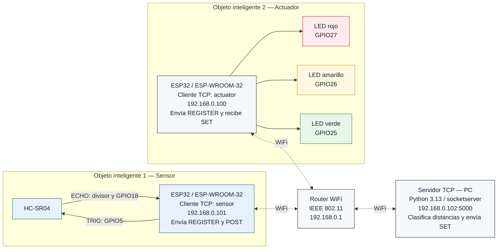
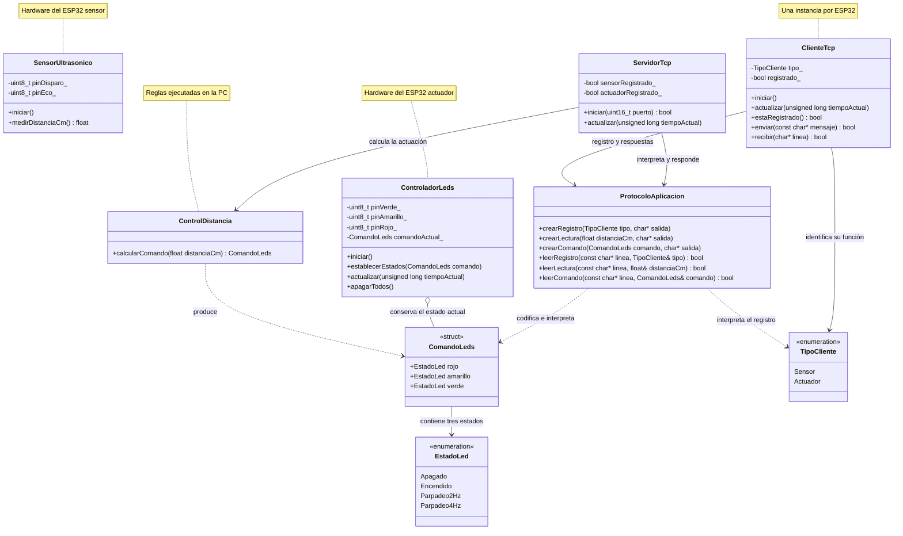
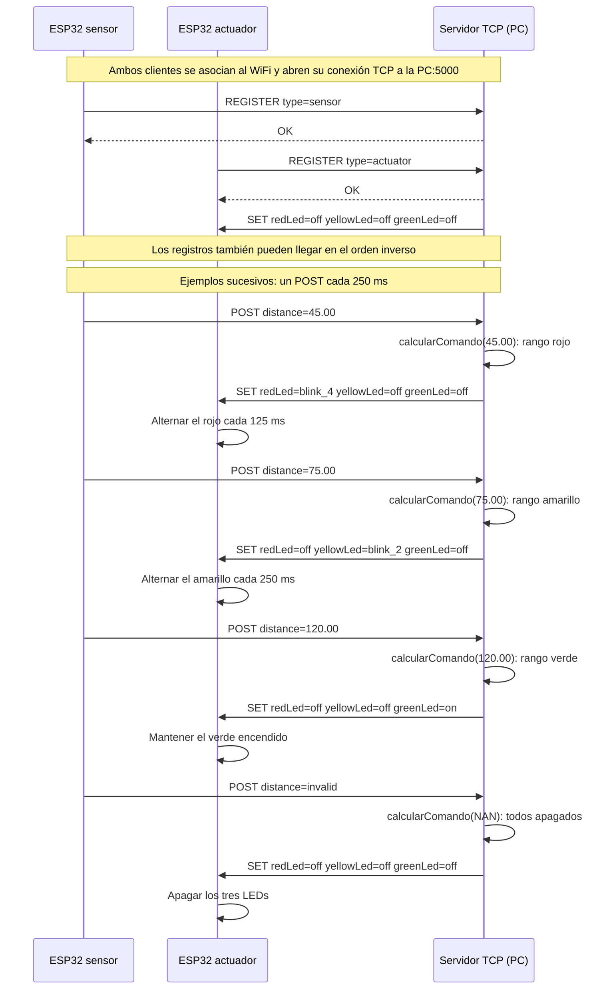
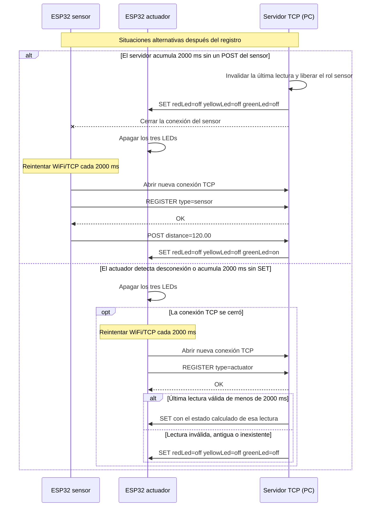

# Informe técnico — Práctica 2

**Actividad:** Integración de Objetos Inteligentes con TCP/IP

**Asignatura:** SIS-234 — Internet de las Cosas

**Grupo:** 8

**Integrantes:** Santiago Javier Torres Vacaflores y Ariel Adrian Mercado Alegre

**Plataformas previstas:** dos ESP32 / ESP-WROOM-32 y una PC Windows

**Estado del proyecto:** en desarrollo; implementación parcial e integración física pendiente

## Introducción

La [consigna de la Práctica 2](docs/consigna/Práctica_2.md) exige integrar un objeto inteligente con sensor ultrasónico, otro con actuadores y un servidor TCP central mediante WiFi (IEEE 802.11). El [diseño propuesto](docs/diagramas/Diseno_del_sistema.md) contempla un HC-SR04, tres LEDs y una PC que clasifica las distancias y envía comandos de actuación.

El proyecto dispone de un [servidor TCP en Python](apps/servidor/servidor.py), con módulos propios de dominio y protocolo, y de una [biblioteca C++](packages/Compartido/README.md) de tipos, reglas de distancia, protocolo y recepción de líneas. El [firmware actual](apps/firmware/src/main.cpp) conserva la adquisición ultrasónica y el control local de LEDs heredados de la Práctica 1. Los clientes TCP independientes de los ESP32 y la integración física del sistema distribuido permanecen pendientes, conforme al [plan de implementación](docs/PLAN_IMPLEMENTACION.md).

Este informe distingue la arquitectura objetivo de los componentes existentes y de su validación. La disponibilidad del código del servidor y del protocolo no acredita todavía la comunicación con ambas placas ni el cumplimiento integral de los requisitos. Los resultados de la Práctica 1 se conservan en [INFORME_P1.md](docs/historico/INFORME_P1.md) como referencia de organización y profundidad; no acreditan el funcionamiento del sistema distribuido de la Práctica 2. Los apartados aún no revisados mantienen las propuestas de diseño y deberán contrastarse con los avances posteriores.

Los marcadores indican información por incorporar: `[PENDIENTE DE IMPLEMENTACIÓN]` para desarrollo y revisión del código, `[PENDIENTE DE MEDICIÓN]` para datos experimentales y `[PENDIENTE DE EVIDENCIA]` para registros verificables. Un resultado esperado es un criterio de prueba, no un resultado obtenido.

## Objetivo general

Diseñar, implementar y validar un sistema distribuido que mida distancias con un sensor ultrasónico, las procese en un servidor TCP y controle tres LEDs en un objeto inteligente independiente, mediante sockets TCP sobre WiFi y un protocolo de aplicación definido por el grupo.

## 1. Requerimientos Funcionales y No Funcionales

Esta sección establece las condiciones que deberá satisfacer el sistema distribuido. Los requerimientos funcionales RF1–RF4 mantienen la numeración y el alcance de la [consigna oficial](docs/consigna/Práctica_2.md); los criterios de aceptación concretan las decisiones del [diseño del equipo](docs/diagramas/Diseno_del_sistema.md). Los requerimientos no funcionales RNF1–RNF5 declaran los atributos de calidad y sus métodos de verificación.

La adquisición y el envío de distancia corresponden al ESP32 sensor; la recepción, clasificación y generación de comandos corresponden al servidor TCP en la PC; la recepción y ejecución de esos comandos corresponden al ESP32 actuador. Esta distribución sitúa el algoritmo de control en el servidor, conforme a la consigna. La PC ya dispone de una implementación Python; el firmware mantiene el programa local heredado y la biblioteca C++ aporta componentes para los futuros clientes. Los estados siguientes identifican el código disponible sin declarar cumplimiento integral ni validación física.

### 1.1 Requerimientos funcionales y criterios de aceptación

| ID | Funcionalidad requerida | Criterio de aceptación | Componente responsable y adaptación prevista | Estado de implementación |
|---|---|---|---|---|
| RF1 | Medir la distancia entre el sensor ultrasónico HC-SR04 y un objeto. | Obtener lecturas finitas positivas expresadas en centímetros y contrastarlas con una referencia física mediante PN-02. Ante timeout de ECHO o valor no válido, identificar la lectura como inválida, según PV-04; la tolerancia de medición se evalúa en RNF2. | ESP32 sensor: `SensorUltrasonico` existente y futuro programa principal de adquisición y envío. | Código de adquisición heredado disponible; adaptación al cliente independiente: [PENDIENTE DE IMPLEMENTACIÓN]. Validación física P2: [PENDIENTE DE MEDICIÓN] / [PENDIENTE DE EVIDENCIA]. |
| RF2 | Interpretar cada distancia válida y clasificarla en tres rangos contiguos y sin solapamiento. | Asignar cada distancia finita positiva a exactamente un rango de §1.2. Las entradas de PV-01 a PV-03, incluidos 49.99, 50, 99.99 y 100 cm, deben producir la clasificación prevista y el comando correspondiente. | PC: `ControlDistancia.calcular_comando()` de `dominio.py`, invocado por `EstadoSistema.procesar()` del servidor Python. | Clasificación implementada en el servidor; incorporación de lecturas del ESP32: [PENDIENTE DE IMPLEMENTACIÓN]. Cumplimiento integrado: [PENDIENTE DE EVIDENCIA]. |
| RF3 | Activar los tres LEDs del objeto actuador en función del rango, con un comportamiento distinto por rango. | Aplicar el comando completo según §1.2: rojo a 4 Hz, amarillo a 2 Hz o verde fijo, con los demás LEDs apagados; una lectura inválida debe producir todos apagados. Verificar estos estados mediante PV-01 a PV-04 y la continuidad de fase ante comandos idénticos mediante PV-05. | Servidor Python: generación de `ComandoLeds` y `SET`; ESP32 actuador: futura recepción y adaptación de `ControladorLeds` para ejecutar estados. | Generación de estados y comandos implementada; ejecución de comandos P2 en el actuador: [PENDIENTE DE IMPLEMENTACIÓN]. Comportamiento físico: [PENDIENTE DE MEDICIÓN] / [PENDIENTE DE EVIDENCIA]. |
| RF4 | Enviar lecturas desde el objeto sensor al servidor y comandos desde el servidor al objeto actuador mediante sockets TCP sobre WiFi (IEEE 802.11), utilizando un protocolo de aplicación definido por el grupo. | Establecer una conexión de cada ESP32 hacia la PC, completar `REGISTER` / `OK` y comprobar con registros el recorrido integrado `POST` → clasificación en servidor → `SET` → actuación física. Los mensajes deben respetar la especificación de §2.6; PV-06 a PV-16 verificarán registro, delimitación, rechazo de errores y recuperación previstos. | PC: `ServidorTcp` y funciones de `protocolo.py`; ESP32: futuros `ClienteTcp` y programas principales, con `ProtocoloAplicacion` y `ReceptorLineas` C++. | Servidor TCP y protocolo Python/C++ implementados; clientes ESP32: [PENDIENTE DE IMPLEMENTACIÓN]. Comunicación TCP sobre WiFi e integración real: [PENDIENTE DE EVIDENCIA]. |

Los criterios se relacionan con el diseño y las validaciones mediante la matriz de §2.7. Las pruebas con entradas controladas al servidor permitirán verificar los límites exactos de RF2 sin confundirlos con el error físico del sensor; las pruebas del recorrido integrado comprobarán conjuntamente adquisición, comunicación y actuación. La revisión del código final y las evidencias de §4 serán necesarias para declarar el cumplimiento de cada requisito.

### 1.2 Rangos y lógica de control propuestos

Para la clasificación, se considera válida una distancia finita mayor que cero, expresada en centímetros. El dominio Python del servidor ya implementa la siguiente lógica de generación de estados; su ejecución física en el ESP32 actuador permanece pendiente:

| Distancia recibida | LED rojo | LED amarillo | LED verde |
|---|---|---|---|
| Lectura inválida | Apagado | Apagado | Apagado |
| 0 < distancia < 50 cm | Parpadeo a 4 Hz | Apagado | Apagado |
| 50 ≤ distancia < 100 cm | Apagado | Parpadeo a 2 Hz | Apagado |
| distancia ≥ 100 cm | Apagado | Apagado | Encendido fijo |

Los intervalos válidos son `(0, 50)`, `[50, 100)` y `[100, +∞)`. El valor 50 cm pertenece únicamente al rango amarillo y 100 cm únicamente al verde: cada límite se excluye del intervalo anterior y se incluye en el siguiente. De esta forma, no existen huecos ni solapamientos para las distancias finitas positivas. La lectura inválida constituye un estado de tratamiento de error, no un cuarto rango de distancia.

En el protocolo, `off` representa apagado y `on` encendido fijo. `blink_4` representa cuatro ciclos completos por segundo: un período de 250 ms, con 125 ms encendido y 125 ms apagado. `blink_2` representa dos ciclos completos por segundo: un período de 500 ms, con 250 ms encendido y 250 ms apagado. Estas frecuencias describen ciclos completos, no el número de alternancias del GPIO. Al comenzar un modo de parpadeo, el LED deberá encenderse; si se recibe de nuevo el mismo modo, deberá conservar su fase y temporización para que el envío periódico de comandos no reinicie el patrón.

Un timeout de ECHO, una lectura no finita o una distancia menor o igual que cero deberán normalizarse en el objeto sensor como `POST distance=invalid`. El servidor deberá interpretar ese mensaje como una lectura inválida y enviar `SET` con los tres estados `off`. El token `invalid` es válido dentro del protocolo; un mensaje mal formado o una distancia numérica cero o negativa recibida directamente se rechazarán conforme a sus reglas. Esta distinción evita tratar un fallo de comunicación como una medición válida.

El diseño también prevé el apagado al iniciar el actuador, ante una desconexión detectada y tras 2000 ms de ausencia de lecturas en el servidor o de comandos en el actuador, según corresponda. El servidor Python ya implementa el registro de roles, el rechazo de mensajes, la invalidación de datos del sensor y el envío del comando de apagado ante desconexión o ausencia de lecturas. El apagado local del actuador, sus temporizadores y los reintentos de ambos ESP32 permanecen [PENDIENTE DE IMPLEMENTACIÓN]. Estos son comportamientos complementarios de RF3 y RF4, especificados en §2.6 y cubiertos por PV-06 a PV-16; no se incorporan como requerimientos funcionales adicionales.

El dominio de clasificación no impone un límite superior de 150 cm ni excluye valores positivos inferiores a 3 cm. En cambio, **3 a 150 cm es el intervalo previsto para validar físicamente la exactitud** de RNF2. La cobertura lógica de los rangos no demuestra que el sensor cumpla la tolerancia fuera de ese intervalo ni que ya la cumpla dentro de él. Su cobertura experimental y sus resultados permanecen `[PENDIENTE DE MEDICIÓN]` y `[PENDIENTE DE EVIDENCIA]`.

### 1.3 Requerimientos no funcionales

Los cuatro atributos cuantitativos adoptan los valores de referencia de la consigna como objetivos del equipo y mantienen pendiente su validación física para la Práctica 2. RNF5 concreta la exigencia de código legible, modular, orientado a objetos y documentado mediante una revisión verificable. Su alcance incluye el servidor Python, ambos firmwares C++ y la biblioteca C++ de dominio y protocolo.

| ID | Atributo de calidad | Criterio de aceptación | Método de verificación | Componente o alcance afectado | Estado de validación |
|---|---|---|---|---|---|
| RNF1 | Estabilidad | Operar durante al menos 10 minutos continuos, con cero reinicios y cero bloqueos, manteniendo la adquisición, el intercambio TCP y la respuesta de los LEDs. | PN-01: registrar inicio, fin y eventos de los tres equipos; observar continuidad de lecturas y actuación, y documentar cualquier interrupción. | Sistema distribuido completo: ESP32 sensor, servidor TCP y ESP32 actuador. | [PENDIENTE DE MEDICIÓN] / [PENDIENTE DE EVIDENCIA] |
| RNF2 | Exactitud de medición | Mantener un error absoluto máximo ≤ 3 cm respecto de una referencia física dentro del intervalo previsto de 3 a 150 cm. | PN-02: comparar lecturas individuales con una regla o cinta métrica en posiciones que cubran los tres rangos y los extremos del intervalo; calcular el valor absoluto de cada diferencia y su máximo. Registrar referencias, repeticiones y condiciones del ensayo. | HC-SR04, circuito y adquisición del ESP32 sensor; comprobar la conservación del valor comunicado al servidor. | [PENDIENTE DE MEDICIÓN] / [PENDIENTE DE EVIDENCIA] |
| RNF3 | Tiempo de respuesta extremo a extremo | Reflejar cada cambio de rango ensayado en el estado visible del actuador en un tiempo máximo de 1 s desde el cambio físico de distancia. | PN-03: registrar el cambio físico y la actuación con una grabación o instrumento de tiempo común; calcular la diferencia temporal por ensayo y el máximo observado, indicando resolución y transiciones evaluadas. | Recorrido completo sensor → servidor → actuador, incluidos adquisición, red, procesamiento y ejecución del comando. | [PENDIENTE DE MEDICIÓN] / [PENDIENTE DE EVIDENCIA] |
| RNF4 | Frecuencia de muestreo | Obtener al menos 2 lecturas/s durante la operación registrada del sensor. | PN-04: contar lecturas obtenidas durante una ventana de duración conocida y calcular cantidad/duración; contabilizar por separado lecturas inválidas y `POST` recibidos en el servidor para contrastar adquisición y recepción. | Planificación de adquisición en ESP32 sensor; recepción en servidor como comprobación del envío. | [PENDIENTE DE MEDICIÓN] / [PENDIENTE DE EVIDENCIA] |
| RNF5 | Calidad del código | Presentar módulos con responsabilidades delimitadas, clases que encapsulen estado y operaciones, interfaces documentadas, nombres y convenciones consistentes en Python y C++, y reglas de control separadas del hardware y los sockets. | Revisión de §3.4 sobre una versión identificada del código final: inspeccionar módulos, clases, interfaces y dependencias en ambos lenguajes; registrar por criterio el cumplimiento, el archivo o fragmento que lo respalda y los ajustes pendientes. | Servidor Python, firmware C++ de ambos ESP32 y biblioteca C++ de dominio y protocolo. | Revisión integral: [PENDIENTE DE EVIDENCIA]. Componentes y adaptaciones faltantes: [PENDIENTE DE IMPLEMENTACIÓN]. |

Para RNF2, la aceptación se basará en el **máximo de los errores absolutos individuales**, no únicamente en el promedio; este último podría ocultar lecturas que excedan la tolerancia. Las lecturas inválidas se registrarán por separado y no se usarán como errores numéricos. La conclusión experimental deberá indicar las posiciones realmente ensayadas y sus condiciones, sin generalizar a distancias no probadas.

Para RNF3, el origen temporal será el cambio físico de distancia y el final el cambio visible correspondiente del LED. Así se incluirá la espera hasta la siguiente adquisición y todo el recorrido de comunicación y control. No se restarán directamente timestamps de relojes de equipos distintos sin una referencia temporal común. El análisis de temporización del diseño podrá apoyar la explicación, pero no sustituirá la medición extremo a extremo exigida por la consigna.

La revisión de RNF5 deberá comprobar, en particular, que el sensor adquiere y comunica, el servidor clasifica y produce comandos, y el actuador ejecuta los estados recibidos. También verificará la encapsulación de pines y conexiones, la coherencia entre declaraciones y uso de interfaces, constantes con nombres descriptivos y comentarios que expliquen unidades, temporización y tratamiento de errores. En Python se revisarán los módulos de servidor, dominio y protocolo, las clases de sesión y estado y sus dependencias; en C++, las clases de hardware, los tipos, el protocolo y los futuros adaptadores de red. Las convenciones se evaluarán de acuerdo con cada lenguaje. El registro de revisión permitirá justificar cada criterio mediante enlaces al código y distinguir los hallazgos de los ajustes efectivamente realizados.

Los **valores objetivo** son los límites de aceptación de la tabla. Los **parámetros de configuración previstos** incluyen el intervalo de adquisición y envío de 250 ms, el timeout de ECHO de 30000 µs y los plazos de registro, ausencia de datos y reintento de 2000 ms. El firmware heredado ya configura el intervalo de adquisición y el timeout de ECHO; el servidor configura plazos de registro y ausencia de lecturas de 2 s. El envío periódico, la supervisión local del actuador y los reintentos ESP32 aún deben implementarse. El intervalo nominal de 250 ms equivale teóricamente a 4 lecturas/s, pero no demuestra la frecuencia obtenida ni el tiempo de respuesta del sistema completo. Los **resultados medidos** se incorporarán en §4 y §5, con su versión de software y evidencias; en esta iteración permanecen pendientes. La revisión de la implementación integral también permanece pendiente y los resultados de la Práctica 1 no acreditan estos requisitos de la Práctica 2.

## 2. Análisis y Diseño

Los diagramas enlazados en esta sección representan la propuesta de la Práctica 2. Su correspondencia con el montaje y el software finales deberá revisarse tras la implementación.

### 2.1 Arquitectura distribuida del sistema

La arquitectura objetivo separa la adquisición de distancia, el procesamiento de las lecturas y la actuación física en tres equipos. Esta distribución responde al sistema exigido por la consigna y permite delimitar las responsabilidades de RF1–RF4: el objeto sensor obtiene los datos, la PC toma la decisión de control y el objeto actuador ejecuta sus órdenes. A diferencia del montaje de la Práctica 1, el diseño distribuye el sensor y los LEDs entre ESP32 independientes y sitúa la clasificación en la PC. El firmware activo todavía reúne adquisición y control local en un solo programa; los dos clientes y el montaje distribuido permanecen pendientes.

El ESP32 sensor deberá controlar el HC-SR04, convertir la duración del eco en centímetros y comunicar una lectura válida o su invalidez. La PC dispone de un servidor TCP en Python que recibe lecturas, aplica los rangos de §1.2 y genera los estados de los tres LEDs. El ESP32 actuador deberá recibir esos estados y mantener las salidas y el parpadeo correspondientes, sin clasificar distancias localmente. El firmware utiliza C++ con Arduino y PlatformIO; la implementación del servidor utiliza la biblioteca estándar de Python, con `socketserver.ThreadingTCPServer`, `socket`, `select` y `threading` para conexiones, atención y sincronización, `time` para plazos y `logging` para registros. La entrada de consola emplea `argparse` e `ipaddress`.

La clasificación en ejecución corresponde a `ControlDistancia.calcular_comando()` de [dominio.py](apps/servidor/dominio.py), invocado desde el estado del servidor. La biblioteca `packages/Compartido` contiene tipos, dominio, `ProtocoloAplicacion` y `ReceptorLineas` C++; su `ControlDistancia` se conserva como referencia de pruebas. Python utiliza sus propios tipos y funciones de [protocolo.py](apps/servidor/protocolo.py), sin llamar directamente a esa biblioteca C++. Ambas implementaciones se comunican mediante un contrato común ASCII/TCP; la compatibilidad dispone de vectores y pruebas, cuya existencia no se presenta aquí como resultado confirmado de ejecución.

El siguiente diagrama presenta el [despliegue objetivo del equipo](docs/diagramas/Diseno_del_sistema.md#11-diagrama-de-despliegue) con las tecnologías actuales. El servidor existe en código; los clientes ESP32 y los enlaces del sistema físico siguen pendientes. **Todas las direcciones IP son ilustrativas.** El puerto TCP `5000` es el valor predeterminado comprobado en el código, no una configuración del montaje ya verificada.



Las líneas discontinuas representan enlaces WiFi bidireccionales a través del router, que proporciona conectividad IP entre los equipos de la red local. El router transportará el tráfico y no participará en la clasificación ni en la generación de comandos. Los enlaces físicos de red deben distinguirse del flujo de aplicación: las lecturas viajarán del sensor al servidor y las órdenes del servidor al actuador.

En el modelo cliente-servidor previsto, **ambos ESP32 iniciarán su propia conexión TCP persistente hacia la PC**. El servidor Python implementa la escucha y aceptación de conexiones, la respuesta al registro y el envío de órdenes por el socket del actuador. Por tanto, recibir comandos no convierte al ESP32 actuador en servidor ni exige que la PC abra una conexión nueva hacia él. El registro `REGISTER` identifica el rol de cada cliente, de modo que las direcciones de los ESP32 podrán obtenerse por DHCP según la configuración del montaje. La aplicación de este modelo en ambos ESP32 permanece pendiente.

La entrada de consola de [__main__.py](apps/servidor/__main__.py) define `--ip` con valor predeterminado `0.0.0.0` y `--puerto` con valor predeterminado `5000`, coincidentes con el constructor de `ServidorTcp`. `0.0.0.0` indica escucha en las interfaces IPv4 locales; no es una dirección de destino para los ESP32. Los clientes deberán utilizar la IPv4 real de la PC y el puerto efectivo. Esa configuración y la conectividad WiFi deberán comprobarse durante la integración física.

| Componente | Responsabilidad | Intercambio principal | Estado actual |
|---|---|---|---|
| ESP32 sensor y HC-SR04 | Adquirir distancia con intervalo nominal de 250 ms y comunicar lecturas válidas o inválidas. | Previsto: enviar `REGISTER type=sensor` y `POST`; recibir la respuesta de registro. | Adquisición heredada disponible; cliente TCP: [PENDIENTE DE IMPLEMENTACIÓN]. |
| PC / servidor TCP Python | Registrar clientes, clasificar lecturas, generar comandos y vigilar la ausencia de datos. | Recibir `REGISTER` y `POST`; enviar `OK`, `ERROR` y `SET`. | Implementado en código; integración con las placas: [PENDIENTE DE EVIDENCIA]. |
| ESP32 actuador y tres LEDs | Recibir órdenes y mantener los modos de los LEDs mediante la temporización local. | Previsto: enviar `REGISTER type=actuator`; recibir la respuesta de registro y `SET`. | Control local heredado disponible; cliente y adaptación a estados: [PENDIENTE DE IMPLEMENTACIÓN]. |
| Router WiFi | Proporcionar conectividad IP entre los tres equipos. | Previsto: transportar el tráfico de las dos conexiones TCP sobre IEEE 802.11. | Configuración y conectividad del montaje: [PENDIENTE DE EVIDENCIA]. |

La comunicación se organiza en las cuatro capas del modelo TCP/IP utilizado en la práctica:

| Capa | Elemento del diseño y estado actual | Función en el sistema |
|---|---|---|
| Aplicación | Protocolo de texto del grupo, descrito en §2.6; implementaciones independientes Python y C++. | Definir los mensajes de registro, lectura, actuación y error, así como su delimitación. |
| Transporte | TCP y sockets; servidor disponible con puerto predeterminado `5000`, clientes ESP32 pendientes. | Mantener las conexiones de los clientes y transportar el flujo ordenado de bytes. |
| Internet | IPv4; configuración real de la red local pendiente. | Identificar los equipos mediante direcciones IP. |
| Acceso a la red | WiFi, IEEE 802.11; conectividad de los ESP32 pendiente. | Proporcionar el enlace de los equipos con el router. |

El servidor y los componentes de protocolo están disponibles en código. La implementación de los clientes ESP32 y la adaptación del actuador permanecen `[PENDIENTE DE IMPLEMENTACIÓN]`. La identificación de la red, las IP reales, el puerto utilizado y la comprobación del recorrido completo permanecen `[PENDIENTE DE EVIDENCIA]`; las mediciones físicas de desempeño permanecen `[PENDIENTE DE MEDICIÓN]`.

### 2.2 Circuito del objeto sensor

El objeto sensor diseñado comprende un ESP32 / ESP-WROOM-32, un HC-SR04 y tres resistencias de 2.2 kΩ que forman el divisor resistivo de ECHO. El ESP32 se alimentará por USB de 5 V y suministrará la alimentación del sensor desde VIN / 5 V. El siguiente esquema corresponde exclusivamente al objeto de adquisición de la Práctica 2:


Las conexiones conservan la asignación del [diseño del objeto sensor](docs/diagramas/Diseno_del_sistema.md#31-objeto-inteligente-con-sensor):

| Elemento o señal | Conexión prevista | Función |
|---|---|---|
| Alimentación del ESP32 | USB de 5 V. | Alimentar la placa del objeto sensor. |
| HC-SR04 VCC | VIN / 5 V del ESP32. | Alimentar el sensor ultrasónico. |
| HC-SR04 GND | GND del ESP32. | Establecer una referencia eléctrica común para alimentación y señales. |
| HC-SR04 TRIG | GPIO5 del ESP32. | Recibir el pulso de disparo generado por el microcontrolador. |
| HC-SR04 ECHO | ECHO → R1 de 2.2 kΩ → nodo conectado a GPIO18. | Conducir el pulso de eco hacia la entrada mediante el divisor. |
| Retorno del divisor | Nodo GPIO18 → R2 de 2.2 kΩ → R3 de 2.2 kΩ → GND. | Formar la rama inferior de 4.4 kΩ del divisor. |

El pulso enviado por GPIO5 a TRIG iniciará la medición. El ESP32 medirá en GPIO18 la duración de ECHO para obtener la distancia. El diseño conserva un pulso TRIG de 10 µs y un timeout de ECHO de 30000 µs; estos valores son parámetros previstos, cuya aplicación deberá comprobarse al revisar el firmware. La detección de una lectura inválida seguirá el comportamiento definido en §1.2.

El divisor es necesario porque ECHO utiliza una señal de 5 V, superior al nivel lógico de 3.3 V del ESP32. El diseño evita conectar ECHO directamente a GPIO18: R1 se sitúa entre ECHO y el nodo de lectura, mientras R2 y R3 están en serie entre ese nodo y GND. La tensión ideal en el nodo se obtiene mediante:

```text
Rsuperior = R1 = 2.2 kΩ
Rinferior = R2 + R3 = 2.2 kΩ + 2.2 kΩ = 4.4 kΩ
VGPIO18 = VECHO × Rinferior / (Rsuperior + Rinferior)
VGPIO18 = 5 V × 4.4 kΩ / (2.2 kΩ + 4.4 kΩ)
VGPIO18 ≈ 3.33 V
```

Este resultado es un cálculo ideal con los valores nominales del diseño, no una tensión medida ni una validación eléctrica del montaje. La tierra común une el ESP32, el HC-SR04 y el retorno del divisor dentro de este objeto. El segundo ESP32 tendrá su propio circuito de actuación; la comunicación prevista entre ambos objetos se realizará por WiFi.

**Aplicación de los parámetros de adquisición en el firmware:** [PENDIENTE DE IMPLEMENTACIÓN]

**Montaje final, lista de componentes y correspondencia con el esquema:** [PENDIENTE DE EVIDENCIA]

**Comprobación de la alimentación y tensión real del nodo ECHO:** [PENDIENTE DE MEDICIÓN]

### 2.3 Circuito del objeto actuador

El objeto actuador diseñado comprende un segundo ESP32 / ESP-WROOM-32, tres LEDs —rojo, amarillo y verde— y tres resistencias de 220 Ω, una por LED. La placa se alimentará mediante USB de 5 V. Los LEDs serán controlados por señales GPIO de 3.3 V, según el esquema; la alimentación USB no equivale a aplicar 5 V a estas salidas.


Las tres ramas conservan la polaridad y las conexiones del [diseño del objeto actuador](docs/diagramas/Diseno_del_sistema.md#32-objeto-inteligente-con-actuadores):

| Elemento | Conexión prevista |
|---|---|
| Alimentación del ESP32 | USB de 5 V. |
| LED verde | GPIO25 → ánodo del LED → cátodo → resistencia RV de 220 Ω → GND. |
| LED amarillo | GPIO26 → ánodo del LED → cátodo → resistencia RA de 220 Ω → GND. |
| LED rojo | GPIO27 → ánodo del LED → cátodo → resistencia RR de 220 Ω → GND. |
| Retorno común | Las tres resistencias retornan al GND de este ESP32. |

Cada resistencia se conecta en serie con su LED para limitar la corriente de su rama. El retorno compartido proporciona la referencia eléctrica común del objeto actuador. Con esta polaridad, un nivel alto en el GPIO encenderá el LED y un nivel bajo lo apagará; la alternancia temporizada producirá el parpadeo. El esquema no incluye el HC-SR04, que pertenece al objeto sensor independiente.

La PC deberá generar el comando `SET` con los estados de los tres LEDs después de clasificar la lectura. El ESP32 actuador deberá interpretar el comando completo y entregarlo al controlador de salidas, que mantendrá los modos recibidos y actualizará el parpadeo mediante `millis()`. Esta separación distingue la decisión de control, ejecutada en el servidor, de la ejecución física y su temporización, realizadas en el actuador. Los rangos y frecuencias se mantienen definidos en §1.2; el circuito aporta las salidas necesarias para representarlos.

**Recepción de comandos y control de salidas conforme al diseño:** [PENDIENTE DE IMPLEMENTACIÓN]

**Montaje final, lista de componentes y correspondencia con el esquema:** [PENDIENTE DE EVIDENCIA]

### 2.4 Diagrama de clases

La estructura propuesta separa la medición, la comunicación, las reglas de control y la ejecución de los estados de los LEDs. El siguiente [diagrama de clases del diseño](docs/diagramas/Diseno_del_sistema.md#4-diagrama-de-clases-propuesto) conserva sus nombres, atributos, métodos y relaciones. Representa las interfaces principales previstas para la Práctica 2; no constituye una descripción de código final implementado.



Las clases y los tipos se distribuyen de acuerdo con la arquitectura de §2.1:

| Clase o tipo propuesto | Responsabilidad | Equipo o ámbito previsto |
|---|---|---|
| `SensorUltrasonico` | Inicializar los pines del HC-SR04 y obtener la distancia mediante `medirDistanciaCm()`. | ESP32 sensor. |
| `ControladorLeds` | Recibir `ComandoLeds` mediante `establecerEstados()`, actualizar las salidas y el parpadeo, y permitir el apagado de los tres LEDs. | ESP32 actuador. |
| `ClienteTcp` | Mantener la conexión y el registro del rol, enviar mensajes y recibir líneas completas. | Una instancia en cada ESP32, con su propio rol. |
| `ServidorTcp` | Aceptar y gestionar las conexiones de ambos roles, interpretar mensajes y coordinar el control central. | PC Windows. |
| `ControlDistancia` | Clasificar una distancia y producir `ComandoLeds` mediante `calcularComando()`. | PC Windows. |
| `ProtocoloAplicacion` | Construir e interpretar registros, lecturas y comandos de actuación. | Elemento conceptualmente compartido por clientes y servidor, según el intercambio que realiza cada equipo. |
| `EstadoLed` y `ComandoLeds` | Representar los modos de un LED y reunir los estados rojo, amarillo y verde en un comando. | Dominio conceptualmente compartido, independiente de GPIO y sockets. |
| `TipoCliente` | Identificar los roles `Sensor` y `Actuador` en el registro. | Tipo del protocolo conceptualmente compartido. |

La dependencia de `ServidorTcp` respecto de `ControlDistancia` sitúa la clasificación en la PC. `ControlDistancia` produce un `ComandoLeds`, mientras `ProtocoloAplicacion` traduce esa representación a mensajes de texto o interpreta mensajes recibidos. Así, las reglas de control y los tipos del dominio pueden expresarse en C++ sin depender de Arduino o Winsock; las clases de hardware y red concentran esas dependencias.

`ComandoLeds` contiene tres valores de `EstadoLed`, no tres controladores de hardware. La relación con `ControladorLeds`, rotulada como conservación del estado actual, representa el comando que este deberá mantener en `comandoActual_`. No se deduce de esa relación una necesidad de asignación dinámica. Las asociaciones de `ClienteTcp` con `TipoCliente` y `ProtocoloAplicacion` expresan, respectivamente, la identidad del cliente y el tratamiento de su registro y sus respuestas; las del servidor expresan la interpretación de mensajes y la generación de la actuación.

Los programas principales de los ESP32 coordinarán los objetos locales, aunque no aparecen como clases en este diagrama. El programa sensor solicitará la medición y su envío; el programa actuador entregará los comandos recibidos al controlador. Esta coordinación explica por qué `SensorUltrasonico` no tiene una relación directa con `ClienteTcp` y por qué `ControladorLeds` no clasifica distancias. La entrada prevista de este último será `establecerEstados(ComandoLeds comando)`, en lugar de la clasificación local mediante `establecerDistancia()` descrita en la Práctica 1.

Las firmas mantienen la separación entre datos y transporte: `calcularComando(float distanciaCm)` devolverá un `ComandoLeds`; `leerRegistro()`, `leerLectura()` y `leerComando()` devolverán un booleano e incorporarán los datos interpretados en sus parámetros de salida. Según el diseño, al interpretar `distance=invalid`, `leerLectura()` entregará `NAN`, que `ControlDistancia` convertirá en todos apagados. `ClienteTcp::enviar()` agregará LF (`\n`) al contenido y `recibir()` entregará una línea completa sin ese delimitador. `ProtocoloAplicacion` trabajará con el contenido; el buffer local previsto tiene 128 bytes, hasta 127 de contenido y el terminador C `\0`, que no se transmitirá.

El diagrama es una vista resumida: no detalla todos los buffers y temporizadores necesarios para las secuencias de §2.5, ni las operaciones específicas para construir o interpretar `OK` y `ERROR`. También omite los tipos de retorno de las operaciones `crearRegistro()`, `crearLectura()` y `crearComando()`. Estos aspectos deberán confirmarse en las interfaces finales; no se añaden firmas ni relaciones para resolverlos en esta iteración. La agregación de `ComandoLeds` se interpreta conforme al atributo declarado, sin afirmar una política de propiedad de memoria no documentada.

**Justificación detallada y correspondencia con las interfaces finales:** [PENDIENTE DE IMPLEMENTACIÓN]

### 2.5 Diagramas de secuencia

Las siguientes secuencias describen el comportamiento previsto entre los equipos de §2.1. Los participantes representan objetos físicos completos; las llamadas internas al servidor y al actuador se relacionan con las responsabilidades de §2.4. Los ejemplos son intercambios propuestos, no registros de una ejecución real. Cada mensaje de aplicación deberá terminar en LF (`\n`), aunque el delimitador se omite en las etiquetas para facilitar la lectura. El puerto `5000` continúa siendo un parámetro previsto.

#### 2.5.1 Registro y funcionamiento normal

El escenario reproduce la [secuencia de registro y funcionamiento normal](docs/diagramas/Diseno_del_sistema.md#51-registro-y-funcionamiento-normal) del diseño:



Antes del registro, ambos ESP32 deberán asociarse a la red WiFi y establecer sus conexiones TCP hacia la PC. Cada cliente enviará `REGISTER` como primer mensaje de aplicación: `REGISTER type=sensor` para el objeto de adquisición y `REGISTER type=actuator` para el de actuación. El servidor reservará cada rol en un socket distinto y responderá `OK`; el cliente deberá esperar esa confirmación antes de iniciar el intercambio operativo. `OK` confirma exclusivamente el registro, no cada lectura ni cada actuación.

El orden de registro podrá invertirse. En el ejemplo, el actuador se registra sin una lectura disponible y recibe `SET redLed=off yellowLed=off greenLed=off`. Si el sensor ya hubiera enviado una lectura, el servidor deberá aplicar el estado correspondiente cuando esa lectura sea válida y tenga menos de 2000 ms; si es inválida, antigua o inexistente, deberá ordenar el apagado. Mientras no exista un actuador registrado, el servidor conservará únicamente la última lectura y su tiempo de recepción.

Una vez registrado, el sensor deberá enviar un `POST` con intervalo nominal de 250 ms. Para los ejemplos de 45.00, 75.00 y 120.00 cm, el servidor interpretará la lectura mediante `ProtocoloAplicacion`, calculará el comando mediante `ControlDistancia` y enviará, respectivamente, los estados rojo `blink_4`, amarillo `blink_2` o verde `on`, con los otros LEDs en `off`. El mensaje `POST distance=invalid` deberá producir un `SET` con los tres LEDs apagados. Estos ejemplos concretan el flujo de mensajes sin acreditar lecturas físicas ni tiempos medidos.

Cada `POST` completo y válido, incluido el token `invalid`, deberá producir un `SET` si el actuador está registrado. El servidor enviará el comando incluso si coincide con el anterior. El ESP32 actuador deberá validar e interpretar el mensaje completo, entregar los tres estados a `ControladorLeds` y controlar localmente la temporización del parpadeo mediante `actualizar()`. La PC decidirá el modo, pero no enviará una orden por cada alternancia del GPIO. Los comandos idénticos deberán conservar la fase del modo vigente y el actuador no enviará una confirmación por cada lectura, conforme al protocolo diseñado.

#### 2.5.2 Ausencia de datos, desconexión y recuperación

El segundo escenario reproduce la [secuencia de ausencia de datos y recuperación](docs/diagramas/Diseno_del_sistema.md#52-ausencia-de-datos-y-recuperación). Sus ramas describen situaciones alternativas después del registro; la rama del sensor presupone que existe un actuador registrado.



**Ausencia de lecturas del sensor.** El servidor deberá contar 2000 ms desde la recepción del último `POST` completo y válido; `POST distance=invalid` también reiniciará ese plazo porque comunica el estado del sensor. Si todavía no hubiera recibido una lectura después del registro, el tiempo se contará desde su aceptación. Al vencer el plazo, la PC invalidará la lectura almacenada, enviará todos apagados al actuador registrado y cerrará la conexión del sensor, liberando su rol. El ESP32 sensor, al detectar la desconexión, deberá reintentar la conexión WiFi/TCP cada 2000 ms y registrarse de nuevo.

**Ausencia de comandos en el actuador.** El ESP32 actuador deberá medir 2000 ms desde el último `SET` completo y válido, o desde la finalización del registro mientras espera el primero. Al vencer ese plazo, apagará localmente los tres LEDs. Si el socket sigue abierto, deberá mantener la conexión y permanecer apagado hasta recibir un `SET` válido; la ausencia de comandos por sí sola no implica abrir otro socket. Esta protección local permite apagar las salidas aun cuando la desconexión del servidor todavía no haya sido detectada.

**Desconexión detectada.** Cuando el servidor detecte la desconexión del sensor, deberá invalidar inmediatamente sus datos, liberar el rol y ordenar el apagado al actuador registrado, sin esperar otros 2000 ms. Cuando el ESP32 actuador detecte la pérdida de su propia conexión, deberá apagar inmediatamente sus salidas. El envío desde la PC presupone que la conexión del actuador sigue disponible; si también se interrumpe, el apagado dependerá de la detección o del plazo local del actuador.

**Reintento y nuevo registro.** Los ESP32 desconectados deberán reintentar WiFi/TCP cada 2000 ms, crear un socket nuevo y repetir `REGISTER` / `OK`. Los roles de conexiones cerradas deberán quedar liberados, y los fragmentos de mensajes, buffers y temporizadores de conexión se reiniciarán conforme al diseño. El registro tiene un plazo de 2000 ms: el servidor cerrará una conexión sin `REGISTER` completo dentro de ese tiempo, y el cliente cerrará y reintentará si no recibe `OK` dentro del plazo previsto. Estos tiempos se miden localmente, sin requerir relojes sincronizados entre equipos.

**Restauración mediante un comando válido.** Tras el nuevo registro del sensor, una lectura como `POST distance=120.00` deberá producir el comando verde encendido que muestra el diagrama, si el actuador está registrado. Tras el nuevo registro del actuador, el servidor deberá enviar inmediatamente el comando correspondiente a la última lectura válida de menos de 2000 ms, o todos apagados si la lectura es inválida, antigua o inexistente. Un nuevo `SET` válido restablecerá los modos; después de un apagado por ausencia de datos, los parpadeos deberán comenzar desde encendido. Esta recuperación no supone reutilizar una lectura cuya vigencia haya vencido.

Las secuencias son coherentes con la clasificación en `ControlDistancia`, el intercambio gestionado por las clases TCP y la ejecución local en `ControladorLeds`. Las actividades de supervisión y recuperación requieren detalles internos no mostrados en el diagrama de clases, que deberán contrastarse con las interfaces y el código finales. PV-06, PV-12 a PV-16 y sus evidencias permitirán verificar los escenarios de registro y recuperación; el flujo normal y la continuidad del parpadeo se relacionan con PV-01 a PV-05.

**Correspondencia de las secuencias con los registros reales de intercambio:** [PENDIENTE DE EVIDENCIA]

**Implementación de los mecanismos de registro, supervisión y recuperación:** [PENDIENTE DE IMPLEMENTACIÓN]

### 2.6 Protocolo de aplicación TCP

La [especificación propuesta](docs/diagramas/Diseno_del_sistema.md#6-especificación-del-protocolo-de-aplicación) define líneas ASCII delimitadas por LF (`\n`), con hasta 127 bytes de contenido y 128 bytes incluyendo LF. Prevé reconstruir mensajes fragmentados y separar mensajes agrupados en el flujo TCP.

| Mensaje previsto | Dirección | Finalidad |
|---|---|---|
| `REGISTER type=<sensor o actuator>` | Cliente → servidor | Solicitar el registro del rol. |
| `OK` | Servidor → cliente | Confirmar exclusivamente el registro. |
| `POST distance=<decimal positivo o invalid>` | Sensor → servidor | Comunicar una lectura en cm o su invalidez. |
| `SET redLed=<estado> yellowLed=<estado> greenLed=<estado>` | Servidor → actuador | Aplicar los tres modos: `off`, `on`, `blink_2` o `blink_4`. |
| `ERROR reason=<motivo>` | Servidor → cliente | Rechazar un mensaje o registro y cerrar la conexión. |

Los campos entre `< >` son marcadores descriptivos. El registro, la ausencia de datos y los reintentos contemplan plazos de 2000 ms según el diseño. La especificación completa conserva las reglas de sintaxis, orden, errores y recuperación.

**Correspondencia con el protocolo implementado y ejemplos reales de intercambio:** [PENDIENTE DE IMPLEMENTACIÓN] / [PENDIENTE DE EVIDENCIA]

### 2.7 Matriz de trazabilidad

| Requisito | Diseño relacionado | Implementación prevista | Validación prevista | Evidencia |
|---|---|---|---|---|
| RF1 | Circuito sensor y protocolo `POST`. | `SensorUltrasonico`, programa sensor: [PENDIENTE DE IMPLEMENTACIÓN]. | PV-04 y PN-02. | [PENDIENTE DE EVIDENCIA] |
| RF2 | Rangos de §1.2. | `ControlDistancia`: [PENDIENTE DE IMPLEMENTACIÓN]. | PV-01 a PV-03, incluidos límites. | [PENDIENTE DE EVIDENCIA] |
| RF3 | Circuito actuador y comandos `SET`. | `ControladorLeds`: [PENDIENTE DE IMPLEMENTACIÓN]. | PV-01 a PV-05. | [PENDIENTE DE EVIDENCIA] |
| RF4 | Arquitectura, secuencias y protocolo. | `ClienteTcp`, `ServidorTcp`, `ProtocoloAplicacion`: [PENDIENTE DE IMPLEMENTACIÓN]. | Flujo integrado y PV-06 a PV-16. | [PENDIENTE DE EVIDENCIA] |
| RNF1 | Operación distribuida y recuperación. | Sistema completo: [PENDIENTE DE IMPLEMENTACIÓN]. | PN-01. | [PENDIENTE DE EVIDENCIA] |
| RNF2 | Medición ultrasónica. | Módulo sensor: [PENDIENTE DE IMPLEMENTACIÓN]. | PN-02. | [PENDIENTE DE EVIDENCIA] |
| RNF3 | Flujo sensor → servidor → actuador. | Sistema completo: [PENDIENTE DE IMPLEMENTACIÓN]. | PN-03. | [PENDIENTE DE EVIDENCIA] |
| RNF4 | Medición y envío nominal cada 250 ms. | Programa sensor y recepción TCP: [PENDIENTE DE IMPLEMENTACIÓN]. | PN-04. | [PENDIENTE DE EVIDENCIA] |
| RNF5 | Clases y separación de responsabilidades. | Módulos y tipos de §3.2: [PENDIENTE DE IMPLEMENTACIÓN]. | Revisión de §3.4. | [PENDIENTE DE EVIDENCIA] |

## 3. Desarrollo e Implementación

Esta sección queda reservada para describir el desarrollo de la Práctica 2 con enlaces al código y a fragmentos clave, sin copiar archivos completos. Las clases del diseño no se presentan como implementadas.

### 3.1 Entorno de desarrollo y configuración

| Elemento | Base prevista | Versión o configuración utilizada |
|---|---|---|
| Firmware de ambos ESP32 | C++ / Arduino / PlatformIO. | [PENDIENTE DE IMPLEMENTACIÓN] |
| Servidor PC | C++ / Windows / Winsock. | [PENDIENTE DE IMPLEMENTACIÓN] |
| Red y servicio | WiFi local / IPv4 / puerto propuesto 5000. | [PENDIENTE DE IMPLEMENTACIÓN] |
| Compilación y ejecución | Documentar herramientas y pasos reproducibles. | [PENDIENTE DE IMPLEMENTACIÓN] |

### 3.2 Implementación de módulos y clases

| Módulo previsto | Clases o tipos propuestos | Responsabilidad | Archivo y enlace al código P2 | Estado |
|---|---|---|---|---|
| Sensor | `SensorUltrasonico`, programa principal sensor. | Medir y coordinar envío de lecturas. | [PENDIENTE DE IMPLEMENTACIÓN] | Reutilización prevista; por verificar. |
| Actuador | `ControladorLeds`, programa principal actuador. | Aplicar comandos y temporizar parpadeos. | [PENDIENTE DE IMPLEMENTACIÓN] | Adaptación prevista; por verificar. |
| Cliente de red | `ClienteTcp`. | Conectar, registrar, enviar, recibir y reintentar. | [PENDIENTE DE IMPLEMENTACIÓN] | Desarrollo propuesto. |
| Servidor de red | `ServidorTcp`. | Atender sockets, roles y ausencia de lecturas. | [PENDIENTE DE IMPLEMENTACIÓN] | Desarrollo propuesto. |
| Control en PC | `ControlDistancia`. | Convertir distancias en estados de LEDs. | [PENDIENTE DE IMPLEMENTACIÓN] | Desarrollo propuesto. |
| Dominio compartido | `EstadoLed`, `ComandoLeds`. | Representar la actuación. | [PENDIENTE DE IMPLEMENTACIÓN] | Tipos propuestos. |
| Protocolo compartido | `ProtocoloAplicacion`, `TipoCliente`. | Codificar y validar mensajes y roles. | [PENDIENTE DE IMPLEMENTACIÓN] | Desarrollo propuesto. |

### 3.3 Fragmentos clave y decisiones técnicas

| Aspecto por documentar | Explicación y decisión final | Enlace al fragmento |
|---|---|---|
| Medición, periodicidad y lectura inválida. | [PENDIENTE DE IMPLEMENTACIÓN] | [PENDIENTE DE IMPLEMENTACIÓN] |
| Registro, sockets y delimitación del flujo TCP. | [PENDIENTE DE IMPLEMENTACIÓN] | [PENDIENTE DE IMPLEMENTACIÓN] |
| Clasificación en servidor y actuación no bloqueante. | [PENDIENTE DE IMPLEMENTACIÓN] | [PENDIENTE DE IMPLEMENTACIÓN] |
| Errores, apagado y recuperación. | [PENDIENTE DE IMPLEMENTACIÓN] | [PENDIENTE DE IMPLEMENTACIÓN] |

### 3.4 Revisión de calidad del código

| Criterio RNF5 | Hallazgos y ajustes | Evidencia de revisión |
|---|---|---|
| POO, modularidad, nombres, convenciones, comentarios y separación de hardware/red/control. | [PENDIENTE DE IMPLEMENTACIÓN] | [PENDIENTE DE EVIDENCIA] |

## 4. Pruebas y Validaciones

El plan toma como referencia las [validaciones previstas del diseño](docs/diagramas/Diseno_del_sistema.md#7-trazabilidad-y-validaciones-previstas). No se registra ninguna prueba como ejecutada o aprobada en esta iteración.

### 4.1 Datos de la sesión y procedimiento

| Campo | Registro |
|---|---|
| Fecha, hora e integrantes responsables | [PENDIENTE DE EVIDENCIA] |
| Versiones o commits de ambos firmwares y del servidor | [PENDIENTE DE IMPLEMENTACIÓN] |
| Montaje, alimentación, red, IP y puerto reales | [PENDIENTE DE EVIDENCIA] |
| Instrumento de referencia y condiciones ambientales | [PENDIENTE DE EVIDENCIA] |
| Método, repeticiones y resolución temporal de las mediciones | [PENDIENTE DE MEDICIÓN] |

### 4.2 Casos de prueba funcionales

Para los límites exactos, distinguir pruebas con entradas controladas al servidor de pruebas físicas sujetas al error del sensor. Registrar el método empleado y verificar además el recorrido integrado sensor → servidor → actuador.

| ID | Requisitos | Entrada o situación prevista | Resultado esperado según el diseño | Resultado y evaluación | Evidencia |
|---|---|---|---|---|---|
| PV-01 | RF2, RF3 | 45 y 49.99 cm. | Solo rojo a 4 Hz. | [PENDIENTE DE MEDICIÓN] | [PENDIENTE DE EVIDENCIA] |
| PV-02 | RF2, RF3 | 50, 75 y 99.99 cm. | Solo amarillo a 2 Hz. | [PENDIENTE DE MEDICIÓN] | [PENDIENTE DE EVIDENCIA] |
| PV-03 | RF2, RF3 | 100 y 120 cm. | Solo verde fijo. | [PENDIENTE DE MEDICIÓN] | [PENDIENTE DE EVIDENCIA] |
| PV-04 | RF1, RF3, RF4 | Timeout de ECHO o lectura inválida. | `POST distance=invalid`; `SET` con todos apagados. | [PENDIENTE DE MEDICIÓN] | [PENDIENTE DE EVIDENCIA] |
| PV-05 | RF3, RF4 | Comandos idénticos cada 250 ms. | Conservar fase; ciclos de 500 o 250 ms. | [PENDIENTE DE MEDICIÓN] | [PENDIENTE DE EVIDENCIA] |
| PV-06 | RF4 | Registrar primero sensor y luego actuador; repetir en orden inverso. | Ambos órdenes funcionan; estado reciente o apagado inicial. | [PENDIENTE DE MEDICIÓN] | [PENDIENTE DE EVIDENCIA] |
| PV-07 | RF4 | Solicitar un rol ocupado desde un cliente nuevo. | `ERROR reason=role_busy`; conservar al cliente original. | [PENDIENTE DE MEDICIÓN] | [PENDIENTE DE EVIDENCIA] |
| PV-08 | RF4 | Fragmentar un `POST` o `SET` en TCP. | Procesarlo una sola vez tras recibir LF. | [PENDIENTE DE MEDICIÓN] | [PENDIENTE DE EVIDENCIA] |
| PV-09 | RF4 | Agrupar mensajes en una lectura TCP. | Procesarlos en orden y conservar el fragmento final. | [PENDIENTE DE MEDICIÓN] | [PENDIENTE DE EVIDENCIA] |
| PV-10 | RF4 | Líneas de 127 y 128 bytes de contenido antes de LF. | 127 cumple longitud, sujeto a sintaxis; 128 se rechaza. | [PENDIENTE DE MEDICIÓN] | [PENDIENTE DE EVIDENCIA] |
| PV-11 | RF3, RF4 | Comando desconocido, argumentos incompletos, coma decimal, cero o rol incompatible. | Rechazo sin actuación parcial; cierre y apagado según corresponda. | [PENDIENTE DE MEDICIÓN] | [PENDIENTE DE EVIDENCIA] |
| PV-12 | RF4 | Socket abierto sin completar registro en 2000 ms. | Cierre por plazo de registro y posterior reintento. | [PENDIENTE DE MEDICIÓN] | [PENDIENTE DE EVIDENCIA] |
| PV-13 | RF3, RF4 | Sensor deja de enviar; servidor activo. | Tras 2000 ms: invalidar datos, apagar LEDs y liberar sensor. | [PENDIENTE DE MEDICIÓN] | [PENDIENTE DE EVIDENCIA] |
| PV-14 | RF3, RF4 | Actuador no recibe comandos; desconexión aún no detectada. | Apagado local tras 2000 ms sin `SET`. | [PENDIENTE DE MEDICIÓN] | [PENDIENTE DE EVIDENCIA] |
| PV-15 | RF3, RF4 | Desconexión detectada y recuperación. | Apagado, reintentos cada 2000 ms, nuevo registro y restauración válida. | [PENDIENTE DE MEDICIÓN] | [PENDIENTE DE EVIDENCIA] |
| PV-16 | RF3, RF4 | Actuador se conecta con lectura reciente, inválida, antigua o inexistente. | Último estado reciente o todos apagados, según el protocolo. | [PENDIENTE DE MEDICIÓN] | [PENDIENTE DE EVIDENCIA] |

### 4.3 PN-01 — Estabilidad del sistema completo

**Criterio:** RNF1, ≥ 10 minutos sin reinicios ni bloqueos. Conservar eventos de los tres equipos y verificar continuidad de lecturas y actuación.

| Inicio | Fin | Duración | Reinicios por equipo | Bloqueos | Continuidad y fallos | Evaluación | Evidencia |
|---|---|---|---|---|---|---|---|
| [PENDIENTE DE MEDICIÓN] | [PENDIENTE DE MEDICIÓN] | [PENDIENTE DE MEDICIÓN] | [PENDIENTE DE MEDICIÓN] | [PENDIENTE DE MEDICIÓN] | [PENDIENTE DE MEDICIÓN] | [PENDIENTE DE MEDICIÓN] | [PENDIENTE DE EVIDENCIA] |

### 4.4 PN-02 — Exactitud de medición

**Criterio:** RNF2, error absoluto máximo ≤ 3 cm en el intervalo previsto de 3 a 150 cm. Agregar filas para referencias que cubran los tres rangos. Calcular `error absoluto = |lectura − referencia|` y conservar las lecturas individuales.

| Referencia física (cm) | Lecturas (cm) y cantidad | Mínimo / máximo / promedio (cm) | Error absoluto máximo (cm) | Evaluación | Evidencia |
|---|---|---|---|---|---|
| [PENDIENTE DE MEDICIÓN] | [PENDIENTE DE MEDICIÓN] | [PENDIENTE DE MEDICIÓN] | [PENDIENTE DE MEDICIÓN] | [PENDIENTE DE MEDICIÓN] | [PENDIENTE DE EVIDENCIA] |

**Cobertura real del intervalo y análisis de errores:** [PENDIENTE DE MEDICIÓN]

### 4.5 PN-03 — Tiempo de respuesta extremo a extremo

**Criterio:** RNF3, ≤ 1 s desde el cambio físico de distancia hasta el cambio visible del actuador. Registrar ambos eventos con una referencia temporal común; los relojes locales no sincronizados no permiten restar timestamps de equipos distintos directamente.

| Ensayo y transición de rango | Método y resolución temporal | Instante del cambio físico | Instante de actuación | Tiempo extremo a extremo | Evaluación | Evidencia |
|---|---|---|---|---|---|---|
| [PENDIENTE DE MEDICIÓN] | [PENDIENTE DE EVIDENCIA] | [PENDIENTE DE MEDICIÓN] | [PENDIENTE DE MEDICIÓN] | [PENDIENTE DE MEDICIÓN] | [PENDIENTE DE MEDICIÓN] | [PENDIENTE DE EVIDENCIA] |

**Repeticiones, máximo observado y análisis de demoras:** [PENDIENTE DE MEDICIÓN]

### 4.6 PN-04 — Frecuencia de muestreo

**Criterio:** RNF4, ≥ 2 lecturas/s. El intervalo propuesto de 250 ms equivale nominalmente a 4 lecturas/s, pero no constituye una medición. Contar por separado las lecturas obtenidas y los `POST` recibidos, indicando lecturas inválidas. Calcular `frecuencia = cantidad / duración en segundos`.

| Ventana de observación | Duración (s) | Lecturas obtenidas / inválidas | POST recibidos | Frecuencia sensor (lecturas/s) | Frecuencia recepción (POST/s) | Evaluación | Evidencia |
|---|---|---|---|---|---|---|---|
| [PENDIENTE DE MEDICIÓN] | [PENDIENTE DE MEDICIÓN] | [PENDIENTE DE MEDICIÓN] | [PENDIENTE DE MEDICIÓN] | [PENDIENTE DE MEDICIÓN] | [PENDIENTE DE MEDICIÓN] | [PENDIENTE DE MEDICIÓN] | [PENDIENTE DE EVIDENCIA] |

### 4.7 Incidencias y control de evidencias

| Caso o requisito | Incidencia observada | Causa y acción correctiva | Repetición y resultado | Evidencia |
|---|---|---|---|---|
| [PENDIENTE DE MEDICIÓN] | [PENDIENTE DE MEDICIÓN] | [PENDIENTE DE IMPLEMENTACIÓN] | [PENDIENTE DE MEDICIÓN] | [PENDIENTE DE EVIDENCIA] |

Relacionar cada registro con el índice de §8.2. Las fotografías estáticas documentarán el montaje y los estados visibles; la frecuencia de parpadeo y las mediciones temporales requieren registros adecuados.

## 5. Resultados

### 5.1 Cumplimiento de requisitos

| Requisito | Criterio de referencia | Resultado obtenido | Cumplimiento | Evidencia |
|---|---|---|---|---|
| RF1 | Medición ultrasónica y tratamiento de invalidez. | [PENDIENTE DE MEDICIÓN] | [PENDIENTE DE EVIDENCIA] | [PENDIENTE DE EVIDENCIA] |
| RF2 | Tres rangos y límites de 50 y 100 cm. | [PENDIENTE DE MEDICIÓN] | [PENDIENTE DE EVIDENCIA] | [PENDIENTE DE EVIDENCIA] |
| RF3 | Modos de LEDs y apagado según §1.2. | [PENDIENTE DE MEDICIÓN] | [PENDIENTE DE EVIDENCIA] | [PENDIENTE DE EVIDENCIA] |
| RF4 | Comunicación TCP/WiFi y protocolo. | [PENDIENTE DE MEDICIÓN] | [PENDIENTE DE EVIDENCIA] | [PENDIENTE DE EVIDENCIA] |
| RNF1 | ≥ 10 minutos sin reinicios ni bloqueos. | [PENDIENTE DE MEDICIÓN] | [PENDIENTE DE EVIDENCIA] | [PENDIENTE DE EVIDENCIA] |
| RNF2 | Error máximo ≤ 3 cm en 3 a 150 cm. | [PENDIENTE DE MEDICIÓN] | [PENDIENTE DE EVIDENCIA] | [PENDIENTE DE EVIDENCIA] |
| RNF3 | Respuesta extremo a extremo ≤ 1 s. | [PENDIENTE DE MEDICIÓN] | [PENDIENTE DE EVIDENCIA] | [PENDIENTE DE EVIDENCIA] |
| RNF4 | ≥ 2 lecturas/s. | [PENDIENTE DE MEDICIÓN] | [PENDIENTE DE EVIDENCIA] | [PENDIENTE DE EVIDENCIA] |
| RNF5 | Calidad del código según §3.4. | [PENDIENTE DE IMPLEMENTACIÓN] | [PENDIENTE DE EVIDENCIA] | [PENDIENTE DE EVIDENCIA] |

### 5.2 Análisis crítico y limitaciones

**Comparación de objetivos y resultados, errores, cobertura y restricciones del montaje distribuido:** [PENDIENTE DE MEDICIÓN] / [PENDIENTE DE EVIDENCIA]

## 6. Conclusiones

**Conclusiones sobre el objetivo general y el cumplimiento de requisitos, fundamentadas en §4 y §5:** [PENDIENTE DE MEDICIÓN] / [PENDIENTE DE EVIDENCIA]

## 7. Recomendaciones

| Hallazgo que sustenta la recomendación | Recomendación técnica | Prioridad y validación propuesta |
|---|---|---|
| [PENDIENTE DE EVIDENCIA] | [PENDIENTE DE MEDICIÓN] | [PENDIENTE DE MEDICIÓN] |

## 8. Anexos

### 8.1 Documentación y diagramas de referencia

| Anexo | Documento existente | Uso |
|---|---|---|
| A | [Consigna oficial P2](docs/consigna/Práctica_2.md). | Requisitos, entregables y rúbrica. |
| B | [Diseño del sistema P2](docs/diagramas/Diseno_del_sistema.md). | Arquitectura, clases, secuencias y protocolo propuestos. |
| C | [Circuito sensor](docs/diagramas/circuito-sensor.svg) y [circuito actuador](docs/diagramas/circuito-actuador.svg). | Esquemas del diseño previo. |
| D | [Informe P1 conservado](docs/historico/INFORME_P1.md). | Referencia histórica; sus evidencias corresponden a P1. |

### 8.2 Índice de evidencias de la Práctica 2

No se reutilizan las evidencias de la Práctica 1 como pruebas del sistema distribuido.

| ID reservado | Evidencia por incorporar | Prueba o sección relacionada | Archivo / enlace | Fecha, responsable y versión |
|---|---|---|---|---|
| EV-P2-01 | Fotografías de ambos objetos y del montaje distribuido. | §2.2, §2.3 y §4.1. | [PENDIENTE DE EVIDENCIA] | [PENDIENTE DE EVIDENCIA] |
| EV-P2-02 | Registros de mensajes, roles, errores y recuperación. | RF4; PV-06 a PV-16. | [PENDIENTE DE EVIDENCIA] | [PENDIENTE DE EVIDENCIA] |
| EV-P2-03 | Registros funcionales, límites y parpadeo. | PV-01 a PV-05. | [PENDIENTE DE EVIDENCIA] | [PENDIENTE DE EVIDENCIA] |
| EV-P2-04 | Registro continuo de estabilidad de los tres equipos. | PN-01. | [PENDIENTE DE EVIDENCIA] | [PENDIENTE DE EVIDENCIA] |
| EV-P2-05 | Lecturas originales y referencia física. | PN-02. | [PENDIENTE DE EVIDENCIA] | [PENDIENTE DE EVIDENCIA] |
| EV-P2-06 | Grabación o registro temporal extremo a extremo. | PN-03. | [PENDIENTE DE EVIDENCIA] | [PENDIENTE DE EVIDENCIA] |
| EV-P2-07 | Conteos y ventanas de muestreo y recepción. | PN-04. | [PENDIENTE DE EVIDENCIA] | [PENDIENTE DE EVIDENCIA] |
| EV-P2-08 | Registro de revisión de calidad del código. | RNF5 y §3.4. | [PENDIENTE DE EVIDENCIA] | [PENDIENTE DE EVIDENCIA] |

### 8.3 Código y reproducción de la Práctica 2

**Enlaces a versiones finales del código, instrucciones de compilación, configuración y ejecución de los tres equipos:** [PENDIENTE DE IMPLEMENTACIÓN]

### 8.4 Aportes del grupo

| Integrante | Aporte documentado | Commits o evidencia |
|---|---|---|
| Santiago Javier Torres Vacaflores | [PENDIENTE DE EVIDENCIA] | [PENDIENTE DE EVIDENCIA] |
| Ariel Adrian Mercado Alegre | [PENDIENTE DE EVIDENCIA] | [PENDIENTE DE EVIDENCIA] |
