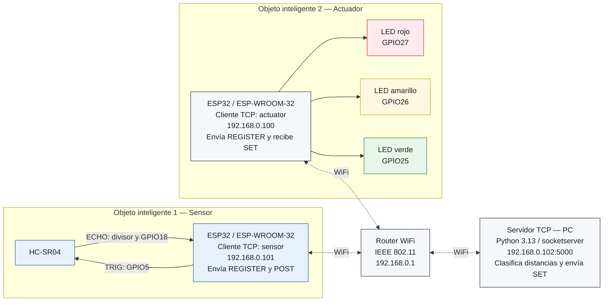
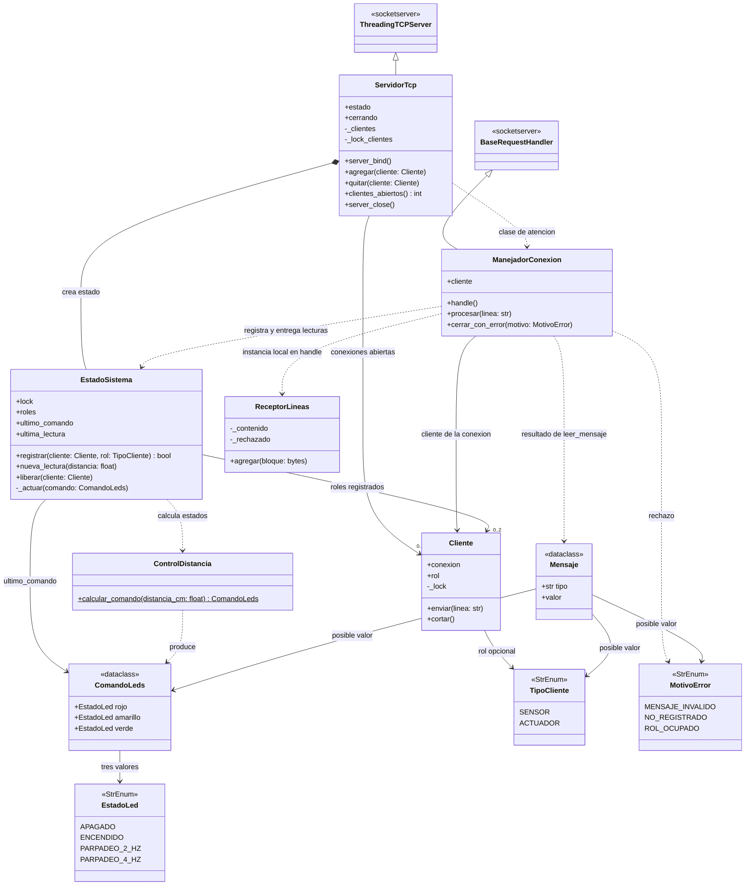
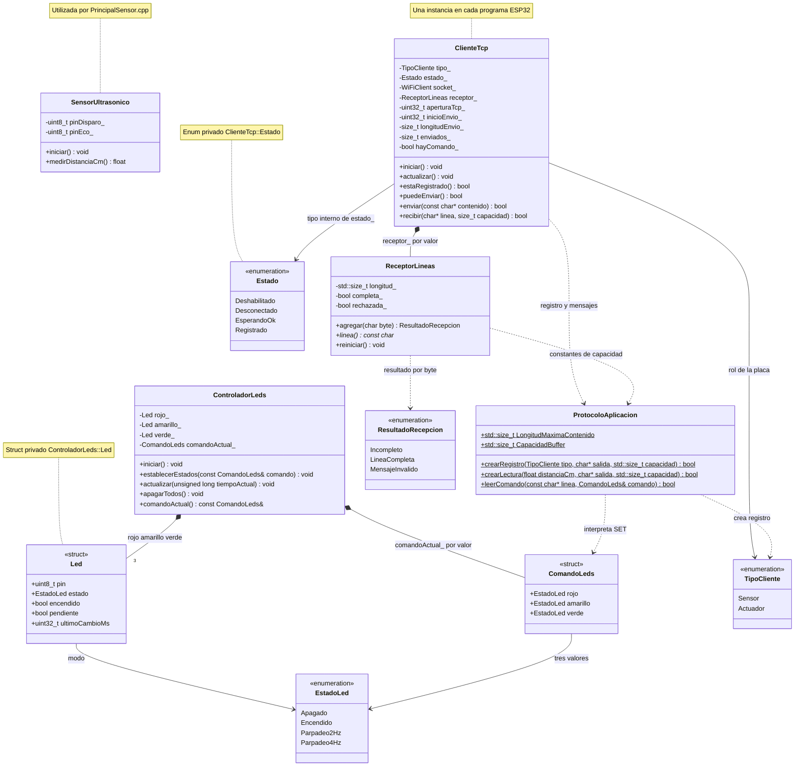

# Informe técnico — Práctica 2

**Actividad:** Integración de Objetos Inteligentes con TCP/IP

**Asignatura:** SIS-234 — Internet de las Cosas

**Grupo:** 8

**Integrantes:** Santiago Javier Torres Vacaflores y Ariel Adrian Mercado Alegre

**Plataformas del proyecto:** firmware para dos ESP32 / ESP-WROOM-32 y servidor para una PC Windows

**Estado del proyecto:** componentes principales implementados; desarrollo y montaje físico realizados conjuntamente según declaración del equipo; evidencias, integración y validación física pendientes de acreditación

## Introducción

La [consigna de la Práctica 2](docs/consigna/Práctica_2.md) exige integrar un objeto inteligente con sensor ultrasónico, otro con actuadores y un servidor TCP central mediante WiFi (IEEE 802.11). El [diseño propuesto](docs/diagramas/Diseno_del_sistema.md) contempla un HC-SR04, tres LEDs y una PC que clasifica las distancias y envía comandos de actuación.

El proyecto dispone de dos programas ESP32 independientes: [PrincipalSensor.cpp](apps/firmware/src/PrincipalSensor.cpp) adquiere y publica la distancia, y [PrincipalActuador.cpp](apps/firmware/src/PrincipalActuador.cpp) recibe órdenes y controla los LEDs. Ambos utilizan [ClienteTcp](apps/firmware/src/ClienteTcp.cpp) para la conexión WiFi/TCP y el registro. La biblioteca C++ común, ubicada en [apps/firmware/lib/Compartido/](apps/firmware/lib/Compartido/), reúne los tipos, el protocolo y el receptor de líneas. El [servidor TCP Python](apps/servidor/servidor.py) concentra la recepción, clasificación y generación de comandos. La estructura vigente corresponde a la simplificación descrita en el [plan de implementación](docs/PLAN_IMPLEMENTACION.md#simplificación-del-código).

Existen [pruebas automatizadas C++](tests/native/) con hardware y red simulados y [pruebas Python](tests/python/) del dominio, protocolo, servidor y simuladores. El [resumen del equipo](docs/RESUMEN_PARA_INFORME.md) informa ejecuciones previas; su incorporación como resultados requiere registros verificables asociados a la versión evaluada. Esta revisión documental constata la implementación y la disponibilidad de pruebas, sin ejecutarlas ni equipararlas con el cumplimiento físico. El equipo declara haber realizado conjuntamente el desarrollo y montaje físico de los componentes. Las fotografías y registros aún no están incorporados al informe; la integración, el funcionamiento sobre WiFi real y las mediciones físicas permanecen sin acreditación mediante resultados verificables, conforme a la [guía de montaje](docs/GUIA_MONTAJE.md) y las [pruebas físicas](docs/PRUEBAS_FISICAS.md).

Los resultados de la Práctica 1 se conservan en [INFORME_P1.md](docs/historico/INFORME_P1.md) como referencia de organización y profundidad; no acreditan el funcionamiento del sistema distribuido de la Práctica 2. El informe describe la implementación vigente y mantiene explícitas las discrepancias y validaciones aún pendientes.

Los marcadores indican información por incorporar: `[PENDIENTE DE IMPLEMENTACIÓN]` para desarrollo y revisión del código, `[PENDIENTE DE MEDICIÓN]` para datos experimentales y `[PENDIENTE DE EVIDENCIA]` para registros verificables. Un resultado esperado es un criterio de prueba, no un resultado obtenido.

## Objetivo general

Diseñar, implementar y validar un sistema distribuido que mida distancias con un sensor ultrasónico, las procese en un servidor TCP y controle tres LEDs en un objeto inteligente independiente, mediante sockets TCP sobre WiFi y un protocolo de aplicación definido por el grupo.

## 1. Requerimientos Funcionales y No Funcionales

Esta sección establece las condiciones que deberá satisfacer el sistema distribuido. Los requerimientos funcionales RF1–RF4 mantienen la numeración y el alcance de la [consigna oficial](docs/consigna/Práctica_2.md); los criterios de aceptación concretan las decisiones del [diseño del equipo](docs/diagramas/Diseno_del_sistema.md). Los requerimientos no funcionales RNF1–RNF5 declaran los atributos de calidad y sus métodos de verificación.

La adquisición y el envío de distancia corresponden al ESP32 sensor; la recepción, clasificación y generación de comandos corresponden al servidor TCP en la PC; la recepción y ejecución de esos comandos corresponden al ESP32 actuador. Esta distribución sitúa el algoritmo de control en el servidor, conforme a la consigna. Los dos programas ESP32, su cliente de red compartido y el servidor Python están implementados. Los estados siguientes identifican el código disponible; ningún requisito se declara plenamente validado sin las evidencias correspondientes.

### 1.1 Requerimientos funcionales y criterios de aceptación

| ID | Funcionalidad requerida | Criterio de aceptación | Componente responsable | Estado de implementación |
|---|---|---|---|---|
| RF1 | Medir la distancia entre el sensor ultrasónico HC-SR04 y un objeto. | Obtener lecturas finitas positivas expresadas en centímetros y contrastarlas con una referencia física mediante PN-02. Ante timeout de ECHO o valor no válido, identificar la lectura como inválida, según PV-04; la tolerancia de medición se evalúa en RNF2. | ESP32 sensor: [SensorUltrasonico](apps/firmware/src/SensorUltrasonico.cpp) adquiere la distancia; [PrincipalSensor.cpp](apps/firmware/src/PrincipalSensor.cpp) planifica la adquisición y publicación mediante `ClienteTcp`. | Adquisición y publicación periódica implementadas. Exactitud y frecuencia físicas: [PENDIENTE DE MEDICIÓN] / [PENDIENTE DE EVIDENCIA]. |
| RF2 | Interpretar cada distancia válida y clasificarla en tres rangos contiguos y sin solapamiento. | Asignar cada distancia finita positiva a exactamente un rango de §1.2. Las entradas de PV-01 a PV-03, incluidos 49.99, 50, 99.99 y 100 cm, deben producir la clasificación prevista y el comando correspondiente. | PC: `ControlDistancia.calcular_comando()` de [dominio.py](apps/servidor/dominio.py), invocado por `EstadoSistema.nueva_lectura()` tras el procesamiento de `POST` en `ManejadorConexion.procesar()`. | Clasificación centralizada implementada exclusivamente en Python; no existe `ControlDistancia` C++. Validación del recorrido con ambas placas: [PENDIENTE DE EVIDENCIA]. |
| RF3 | Activar los tres LEDs del objeto actuador en función del rango, con un comportamiento distinto por rango. | Aplicar el comando completo según §1.2: rojo a 4 Hz, amarillo a 2 Hz o verde fijo, con los demás LEDs apagados; una lectura inválida debe producir todos apagados. Verificar estos estados mediante PV-01 a PV-04 y la continuidad de fase ante comandos idénticos mediante PV-05. | PC: generación de `ComandoLeds` y `SET`; ESP32 actuador: [PrincipalActuador.cpp](apps/firmware/src/PrincipalActuador.cpp) entrega los estados recibidos a [ControladorLeds](apps/firmware/src/ControladorLeds.cpp). | Recepción, ejecución de `ComandoLeds`, parpadeos y conservación de fase implementados. Actuación física y tiempos reales: [PENDIENTE DE MEDICIÓN] / [PENDIENTE DE EVIDENCIA]. |
| RF4 | Enviar lecturas desde el objeto sensor al servidor y comandos desde el servidor al objeto actuador mediante sockets TCP sobre WiFi (IEEE 802.11), utilizando un protocolo de aplicación definido por el grupo. | Establecer una conexión de cada ESP32 hacia la PC, completar `REGISTER` / `OK` y comprobar con registros el recorrido integrado `POST` → clasificación en servidor → `SET` → actuación física. Los mensajes deben respetar la especificación de §2.6; PV-06 a PV-16 verificarán registro, delimitación, rechazo de errores y recuperación previstos. | PC: `ServidorTcp`, `ManejadorConexion`, `Cliente`, `EstadoSistema` y funciones de `protocolo.py`; ambos ESP32: [ClienteTcp](apps/firmware/src/ClienteTcp.cpp), programas principales, `ProtocoloAplicacion` y `ReceptorLineas` C++. | Clientes ESP32, servidor y protocolo implementados. Comunicación TCP sobre WiFi real e integración física: [PENDIENTE DE EVIDENCIA]. Revisión de la diferencia de plazos indicada en §1.3: [PENDIENTE DE EVIDENCIA]. |

Los criterios se relacionan con el diseño y las validaciones mediante la matriz de §2.7. Las pruebas disponibles con entradas controladas al servidor permiten evaluar los límites exactos de RF2 sin confundirlos con el error físico del sensor; las pruebas del recorrido integrado deberán comprobar conjuntamente adquisición, comunicación y actuación. La revisión del código y las evidencias de §4 serán necesarias para declarar el cumplimiento de cada requisito. La matriz de §2.7, las tablas de §4 y la especificación de §2.6 relacionan el código vigente con las pruebas disponibles y distinguen las discrepancias de los criterios de aceptación.

### 1.2 Rangos y lógica de control

Para la clasificación, se considera válida una distancia finita mayor que cero, expresada en centímetros. El dominio Python implementa la siguiente lógica de generación de estados y el firmware actuador incluye su ejecución; la comprobación física permanece pendiente:

| Distancia recibida | LED rojo | LED amarillo | LED verde |
|---|---|---|---|
| Lectura inválida | Apagado | Apagado | Apagado |
| 0 < distancia < 50 cm | Parpadeo a 4 Hz | Apagado | Apagado |
| 50 ≤ distancia < 100 cm | Apagado | Parpadeo a 2 Hz | Apagado |
| distancia ≥ 100 cm | Apagado | Apagado | Encendido fijo |

Los intervalos válidos son `(0, 50)`, `[50, 100)` y `[100, +∞)`. El valor 50 cm pertenece únicamente al rango amarillo y 100 cm únicamente al verde: cada límite se excluye del intervalo anterior y se incluye en el siguiente. De esta forma, no existen huecos ni solapamientos para las distancias finitas positivas. La lectura inválida constituye un estado de tratamiento de error, no un cuarto rango de distancia.

En el protocolo, `off` representa apagado y `on` encendido fijo. `blink_4` representa cuatro ciclos completos por segundo: un período de 250 ms, con 125 ms encendido y 125 ms apagado. `blink_2` representa dos ciclos completos por segundo: un período de 500 ms, con 250 ms encendido y 250 ms apagado. Estas frecuencias describen ciclos completos, no el número de alternancias del GPIO. `ControladorLeds` implementa esas alternancias mediante `millis()`: un modo nuevo comienza encendido y un modo repetido conserva su fase y temporización. Esto evita que el envío periódico de comandos reinicie el patrón; las frecuencias efectivas deberán medirse con el montaje.

Un timeout de ECHO produce una lectura no finita en `SensorUltrasonico`. El codificador C++ transforma las lecturas no finitas, cero o negativas en `POST distance=invalid`; también normaliza como inválidas las distancias inferiores a 0.01 cm, según el umbral implementado para la representación decimal. El servidor interpreta `invalid` como una lectura inválida y genera `SET` con los tres estados `off`. El token `invalid` es válido dentro del protocolo; un mensaje mal formado o una distancia numérica cero o negativa recibida directamente se rechazan conforme a sus reglas. Esta distinción evita tratar un fallo de comunicación como una medición válida.

El diseño también prevé el apagado al iniciar el actuador, ante una desconexión detectada y tras 2000 ms de ausencia de lecturas en el servidor o de comandos en el actuador, según corresponda. El firmware implementa el apagado inicial, el apagado ante pérdida de registro y el temporizador de 2000 ms sin `SET` completo consumido por el programa actuador, conservando la conexión en este último caso. `ClienteTcp` implementa los reintentos de ambos ESP32. El servidor registra roles, rechaza mensajes e invalida los datos y ordena apagar al liberar el sensor, incluido el cierre por timeout de recepción. Ese timeout difiere del plazo desde el último mensaje completo del diseño, como se explica en §1.3. Son comportamientos complementarios de RF3 y RF4, relacionados con PV-06 a PV-16; su validación integrada permanece [PENDIENTE DE EVIDENCIA].

El dominio de clasificación no impone un límite superior de 150 cm ni excluye valores positivos inferiores a 3 cm. En cambio, **3 a 150 cm es el intervalo previsto para validar físicamente la exactitud** de RNF2. La cobertura lógica de los rangos no demuestra que el sensor cumpla la tolerancia fuera de ese intervalo ni que ya la cumpla dentro de él. Su cobertura experimental y sus resultados permanecen `[PENDIENTE DE MEDICIÓN]` y `[PENDIENTE DE EVIDENCIA]`.

### 1.3 Requerimientos no funcionales

Los cuatro atributos cuantitativos adoptan los valores de referencia de la consigna como objetivos del equipo y mantienen pendiente su validación física para la Práctica 2. RNF5 concreta la exigencia de código legible, modular, orientado a objetos y documentado mediante una revisión verificable. Su alcance incluye el servidor Python, ambos firmwares C++ y la biblioteca C++ de tipos, protocolo y recepción de líneas; las reglas de distancia pertenecen exclusivamente al dominio Python.

| ID | Atributo de calidad | Criterio de aceptación | Método de verificación | Componente o alcance afectado | Estado de validación |
|---|---|---|---|---|---|
| RNF1 | Estabilidad | Operar durante al menos 10 minutos continuos, con cero reinicios y cero bloqueos, manteniendo la adquisición, el intercambio TCP y la respuesta de los LEDs. | PN-01: registrar inicio, fin y eventos de los tres equipos; observar continuidad de lecturas y actuación, y documentar cualquier interrupción. | Sistema distribuido completo: ESP32 sensor, servidor TCP y ESP32 actuador. | [PENDIENTE DE MEDICIÓN] / [PENDIENTE DE EVIDENCIA] |
| RNF2 | Exactitud de medición | Mantener un error absoluto máximo ≤ 3 cm respecto de una referencia física dentro del intervalo previsto de 3 a 150 cm. | PN-02: comparar lecturas individuales con una regla o cinta métrica en posiciones que cubran los tres rangos y los extremos del intervalo; calcular el valor absoluto de cada diferencia y su máximo. Registrar referencias, repeticiones y condiciones del ensayo. | HC-SR04, circuito y adquisición del ESP32 sensor; comprobar la conservación del valor comunicado al servidor. | [PENDIENTE DE MEDICIÓN] / [PENDIENTE DE EVIDENCIA] |
| RNF3 | Tiempo de respuesta extremo a extremo | Reflejar cada cambio de rango ensayado en el estado visible del actuador en un tiempo máximo de 1 s desde el cambio físico de distancia. | PN-03: registrar el cambio físico y la actuación con una grabación o instrumento de tiempo común; calcular la diferencia temporal por ensayo y el máximo observado, indicando resolución y transiciones evaluadas. | Recorrido completo sensor → servidor → actuador, incluidos adquisición, red, procesamiento y ejecución del comando. | [PENDIENTE DE MEDICIÓN] / [PENDIENTE DE EVIDENCIA] |
| RNF4 | Frecuencia de muestreo | Obtener al menos 2 lecturas/s durante la operación registrada del sensor. | PN-04: contar lecturas obtenidas durante una ventana de duración conocida y calcular cantidad/duración; contabilizar por separado lecturas inválidas y `POST` recibidos en el servidor para contrastar adquisición y recepción. | Planificación de adquisición en ESP32 sensor; recepción en servidor como comprobación del envío. | [PENDIENTE DE MEDICIÓN] / [PENDIENTE DE EVIDENCIA] |
| RNF5 | Calidad del código | Presentar módulos con responsabilidades delimitadas, clases que encapsulen estado y operaciones, interfaces documentadas, nombres y convenciones consistentes en Python y C++, y reglas de control separadas del hardware y los sockets. | Revisión de §3.4 sobre una versión identificada del código final: inspeccionar módulos, clases, interfaces y dependencias en ambos lenguajes; registrar por criterio el cumplimiento, el archivo o fragmento que lo respalda y los ajustes pendientes. | Servidor Python, firmware C++ de ambos ESP32 y biblioteca C++ de tipos, protocolo y recepción de líneas. | Separación de responsabilidades identificada en el código disponible. Revisión integral documentada: [PENDIENTE DE EVIDENCIA]. |

Para RNF2, la aceptación se basará en el **máximo de los errores absolutos individuales**, no únicamente en el promedio; este último podría ocultar lecturas que excedan la tolerancia. Las lecturas inválidas se registrarán por separado y no se usarán como errores numéricos. La conclusión experimental deberá indicar las posiciones realmente ensayadas y sus condiciones, sin generalizar a distancias no probadas.

Para RNF3, el origen temporal será el cambio físico de distancia y el final el cambio visible correspondiente del LED. Así se incluirá la espera hasta la siguiente adquisición y todo el recorrido de comunicación y control. No se restarán directamente timestamps de relojes de equipos distintos sin una referencia temporal común. El análisis de temporización del diseño podrá apoyar la explicación, pero no sustituirá la medición extremo a extremo exigida por la consigna.

La revisión de RNF5 deberá comprobar, en particular, que el sensor adquiere y comunica, el servidor clasifica y produce comandos, y el actuador ejecuta los estados recibidos. También verificará la encapsulación de pines y conexiones, la coherencia entre declaraciones y uso de interfaces, constantes con nombres descriptivos y comentarios que expliquen unidades, temporización y tratamiento de errores. En Python se revisarán `ServidorTcp`, `ManejadorConexion`, `Cliente` y `EstadoSistema` de [servidor.py](apps/servidor/servidor.py), el dominio y el protocolo. En C++ se revisarán `SensorUltrasonico`, `ControladorLeds` y `ClienteTcp`, la biblioteca común y los programas principales, que contienen `setup()` y `loop()` y no son clases. La lista de revisión deberá contrastar cada interfaz con sus declaraciones y llamadas, comprobar la sincronización del estado y los envíos del servidor y registrar por criterio un enlace al código, el hallazgo y cualquier ajuste pendiente. Las convenciones se evaluarán de acuerdo con cada lenguaje; la disponibilidad de módulos separados no basta para aprobar toda la revisión.

Los **valores objetivo** son los límites de aceptación de la tabla. Los **parámetros implementados** incluyen 250 ms entre adquisiciones del sensor registrado y con capacidad de envío, un timeout de ECHO de 30000 µs y 2000 ms sin comandos en el actuador. `ClienteTcp` configura 2000 ms para recibir `OK` desde la apertura TCP completada, 2000 ms para un envío pendiente y 2000 ms entre reintentos TCP; la apertura TCP puede esperar hasta 1000 ms. Tras perder WiFi espera 2000 ms para reintentar y luego deja 10000 ms entre intentos de asociación. La adquisición se omite mientras no hay registro o existe un envío pendiente, sin acumular lecturas para una conexión futura. Los 250 ms equivalen nominalmente a 4 lecturas/s; no garantizan la frecuencia observada, la estabilidad ni la respuesta extremo a extremo.

En el servidor, `PLAZO = 2.0` configura el timeout de las operaciones del socket mediante `settimeout()`. La espera de `recv()` vence si no recibe datos durante esa operación; un fragmento recibido permite iniciar otra espera, aunque todavía no haya una línea completa. **No equivale al plazo de 2000 ms desde la apertura sin registro completo o desde el último `POST` completo descrito por el diseño.** El código sí comprueba por separado la antigüedad de la última lectura al registrar un actuador. La diferencia de supervisión queda pendiente de revisión técnica y evidencia, especialmente para PV-12 y PV-13 con mensajes incompletos; no se modifican sus objetivos ni se declara satisfecho ese comportamiento.

Los **resultados medidos** se incorporarán en §4 y §5 con la versión de software y sus evidencias. La ejecución automatizada documentada por el equipo deberá respaldarse con registros; no sustituye las mediciones físicas de RNF1–RNF4 ni la revisión integral de RNF5. Los resultados de la Práctica 1 no acreditan estos requisitos de la Práctica 2.

## 2. Análisis y Diseño

Esta sección integra los circuitos diseñados y los diagramas de arquitectura, clases y secuencias contrastados con el software vigente. La correspondencia eléctrica con el montaje definitivo y los comportamientos físicos siguen pendientes de validación.

### 2.1 Arquitectura distribuida del sistema

La arquitectura separa la adquisición de distancia, el procesamiento de las lecturas y la actuación física en tres equipos: **ESP32 sensor → servidor TCP Python → ESP32 actuador**. Esta distribución responde al sistema exigido por la consigna y delimita las responsabilidades de RF1–RF4: el sensor obtiene los datos, la PC toma la decisión de control y el actuador ejecuta sus órdenes. Los dos programas ESP32 están implementados de forma independiente; el programa local de la Práctica 1 ya no forma parte de los entornos activos. La correspondencia con el montaje definitivo permanece pendiente de evidencia.

El firmware utiliza C++ con Arduino y los entornos definidos en [platformio.ini](platformio.ini). `sensor`, predeterminado, selecciona `PrincipalSensor.cpp`, `ClienteTcp.cpp` y `SensorUltrasonico.cpp` para la placa `esp32doit-devkit-v1`; `actuador` selecciona `PrincipalActuador.cpp`, `ClienteTcp.cpp` y `ControladorLeds.cpp` para `esp32dev`. Cada selección incluye únicamente el programa principal de su rol y ambos reutilizan la biblioteca de `apps/firmware/lib/Compartido/`.

En el flujo implementado, [PrincipalSensor.cpp](apps/firmware/src/PrincipalSensor.cpp) mide con `SensorUltrasonico` después del registro y cuando el intervalo y la disponibilidad de envío lo permiten. `ProtocoloAplicacion` genera `POST` y `ClienteTcp` lo transmite. En la PC, `ManejadorConexion.procesar()` interpreta la línea mediante [protocolo.py](apps/servidor/protocolo.py) y llama a `EstadoSistema.nueva_lectura()`. La clasificación corresponde exclusivamente a `ControlDistancia.calcular_comando()` de [dominio.py](apps/servidor/dominio.py); el estado del servidor conserva el último comando y su tiempo de recepción y envía `SET` al actuador registrado.

En el otro ESP32, `ClienteTcp` valida las líneas recibidas y conserva el último `SET` completo para el programa principal; un comando aún no consumido puede ser reemplazado por otro más reciente. [PrincipalActuador.cpp](apps/firmware/src/PrincipalActuador.cpp) convierte ese contenido en `ComandoLeds`, lo entrega a `ControladorLeds` y actualiza las salidas y los parpadeos. El actuador no clasifica distancias. La biblioteca común contiene [Tipos.h](apps/firmware/lib/Compartido/Tipos.h), [ProtocoloAplicacion](apps/firmware/lib/Compartido/ProtocoloAplicacion.h) y [ReceptorLineas](apps/firmware/lib/Compartido/ReceptorLineas.h); Python tiene sus propios tipos y funciones y no ejecuta código de esa biblioteca C++. La interoperabilidad depende del protocolo ASCII delimitado por LF, no de compartir un binario entre lenguajes.

El [servidor simplificado](apps/servidor/servidor.py) utiliza `socketserver.ThreadingTCPServer`, con un hilo por conexión aceptada. `ManejadorConexion` recibe mediante sockets bloqueantes con timeout y `Cliente.enviar()` utiliza `sendall`; no emplea `Sesion`, `ColaEnvio` ni `select`. `EstadoSistema` protege los roles y la última lectura con un `threading.Lock`, y cada `Cliente` serializa sus envíos con otro bloqueo porque el hilo del sensor puede escribir en la conexión del actuador. Los envíos de registro y actuación también se realizan con el bloqueo del estado tomado; un envío lento puede retrasar otras operaciones. Este modelo de concurrencia no demuestra por sí mismo el cumplimiento del tiempo de respuesta de RNF3. `time.monotonic()` permite evaluar la antigüedad de la lectura y `logging` registra los intercambios.

El siguiente diagrama conserva el [despliegue del diseño del equipo](docs/diagramas/Diseno_del_sistema.md#11-diagrama-de-despliegue), coherente con la distribución implementada. Los enlaces y equipos del montaje físico deben verificarse. **Todas las direcciones IP son ilustrativas.** El puerto TCP `5000` es el valor predeterminado comprobado en el código, no una configuración del montaje ya verificada.



Las líneas discontinuas representan los enlaces WiFi bidireccionales previstos a través del router, que proporciona conectividad IP entre los equipos de la red local. El router transporta el tráfico y no participa en la clasificación ni en la generación de comandos. Los enlaces de red deben distinguirse del flujo de aplicación: las lecturas se dirigen del sensor al servidor y las órdenes del servidor al actuador; comprobar ese recorrido con las placas permanece pendiente.

En el modelo cliente-servidor implementado, **ambos ESP32 inician su propia conexión TCP persistente hacia la PC** mediante una instancia de `ClienteTcp` por placa. El servidor escucha, acepta conexiones, responde al registro y envía órdenes por el socket del actuador; la PC no abre una conexión nueva hacia este objeto. `REGISTER` identifica el rol y ambos programas esperan `OK` antes de operar. El firmware configura WiFi en modo estación y permite obtener la dirección local mediante DHCP; las direcciones efectivas aún deben registrarse durante el montaje.

En los ESP32, `ClienteTcp.actualizar()` atiende envío y recepción con `send` y `recv` de lwIP y `MSG_DONTWAIT`, conserva fragmentos y el progreso del único envío pendiente y gestiona los reintentos. Esto no hace que todo el firmware sea no bloqueante: `connect` puede esperar hasta 1000 ms y la adquisición de ECHO hasta 30000 µs. El actuador supervisa localmente la ausencia de comandos. En la PC, el timeout de 2 s se aplica a las operaciones del socket; la llegada de fragmentos puede prolongar la espera de una línea completa. La diferencia respecto del plazo del diseño queda pendiente de revisión técnica conforme a §1.3.

La entrada de consola de [__main__.py](apps/servidor/__main__.py) define `--ip` con valor predeterminado `0.0.0.0` y `--puerto` con valor predeterminado `5000`, coincidentes con el constructor de `ServidorTcp`. `0.0.0.0` indica escucha en las interfaces IPv4 locales; no es una dirección de destino para los ESP32. Los clientes deberán utilizar la IPv4 real de la PC y el puerto efectivo. Esa configuración y la conectividad WiFi deberán comprobarse durante la integración física.

La configuración de ejemplo [ConfiguracionRed.example.h](apps/firmware/include/ConfiguracionRed.example.h) contiene SSID vacío e IP `0.0.0.0`; con esos valores, `ClienteTcp` deshabilita los intentos de conexión. El archivo local y la carga de cada entorno deberán prepararse según la guía de montaje; la existencia del ejemplo no acredita una configuración de red operativa.

| Componente | Responsabilidad | Intercambio principal | Estado actual |
|---|---|---|---|
| ESP32 sensor y HC-SR04 | Adquirir distancia con intervalo nominal de 250 ms, condicionado al registro y la disponibilidad de envío; comunicar lecturas válidas o inválidas. | Enviar `REGISTER type=sensor` y `POST`; recibir `OK` o `ERROR`. | `PrincipalSensor`, `SensorUltrasonico` y `ClienteTcp` implementados. Exactitud y cadencia físicas: [PENDIENTE DE MEDICIÓN]. Integración: [PENDIENTE DE EVIDENCIA]. |
| PC / servidor TCP Python | Registrar clientes, clasificar lecturas, generar comandos y atender la ausencia de datos con el timeout implementado. | Recibir `REGISTER` y `POST`; enviar `OK`, `ERROR` y `SET`. | Servidor, dominio y protocolo implementados; diferencia de plazos pendiente de revisión técnica. Integración con las placas: [PENDIENTE DE EVIDENCIA]. |
| ESP32 actuador y tres LEDs | Ejecutar el último comando recibido, conservar la fase de modos repetidos y supervisar la ausencia de comandos. | Enviar `REGISTER type=actuator`; recibir `OK`, `ERROR` y `SET`. | `PrincipalActuador`, `ControladorLeds` y `ClienteTcp` implementados. Actuación y tiempos físicos: [PENDIENTE DE MEDICIÓN] / [PENDIENTE DE EVIDENCIA]. |
| Router WiFi | Proporcionar conectividad IP entre los tres equipos. | Previsto: transportar el tráfico de las dos conexiones TCP sobre IEEE 802.11. | Configuración y conectividad del montaje: [PENDIENTE DE EVIDENCIA]. |

La comunicación se organiza en las cuatro capas del modelo TCP/IP utilizado en la práctica:

| Capa | Elemento del diseño y estado actual | Función en el sistema |
|---|---|---|
| Aplicación | Protocolo de texto del grupo, descrito en §2.6; implementaciones independientes Python y C++. | Definir los mensajes de registro, lectura, actuación y error, así como su delimitación. |
| Transporte | TCP y sockets; servidor Python y clientes ESP32 implementados, con puerto predeterminado `5000`. | Mantener las conexiones de los clientes y transportar el flujo ordenado de bytes. |
| Internet | IPv4; configuración real de la red local pendiente. | Identificar los equipos mediante direcciones IP. |
| Acceso a la red | WiFi, IEEE 802.11; gestión de conectividad implementada en `ClienteTcp`, asociación real pendiente de evidencia. | Proporcionar el enlace de los equipos con el router. |

Los componentes principales de adquisición, transporte, clasificación y actuación están implementados y cuentan con pruebas automatizadas disponibles. La ejecución de esas pruebas y sus registros deben distinguirse de la integración con hardware. La identificación de la red, las IP reales, el puerto utilizado y la comprobación del recorrido completo permanecen `[PENDIENTE DE EVIDENCIA]`; las mediciones físicas de desempeño permanecen `[PENDIENTE DE MEDICIÓN]`.

### 2.2 Circuito del objeto sensor

El objeto sensor diseñado comprende un ESP32 / ESP-WROOM-32, un HC-SR04 y tres resistencias de 2.2 kΩ que forman el divisor resistivo de ECHO. El ESP32 se alimentará por USB de 5 V y suministrará la alimentación del sensor desde VIN / 5 V. El siguiente esquema corresponde exclusivamente al objeto de adquisición de la Práctica 2:


Las conexiones conservan la asignación del [diseño del objeto sensor](docs/diagramas/Diseno_del_sistema.md#31-objeto-inteligente-con-sensor):

| Elemento o señal | Conexión prevista | Función |
|---|---|---|
| Alimentación del ESP32 | USB de 5 V. | Alimentar la placa del objeto sensor. |
| HC-SR04 VCC | VIN / 5 V del ESP32. | Alimentar el sensor ultrasónico. |
| HC-SR04 GND | GND del ESP32. | Establecer una referencia eléctrica común para alimentación y señales. |
| HC-SR04 TRIG | GPIO5 del ESP32. | Recibir el pulso de disparo generado por el microcontrolador. |
| HC-SR04 ECHO | ECHO → R1 de 2.2 kΩ → nodo conectado a GPIO18. | Conducir el pulso de eco hacia la entrada mediante el divisor. |
| Retorno del divisor | Nodo GPIO18 → R2 de 2.2 kΩ → R3 de 2.2 kΩ → GND. | Formar la rama inferior de 4.4 kΩ del divisor. |

El firmware utiliza GPIO5 para generar TRIG y GPIO18 para medir la duración de ECHO. [SensorUltrasonico.cpp](apps/firmware/src/SensorUltrasonico.cpp) implementa el pulso de 10 µs y el timeout de 30000 µs previstos por el diseño. Son parámetros de código; su comportamiento eléctrico y la exactitud física siguen pendientes. La lectura inválida se trata conforme a §1.2.

El divisor es necesario porque ECHO utiliza una señal de 5 V, superior al nivel lógico de 3.3 V del ESP32. El diseño evita conectar ECHO directamente a GPIO18: R1 se sitúa entre ECHO y el nodo de lectura, mientras R2 y R3 están en serie entre ese nodo y GND. La tensión ideal en el nodo se obtiene mediante:

```text
Rsuperior = R1 = 2.2 kΩ
Rinferior = R2 + R3 = 2.2 kΩ + 2.2 kΩ = 4.4 kΩ
VGPIO18 = VECHO × Rinferior / (Rsuperior + Rinferior)
VGPIO18 = 5 V × 4.4 kΩ / (2.2 kΩ + 4.4 kΩ)
VGPIO18 ≈ 3.33 V
```

Este resultado es un cálculo ideal con los valores nominales del diseño, no una tensión medida ni una validación eléctrica del montaje. La tierra común une el ESP32, el HC-SR04 y el retorno del divisor dentro de este objeto. El segundo ESP32 corresponde al circuito independiente de actuación. El equipo declara el montaje conjunto de los componentes; la comunicación prevista por WiFi y las condiciones eléctricas siguen pendientes de evidencia verificable.

**Parámetros de adquisición:** implementados; comprobación con el HC-SR04 real: [PENDIENTE DE MEDICIÓN] / [PENDIENTE DE EVIDENCIA]

**Montaje realizado según declaración conjunta del equipo; fotografías, lista definitiva de componentes y correspondencia verificada con el esquema:** [PENDIENTE DE EVIDENCIA]

**Comprobación de la alimentación y tensión real del nodo ECHO:** [PENDIENTE DE MEDICIÓN]

### 2.3 Circuito del objeto actuador

El objeto actuador diseñado comprende un segundo ESP32 / ESP-WROOM-32, tres LEDs —rojo, amarillo y verde— y tres resistencias de 220 Ω, una por LED. La placa se alimentará mediante USB de 5 V. Los LEDs serán controlados por señales GPIO de 3.3 V, según el esquema; la alimentación USB no equivale a aplicar 5 V a estas salidas.


Las tres ramas conservan la polaridad y las conexiones del [diseño del objeto actuador](docs/diagramas/Diseno_del_sistema.md#32-objeto-inteligente-con-actuadores):

| Elemento | Conexión prevista |
|---|---|
| Alimentación del ESP32 | USB de 5 V. |
| LED verde | GPIO25 → ánodo del LED → cátodo → resistencia RV de 220 Ω → GND. |
| LED amarillo | GPIO26 → ánodo del LED → cátodo → resistencia RA de 220 Ω → GND. |
| LED rojo | GPIO27 → ánodo del LED → cátodo → resistencia RR de 220 Ω → GND. |
| Retorno común | Las tres resistencias retornan al GND de este ESP32. |

Cada resistencia se conecta en serie con su LED para limitar la corriente de su rama. El retorno compartido proporciona la referencia eléctrica común del objeto actuador. Con esta polaridad, un nivel alto en el GPIO encenderá el LED y un nivel bajo lo apagará; la alternancia temporizada producirá el parpadeo. El esquema no incluye el HC-SR04, que pertenece al objeto sensor independiente.

El servidor genera `SET` después de clasificar la lectura. El firmware actuador valida y consume el último comando completo pendiente, lo entrega a `ControladorLeds` y atiende las salidas y el parpadeo mediante `millis()`. Esta separación distingue la decisión de control en la PC de su ejecución en el actuador; ambas están implementadas, con comprobación física pendiente. Los rangos y frecuencias se definen en §1.2; el circuito aporta las salidas necesarias para representarlos.

**Recepción y control de salidas:** implementados; correspondencia con la actuación física: [PENDIENTE DE MEDICIÓN] / [PENDIENTE DE EVIDENCIA]

**Montaje realizado según declaración conjunta del equipo; fotografías, lista definitiva de componentes y correspondencia verificada con el esquema:** [PENDIENTE DE EVIDENCIA]

### 2.4 Diagrama de clases

Este apartado representa la estructura del código vigente, después de la implementación de los dos clientes ESP32 y de la simplificación descrita en el [plan de implementación](docs/PLAN_IMPLEMENTACION.md#simplificación-del-código). Se utilizan dos diagramas porque **Python y C++ tienen implementaciones independientes de sus tipos y del protocolo**: el servidor no invoca la biblioteca C++. La distribución de responsabilidades corresponde a RF1–RF4 de §1.1 y a la arquitectura de §2.1.

Los diagramas seleccionan atributos y operaciones relevantes; las declaraciones completas están en los archivos de la tabla de §2.4.4. El signo `+` identifica miembros públicos y `-` miembros internos; en Python, este último expresa la convención del prefijo `_`, no una restricción de acceso del lenguaje. El sufijo `$` indica una operación estática. Las flechas discontinuas representan dependencias de uso; las continuas, asociaciones; el rombo lleno, composición, y el triángulo vacío, herencia.

#### 2.4.1 Servidor Python

La PC separa el servicio TCP en `servidor.py`, las reglas de control en `dominio.py` y la interpretación del protocolo en `protocolo.py`. Las dos clases externas del diagrama pertenecen a `socketserver`, de la biblioteca estándar.



`ServidorTcp` hereda de `socketserver.ThreadingTCPServer`, crea un `EstadoSistema` y conserva el conjunto de conexiones abiertas en `_clientes`, protegido por `_lock_clientes`. La biblioteca estándar atiende cada conexión mediante un hilo y una instancia de `ManejadorConexion`, derivada de `BaseRequestHandler`. Este manejador crea un `Cliente` para el socket aceptado y un `ReceptorLineas` local en `handle()`; recibe bloques, procesa líneas completas y libera el rol al finalizar. El receptor no es un atributo de `Cliente`. Las operaciones heredadas, como `serve_forever()`, no se presentan como métodos redefinidos.

`Cliente` mantiene el socket en `conexion`, el rol en `rol` y un bloqueo de envío en `_lock`. Su método `enviar()` codifica la línea y utiliza `sendall()`; `cortar()` solicita el cierre mediante `shutdown()`. El bloqueo evita mezclar envíos de distintos hilos hacia un mismo socket. `EstadoSistema` coordina hasta un sensor y un actuador registrados, conserva `ultimo_comando` y almacena en `ultima_lectura` el instante de recepción, no la distancia ni un historial de lecturas.

El estado compartido se protege con `threading.Lock`. `registrar()` reserva un rol, `nueva_lectura()` invoca la clasificación y `liberar()` invalida los datos al perder el sensor; `_actuar()` genera y envía el comando al actuador. Los envíos de registro y actuación se realizan con el bloqueo de estado tomado, además del bloqueo propio de `Cliente`. Por ello, un envío lento puede retrasar otras operaciones. El servidor usa sockets bloqueantes con timeout; la diferencia entre este timeout y el plazo desde el último mensaje completo sigue siendo la indicada en §1.3 y §2.1.

`ControlDistancia.calcular_comando()` es estático y concentra las reglas de §1.2. `ComandoLeds` y `Mensaje` son `dataclass(frozen=True)`; `EstadoLed`, `TipoCliente` y `MotivoError` son enumeraciones `StrEnum`. El campo `Mensaje.valor` puede contener el rol, la distancia, el comando, el motivo de error o `None`. `ReceptorLineas.agregar()` es un generador que conserva fragmentos y entrega líneas sin LF.

La interpretación y construcción del protocolo son **funciones de módulo**: `ManejadorConexion.procesar()` utiliza `leer_mensaje()`; `EstadoSistema._actuar()` utiliza `crear_comando()`; `cerrar_con_error()` utiliza `crear_error()`, y `Cliente.enviar()` utiliza `codificar()`. Los errores de contenido y delimitación se notifican mediante `MensajeInvalido`, excepción derivada de `ValueError`. Estas funciones y la excepción figuran en la tabla, sin introducir una clase ficticia para agruparlas.

#### 2.4.2 Firmware y biblioteca C++

Las clases de hardware y red pertenecen a `apps/firmware/include/` y `apps/firmware/src/`. Los tipos, el codificador y el receptor comunes a ambos ESP32 se encuentran en `apps/firmware/lib/Compartido/`. La clasificación de distancias se ejecuta exclusivamente en Python.



`SensorUltrasonico` encapsula los GPIO de TRIG y ECHO y convierte la duración del eco en centímetros. `ClienteTcp` encapsula la conexión `WiFiClient`, el rol, el estado de registro, los buffers y los temporizadores de conexión y envío. Su enumeración privada `ClienteTcp::Estado` se muestra como `Estado` en el diagrama. `actualizar()` atiende comunicación y reconexión; `enviar()` admite un `POST` del sensor registrado, y `recibir()` entrega al actuador el último `SET` completo pendiente. El cliente conserva un solo envío pendiente y el comando más reciente, sin una cola de estados anteriores.

`ControladorLeds` recibe `ComandoLeds` mediante `establecerEstados()` y guarda una copia en `comandoActual_`. Contiene por valor tres instancias de su estructura privada `ControladorLeds::Led`, representada como `Led`: cada una mantiene pin, modo, nivel de salida, cambio pendiente y tiempo de alternancia. Los campos de la estructura son públicos, aunque el tipo está declarado en la parte privada del controlador. `actualizar()` aplica los cambios y mantiene los parpadeos; un modo repetido conserva su fase. `apagarTodos()` es público y apaga inmediatamente; `comandoActual()` devuelve una referencia constante al comando almacenado. El controlador no recibe distancias ni realiza clasificación local.

`Tipos.h` declara únicamente `EstadoLed`, `ComandoLeds` y `TipoCliente`; el comando comienza con los tres estados apagados. `ResultadoRecepcion` se declara en `ReceptorLineas.h`. Estas enumeraciones y `ClienteTcp::Estado` tienen tipo subyacente de 8 bits. `ProtocoloAplicacion` conserva tres operaciones estáticas: `crearRegistro()`, `crearLectura()` y `leerComando()`. Las dos primeras escriben contenido sin LF en un buffer con capacidad explícita; la tercera valida los tres estados antes de modificar el comando de salida. Sus constantes públicas `static constexpr` fijan 127 bytes de contenido y 128 bytes de buffer. `ClienteTcp` añade LF al transmitir.

`ReceptorLineas` forma parte de `ClienteTcp` por valor, reconstruye líneas en un buffer fijo y notifica el resultado por byte. `linea()` debe consultarse tras `LineaCompleta` y antes de agregar otro byte; `reiniciar()` descarta fragmentos y errores. `estaRegistrado()`, `puedeEnviar()`, `comandoActual()` y `linea()` están declarados `const`; las firmas del diagrama omiten ese calificador final y los constructores para facilitar la lectura. También se omiten miembros auxiliares, como las credenciales, los arrays de envío y recepción y los métodos internos de transporte; sus declaraciones permanecen en las cabeceras enlazadas.

#### 2.4.3 Programas principales y entornos

[PrincipalSensor.cpp](apps/firmware/src/PrincipalSensor.cpp) y [PrincipalActuador.cpp](apps/firmware/src/PrincipalActuador.cpp) contienen las funciones `setup()` y `loop()` del framework Arduino; **no declaran clases con esos nombres**. Cada archivo crea una instancia de `ClienteTcp` con su rol y coordina las clases de hardware que necesita.

En el sensor, `setup()` inicializa `SensorUltrasonico` y el cliente. `loop()` atiende la red y, tras el registro y con disponibilidad de envío, adquiere una lectura cuando corresponde al intervalo nominal de 250 ms. Después utiliza `crearLectura()` y `ClienteTcp.enviar()`; no clasifica distancias ni conserva un historial para enviarlo tras reconectar.

En el actuador, `setup()` inicializa `ControladorLeds` con salidas apagadas y el cliente. `loop()` atiende la red, obtiene el último comando disponible, lo interpreta con `leerComando()` y entrega el resultado a `establecerEstados()`. El mismo ciclo llama a `actualizar()` para los LEDs y supervisa el apagado ante pérdida de registro o ausencia de comandos, conforme a §1.2.

[platformio.ini](platformio.ini) selecciona archivos distintos para evitar incorporar ambos pares de `setup()` y `loop()` en un mismo firmware. El entorno `sensor`, predeterminado, incluye `PrincipalSensor.cpp`, `ClienteTcp.cpp` y `SensorUltrasonico.cpp` para `esp32doit-devkit-v1`; `actuador` incluye `PrincipalActuador.cpp`, `ClienteTcp.cpp` y `ControladorLeds.cpp` para `esp32dev`. Ambos comparten la implementación de `ClienteTcp`, la biblioteca `Compartido` y el esquema de configuración de red; cada placa mantiene sus propias instancias y su propio estado en ejecución.

#### 2.4.4 Responsabilidades, archivos y estado

| Componente o tipo | Lenguaje | Archivo real | Responsabilidad | Estado de implementación |
|---|---|---|---|---|
| `ServidorTcp` | Python | [servidor.py](apps/servidor/servidor.py) | Administrar el servicio, el estado y las conexiones abiertas; heredar la atención por hilos de `socketserver`. | Implementado; integración física: [PENDIENTE DE EVIDENCIA]. |
| `ManejadorConexion` | Python | [servidor.py](apps/servidor/servidor.py) | Reconstruir y procesar líneas por conexión, gestionar errores y liberar el rol al finalizar. | Implementado. |
| `Cliente` | Python | [servidor.py](apps/servidor/servidor.py) | Encapsular socket y rol, serializar envíos con un bloqueo y solicitar el cierre. | Implementado. |
| `EstadoSistema` | Python | [servidor.py](apps/servidor/servidor.py) | Coordinar roles, antigüedad de lectura, clasificación y comandos con estado protegido. | Implementado; revisión de plazos conforme a §1.3 pendiente. |
| `ControlDistancia`, `ComandoLeds`, `EstadoLed` | Python | [dominio.py](apps/servidor/dominio.py) | Clasificar en la PC y representar estados sin depender de GPIO ni sockets. | Implementados. |
| `Mensaje`, `ReceptorLineas`, `TipoCliente`, `MotivoError` | Python | [protocolo.py](apps/servidor/protocolo.py) | Representar mensajes, delimitar líneas y definir roles y motivos de rechazo. | Implementados. |
| `leer_mensaje`, `crear_comando`, `crear_error`, `codificar`; `MensajeInvalido` | Python | [protocolo.py](apps/servidor/protocolo.py) | Interpretar y construir mensajes con funciones de módulo; notificar errores con una excepción. | Implementados. |
| Entrada de consola: `main`, `puerto_valido`, `ipv4_valida`, `ipv4_locales` | Python | [__main__.py](apps/servidor/__main__.py) | Validar argumentos, iniciar el servicio, mostrar direcciones locales y configurar registros. | Funciones implementadas. |
| `ClienteTcp`, `ClienteTcp::Estado` | C++ | [ClienteTcp.h](apps/firmware/include/ClienteTcp.h), [implementación](apps/firmware/src/ClienteTcp.cpp) | Gestionar WiFi/TCP, registro, mensajes y reconexión de cada objeto. | Implementados; WiFi real: [PENDIENTE DE EVIDENCIA]. |
| `SensorUltrasonico` | C++ | [SensorUltrasonico.h](apps/firmware/include/SensorUltrasonico.h), [implementación](apps/firmware/src/SensorUltrasonico.cpp) | Adquirir distancia con el HC-SR04 e identificar ausencia de eco. | Implementado; exactitud física: [PENDIENTE DE MEDICIÓN]. |
| `ControladorLeds`, `ControladorLeds::Led` | C++ | [ControladorLeds.h](apps/firmware/include/ControladorLeds.h), [implementación](apps/firmware/src/ControladorLeds.cpp) | Ejecutar estados, conservar la fase y mantener la temporización y el apagado de LEDs. | Implementados; actuación física: [PENDIENTE DE MEDICIÓN] / [PENDIENTE DE EVIDENCIA]. |
| `ProtocoloAplicacion` | C++ | [ProtocoloAplicacion.h](apps/firmware/lib/Compartido/ProtocoloAplicacion.h), [implementación](apps/firmware/lib/Compartido/ProtocoloAplicacion.cpp) | Crear registro y lectura e interpretar comandos completos. | Implementado y utilizado por ambos programas. |
| `ReceptorLineas`, `ResultadoRecepcion` | C++ | [ReceptorLineas.h](apps/firmware/lib/Compartido/ReceptorLineas.h), [implementación](apps/firmware/lib/Compartido/ReceptorLineas.cpp) | Reconstruir mensajes y comunicar el resultado por byte al cliente. | Implementados y utilizados por `ClienteTcp`. |
| `EstadoLed`, `ComandoLeds`, `TipoCliente` | C++ | [Tipos.h](apps/firmware/lib/Compartido/Tipos.h) | Representar modos de LED, comandos y roles comunes al firmware. | Tipos implementados. |
| Programa sensor: `setup`, `loop` | C++ | [PrincipalSensor.cpp](apps/firmware/src/PrincipalSensor.cpp) | Coordinar adquisición y publicación; utilizar el rol sensor. | Implementado; recorrido físico: [PENDIENTE DE EVIDENCIA]. |
| Programa actuador: `setup`, `loop` | C++ | [PrincipalActuador.cpp](apps/firmware/src/PrincipalActuador.cpp) | Coordinar recepción, ejecución y supervisión local; utilizar el rol actuador. | Implementado; recorrido físico: [PENDIENTE DE EVIDENCIA]. |

La organización mantiene la adquisición y la actuación encapsuladas en C++, la clasificación en el dominio Python y los adaptadores de red separados de las reglas de control. Los tipos con nombres equivalentes en ambos lenguajes son definiciones distintas relacionadas por el protocolo. Esta estructura aporta elementos verificables para la revisión de modularidad y orientación a objetos de RNF5, sin declarar aprobada su revisión integral.

**Integración con las dos placas, mediciones físicas y evidencias de ejecución:** [PENDIENTE DE MEDICIÓN] / [PENDIENTE DE EVIDENCIA]

### 2.5 Diagramas de secuencia

Los dos diagramas describen **comportamientos implementados** de los programas ESP32 y del servidor Python, conforme a la arquitectura de §2.1 y las clases de §2.4. Los mensajes y las distancias son ejemplos, no registros de ejecución. La asociación WiFi, el recorrido con ambas placas y la actuación física permanecen pendientes de evidencia. Cada mensaje de aplicación termina en LF (`\n`), omitido en las etiquetas; `5000` es el puerto predeterminado, sin afirmar una configuración del montaje verificada.

#### 2.5.1 Registro y funcionamiento normal

Se conserva la finalidad de la [secuencia normal del diseño](docs/diagramas/Diseno_del_sistema.md#51-registro-y-funcionamiento-normal). El ejemplo comienza con el actuador, sin una lectura previa; los registros también pueden llegar en el orden inverso. Los participantes agrupan las operaciones de cada equipo para distinguir los intercambios TCP de las llamadas internas.

```mermaid
sequenceDiagram
    participant S as ESP32 sensor
    participant PC as Servidor TCP Python
    participant A as ESP32 actuador

    Note over S,A: Configuracion de red completa; ambos ESP32 ejecutan ClienteTcp.iniciar()
    A->>A: ControladorLeds.iniciar(): salidas apagadas
    S->>S: ClienteTcp.actualizar(): WiFi.begin() y asociacion
    A->>A: ClienteTcp.actualizar(): WiFi.begin() y asociacion
    Note over S,A: WiFi conecta los equipos a traves del router; no clasifica distancias

    A->>PC: Apertura TCP con socket_.connect()
    PC->>PC: ManejadorConexion.handle(): crear Cliente y receptor
    A->>PC: REGISTER type=actuator
    PC->>PC: procesar(): leer_mensaje(); EstadoSistema.registrar()
    PC-->>A: OK
    PC-->>A: SET redLed=off yellowLed=off greenLed=off
    A->>A: ClienteTcp recibe OK y conserva el SET completo
    A->>A: loop(): recibir(), leerComando(), establecerEstados(), actualizar()

    S->>PC: Apertura TCP con socket_.connect()
    PC->>PC: ManejadorConexion.handle(): crear Cliente y receptor
    S->>PC: REGISTER type=sensor
    PC->>PC: procesar(): leer_mensaje(); EstadoSistema.registrar()
    PC-->>S: OK
    S->>S: loop(): habilitar primera adquisicion nueva tras el registro

    loop Primera adquisicion o intervalo de 250 ms, registrado y puedeEnviar()
        S->>S: SensorUltrasonico.medirDistanciaCm(); ProtocoloAplicacion.crearLectura()
        Note over S,PC: ClienteTcp.enviar() prepara POST; actualizar() completa el envio
        Note over PC: Para cada POST aceptado, _actuar() genera SET y Cliente.enviar() usa codificar() y sendall()
        alt Ejemplo de distancia 45.00 cm
            S->>PC: POST distance=45.00
            PC->>PC: procesar() y nueva_lectura(): calcular_comando(45.00)
            PC-->>A: SET redLed=blink_4 yellowLed=off greenLed=off
        else Ejemplo de distancia 75.00 cm
            S->>PC: POST distance=75.00
            PC->>PC: procesar() y nueva_lectura(): calcular_comando(75.00)
            PC-->>A: SET redLed=off yellowLed=blink_2 greenLed=off
        else Ejemplo de distancia 120.00 cm
            S->>PC: POST distance=120.00
            PC->>PC: procesar() y nueva_lectura(): calcular_comando(120.00)
            PC-->>A: SET redLed=off yellowLed=off greenLed=on
        else Ausencia de eco o lectura normalizada como invalida
            S->>PC: POST distance=invalid
            PC->>PC: procesar() y nueva_lectura(): calcular_comando(NaN)
            PC-->>A: SET redLed=off yellowLed=off greenLed=off
        end
        A->>A: ClienteTcp.actualizar(): reconstruir, validar y guardar ultimo SET
        A->>A: loop(): recibir(), leerComando(), establecerEstados(), actualizar()
        Note over A: La recepcion precede al consumo; SET posteriores pueden reemplazar el pendiente
    end
```

**Conexión y registro.** Cada ESP32 usa una instancia de [ClienteTcp](apps/firmware/src/ClienteTcp.cpp). Con configuración válida, `iniciar()` prepara el modo estación y `actualizar()` inicia la asociación mediante `WiFi.begin()`; una vez conectado a WiFi, abre su socket hacia la PC y prepara `REGISTER` con el rol. El cliente acepta `OK` completo únicamente después de terminar de enviar el registro. Antes de ese estado, el sensor no mide ni publica y el actuador permanece apagado.

En la PC, `ServidorTcp` atiende cada conexión mediante `ManejadorConexion.handle()`, que crea un `Cliente` y un `ReceptorLineas` Python. El receptor entrega líneas completas a `ManejadorConexion.procesar()`; esta operación utiliza `leer_mensaje()` y llama a `EstadoSistema.registrar()`. La reserva de un rol libre produce `OK`. Al registrar el actuador, el servidor envía además el último comando si su lectura tiene menos de 2000 ms; si no hay lectura reciente, envía todos apagados. Una lectura reciente inválida también produce apagado. `OK` confirma únicamente el registro.

**Adquisición y publicación.** [PrincipalSensor.cpp](apps/firmware/src/PrincipalSensor.cpp) habilita una primera medición nueva al observar el registro aceptado, sin esperar un intervalo adicional de 250 ms. Las siguientes requieren estar registrado, haber alcanzado el intervalo nominal y que `ClienteTcp.puedeEnviar()` indique ausencia de otro envío pendiente. `SensorUltrasonico.medirDistanciaCm()` adquiere la distancia; `ProtocoloAplicacion.crearLectura()` genera el contenido y `enviar()` lo prepara para transmisión. Después de medir, el principal vuelve a atender el cliente antes de publicar, para comprobar si la conexión se perdió durante la espera de ECHO. El progreso de escritura se conserva hasta completar la línea; preparar el mensaje no significa que ya haya llegado a la PC.

**Interpretación y clasificación.** Para cada `POST` aceptado, `ManejadorConexion.procesar()` llama a `EstadoSistema.nueva_lectura()`. Esta registra el instante de recepción y utiliza `ControlDistancia.calcular_comando()` de [dominio.py](apps/servidor/dominio.py). `distance=invalid` se interpreta como `math.nan`. `EstadoSistema._actuar()` construye `SET` mediante `crear_comando()`, y `Cliente.enviar()` añade LF con `codificar()` y transmite mediante `sendall()`, según [servidor.py](apps/servidor/servidor.py) y [protocolo.py](apps/servidor/protocolo.py). El servidor produce un comando por lectura aceptada si hay actuador registrado, incluso cuando repite los mismos estados. Sin actuador, conserva solo el último comando y su instante de recepción.

**Recepción, consumo y actuación.** En el ESP32 actuador, `ClienteTcp.actualizar()` reconstruye las líneas y valida cada `SET` completo con `ProtocoloAplicacion.leerComando()`. Guarda **solo el último comando completo pendiente de consumo**: otro `SET` puede reemplazarlo antes de que el principal lo consulte. El orden del flujo TCP no implica que se apliquen todos los estados intermedios. [PrincipalActuador.cpp](apps/firmware/src/PrincipalActuador.cpp) utiliza `recibir()`, vuelve a interpretar el contenido como `ComandoLeds` y llama a `ControladorLeds.establecerEstados()`; la modificación de las salidas y la temporización se atienden mediante `actualizar()` en el mismo ciclo.

[ControladorLeds.cpp](apps/firmware/src/ControladorLeds.cpp) mantiene las alternancias locales de 125 ms para `blink_4` y 250 ms para `blink_2`. Un modo nuevo comienza encendido; si el modo de un LED se repite, conserva su fase. Por ello, los comandos periódicos no reinician el parpadeo. El ciclo del actuador continúa actualizando los LEDs entre mensajes; la PC decide los modos y no envía una orden por cada alternancia. No existe confirmación de aplicación por cada `SET`, por lo que un envío TCP no demuestra la actuación física.

#### 2.5.2 Ausencia de datos, desconexión y recuperación

Se conserva la finalidad de la [secuencia de recuperación del diseño](docs/diagramas/Diseno_del_sistema.md#52-ausencia-de-datos-y-recuperación), diferenciando el timeout implementado en la PC y la supervisión local del actuador. Las ramas son situaciones alternativas. Los envíos mostrados presuponen que el servidor y el otro cliente siguen accesibles; generar apagado no garantiza que un objeto desconectado pueda recibirlo.

```mermaid
sequenceDiagram
    participant S as ESP32 sensor
    participant PC as Servidor TCP Python
    participant A as ESP32 actuador

    Note over S,A: Casos alternativos; los roles estan registrados al comenzar
    alt Sensor pierde WiFi/TCP o vence su envio pendiente
        S->>S: ClienteTcp.cerrar(): detener socket y limpiar buffers
        Note over S: Sin registro o con envio pendiente, loop() no adquiere nuevas lecturas
        PC->>PC: handle(): detectar cierre/error o timeout de recv() sin datos
        PC->>PC: EstadoSistema.liberar(): invalidar lectura y generar apagado
        PC-->>A: SET redLed=off yellowLed=off greenLed=off
        A->>A: Consumir comando; establecerEstados() y actualizar()
        opt Se perdio la asociacion WiFi del sensor
            Note over S: Primer reintento tras 2000 ms; siguientes cada 10000 ms
            S->>S: WiFi.begin() y recuperacion de la asociacion
        end
        Note over S,PC: Reintento TCP tras 2000 ms; connect solicita timeout de 1000 ms
        S->>PC: Nueva apertura TCP
        S->>PC: REGISTER type=sensor
        PC->>PC: procesar(): EstadoSistema.registrar()
        PC-->>S: OK
        S->>S: Adquirir una lectura nueva; crearLectura() y enviar()
        S->>PC: POST distance=120.00
        PC->>PC: nueva_lectura(): calcular_comando(120.00) y _actuar()
        PC-->>A: SET redLed=off yellowLed=off greenLed=on
        A->>A: Consumir y aplicar el comando disponible
    else Actuador acumula 2000 ms sin consumir un SET valido
        A->>A: loop(): apagarPorAusencia(); ControladorLeds.apagarTodos()
        Note over A: Conserva TCP y registro si la conexion sigue abierta
        opt Llega un nuevo SET completo valido
            PC-->>A: SET redLed=off yellowLed=blink_2 greenLed=off
            A->>A: recibir(), leerComando(), establecerEstados(), actualizar()
            Note over A: El parpadeo reinicia desde encendido despues del apagado
        end
    else Actuador detecta perdida de conexion o registro
        A->>A: ClienteTcp.cerrar(); loop(): apagarPorAusencia()
        PC->>PC: handle(): liberar rol actuador, conservar datos del sensor
        Note over A: Reintentar TCP; si perdio WiFi, recuperar primero la asociacion
        A->>PC: Nueva apertura TCP
        A->>PC: REGISTER type=actuator
        PC->>PC: procesar(): EstadoSistema.registrar()
        PC-->>A: OK
        alt Ultima lectura valida reciente; ejemplo de 120 cm
            PC-->>A: SET redLed=off yellowLed=off greenLed=on
        else Lectura invalida, antigua o inexistente
            PC-->>A: SET redLed=off yellowLed=off greenLed=off
        end
        A->>A: Consumir y aplicar el ultimo SET completo
    else Servidor rechaza un mensaje del sensor; ejemplo numerico cero
        S->>PC: POST distance=0
        PC->>PC: leer_mensaje() rechaza; cerrar_con_error() libera el sensor
        PC-->>A: SET redLed=off yellowLed=off greenLed=off
        A->>A: Consumir comando y apagar mediante el controlador
        PC-->>S: ERROR reason=invalid_message
        S->>S: ClienteTcp detecta ERROR, cierra y limpia buffers
        Note over S,PC: El servidor finaliza la conexion; el sensor reintenta y repite REGISTER
    end
```

**Sensor: conexión y envío pendiente.** `ClienteTcp.actualizar()` detecta pérdida de WiFi, cierre remoto (`recv() = 0`) o errores fatales de transporte, y llama a `cerrar()`. También cierra si vence el plazo de registro o de un envío pendiente. El cierre detiene el socket, limpia los buffers y elimina el registro local. Mientras un envío sigue pendiente, el principal atiende la red pero omite nuevas adquisiciones; si la conexión se pierde, descarta ese envío. Tras reconectar y recibir `OK`, mide de nuevo y no retransmite lecturas almacenadas de la conexión anterior.

La recuperación WiFi y la TCP tienen temporizaciones diferentes. El primer intento WiFi al iniciar se habilita sin espera; tras una pérdida detectada, se esperan 2000 ms para volver a intentarlo y luego 10000 ms entre llamadas a `WiFi.begin()`, para permitir la asociación en curso. Con WiFi disponible, el reintento TCP se habilita 2000 ms después del cierre o del final del intento fallido anterior. Un socket nuevo reinicia el receptor y exige otro `REGISTER` / `OK`. Los reintentos son responsabilidad de cada ESP32, no del servidor.

**Actuador: desconexión y ausencia de comandos.** Al observar pérdida de registro, `loop()` llama a `apagarPorAusencia()`, que utiliza `ControladorLeds.apagarTodos()`. El apagado ocurre al atender esa condición en el ciclo principal; no se declara un retardo físico medido. Si continúa registrado pero pasan 2000 ms desde el último `SET` completo consumido y válido, apaga los LEDs y conserva el socket. El plazo se inicia al observar la aceptación del registro mientras espera el primer comando y se renueva cuando el principal consume un comando válido; recibir fragmentos no lo renueva.

Un `SET` válido posterior reactiva los modos sin exigir reconexión si el socket se mantuvo abierto. Después de `apagarTodos()`, los modos anteriores son `Apagado`; al establecer de nuevo un parpadeo, este comienza encendido, en lugar de recuperar su fase anterior. Si hubo desconexión, `ClienteTcp` repite asociación cuando corresponda, apertura TCP y registro antes de entregar órdenes al principal.

**Servidor: liberación, errores y restauración.** Cuando el manejador termina por cierre, error o timeout aplicable, su bloque `finally` llama a `EstadoSistema.liberar()` y retira la conexión mediante `ServidorTcp.quitar()`. Liberar al sensor elimina su rol, establece `ultima_lectura = None`, sustituye el comando por todos apagados e intenta enviarlo al actuador registrado. Liberar al actuador conserva los datos del sensor. Un fallo al enviar `SET` libera el rol actuador y solicita cortar su conexión.

`ManejadorConexion.cerrar_con_error()` libera primero el rol del cliente rechazado, intenta transmitir `ERROR`, cierra la dirección de escritura y lee datos restantes antes de finalizar. La entrega de la respuesta depende del socket; no se presenta ese cierre como instantáneo ni como un plazo total estricto de 2000 ms. Un mensaje operativo válido antes del registro produce `not_registered`; sintaxis inválida, segundo registro o mensaje incompatible con el rol producen `invalid_message`; un rol ocupado produce `role_busy`, conservando al cliente original. En el ESP32, `ERROR` o una respuesta inesperada cierran la conexión; un `SET` inválido no aplica estados parciales y provoca el apagado del actuador al perder el registro. El ejemplo `POST distance=0` representa una entrada errónea de prueba: el firmware sensor normaliza cero como `invalid`.

Una conexión nueva puede registrarse cuando su rol esté libre. Al registrar el actuador, `EstadoSistema.registrar()` compara la antigüedad de la última lectura con `time.monotonic()`: si es menor que 2 s, envía el último comando, y en otro caso envía apagado. Una lectura reciente inválida también contiene todos apagados. La comparación de antigüedad sí se hace desde la recepción de la lectura completa; es independiente de la política de timeout del socket.

**Parámetros implementados.** Los valores siguientes proceden de las constantes de [ClienteTcp.h](apps/firmware/include/ClienteTcp.h), los programas principales, [SensorUltrasonico.cpp](apps/firmware/src/SensorUltrasonico.cpp) y `servidor.py`. Son intervalos configurados y condiciones del código, no tiempos experimentales ni garantías de desempeño extremo a extremo.

| Parámetro | Valor configurado | Condición implementada |
|---|---|---|
| Adquisición del sensor | 250 ms nominales | Después de la primera lectura tras el registro; requiere registro y capacidad de envío. |
| Timeout de ECHO | 30000 µs | `pulseIn()` espera el eco; si devuelve cero, la lectura resulta inválida. |
| Reintento TCP | 2000 ms | Desde el cierre o el final del intento fallido anterior, con WiFi disponible. |
| Reintento WiFi tras pérdida | 2000 ms; luego 10000 ms entre intentos | Espera inicial tras la pérdida detectada y margen para completar asociaciones posteriores. |
| Apertura TCP | 1000 ms solicitados | Argumento de timeout de `socket_.connect()`; el intento puede esperar. |
| Registro del cliente ESP32 | 2000 ms | Desde que termina la apertura TCP; debe recibirse `OK` completo tras enviar `REGISTER`. |
| Envío pendiente del cliente | 2000 ms | Desde que se prepara el mensaje; al vencer, cierra y descarta el envío. |
| Watchdog del actuador | 2000 ms | Desde el registro observado o el último comando válido consumido; apaga y conserva la conexión si sigue abierta. |
| Socket del servidor | 2 s por operación | Timeout configurado mediante `settimeout(PLAZO)`; no es un plazo global desde el último mensaje completo. |

Los ESP32 atienden `send` y `recv` con `MSG_DONTWAIT` y temporizadores basados en resta sin signo de `millis()`. Sin embargo, **no todas las operaciones del firmware son completamente no bloqueantes**: `connect` puede esperar y la adquisición utiliza `pulseIn()`. El apagado, la alternancia y las comprobaciones de plazos dependen de cuándo el ciclo vuelve a atenderlos. Por ello, las constantes no sustituyen la medición de RNF3.

**Discrepancia respecto de la supervisión original.** El diseño inicial prevé 2000 ms desde la apertura sin registro completo o desde el último `POST` completo aceptado; los fragmentos no deberían renovar ese plazo. El servidor simplificado configura un timeout por operación: una llamada a `recv()` que recibe un fragmento puede dar paso a otra espera de hasta 2 s, aunque todavía no exista una línea completa. Por tanto, una sesión puede prolongarse más allá del plazo original. En ausencia de datos, un cliente no registrado recibe `ERROR reason=not_registered` y el manejador finaliza; un sensor registrado termina su atención y libera el rol; un actuador registrado puede permanecer en silencio y el manejador continúa esperando.

**Ambas políticas no son equivalentes.** La diferencia queda pendiente de revisión técnica y pruebas específicas de fragmentos prolongados, especialmente PV-12 y PV-13, sin modificar los criterios de §1 ni atribuir al diagrama el plazo estricto anterior. El watchdog local del actuador limita la ausencia de comandos que consume, pero no demuestra que el servidor haya aplicado la política prevista.

Las pruebas disponibles de [cliente TCP](tests/native/cliente_tcp.cpp), [principal sensor](tests/native/principal_sensor.cpp), [principal actuador](tests/native/principal_actuador.cpp) y [controlador de LEDs](tests/native/controlador_leds.cpp) contienen casos de registro, envíos parciales, reintentos, watchdog, último comando y conservación de fase con red, reloj y GPIO simulados. Las del [servidor Python](tests/python/test_servidor.py) contemplan roles, registros, fragmentos, apagado y reconexión mediante sockets locales. Sus casos de timeout comprueban ausencia de datos; no acreditan el plazo original ante fragmentos que llegan durante una sesión prolongada. Esta revisión inspecciona los casos sin ejecutarlos ni declarar su aprobación. Las tablas de §4 y la especificación de §2.6 conservan identificados el alcance de estas pruebas y las discrepancias pendientes.

**Revisión técnica y pruebas específicas de PV-12/PV-13 con fragmentos prolongados:** [PENDIENTE DE EVIDENCIA]

**Registros del recorrido con ambas placas, apagado y recuperación física, y mediciones de tiempos:** [PENDIENTE DE MEDICIÓN] / [PENDIENTE DE EVIDENCIA]

### 2.6 Protocolo de aplicación TCP

TCP transporta un flujo ordenado de bytes; una recepción del socket no equivale necesariamente a un mensaje completo. El protocolo del grupo define contenido, delimitación y significado para RF4. Se implementa en [protocolo.py](apps/servidor/protocolo.py) y en [ProtocoloAplicacion.h](apps/firmware/lib/Compartido/ProtocoloAplicacion.h) y [su implementación C++](apps/firmware/lib/Compartido/ProtocoloAplicacion.cpp), utilizados por los clientes ESP32. Las reglas de clasificación existen exclusivamente en Python. Esta sección distingue la sintaxis, las políticas de sesión y la validación pendiente, precisando los cambios frente al [diseño inicial](docs/diagramas/Diseno_del_sistema.md#6-especificación-del-protocolo-de-aplicación).

#### 2.6.1 Codificación, delimitación y tamaño

| Propiedad | Regla implementada |
|---|---|
| Codificación del contenido | ASCII imprimible: bytes de `0x20` a `0x7E`. La sintaxis restringe además cada campo. |
| Delimitador transmitido | Un byte LF, `0x0A`, al finalizar cada mensaje. |
| Longitud máxima | 127 bytes de contenido más LF: 128 bytes por línea, sin cabeceras TCP/IP. |
| Longitud mínima | Contenido no vacío; un LF aislado se rechaza. |
| Separación y campos | Un espacio ASCII entre comando y argumentos y entre argumentos; `clave=valor`, con nombres y orden exactos. |
| Mayúsculas | Comandos, claves y valores sensibles a mayúsculas. |
| Caracteres rechazados | CR, NUL, tabuladores, otros controles, DEL y bytes fuera del ASCII imprimible. No se admite CRLF. |
| Buffer C++ de contenido | Hasta 127 bytes y un terminador local NUL (`\0`): capacidad de 128 bytes, sin LF. |

No se admiten espacios iniciales o finales, campos adicionales, claves repetidas ni cambios de orden. Pasar la validación de caracteres y longitud no acredita sintaxis correcta: `UNKNOWN` es ASCII, pero no un comando del protocolo.

**Contenido y transmisión son representaciones distintas.** `OK` ocupa dos bytes de contenido; se transmite seguido de LF, tres bytes en total. El buffer C++ guarda `O`, `K` y `\0`; ese NUL no se transmite. `ClienteTcp` copia el contenido al buffer de envío y añade LF. Los receptores retiran el delimitador antes de interpretar. En los ejemplos, `\n` representa un byte LF, no barra invertida y letra `n`. El límite transmitido y la capacidad local coinciden numéricamente, pero reservan su último byte para delimitadores distintos.

#### 2.6.2 Reconstrucción del flujo recibido

Cada conexión tiene su receptor. El [ReceptorLineas Python](apps/servidor/protocolo.py) conserva bytes entre bloques y entrega líneas mediante un generador. El [receptor C++](apps/firmware/lib/Compartido/ReceptorLineas.cpp), declarado en [ReceptorLineas.h](apps/firmware/lib/Compartido/ReceptorLineas.h), recibe un byte por llamada y señala `Incompleto`, `LineaCompleta` o `MensajeInvalido`.

Un registro fragmentado, `REGI` seguido de `STER type=sensor\n`, se interpreta una sola vez tras LF. Los siguientes bloques son ejemplos de **direcciones diferentes**, no contenido mezclado de una conexión:

- Sensor registrado → PC: `POST distance=45.00\nPOST distance=75.00\nPOST dis`. Se entregan dos lecturas completas y se conserva el fragmento de la siguiente.
- PC → actuador: `OK\nSET redLed=off yellowLed=off greenLed=on\nSET redLed=off yellowLed=`. Se reconoce el registro, se valida el comando completo y se conserva el fragmento final.

Una línea de 127 bytes puede esperar LF; un byte adicional de contenido provoca rechazo. Los mensajes completos anteriores a un error posterior del bloque no se deshacen. Un error de delimitación deja el receptor rechazado; Python crea otro para una conexión nueva y C++ lo reinicia. En C++, `linea()` debe consultarse después de `LineaCompleta` y antes de agregar el siguiente byte.

Una línea incompleta no produce una lectura ni un comando, pero **recibir sus fragmentos sí puede prolongar la sesión del servidor**, al iniciar nuevas operaciones de recepción con timeout. Esto difiere del plazo original desde el último mensaje completo, conforme a §2.5.2. En el actuador, cada `SET` completo se valida, pero solo el último pendiente queda disponible para consumo; reconstruir mensajes en orden no garantiza aplicar todos sus estados intermedios.

#### 2.6.3 Mensajes y ejemplos de intercambio

Reconocer sintácticamente una línea no autoriza su uso en cualquier rol o estado.

| Mensaje | Dirección | Sintaxis del contenido | Parámetros | Finalidad y política |
|---|---|---|---|---|
| `REGISTER` | Cliente → PC | `REGISTER type=<tipo>` | `sensor` o `actuator`. | Primer mensaje de aplicación para reservar un rol libre. |
| `OK` | PC → cliente | `OK` | Ninguno. | Confirma exclusivamente el registro; el ESP32 espera la línea completa antes de operar. |
| `POST` | Sensor → PC | `POST distance=<valor>` | Decimal positivo finito en cm o `invalid`. | Se acepta solo desde el sensor registrado. |
| `SET` | PC → actuador | `SET redLed=<estado> yellowLed=<estado> greenLed=<estado>` | Cada estado: `off`, `on`, `blink_2` o `blink_4`. | Orden completa de tres LEDs; el cliente valida y conserva el último comando pendiente. |
| `ERROR` | PC → cliente | `ERROR reason=<motivo>` | `invalid_message`, `not_registered` o `role_busy`. | El servidor intenta notificar el rechazo y finaliza la conexión afectada. |

Los textos entre `< >` son variables descriptivas. `blink_2` y `blink_4` representan ciclos completos por segundo; el firmware implementa las alternancias locales de §1.2. La comprobación física de esas frecuencias sigue pendiente.

Este intercambio ilustrativo distingue los dos sockets y sus direcciones; no constituye evidencia experimental:

| Conexión | Origen | Destino | Línea transmitida |
|---|---|---|---|
| Actuador–PC | Actuador | PC | `REGISTER type=actuator\n` |
| Actuador–PC | PC | Actuador | `OK\n` |
| Actuador–PC | PC | Actuador | `SET redLed=off yellowLed=off greenLed=off\n` |
| Sensor–PC | Sensor | PC | `REGISTER type=sensor\n` |
| Sensor–PC | PC | Sensor | `OK\n` |
| Sensor–PC | Sensor | PC | `POST distance=45.00\n` |
| Actuador–PC | PC | Actuador | `SET redLed=blink_4 yellowLed=off greenLed=off\n` |
| Sensor–PC | Sensor | PC | `POST distance=invalid\n` |
| Actuador–PC | PC | Actuador | `SET redLed=off yellowLed=off greenLed=off\n` |

El apagado inicial presupone ausencia de lectura reciente. Un registro para un rol ocupado recibe `ERROR reason=role_busy\n` en la conexión nueva, conservando al cliente original.

La medición inválida se distingue del mensaje rechazado: `POST distance=invalid` es sintácticamente válido, entrega `math.nan` al dominio y genera apagado. `POST distance=0` o `POST distance=45,00` son inválidos y producen rechazo, no una normalización automática al recibirlos. Un `SET` incompleto o inválido no aplica parcialmente sus campos. El protocolo no incluye confirmación de actuación por cada comando; envío y recepción no demuestran ejecución física.

#### 2.6.4 Representación decimal y conversión numérica

La gramática es `[0-9]+(?:\.[0-9]+)?`: parte entera obligatoria y fracción opcional con al menos un dígito. Se aceptan `45`, `45.00`, `00045.50` y `0.01`; se rechazan signos, coma, notación científica, `.5`, `1.`, `NaN` e `Infinity`. Python utiliza `float(texto)` y exige un resultado finito y mayor que cero. **Ya no convierte explícitamente a float32 ni comprueba un máximo binario32.** La clasificación utiliza el valor convertido por Python; la representación binaria puede redondear decimales.

| Distancia interpretada por Python | Comando esperado según §1.2 |
|---|---|
| 49.99 cm | Solo rojo `blink_4`. |
| 50 cm | Solo amarillo `blink_2`. |
| 99.99 cm | Solo amarillo `blink_2`. |
| 100 cm | Solo verde `on`. |
| Lectura `invalid` | Todos `off`. |

Estos son resultados esperados de la lógica, no pruebas declaradas aprobadas. El receptor Python puede aceptar números positivos inferiores a 0.01 cm; el intervalo físico de exactitud de 3 a 150 cm tampoco limita la gramática ni los rangos de clasificación.

El emisor C++ recibe un `float`. `crearLectura()` normaliza a `POST distance=invalid` cualquier valor no finito o menor que `0.01F`, incluidos cero y negativos. Este es un umbral explícito, no únicamente una comprobación del resultado redondeado. Para las demás entradas usa `snprintf()` con `%.2f`; por ejemplo, el caso de prueba `45.126F` espera `45.13`. Comprueba longitud y capacidad del buffer y devuelve `false` si no puede construir el contenido.

El formato definido exige punto decimal; la implementación actual utiliza directamente `snprintf()`, sin normalización explícita del separador regional. No se conserva la garantía anterior de independencia del locale. C++ no interpreta distancias recibidas ni clasifica rangos: sus tres operaciones se destinan al registro, la publicación y la lectura de `SET`. La precisión del sensor y la reducción a dos decimales deben evaluarse mediante RNF2, sin asumir equivalencia numérica exhaustiva entre lenguajes.

#### 2.6.5 Implementaciones y políticas de sesión

**Python.** `leer_mensaje()` devuelve `Mensaje` o lanza `MensajeInvalido`. `crear_comando()` y `crear_error()` construyen contenido sin LF; `codificar()` lo valida y añade LF. [servidor.py](apps/servidor/servidor.py) aplica la política mediante `ManejadorConexion.procesar()`, `Cliente` y `EstadoSistema`; la clasificación reside en [dominio.py](apps/servidor/dominio.py). Se atiende cada conexión con un hilo, sockets bloqueantes y `sendall()`, serializado por el bloqueo de cada `Cliente`. No hay cola de envío propia ni seguimiento manual de escrituras parciales en el servidor.

**C++.** `ProtocoloAplicacion` tiene únicamente `crearRegistro()`, `crearLectura()` y `leerComando()`, estáticos y con retorno `bool`. Las construcciones reciben buffer y capacidad, incluido el NUL local. `leerComando()` asigna `ComandoLeds` solo tras validar los tres campos. [ClienteTcp.cpp](apps/firmware/src/ClienteTcp.cpp) añade LF, conserva el progreso del único envío pendiente y atiende `send` y `recv` con `MSG_DONTWAIT`. Reconoce `OK`, el prefijo `ERROR ` y comandos `SET` completos; no implementa un intérprete genérico simétrico de los cinco mensajes. En el actuador guarda solo el último `SET` pendiente; el principal lo consume y lo entrega a `ControladorLeds`.

Las políticas de sesión son independientes de la sintaxis:

- Se reserva como máximo un sensor y un actuador registrados. `EstadoSistema.registrar()` envía `OK`; al actuador también le envía el comando de una lectura de menos de 2 s, o apagado si es inválida, antigua o inexistente.
- Después del registro, el servidor admite únicamente `POST` del sensor. Un segundo registro o mensajes incompatibles con el rol producen `invalid_message`.
- La sintaxis se comprueba primero: un `POST` válido sin registro produce `not_registered`, mientras que `POST distance=0` produce `invalid_message` incluso antes de registrar. Un rol ocupado produce `role_busy`.
- `cerrar_con_error()` libera el rol afectado antes de intentar enviar `ERROR`, cierra la dirección de escritura y lee datos restantes antes de terminar. No se garantiza un plazo total estricto de cierre ni la entrega ante fallos de transporte. Liberar el sensor invalida su lectura y genera apagado para el actuador disponible.
- `settimeout(2.0)` configura **2 s por operación de socket**. Sin datos, el cliente no registrado se rechaza y el sensor registrado termina su atención y libera el rol; el silencio del actuador es normal y permite continuar esperando. Recibir fragmentos puede iniciar nuevas esperas sin completar un mensaje. Esto no equivale al plazo original desde el último `POST` completo, aunque `invalid` sí se procesa como una lectura completa. La diferencia de PV-12/PV-13 sigue pendiente.
- Los ESP32 realizan sus propios reintentos y repiten el registro al reconectar. El actuador apaga ante pérdida de registro o 2000 ms sin consumir un comando válido; en este último caso mantiene TCP si sigue abierto. La recepción de fragmentos no renueva ese watchdog. Parámetros, bloqueos y recuperación se detallan en §2.5.

#### 2.6.6 Pruebas disponibles y validación pendiente

El contrato JSON y el verificador de compatibilidad cruzada fueron eliminados; **no son mecanismos actuales de prueba**. Las implementaciones deben interoperar según la especificación, pero las suites actuales verifican escenarios concretos y no acreditan equivalencia exhaustiva entre todos los valores o sesiones posibles.

[protocolo_aplicacion.cpp](tests/native/protocolo_aplicacion.cpp) comprueba las tres operaciones C++, buffers, normalización y rechazo de comandos; [receptor_lineas.cpp](tests/native/receptor_lineas.cpp) comprueba fragmentos, longitud y delimitación; [cliente_tcp.cpp](tests/native/cliente_tcp.cpp) comprueba registro, transporte, último comando y recuperación con red simulada. [test_protocolo.py](tests/python/test_protocolo.py) verifica el dominio y el protocolo Python; [test_servidor.py](tests/python/test_servidor.py) y [test_simuladores.py](tests/python/test_simuladores.py) contienen escenarios mediante sockets locales y clientes simulados. Su disponibilidad no constituye aprobación de las pruebas ni evidencia de WiFi real.

La auditoría identifica **191 comprobaciones C++ y 26 métodos de prueba Python**. El equipo reportó ejecución satisfactoria, pero nuestra revisión no la confirmó mediante registros asociados a la versión evaluada. No se ejecutaron pruebas en esta iteración; los registros y las mediciones físicas siguen pendientes.

**Resultados verificables de ejecución y comunicación con ambas placas:** [PENDIENTE DE EVIDENCIA]

**Mediciones de exactitud, estabilidad, respuesta y frecuencia:** [PENDIENTE DE MEDICIÓN]

### 2.7 Matriz de trazabilidad

La matriz conserva RF1–RF4 y RNF1–RNF5 de §1 y relaciona la implementación real de §2.4 con pruebas disponibles y validaciones previstas. **Implementado no significa validado físicamente.** Las suites nativas utilizan hardware, reloj y red simulados; las pruebas Python de protocolo son lógicas y las de servidor y simuladores utilizan sockets locales. Las comprobaciones físicas siguen el procedimiento de [PRUEBAS_FISICAS.md](docs/PRUEBAS_FISICAS.md), sin convertir sus expectativas en resultados.

Para identificar las suites se utilizan sus archivos reales: [protocolo_aplicacion](tests/native/protocolo_aplicacion.cpp), [receptor_lineas](tests/native/receptor_lineas.cpp), [cliente_tcp](tests/native/cliente_tcp.cpp), [controlador_leds](tests/native/controlador_leds.cpp), [principal_sensor](tests/native/principal_sensor.cpp), [principal_actuador](tests/native/principal_actuador.cpp), [test_protocolo](tests/python/test_protocolo.py), [test_servidor](tests/python/test_servidor.py) y [test_simuladores](tests/python/test_simuladores.py). Los nombres en las tablas remiten a estas suites disponibles, no a resultados aprobados.

| Requisito y criterio conservado | Componentes implementados | Pruebas automatizadas disponibles y alcance | Validación física o revisión prevista | Estado de evidencia |
|---|---|---|---|---|
| RF1: medir distancia e identificar lecturas inválidas. | `SensorUltrasonico`, `PrincipalSensor`, `ProtocoloAplicacion` y `ClienteTcp` del sensor. | `principal_sensor`: eco, conversión, publicación e invalidez con hardware simulado; `protocolo_aplicacion`: codificación. PV-04. | PV-04 y PN-02 con HC-SR04 y referencia graduada. | Código disponible; [PENDIENTE DE MEDICIÓN] / [PENDIENTE DE EVIDENCIA]. |
| RF2: tres rangos contiguos sin solapamiento y límites de §1.2. | `ControlDistancia.calcular_comando()` Python, invocado por `EstadoSistema.nueva_lectura()`. | `test_protocolo`: dominio; `test_servidor`: 49.99/50/99.99/100 y comandos mediante sockets locales. PV-01 a PV-03. | PV-01 a PV-03 y PF-01: comparar lectura y actuación, distinguiendo el error físico del límite lógico exacto. | Implementación disponible; ejecución y recorrido físico: [PENDIENTE DE EVIDENCIA]. |
| RF3: rojo 4 Hz, amarillo 2 Hz, verde fijo e invalidez con todos apagados. | Dominio Python, `PrincipalActuador`, `ClienteTcp` y `ControladorLeds`. | `controlador_leds` y `principal_actuador`: modos, fase, aplicación y apagado con GPIO simulados; `test_servidor`: generación de comandos. PV-01 a PV-05. | PV-01 a PV-05; PF-01 a PF-03: color, apagado, parpadeo y lectura inválida observados. | [PENDIENTE DE MEDICIÓN] / [PENDIENTE DE EVIDENCIA]. |
| RF4: recorrido `POST` → clasificación → `SET` mediante TCP sobre WiFi. | Ambos `ClienteTcp`, programas principales, protocolo C++, `ServidorTcp`, `ManejadorConexion`, `Cliente` y `EstadoSistema`. | `cliente_tcp`, `receptor_lineas`, `protocolo_aplicacion` y principales: red simulada; `test_servidor` y `test_simuladores`: sockets locales. PV-06 a PV-16 con las limitaciones de la tabla siguiente. | Registro y recorrido con ambas placas, registros serie/TCP y recuperación PF-04; PV-06 a PV-16 según escenario. | WiFi real e integración: [PENDIENTE DE EVIDENCIA]; plazos y estados intermedios pendientes de revisión. |
| RNF1: ≥ 10 minutos continuos, sin reinicios ni bloqueos. | Sistema completo; supervisión y recuperación en clientes y servidor. | Suites de clientes, principales y servidor: fallos y recuperación en escenarios acotados; no demuestran estabilidad física de 10 minutos. | PN-01: registrar eventos de los tres equipos y continuidad del recorrido. | [PENDIENTE DE MEDICIÓN] / [PENDIENTE DE EVIDENCIA]. |
| RNF2: error absoluto máximo ≤ 3 cm en 3–150 cm. | HC-SR04, `SensorUltrasonico`, codificador y publicación del sensor. | `principal_sensor` y `protocolo_aplicacion`: conversión y representación con datos controlados; no miden exactitud del HC-SR04. | PN-02: referencias, repeticiones y máximo de los errores individuales, cubriendo extremos y rangos. | [PENDIENTE DE MEDICIÓN] / [PENDIENTE DE EVIDENCIA]. |
| RNF3: respuesta visible extremo a extremo ≤ 1 s desde el cambio físico. | Adquisición, clientes, servidor Python y controlador de LEDs. | Pruebas de temporizadores y control con reloj simulado; sockets locales sin medición física extremo a extremo. | PN-03: objeto y LEDs con referencia temporal común; medir desde el cambio físico, no solo desde recepción de `POST`. | [PENDIENTE DE MEDICIÓN] / [PENDIENTE DE EVIDENCIA]. |
| RNF4: ≥ 2 lecturas/s adquiridas. | `PrincipalSensor` con intervalo nominal de 250 ms, `SensorUltrasonico` y `ClienteTcp`. | `principal_sensor`: cadencia condicionada, registro y envío pendiente con reloj simulado; `test_simuladores`: analizador de registros. | PN-04: contar adquisiciones en una ventana conocida y contrastar separadamente `POST` recibidos e inválidos. | Cadencia nominal no equivale a frecuencia medida: [PENDIENTE DE MEDICIÓN] / [PENDIENTE DE EVIDENCIA]. |
| RNF5: modularidad, POO, documentación y convenciones de C++ y Python. | Clases y módulos vigentes de §2.4; tipos y protocolo en `apps/firmware/lib/Compartido/`. | Las suites aportan comprobaciones de comportamiento, no certifican por sí mismas calidad del código. | Revisión de §3.4 por criterio, sobre una versión identificada: responsabilidades, interfaces, dependencias, sincronización, nombres y comentarios, con referencias al código. | Revisión integral documentada: [PENDIENTE DE EVIDENCIA]. |

La siguiente relación delimita la cobertura disponible de los 16 casos funcionales. No sustituye sus criterios originales ni las tablas de ejecución de §4.

| Casos | Suites relacionadas | Alcance y aspectos pendientes |
|---|---|---|
| PV-01 a PV-03 | `test_protocolo`, `test_servidor`, `test_simuladores`; `controlador_leds`. | Rangos, límites y estados con entradas controladas; actuación física pendiente. |
| PV-04 y PV-05 | `principal_sensor`, `protocolo_aplicacion`, `principal_actuador`, `controlador_leds`; pruebas Python de invalidez. | Timeout de eco simulado, apagado y conservación de fase; comprobar sensor y frecuencias reales. |
| PV-06 y PV-07 | `test_servidor`, `test_simuladores`, `cliente_tcp`. | Orden de registro, confirmación y rol ocupado; evidencia del montaje pendiente. |
| PV-08 y PV-09 | `receptor_lineas`, `cliente_tcp`, `principal_actuador`, `test_servidor`. | Fragmentos y bloques con varios mensajes; el actuador conserva solo el último `SET` pendiente. Revisar la expectativa de aplicación de estados intermedios sin cambiar el caso original. |
| PV-10 y PV-11 | `protocolo_aplicacion`, `receptor_lineas`, `cliente_tcp`, `test_protocolo`, `test_servidor`. | Longitud, sintaxis, caracteres y rol; una línea de longitud válida aún debe superar la sintaxis. |
| PV-12 y PV-13 | `cliente_tcp`, `test_servidor`, `principal_sensor`. | Plazo local de registro y silencio de socket; faltan pruebas específicas de fragmentos prolongados frente al plazo original del servidor. |
| PV-14 y PV-15 | `principal_actuador`, `cliente_tcp`, `principal_sensor`, `test_servidor`. | Watchdog, desconexión y reconexión simulados/locales; recuperación física y tiempos pendientes, con reintento WiFi de 2 s inicial y luego 10 s. |
| PV-16 | `test_servidor`, `principal_actuador`. | Hay escenarios de lectura reciente y reconexión; completar evidencia de las variantes reciente, inválida, antigua e inexistente, sin presumir cobertura integral aprobada. |

Los conteos auditados de 191 comprobaciones C++ y 26 métodos Python identifican pruebas disponibles. La ejecución satisfactoria reportada por el equipo permanece **sin confirmación mediante registros en nuestra revisión**; su aprobación y los resultados físicos no se deducen de esos conteos.

El procedimiento de PN-01 a PN-04 está armonizado con §1: PN-02 incluye 3 cm; PN-03 toma como origen el cambio físico de rango; PN-04 separa adquisiciones, lecturas inválidas y recepción TCP; PN-01 exige eventos y continuidad de ambos ESP32 y del servidor. La actualización del procedimiento no equivale a ejecutar los ensayos ni acredita resultados.

**Registros de ejecución, revisión de discrepancias y evidencias por requisito:** [PENDIENTE DE EVIDENCIA]

**Validaciones físicas PN-01 a PN-04:** [PENDIENTE DE MEDICIÓN]

## 3. Desarrollo e Implementación

El proyecto dispone de los dos firmwares ESP32, el servidor Python y el protocolo de comunicación. Se describe el código disponible y su configuración reproducible. El equipo declara que realizó conjuntamente el desarrollo y montaje físico; su documentación fotográfica, la verificación de integración y los resultados experimentales siguen pendientes. Los fragmentos siguientes se transcriben de los archivos actuales y muestran decisiones concretas relacionadas con RF1–RF4; no sustituyen las declaraciones completas ni acreditan cumplimiento experimental.

### 3.1 Montaje y configuración

La [guía de montaje](docs/GUIA_MONTAJE.md) define dos circuitos independientes, coherentes con §2.2 y §2.3. Santiago y Ariel declaran haber desarrollado y montado conjuntamente los componentes. Falta incorporar fotografías, identificación del equipo y registros que permitan contrastar el montaje con los esquemas. La declaración de trabajo realizado no acredita por sí sola verificación eléctrica, integración operativa ni cumplimiento físico de los requisitos.

| Objeto | Componentes y conexiones definidos | Verificación del montaje |
|---|---|---|
| Sensor | ESP32 DEVKIT V1 de 30 pines, HC-SR04, protoboard y cables; VCC a VIN/5 V del USB, GND común y TRIG a GPIO5. ECHO pasa por R1 de 2.2 kΩ hasta el nodo de GPIO18, y desde ese nodo por R2 y R3 de 2.2 kΩ en serie hacia GND. | Divisor, alimentación y correspondencia física de pines: [PENDIENTE DE EVIDENCIA]. |
| Actuador | ESP32 genérico de 38 pines, tres LEDs y una resistencia de 220 Ω por LED. Verde en GPIO25, amarillo en GPIO26 y rojo en GPIO27; cada GPIO conecta al ánodo, y el cátodo a su resistencia y GND. | Polaridad, resistencias y salidas reales: [PENDIENTE DE EVIDENCIA]. |
| Infraestructura | Dos cables USB de datos, PC Windows y red WiFi de 2.4 GHz con conectividad entre equipos. Alimentación por USB y GND común dentro de cada objeto. | Puertos COM, red, conectividad y condiciones del ensayo: [PENDIENTE DE EVIDENCIA]. |

La adaptación de ECHO utiliza el divisor diseñado de §2.2, cuya tensión ideal es aproximadamente 3.33 V. El montaje fue realizado según declaración del equipo; su evidencia y la medición de la tensión real siguen pendientes. No se reutiliza como evidencia el circuito único de la Práctica 1.

| Elemento | Implementación/configuración del repositorio | Datos de la ejecución real |
|---|---|---|
| Firmware | C++ con Arduino-ESP32 2.0.17; `espressif32@7.0.1` y paquete `framework-arduinoespressif32@3.20017.0` fijados en [platformio.ini](platformio.ini). Monitor serie a 115200 baudios. | Herramientas instaladas, carga efectiva y registros: [PENDIENTE DE EVIDENCIA]. |
| Entorno `sensor` | Predeterminado; placa `esp32doit-devkit-v1`; selecciona `PrincipalSensor.cpp`, `ClienteTcp.cpp` y `SensorUltrasonico.cpp`. | Placa y puerto COM utilizados: [PENDIENTE DE EVIDENCIA]. |
| Entorno `actuador` | Placa `esp32dev`; selecciona `PrincipalActuador.cpp`, `ClienteTcp.cpp` y `ControladorLeds.cpp`. Ambos entornos comparten `apps/firmware/lib/Compartido/`. | Placa y puerto COM utilizados: [PENDIENTE DE EVIDENCIA]. |
| Servidor PC | Python 3.13 y biblioteca estándar; entrada `apps.servidor`, escucha IPv4 predeterminada en `0.0.0.0:5000`. | Versión ejecutada, interfaz, IPv4 y puerto efectivos: [PENDIENTE DE EVIDENCIA]. |
| Red y servicio | Configuración local mediante SSID, clave, IPv4 de la PC y puerto; red con tráfico TCP permitido. | Asociación WiFi, ausencia de aislamiento entre clientes y acceso al servicio: [PENDIENTE DE EVIDENCIA]. |

[ConfiguracionRed.example.h](apps/firmware/include/ConfiguracionRed.example.h) se copia a `ConfiguracionRed.h` y se completan `SSID`, `CLAVE`, `IP_SERVIDOR` y `PUERTO`. El ejemplo contiene SSID vacío e IP `0.0.0.0`: con esos valores el cliente deshabilita los intentos. La dirección de escucha `0.0.0.0` no es un destino válido para las placas; deben utilizar la IPv4 real de la PC. No se publican credenciales ni se presume una configuración operativa.

Los pasos reproducibles están en el [README](README.md#ejecutar). Los comandos siguientes son instrucciones documentadas, **no ejecutadas en esta iteración**; `COMx` y `COMy` deben sustituirse por los puertos identificados:

```powershell
Copy-Item apps/firmware/include/ConfiguracionRed.example.h apps/firmware/include/ConfiguracionRed.h
pio run -e sensor -t upload --upload-port COMx
pio run -e actuador -t upload --upload-port COMy
py -3.13 -m apps.servidor --ip 0.0.0.0 --puerto 5000 --registro docs/evidencias/p2/servidor.log
```

Antes de cargar se completa la configuración local. Para el montaje se inicia el servidor y se observan ambas consolas serie y los registros de roles. La opción `--registro` permite conservar el intercambio del servidor para los ensayos; su disponibilidad no significa que el archivo de evidencia ya exista.

### 3.2 Implementación del ESP32 sensor y actuador

Los programas contienen `setup()` y `loop()` del framework Arduino, no clases artificiales con el nombre del archivo. Cada placa mantiene una instancia de `ClienteTcp` con su rol y objetos de hardware independientes.

| Módulo | Clases o funciones | Responsabilidad | Archivo real | Estado |
|---|---|---|---|---|
| Sensor | `setup`, `loop`; `SensorUltrasonico`. | Inicializar TRIG/ECHO, adquirir y planificar la publicación. | [PrincipalSensor.cpp](apps/firmware/src/PrincipalSensor.cpp), [SensorUltrasonico.cpp](apps/firmware/src/SensorUltrasonico.cpp). | Implementado; exactitud y cadencia físicas pendientes. |
| Actuador | `setup`, `loop`, `apagarPorAusencia`; `ControladorLeds`. | Consumir comandos, mantener modos y supervisar el apagado. | [PrincipalActuador.cpp](apps/firmware/src/PrincipalActuador.cpp), [ControladorLeds.cpp](apps/firmware/src/ControladorLeds.cpp). | Implementado; actuación física pendiente. |
| Cliente común | `ClienteTcp`. | Gestionar WiFi/TCP, registro, buffers, envío, recepción y reintentos por placa. | [ClienteTcp.h](apps/firmware/include/ClienteTcp.h), [ClienteTcp.cpp](apps/firmware/src/ClienteTcp.cpp). | Implementado; WiFi real e integración pendientes. |

**Sensor: adquisición condicionada y publicación (RF1 y RF4).** El principal atiende el cliente antes de adquirir. Al aceptar el registro habilita una primera medición nueva; las siguientes requieren el intervalo nominal de 250 ms y capacidad de envío. El siguiente fragmento de `PrincipalSensor.cpp` omite la medición cuando el envío anterior sigue pendiente:

```cpp
    if (ahora - ultimaMedicion < INTERVALO_MEDICION_MS || !cliente.puedeEnviar()) {
        return;
    }
    ultimaMedicion = ahora;
    const float distanciaCm = sensor.medirDistanciaCm();
```

El intervalo se calcula con resta sin signo de `millis()`, tolerando su desbordamiento. No constituye una frecuencia física garantizada: sin registro o con envío pendiente no se adquieren nuevas lecturas. Después de medir, el principal vuelve a atender la conexión, codifica mediante `crearLectura()` y prepara el `POST`; no clasifica distancias ni acumula historial para una conexión posterior.

`SensorUltrasonico` genera TRIG durante 10 µs, espera ECHO hasta 30000 µs y convierte el tiempo de ida y vuelta usando `0.0343 cm/µs / 2`. Este fragmento real de `SensorUltrasonico.cpp` identifica la ausencia de eco, relacionada con PV-04:

```cpp
    const unsigned long duracionEcoUs = pulseIn(
        pinEco_, HIGH, TIEMPO_MAXIMO_ECO_US);

    if (duracionEcoUs == 0UL) {
        return NAN;
    }
```

El `NAN` se comunica como `distance=invalid` mediante el codificador. La conversión y el timeout están implementados, pero RNF2 requiere comparaciones físicas y RNF3 debe incluir esta espera.

**Cliente: registro, transporte y recuperación (RF4).** `ClienteTcp` pasa por los estados internos `Deshabilitado`, `Desconectado`, `EsperandoOk` y `Registrado`. Envía `REGISTER`, espera `OK` completo y conserva el progreso del único envío pendiente con `send` y `recv` y `MSG_DONTWAIT`. Al perder conexión, recibir `ERROR` o detectar un mensaje inesperado, cierra y limpia los buffers. Reintenta TCP tras 2000 ms; tras pérdida WiFi espera 2000 ms y luego deja 10000 ms entre asociaciones. El intento `connect` solicita hasta 1000 ms y los plazos de registro y envío son de 2000 ms. Estos parámetros no eliminan todas las esperas del firmware ni equivalen a resultados medidos.

En el actuador, este fragmento de `ClienteTcp.cpp` muestra que un comando completo nuevo reemplaza al pendiente:

```cpp
        // Solo importa el ultimo SET: si la aplicacion no consumio el anterior, se reemplaza.
        memcpy(comando_, linea, strlen(linea) + 1);
        hayComando_ = true;
```

La validación de `SET` precede a ese almacenamiento. El flujo TCP conserva el orden de bytes, pero el programa actuador no necesariamente aplica todos los estados intermedios: consume el último contenido disponible mediante `recibir()`.

**Actuador: estados, fase y supervisión (RF3 y RF4).** El principal interpreta el contenido con `leerComando()`, entrega `ComandoLeds` a `establecerEstados()` y llama a `actualizar()` para las salidas. En `ControladorLeds.cpp`, el cambio de estado incluye esta condición:

```cpp
    if (estado == led.estado) {
        return;
    }
    led.estado = estado;
    led.pendiente = true;
```

Mantener un modo idéntico conserva su fase; cambiarlo señala su aplicación en el siguiente `actualizar()`. El controlador alterna cada 125 ms para 4 Hz y cada 250 ms para 2 Hz, usando `millis()` sin `delay()` para el parpadeo. Tras una espera larga se resincroniza y evita encadenar alternancias atrasadas. Las frecuencias visibles siguen pendientes de medición.

`PrincipalActuador.cpp` inicia el plazo al observar el registro y lo renueva al consumir un comando válido. El fragmento siguiente apaga por ausencia de comandos y continúa actualizando el controlador:

```cpp
    if (comandosVigentes && ahora - ultimoComando >= PLAZO_COMANDOS_MS) {
        apagarPorAusencia("2000 ms sin SET; LEDs apagados y conexion conservada.");
    }
    leds.actualizar(ahora);
```

`apagarPorAusencia()` llama a `apagarTodos()`; si solo venció este plazo, se mantiene TCP. La pérdida de registro también apaga. Tras el apagado, un modo de parpadeo recibido de nuevo comienza encendido. La ejecución depende de la atención del ciclo principal; no se atribuye una latencia física confirmada.

### 3.3 Implementación del servidor Python y protocolo

La PC concentra la decisión de control. [servidor.py](apps/servidor/servidor.py) administra conexiones y estado; [dominio.py](apps/servidor/dominio.py) transforma distancias en comandos, y [protocolo.py](apps/servidor/protocolo.py) interpreta y codifica mensajes. El servidor utiliza biblioteca estándar, un hilo por conexión y sockets bloqueantes; la estructura se detalló en §2.4 y aquí se justifican sus operaciones principales.

| Componente | Responsabilidad implementada | Archivo |
|---|---|---|
| `ServidorTcp` | Heredar `ThreadingTCPServer`, crear el estado común, registrar conexiones abiertas y cerrar el servicio. | [servidor.py](apps/servidor/servidor.py) |
| `ManejadorConexion` | Recibir bloques, reconstruir líneas, aplicar reglas de sesión y finalizar conexiones. | [servidor.py](apps/servidor/servidor.py) |
| `Cliente` | Conservar socket y rol; serializar envíos con un bloqueo propio. | [servidor.py](apps/servidor/servidor.py) |
| `EstadoSistema` | Coordinar roles, antigüedad de lectura, clasificación y envío de actuación. | [servidor.py](apps/servidor/servidor.py) |
| `ControlDistancia`, `ComandoLeds`, `EstadoLed` | Aplicar los rangos de §1.2 y representar la actuación sin dependencias de hardware. | [dominio.py](apps/servidor/dominio.py) |
| Funciones de protocolo y `ReceptorLineas` Python | Validar sintaxis, construir mensajes y separar líneas del flujo. | [protocolo.py](apps/servidor/protocolo.py) |
| Tipos, `ProtocoloAplicacion` y `ReceptorLineas` C++ | Representar datos y adaptar el protocolo para ambos clientes. | [Tipos.h](apps/firmware/lib/Compartido/Tipos.h), [ProtocoloAplicacion.cpp](apps/firmware/lib/Compartido/ProtocoloAplicacion.cpp), [ReceptorLineas.cpp](apps/firmware/lib/Compartido/ReceptorLineas.cpp) |

**Recepción y clasificación centralizada (RF2 y RF4).** `ManejadorConexion.procesar()` interpreta la línea mediante `leer_mensaje()` y admite `POST` únicamente del sensor registrado. El siguiente método real de `EstadoSistema` conserva el instante, calcula el comando en Python y solicita su envío:

```python
    def nueva_lectura(self, distancia: float):
        with self.lock:
            self.ultima_lectura = time.monotonic()
            self.ultimo_comando = ControlDistancia.calcular_comando(distancia)
            self._actuar(self.ultimo_comando)
```

El dominio produce rojo a 4 Hz para distancias positivas menores de 50 cm, amarillo a 2 Hz desde 50 hasta menos de 100 cm y verde fijo desde 100 cm; las entradas inválidas producen apagado. No existe clasificación C++ local. El estado guarda el último comando, no un historial; al registrar al actuador se utiliza si la lectura es reciente, conforme a §2.6.

**Envío y sincronización (RF4 y RNF5).** El método `Cliente.enviar()` del servidor es:

```python
    def enviar(self, linea: str):
        with self._lock:
            self.conexion.sendall(codificar(linea))
```

El bloqueo evita intercalar líneas cuando el hilo del sensor escribe en el socket del actuador. `codificar()` valida y añade LF, y `sendall()` atiende la transmisión sin una cola de envío propia. `EstadoSistema` protege los roles con otro `Lock`; los envíos de registro y actuación pueden realizarse mientras ese bloqueo está tomado. Un envío lento retrasa otras operaciones, por lo que esta concurrencia no prueba el tiempo extremo a extremo de RNF3.

**Errores y protocolo.** Un rol ocupado conserva al cliente original; sintaxis o mensajes incompatibles producen rechazo. `cerrar_con_error()` libera el rol afectado antes de intentar enviar `ERROR`. Liberar el sensor invalida su lectura y ordena apagar al actuador accesible. El socket tiene timeout de 2 s por operación: los fragmentos pueden permitir nuevas esperas y prolongar la sesión. Esta limitación difiere del plazo original desde el último mensaje completo y requiere los ensayos específicos de PV-12/PV-13.

La biblioteca C++ común contiene únicamente tipos y adaptación del protocolo, sin ejecutar Python ni clasificar distancias. `ProtocoloAplicacion` ofrece `crearRegistro()`, `crearLectura()` y `leerComando()`; el receptor reconstruye líneas antes de interpretarlas. Este fragmento de `ProtocoloAplicacion.cpp` normaliza valores no finitos o inferiores a `0.01F`:

```cpp
    if (!std::isfinite(distanciaCm) || distanciaCm < 0.01F) {
        return copiar("POST distance=invalid", salida, capacidad);
    }
```

El resto de las lecturas se construye con dos decimales; `leerComando()` valida los tres estados antes de modificar su salida. Esta separación permite distinguir lectura inválida, mensaje incorrecto y fallo de transporte, sin duplicar la especificación completa de §2.6.

### 3.4 Revisión de calidad del código

La inspección estructural proporciona ejemplos concretos para RNF5, pero no certifica por sí sola una revisión integral ni la ejecución correcta. La revisión final debe identificar la versión evaluada, registrar cada criterio, sus referencias y los ajustes pendientes.

| Criterio RNF5 | Hallazgos y limitaciones de la implementación | Evidencia de revisión |
|---|---|---|
| Modularidad y responsabilidades | El sensor adquiere y publica; el dominio Python clasifica; el actuador ejecuta estados. Los programas coordinan objetos sin convertirse en clases ficticias. | Archivos y llamadas de §3.2 y §3.3; revisión integral: [PENDIENTE DE EVIDENCIA]. |
| Orientación a objetos y encapsulación | `SensorUltrasonico` oculta pines; `ControladorLeds` conserva estados y tiempos por LED; `ClienteTcp` encapsula socket, buffers y registro. Python separa cliente, manejador y estado común. | Cabeceras enlazadas en §2.4 y fragmentos anteriores; revisión completa pendiente. |
| Dependencias y reutilización | La biblioteca común C++ no administra GPIO ni sockets; el dominio Python no depende del hardware. Ambos programas reutilizan el cliente y los tipos, con instancias independientes. | Rutas de módulos y filtros de `platformio.ini`; [PENDIENTE DE EVIDENCIA] para revisión final. |
| Sincronización y manejo de errores | Hay bloqueo por socket y por estado, validación completa y limpieza al reconectar. Los envíos con bloqueo global pueden demorar otros hilos; el timeout por operación no aplica el plazo original estricto. | `Cliente.enviar()`, `EstadoSistema` y `ManejadorConexion`; ensayos y decisiones sobre limitaciones pendientes. |
| Nombres, comentarios y temporización | Constantes identifican unidades y plazos; comentarios explican fase, desbordamiento y descartes. Se usan resta sin signo y buffers acotados. | Fragmentos y cabeceras; comprobar consistencia de todas las interfaces: [PENDIENTE DE EVIDENCIA]. |
| Validación y documentación | Hay suites y simuladores, pero faltan registros verificables y observaciones físicas. Deben contrastarse documentación y comportamiento, sin dar por aprobados todos los criterios. | §4 y matriz de §2.7; RNF5 no se declara plenamente validado. |

**Acta de revisión integral de RNF5, versión y decisiones sobre hallazgos:** [PENDIENTE DE EVIDENCIA]

## 4. Pruebas y Validaciones

El plan conserva los 16 casos PV y los cuatro ensayos PN de las [validaciones previstas del diseño](docs/diagramas/Diseno_del_sistema.md#7-trazabilidad-y-validaciones-previstas), relacionados con los requisitos en §2.7. Se distingue código de prueba disponible, ejecución reportada y evidencia verificable. No se ejecutaron pruebas en esta iteración ni se presentan resultados físicos obtenidos.

### 4.1 Datos de la sesión y procedimiento

| Campo | Registro |
|---|---|
| Fecha, hora e integrantes responsables | [PENDIENTE DE EVIDENCIA] |
| Versiones o identificadores de ambos firmwares y del servidor evaluados | [PENDIENTE DE EVIDENCIA] |
| Montaje, alimentación, red, IP y puerto reales | [PENDIENTE DE EVIDENCIA] |
| Instrumento de referencia y condiciones ambientales | [PENDIENTE DE EVIDENCIA] |
| Método, repeticiones y resolución temporal de las mediciones | [PENDIENTE DE MEDICIÓN] |

#### 4.1.1 Pruebas automatizadas disponibles

El [resumen del equipo](docs/RESUMEN_PARA_INFORME.md) reporta 7/7 suites satisfactorias: seis suites nativas y el conjunto Python. La auditoría identifica 191 comprobaciones C++ y 26 métodos Python, pero no encontró registros verificables de esa ejecución. Los conteos siguientes describen el alcance disponible; **no son resultados confirmados ni sustituyen los ensayos físicos**.

| Suite o archivo | Comprobaciones / métodos | Entorno y alcance |
|---|---:|---|
| [protocolo_aplicacion](tests/native/protocolo_aplicacion.cpp) | 29 comprobaciones | C++ nativo: registro, publicación, normalización y comandos válidos/incorrectos. |
| [receptor_lineas](tests/native/receptor_lineas.cpp) | 23 comprobaciones | C++ nativo: fragmentos, mensajes consecutivos, longitud, LF y caracteres rechazados. |
| [cliente_tcp](tests/native/cliente_tcp.cpp) | 76 comprobaciones | Arduino/WiFi/socket simulados: registro, envíos parciales, plazos, reintentos y último `SET`. |
| [controlador_leds](tests/native/controlador_leds.cpp) | 21 comprobaciones | GPIO y reloj simulados: modos, alternancia, conservación de fase y apagado. |
| [principal_sensor](tests/native/principal_sensor.cpp) | 19 comprobaciones | Principal real con fakes: eco, intervalo, publicación, envío pendiente y recuperación. |
| [principal_actuador](tests/native/principal_actuador.cpp) | 23 comprobaciones | Principal real con fakes: registro, consumo, watchdog, error, apagado y reconexión. |
| [test_protocolo.py](tests/python/test_protocolo.py) | 8 métodos | Pruebas lógicas Python de dominio, sintaxis, estados y reconstrucción de líneas. |
| [test_servidor.py](tests/python/test_servidor.py) | 14 métodos | Servidor con sockets TCP locales: rangos, roles, fragmentos, silencio, errores y cierre. |
| [test_simuladores.py](tests/python/test_simuladores.py) | 4 métodos | Clientes Python por sockets locales y análisis de registros controlados. |
| Total auditado | 191 comprobaciones C++; 26 métodos Python | Inventario de pruebas, sin confirmación de ejecución mediante registros. |

Las suites nativas enlazan el firmware con [fakes de Arduino, WiFi y sockets](tests/native/fakes/); no demuestran asociación WiFi real ni niveles eléctricos medidos. Las suites Python usan `unittest`; dominio y protocolo no requieren red, mientras que servidor y simuladores comprueban intercambio TCP por loopback. Este recorrido Python no equivale a haber ensayado conjuntamente los dos ESP32 físicos. Los comandos de reproducción están en [README — Pruebas](README.md#pruebas), sin ejecutarse aquí.

#### 4.1.2 Herramientas y registro reproducible

[simular_sensor.py](tools/simular_sensor.py) se registra como sensor y publica entradas controladas para evaluar servidor y actuador; [simular_actuador.py](tools/simular_actuador.py) se registra como actuador y recibe comandos. Permiten aislar roles y probar una placa frente al otro objeto simulado; sus resultados no miden exactitud ultrasónica, frecuencia visible ni respuesta física completa.

[analizar_registro.py](tools/analizar_registro.py) resume `POST`, inválidos, `SET`, registros, errores y cierres, así como la duración entre la primera y última llegada y el mayor intervalo. Estima cadencia de recepción mediante `(N−1)/(t_último−t_primero)` cuando hay suficientes datos y duración positiva. Esto difiere de contar adquisiciones en una ventana externa mediante `N/T`; los registros del servidor tampoco demuestran por sí solos ausencia de reinicios en ambas placas.

Para cada futura ejecución automatizada se debe conservar salida completa, herramienta/versión, fecha, identificador del código, casos ejecutados y omitidos y estado final. El resumen cita un registro de CTest no versionado; su incorporación al informe o a §8.2 permanece [PENDIENTE DE EVIDENCIA]. Los resultados reportados no se transcriben como aprobados sin ese respaldo.

La [guía de pruebas físicas](docs/PRUEBAS_FISICAS.md) establece preparación, superficie de referencia, grabación y registros por sesión. Las tablas siguientes se completarán con datos de los ESP32 reales, separando cada ensayo de las simulaciones.

### 4.2 Casos de prueba funcionales

Para los límites exactos, distinguir pruebas con entradas controladas al servidor de pruebas físicas sujetas al error del sensor. Registrar el método empleado y verificar además el recorrido integrado sensor → servidor → actuador.

| ID | Requisitos | Entrada o situación prevista | Resultado esperado según el diseño | Resultado y evaluación | Evidencia |
|---|---|---|---|---|---|
| PV-01 | RF2, RF3 | 45 y 49.99 cm. | Solo rojo a 4 Hz. | [PENDIENTE DE MEDICIÓN] | [PENDIENTE DE EVIDENCIA] |
| PV-02 | RF2, RF3 | 50, 75 y 99.99 cm. | Solo amarillo a 2 Hz. | [PENDIENTE DE MEDICIÓN] | [PENDIENTE DE EVIDENCIA] |
| PV-03 | RF2, RF3 | 100 y 120 cm. | Solo verde fijo. | [PENDIENTE DE MEDICIÓN] | [PENDIENTE DE EVIDENCIA] |
| PV-04 | RF1, RF3, RF4 | Timeout de ECHO o lectura inválida. | `POST distance=invalid`; `SET` con todos apagados. | [PENDIENTE DE MEDICIÓN] | [PENDIENTE DE EVIDENCIA] |
| PV-05 | RF3, RF4 | Comandos idénticos cada 250 ms. | Conservar fase; ciclos de 500 o 250 ms. | [PENDIENTE DE MEDICIÓN] | [PENDIENTE DE EVIDENCIA] |
| PV-06 | RF4 | Registrar primero sensor y luego actuador; repetir en orden inverso. | Ambos órdenes funcionan; estado reciente o apagado inicial. | [PENDIENTE DE MEDICIÓN] | [PENDIENTE DE EVIDENCIA] |
| PV-07 | RF4 | Solicitar un rol ocupado desde un cliente nuevo. | `ERROR reason=role_busy`; conservar al cliente original. | [PENDIENTE DE MEDICIÓN] | [PENDIENTE DE EVIDENCIA] |
| PV-08 | RF4 | Fragmentar un `POST` o `SET` en TCP. | Procesarlo una sola vez tras recibir LF. | [PENDIENTE DE MEDICIÓN] | [PENDIENTE DE EVIDENCIA] |
| PV-09 | RF4 | Agrupar mensajes en una lectura TCP. | Reconstruirlos en orden y conservar el fragmento final; el actuador consume solo el último `SET` completo pendiente, sin garantizar todos los estados intermedios. | [PENDIENTE DE MEDICIÓN] | [PENDIENTE DE EVIDENCIA] |
| PV-10 | RF4 | Líneas de 127 y 128 bytes de contenido antes de LF. | 127 cumple longitud, sujeto a sintaxis; 128 se rechaza. | [PENDIENTE DE MEDICIÓN] | [PENDIENTE DE EVIDENCIA] |
| PV-11 | RF3, RF4 | Comando desconocido, argumentos incompletos, coma decimal, cero o rol incompatible. | Rechazo sin actuación parcial; cierre y apagado según corresponda. | [PENDIENTE DE MEDICIÓN] | [PENDIENTE DE EVIDENCIA] |
| PV-12 | RF4 | Socket abierto sin completar registro en 2000 ms. | Cierre por plazo de registro y posterior reintento, según el criterio original. | Plazo local ESP32 implementado; el timeout por operación de la PC difiere ante fragmentos prolongados. [PENDIENTE DE MEDICIÓN] | [PENDIENTE DE EVIDENCIA] |
| PV-13 | RF3, RF4 | Sensor deja de enviar; servidor activo. | Tras 2000 ms: invalidar datos, apagar LEDs y liberar sensor, según el criterio original. | La PC termina la atención por timeout de recepción sin datos; no aplica el plazo estricto desde el último `POST` completo si llegan fragmentos. [PENDIENTE DE MEDICIÓN] | [PENDIENTE DE EVIDENCIA] |
| PV-14 | RF3, RF4 | Actuador no recibe comandos; desconexión aún no detectada. | Apagado local tras 2000 ms sin `SET`. | [PENDIENTE DE MEDICIÓN] | [PENDIENTE DE EVIDENCIA] |
| PV-15 | RF3, RF4 | Desconexión detectada y recuperación. | Apagado, reintento TCP tras 2000 ms; WiFi tras 2000 ms de la pérdida y luego cada 10000 ms; nuevo registro y restauración válida. | [PENDIENTE DE MEDICIÓN] | [PENDIENTE DE EVIDENCIA] |
| PV-16 | RF3, RF4 | Actuador se conecta con lectura reciente, inválida, antigua o inexistente. | Último estado reciente o todos apagados, según el protocolo. | [PENDIENTE DE MEDICIÓN] | [PENDIENTE DE EVIDENCIA] |

La matriz de §2.7 identifica las suites relacionadas con cada caso. Los resultados esperados de la tabla se conservan como criterios, no como comportamientos íntegramente demostrados. Deben anotarse estas diferencias al ejecutar y evaluar:

- PV-09: se reconstruyen líneas en orden, pero el actuador conserva solo el último `SET` completo pendiente; verificar recepción y consumo por separado.
- PV-12/PV-13: las pruebas disponibles de silencio no cubren el plazo original ante fragmentos prolongados; el timeout del servidor es por operación.
- PV-14: el plazo se renueva al consumir un comando válido, no al recibir cualquier fragmento.
- PV-15: los 2000 ms corresponden al reintento TCP; WiFi espera 2000 ms tras pérdida y luego 10000 ms entre intentos. Conservar esta distinción al evaluar recuperación.
- PV-16: documentar las cuatro variantes de lectura, sin inferir cobertura aprobada de su mera presencia en el plan.

### 4.3 PN-01 — Estabilidad del sistema completo

**Criterio:** RNF1, ≥ 10 minutos sin reinicios ni bloqueos. Conservar eventos de los tres equipos y verificar continuidad de lecturas y actuación.

| Inicio | Fin | Duración | Reinicios por equipo | Bloqueos | Continuidad y fallos | Evaluación | Evidencia |
|---|---|---|---|---|---|---|---|
| [PENDIENTE DE MEDICIÓN] | [PENDIENTE DE MEDICIÓN] | [PENDIENTE DE MEDICIÓN] | [PENDIENTE DE MEDICIÓN] | [PENDIENTE DE MEDICIÓN] | [PENDIENTE DE MEDICIÓN] | [PENDIENTE DE MEDICIÓN] | [PENDIENTE DE EVIDENCIA] |

Se propone una sesión de al menos 12 minutos para superar el mínimo de 10, según la guía. Registrar inicio y fin externos, eventos serie de ambas placas, log del servidor y continuidad visible de actuación. Los conteos de registros, errores y separación de `POST` ayudan a detectar interrupciones, pero no sustituyen la observación de reinicios y bloqueos de los tres equipos. Cualquier interrupción debe quedar registrada y evaluarse, sin ocultarla con un promedio.

### 4.4 PN-02 — Exactitud de medición

**Criterio:** RNF2, error absoluto máximo ≤ 3 cm en el intervalo previsto de 3 a 150 cm. Agregar filas para referencias que cubran los tres rangos. Calcular `error absoluto = |lectura − referencia|` y conservar las lecturas individuales.

| Referencia física (cm) | Lecturas (cm) y cantidad | Mínimo / máximo / promedio (cm) | Error absoluto máximo (cm) | Evaluación | Evidencia |
|---|---|---|---|---|---|
| [PENDIENTE DE MEDICIÓN] | [PENDIENTE DE MEDICIÓN] | [PENDIENTE DE MEDICIÓN] | [PENDIENTE DE MEDICIÓN] | [PENDIENTE DE MEDICIÓN] | [PENDIENTE DE EVIDENCIA] |

El procedimiento incluye **3 cm** junto con las referencias de 5, 20, 45, 75, 100, 125 y 150 cm previstas en la guía. Tomar al menos tres lecturas individuales por posición, anotar condiciones y registrar inválidas por separado. La aceptación se basa en el máximo de los errores absolutos individuales, no en el promedio. La cobertura se limita a las distancias realmente ensayadas; la conversión simulada no demuestra exactitud del sensor.

**Cobertura real del intervalo y análisis de errores:** [PENDIENTE DE MEDICIÓN]

### 4.5 PN-03 — Tiempo de respuesta extremo a extremo

**Criterio:** RNF3, ≤ 1 s desde el cambio físico de distancia hasta el cambio visible del actuador. Registrar ambos eventos con una referencia temporal común; los relojes locales no sincronizados no permiten restar timestamps de equipos distintos directamente.

| Ensayo y transición de rango | Método y resolución temporal | Instante del cambio físico | Instante de actuación | Tiempo extremo a extremo | Evaluación | Evidencia |
|---|---|---|---|---|---|---|
| [PENDIENTE DE MEDICIÓN] | [PENDIENTE DE EVIDENCIA] | [PENDIENTE DE MEDICIÓN] | [PENDIENTE DE MEDICIÓN] | [PENDIENTE DE MEDICIÓN] | [PENDIENTE DE MEDICIÓN] | [PENDIENTE DE EVIDENCIA] |

La guía armonizada identifica el **cambio físico de distancia/rango** que inicia la respuesta, sin esperar a que termine el movimiento del objeto. Grabar objeto y LEDs en el mismo cuadro, anotar la referencia inicial y final y la tasa real de cuadros. Calcular la diferencia de cuadros dividida por fps, informar la resolución y repetir transiciones de los tres rangos. El máximo observado se compara con 1 s; no se sustituye por la suma de intervalos nominales ni por timestamps de recepción del servidor.

**Repeticiones, máximo observado y análisis de demoras:** [PENDIENTE DE MEDICIÓN]

### 4.6 PN-04 — Frecuencia de muestreo

**Criterio:** RNF4, ≥ 2 lecturas/s. El intervalo implementado de 250 ms equivale nominalmente a 4 lecturas/s, pero no constituye una medición. Contar por separado las lecturas obtenidas y los `POST` recibidos, indicando lecturas inválidas. Calcular `frecuencia = cantidad / duración en segundos`.

| Ventana de observación | Duración (s) | Lecturas obtenidas / inválidas | POST recibidos | Frecuencia sensor (lecturas/s) | Frecuencia recepción (POST/s) | Evaluación | Evidencia |
|---|---|---|---|---|---|---|---|
| [PENDIENTE DE MEDICIÓN] | [PENDIENTE DE MEDICIÓN] | [PENDIENTE DE MEDICIÓN] | [PENDIENTE DE MEDICIÓN] | [PENDIENTE DE MEDICIÓN] | [PENDIENTE DE MEDICIÓN] | [PENDIENTE DE MEDICIÓN] | [PENDIENTE DE EVIDENCIA] |

Utilizar una ventana externa de duración conocida, por ejemplo al menos 60 s, e identificar cada adquisición mediante un método de conteo verificable. El monitor de publicaciones y el analizador de `POST` no certifican necesariamente todas las adquisiciones. Mantener separadas adquisición válida/inválida y recepción TCP; indicar pérdidas, envíos pendientes y reconexiones. La estimación entre primera y última llegada del analizador es información complementaria, no reemplaza la frecuencia del sensor exigida por RNF4. Método y registro del conteo de adquisiciones: [PENDIENTE DE EVIDENCIA].

### 4.7 Incidencias y control de evidencias

| Caso o requisito | Incidencia observada | Causa y acción correctiva | Repetición y resultado | Evidencia |
|---|---|---|---|---|
| [PENDIENTE DE MEDICIÓN] | [PENDIENTE DE MEDICIÓN] | [PENDIENTE DE IMPLEMENTACIÓN] | [PENDIENTE DE MEDICIÓN] | [PENDIENTE DE EVIDENCIA] |

Relacionar cada registro con el índice de §8.2 y el caso/requisito correspondiente, indicando versión, fecha, origen simulado/local/físico y método. Separar incidencias de implementación de fallos del montaje o de la red; conservar el ensayo original y la repetición después de una corrección. Las fotografías estáticas documentarán el montaje y los estados visibles; la frecuencia de parpadeo y las mediciones temporales requieren registros adecuados.

## 5. Resultados

Los resultados documentales se clasifican por su respaldo: implementación observable en el código, pruebas disponibles, ejecución reportada y mediciones físicas. La existencia de una funcionalidad o de un caso automatizado no demuestra por sí sola el cumplimiento con las placas reales. Las referencias de §3 y §4 permiten identificar el alcance sin atribuir resultados experimentales inexistentes.

### 5.1 Cumplimiento de requisitos

Se dispone de programas independientes de sensor y actuador, un cliente WiFi/TCP común, el servidor Python y el protocolo de aplicación. La adquisición y publicación pertenecen al sensor; la clasificación y generación de comandos, a la PC; la ejecución de los modos y su temporización, al actuador. La siguiente tabla resume esos avances y conserva pendiente la aceptación integral.

| Requisito | Criterio de referencia | Resultado documentado | Cumplimiento | Evidencia |
|---|---|---|---|---|
| RF1 | Medición ultrasónica y tratamiento de invalidez. | Adquisición y publicación implementadas en `SensorUltrasonico` y `PrincipalSensor`; timeout de eco e invalidez codificados. | Validación física pendiente. | Código y fragmentos de §3.2; [PENDIENTE DE MEDICIÓN] / [PENDIENTE DE EVIDENCIA]. |
| RF2 | Tres rangos y límites de 50 y 100 cm. | Clasificación centralizada en `ControlDistancia` Python; casos automatizados disponibles para los límites. | Ejecución verificable y recorrido físico pendientes. | §3.3 y §4.2; [PENDIENTE DE EVIDENCIA]. |
| RF3 | Modos de LEDs y apagado según §1.2. | `ControladorLeds` ejecuta comandos, conserva fase y permite apagado; el principal incorpora watchdog. | Actuación y frecuencias físicas pendientes. | §3.2; [PENDIENTE DE MEDICIÓN] / [PENDIENTE DE EVIDENCIA]. |
| RF4 | Comunicación TCP/WiFi y protocolo. | Clientes ESP32, servidor y protocolo implementados; reconstrucción de líneas, registro y reconexión disponibles. | WiFi real e integración pendientes; diferencias de plazos por resolver. | §2.5, §2.6 y §4.2; [PENDIENTE DE EVIDENCIA]. |
| RNF1 | ≥ 10 minutos sin reinicios ni bloqueos. | Existen mecanismos de recuperación y escenarios automatizados acotados; no hay duración física confirmada. | Pendiente de PN-01. | [PENDIENTE DE MEDICIÓN] / [PENDIENTE DE EVIDENCIA]. |
| RNF2 | Error máximo ≤ 3 cm en 3 a 150 cm. | Conversión de eco y representación decimal implementadas; no hay errores físicos medidos confirmados. | Pendiente de PN-02. | [PENDIENTE DE MEDICIÓN] / [PENDIENTE DE EVIDENCIA]. |
| RNF3 | Respuesta extremo a extremo ≤ 1 s. | Temporizadores y recorrido de comunicación implementados; no hay tiempos físicos confirmados. | Pendiente de PN-03. | [PENDIENTE DE MEDICIÓN] / [PENDIENTE DE EVIDENCIA]. |
| RNF4 | ≥ 2 lecturas/s. | Intervalo nominal de 250 ms condicionado al registro y disponibilidad de envío; no acredita cadencia medida. | Pendiente de PN-04. | [PENDIENTE DE MEDICIÓN] / [PENDIENTE DE EVIDENCIA]. |
| RNF5 | Calidad del código según §3.4. | Separación de módulos, objetos, interfaces y responsabilidades documentada; limitaciones identificadas. | Revisión integral pendiente, sin aprobación global. | Inspección parcial de §3.4; [PENDIENTE DE EVIDENCIA]. |

El inventario de pruebas y el estado de la ejecución se distinguen de la evaluación de requisitos:

| Categoría | Información disponible | Alcance del resultado |
|---|---|---|
| Pruebas C++ | Seis suites con 191 comprobaciones, detalladas en §4.1.1. | Código de pruebas disponible; hardware, reloj y red simulados. No acredita montaje real. |
| Pruebas Python | 26 métodos sobre dominio, protocolo, servidor, simuladores y analizador. | Pruebas lógicas y escenarios con sockets locales; no equivalen a WiFi con ambos ESP32. |
| Ejecución automatizada | El [resumen del equipo](docs/RESUMEN_PARA_INFORME.md) reporta 7/7 suites satisfactorias. | Reporte del equipo sin registros verificables confirmados en nuestra revisión; [PENDIENTE DE EVIDENCIA]. No se calcula un porcentaje de éxito confirmado. |
| Validación física | PN-01 a PN-04 y casos funcionales previstos en §4. | Estabilidad, exactitud, respuesta y adquisición: [PENDIENTE DE MEDICIÓN]. Montaje e intercambio: [PENDIENTE DE EVIDENCIA]. |

No se declara ningún RF ni RNF plenamente validado. Los resultados físicos se incorporarán en las tablas de §4 y se compararán aquí con los criterios originales, indicando versión evaluada, método, cobertura y evidencias.

### 5.2 Análisis crítico y limitaciones

El avance principal es la materialización en código de la arquitectura distribuida: se sustituyó la actuación local de P1 por dos programas ESP32 y control central en Python. La biblioteca C++ común facilita reutilizar tipos y codificación sin duplicar la clasificación. Este resultado es estructural; su comportamiento con ambas placas aún requiere observación.

| Aspecto identificado | Implicación para interpretar los resultados | Validación o decisión pendiente |
|---|---|---|
| Timeout del servidor por operación | Los fragmentos pueden iniciar nuevas esperas, sin aplicar el plazo original desde el último mensaje completo. | Revisar la política y ensayar PV-12/PV-13 con fragmentos prolongados. |
| Envíos con bloqueos | Un `sendall()` lento puede mantener tomado el bloqueo del estado y retrasar otras operaciones. | Evaluar concurrencia y demoras antes de concluir sobre RNF3. |
| Último `SET` pendiente | La recepción ordenada no garantiza aplicación de todos los estados intermedios. | Evaluar PV-09 separando reconstrucción, consumo y actuación. |
| Temporización local | `connect` y ECHO pueden esperar; parpadeo y watchdog se atienden desde el ciclo principal. | Medir frecuencia, apagado y respuesta con el hardware real. |
| Exactitud y adquisición | Conversión simulada y publicaciones TCP no equivalen a error físico ni conteo de todas las adquisiciones. | Incluir 3 cm en PN-02 y distinguir adquisición de recepción en PN-04. |
| Evidencia y cobertura | El reporte automatizado carece de respaldo confirmado; las evidencias conservadas de P1 no prueban P2. | Incorporar registros reproducibles y evidencia específica de los tres equipos. |

Para PN-03, el origen temporal debe ser el cambio físico de distancia/rango, no únicamente el momento en que el objeto queda quieto o llega un `POST`. Para PN-01, el log de la PC debe complementarse con eventos de ambas placas. Estas limitaciones no modifican los objetivos; delimitan las conclusiones que pueden sostenerse.

**Comparación cuantitativa, errores y cobertura experimental:** [PENDIENTE DE MEDICIÓN] / [PENDIENTE DE EVIDENCIA]

## 6. Conclusiones

La implementación disponible responde a la organización distribuida exigida por la práctica: dos objetos clientes TCP y una PC como entidad central de control. El código separa adquisición, decisión y actuación, y permite identificar los componentes que desarrollan RF1–RF4. Esta conclusión describe la estructura del software; no acredita todavía un prototipo físicamente validado.

La combinación de C++ en los ESP32 y Python en la PC mantiene responsabilidades delimitadas. Las clases de hardware encapsulan pines, estados y tiempos; el dominio Python concentra los tres rangos contiguos y su lógica de actuación. Los programas principales coordinan objetos y reutilizan `ClienteTcp` y la biblioteca común, mientras que el servidor no depende de ejecutar código C++.

El protocolo de texto define roles, mensajes y delimitación de forma explícita. Sus implementaciones incluyen reconstrucción del flujo TCP y validación antes de aplicar comandos, distinguiendo lecturas inválidas de errores de comunicación. La política de conservar el último comando pendiente expresa una actuación sobre el estado más reciente y debe considerarse al evaluar secuencias con varios mensajes.

El código incorpora recuperación mediante limpieza de buffers, reconexión y nuevo registro, además de apagado inicial, por pérdida de registro y por ausencia de comandos. Son mecanismos implementados cuya efectividad y tiempos reales todavía deben verificarse. La diferencia entre el timeout por operación del servidor y la supervisión original impide concluir que toda la política prevista de caducidad se cumple.

Las seis suites C++ y los 26 métodos Python proporcionan una base de validación con simulación y sockets locales. El 7/7 satisfactorio informado por el equipo constituye un reporte pendiente de corroboración documental. Sin registros verificables ni ensayos físicos, no es posible establecer conclusiones experimentales sobre exactitud, estabilidad, tiempo extremo a extremo o frecuencia de adquisición.

El objetivo general cuenta con diseño y componentes implementados; su validación integral permanece abierta. Para completar la evaluación académica deben ejecutarse y documentarse los casos de §4, revisar RNF5 y relacionar cada conclusión de cumplimiento con evidencia específica de P2, sin trasladar los resultados del montaje anterior.

**Conclusiones experimentales y aceptación integral de requisitos:** [PENDIENTE DE MEDICIÓN] / [PENDIENTE DE EVIDENCIA]

## 7. Recomendaciones

Las recomendaciones siguientes son acciones propuestas a partir de los hallazgos documentados; no se presentan como correcciones realizadas.

| Hallazgo que sustenta la recomendación | Recomendación técnica | Prioridad y validación propuesta |
|---|---|---|
| Integración física sin evidencia confirmada | Verificar cableado de ambos objetos, divisor ECHO, resistencias, alimentación, configuración WiFi y acceso a la PC; registrar roles y recorrido completo. | Alta; seguir §3.1 y la guía de montaje, documentando PV-01 a PV-16 según corresponda. |
| RNF1–RNF4 sin resultados medidos | Realizar PN-01 a PN-04 con instrumentos y ventanas definidos: ≥ 10 min, error máximo ≤ 3 cm en 3–150 cm, respuesta ≤ 1 s y adquisición ≥ 2 lecturas/s. | Alta; conservar datos originales, repeticiones, inválidos, máximos y condiciones del ensayo. |
| Procedimiento físico armonizado, sin ensayos acreditados | Aplicar la referencia de 3 cm, el instante inicial del cambio físico y los conteos separados de adquisición y recepción; conservar registros de los tres equipos. | Alta; seguir §4.3 a §4.6 y la guía actualizada al medir. |
| Timeout por operación distinto del diseño | Revisar si la política debe medir tiempo desde la apertura/último mensaje completo y acordar su implementación o justificación explícita, sin cambiar silenciosamente los requisitos. | Alta; ensayos de silencio y fragmentos prolongados de PV-12/PV-13. |
| Envíos realizados con bloqueo del estado | Evaluar el efecto de clientes lentos y de los envíos sobre la concurrencia; considerar reducir el tiempo de bloqueo según resultados. | Alta; registrar demoras y relacionarlas con RNF3, sin asumir una mejora ya aplicada. |
| Watchdog y recuperación dependientes del ciclo | Verificar pérdida WiFi/TCP, reinicio del servidor, ausencia de comandos y nuevo registro, distinguiendo reintentos TCP de asociación WiFi. | Alta; PV-14/PV-15 y PF-04 con consolas, video y registros. |
| Fase y último comando pendiente | Medir ambas frecuencias con video, enviar modos idénticos y agrupar comandos para observar consumo del último estado; comprobar reinicio desde encendido tras apagado. | Alta; PV-05/PV-09 y PF-03, diferenciando recepción de actuación. |
| Ejecución reportada sin registros verificables | Conservar salida completa de las suites, entorno, fecha, versión, omisiones y resultado; incorporar evidencias mediante el índice de §8.2. | Alta; corroborar el reporte 7/7 sin convertirlo en resultado confirmado antes del respaldo. |
| RNF5 requiere revisión integral | Completar un acta por criterio con enlaces al código, decisiones sobre limitaciones y responsables verificables. | Media; seguir §3.4 y registrar los aportes con respaldo documental y de autoría. |

## 8. Anexos

### 8.1 Documentación y diagramas de referencia

| Anexo | Documento existente | Uso |
|---|---|---|
| A | [Consigna oficial P2](docs/consigna/Práctica_2.md). | Requisitos, entregables y rúbrica. |
| B | [Diseño del sistema P2](docs/diagramas/Diseno_del_sistema.md). | Propuesta original; contrastar sus políticas con la implementación descrita en §2 y §3. |
| C | [Circuito sensor](docs/diagramas/circuito-sensor.svg) y [circuito actuador](docs/diagramas/circuito-actuador.svg). | Esquemas diseñados; no acreditan el montaje físicamente verificado. |
| D | [Informe P1 conservado](docs/historico/INFORME_P1.md). | Referencia histórica; sus resultados y evidencias corresponden a P1. |
| E | [Guía de montaje](docs/GUIA_MONTAJE.md) y [pruebas físicas](docs/PRUEBAS_FISICAS.md). | Documentación del montaje declarado y procedimientos PN armonizados; ensayos y resultados verificables pendientes. |
| F | [Resumen del equipo](docs/RESUMEN_PARA_INFORME.md) y [plan de implementación](docs/PLAN_IMPLEMENTACION.md). | Avances reportados y evolución; sus afirmaciones de ejecución requieren registros verificables. |
| G | [README](README.md), [guía del firmware](apps/firmware/README.md) y [guía del servidor](apps/servidor/README.md). | Configuración y reproducción; la estructura vigente prevalece sobre descripciones históricas. |

### 8.2 Índice de evidencias de la Práctica 2

No se reutilizan las fotografías ni el PDF de la Práctica 1 como pruebas del sistema distribuido. Los identificadores siguientes reservan evidencias por incorporar; **no representan archivos existentes**. La documentación propone `docs/evidencias/p2/` como destino futuro, sin enlazar fotografías o registros aún no disponibles.

| ID reservado | Evidencia por incorporar | Prueba o sección relacionada | Archivo / enlace | Fecha, responsable y versión |
|---|---|---|---|---|
| EV-P2-01 | Fotografías de ambos objetos y del montaje distribuido. | §2.2, §2.3 y §4.1. | [PENDIENTE DE EVIDENCIA] | [PENDIENTE DE EVIDENCIA] |
| EV-P2-02 | Registros de mensajes, roles, errores y recuperación. | RF4; PV-06 a PV-16. | [PENDIENTE DE EVIDENCIA] | [PENDIENTE DE EVIDENCIA] |
| EV-P2-03 | Registros funcionales, límites y parpadeo. | PV-01 a PV-05. | [PENDIENTE DE EVIDENCIA] | [PENDIENTE DE EVIDENCIA] |
| EV-P2-04 | Registro continuo de estabilidad de los tres equipos. | PN-01. | [PENDIENTE DE EVIDENCIA] | [PENDIENTE DE EVIDENCIA] |
| EV-P2-05 | Lecturas originales y referencia física. | PN-02. | [PENDIENTE DE EVIDENCIA] | [PENDIENTE DE EVIDENCIA] |
| EV-P2-06 | Grabación o registro temporal extremo a extremo. | PN-03. | [PENDIENTE DE EVIDENCIA] | [PENDIENTE DE EVIDENCIA] |
| EV-P2-07 | Conteos y ventanas de adquisición y recepción. | PN-04. | [PENDIENTE DE EVIDENCIA] | [PENDIENTE DE EVIDENCIA] |
| EV-P2-08 | Acta de revisión integral del código y decisiones sobre hallazgos. | RNF5 y §3.4. | [PENDIENTE DE EVIDENCIA] | [PENDIENTE DE EVIDENCIA] |
| EV-P2-09 | Salidas completas de CTest/unittest y datos del entorno ejecutado. | §4.1.1 y reporte automatizado de §5.1. | [PENDIENTE DE EVIDENCIA] | [PENDIENTE DE EVIDENCIA] |

Cada registro debe identificar método, versión evaluada, origen simulado/local/físico y caso relacionado. Una fotografía estática no prueba frecuencia ni latencia; estas requieren registros temporales adecuados. Las evidencias fallidas y las repeticiones posteriores deben conservarse para fundamentar el análisis.

### 8.3 Código y reproducción de la Práctica 2

#### Estructura vigente

```text
apps/
  firmware/
    src/                 PrincipalSensor, PrincipalActuador, ClienteTcp,
                         SensorUltrasonico y ControladorLeds
    include/             Cabeceras y ConfiguracionRed.example.h
    lib/Compartido/      Tipos.h, ProtocoloAplicacion y ReceptorLineas
  servidor/              __main__, servidor, dominio y protocolo Python
tools/                   Simuladores y analizador de registros
tests/
  native/                Seis suites C++ y fakes de hardware/red
  python/                test_protocolo, test_servidor y test_simuladores
docs/
  consigna/              Enunciados oficiales
  diagramas/             Diseño y circuitos SVG
  historico/             Informe P1
  evidencias/            Evidencias históricas; evidencia específica P2 pendiente
  GUIA_MONTAJE.md
  PRUEBAS_FISICAS.md
  RESUMEN_PARA_INFORME.md
  PLAN_IMPLEMENTACION.md
platformio.ini           Entornos sensor y actuador
CMakeLists.txt           Construcción de pruebas nativas y registro en CTest
INFORME.md               Informe técnico de P2
```

El archivo local `ConfiguracionRed.h` debe prepararse a partir del ejemplo y no se incluye como archivo público del árbol. Los programas principales de cada entorno son independientes; la biblioteca común y el cliente se reutilizan.

| Componente | Archivos principales | Referencia en el informe |
|---|---|---|
| Adquisición | [PrincipalSensor.cpp](apps/firmware/src/PrincipalSensor.cpp), [SensorUltrasonico.h](apps/firmware/include/SensorUltrasonico.h), [SensorUltrasonico.cpp](apps/firmware/src/SensorUltrasonico.cpp). | RF1; §3.2. |
| Actuación | [PrincipalActuador.cpp](apps/firmware/src/PrincipalActuador.cpp), [ControladorLeds.h](apps/firmware/include/ControladorLeds.h), [ControladorLeds.cpp](apps/firmware/src/ControladorLeds.cpp). | RF3; §3.2. |
| Cliente y configuración | [ClienteTcp.h](apps/firmware/include/ClienteTcp.h), [ClienteTcp.cpp](apps/firmware/src/ClienteTcp.cpp), [ConfiguracionRed.example.h](apps/firmware/include/ConfiguracionRed.example.h), [platformio.ini](platformio.ini). | RF4; §3.1 y §3.2. |
| Biblioteca C++ | [Tipos.h](apps/firmware/lib/Compartido/Tipos.h), [ProtocoloAplicacion.h](apps/firmware/lib/Compartido/ProtocoloAplicacion.h), [ProtocoloAplicacion.cpp](apps/firmware/lib/Compartido/ProtocoloAplicacion.cpp), [ReceptorLineas.h](apps/firmware/lib/Compartido/ReceptorLineas.h), [ReceptorLineas.cpp](apps/firmware/lib/Compartido/ReceptorLineas.cpp). | §2.6 y §3.3. |
| Servidor y control | [__main__.py](apps/servidor/__main__.py), [servidor.py](apps/servidor/servidor.py), [dominio.py](apps/servidor/dominio.py), [protocolo.py](apps/servidor/protocolo.py). | RF2 y RF4; §3.3. |
| Pruebas | [Suites nativas](tests/native/), [suites Python](tests/python/), [CMakeLists.txt](CMakeLists.txt). | §4.1.1; alcance y evidencia pendiente. |
| Herramientas | [simular_sensor.py](tools/simular_sensor.py), [simular_actuador.py](tools/simular_actuador.py), [analizar_registro.py](tools/analizar_registro.py). | §4.1.2. |

#### Comandos reproducibles

Los siguientes comandos proceden del [README — Ejecutar](README.md#ejecutar) y [README — Pruebas](README.md#pruebas). Son instrucciones para futuras ejecuciones; no se ejecutaron en esta iteración ni constituyen evidencia de compilación o aprobación.

Desde la raíz, completar primero la configuración local y sustituir los puertos de ejemplo por los identificados. Cargar cada entorno y ejecutar el servidor:

```powershell
pio run -e sensor -t upload --upload-port COMx
pio run -e actuador -t upload --upload-port COMy
py -3.13 -m apps.servidor --ip 0.0.0.0 --puerto 5000
```

Para conservar evidencia del servidor, la guía documenta la opción `--registro docs/evidencias/p2/servidor.log`. Las placas deben usar la IPv4 real de la PC, no `0.0.0.0`. Identificar la red y comprobar el puerto efectivo antes del ensayo.

Para aislar un rol con los clientes de prueba, utilizar terminales separadas; cerrar el simulador del mismo rol antes de conectar su placa:

```powershell
py -3.13 -m tools.simular_actuador --ip 127.0.0.1 --puerto 5000
py -3.13 -m tools.simular_sensor --ip 127.0.0.1 --puerto 5000 --distancias 45,75,120,invalid
```

Para reproducir pruebas Python o el conjunto registrado en CTest, usar el entorno de herramientas correspondiente. Los comandos CMake siguientes presuponen una terminal de desarrollo de Visual Studio y Ninja, según el README:

```powershell
py -3.13 -m unittest discover -s tests/python -v
cmake -S . -B build/windows -G Ninja -DCMAKE_BUILD_TYPE=Debug
cmake --build build/windows
ctest --test-dir build/windows --output-on-failure
```

Guardar la salida, fecha, versión, herramientas y casos omitidos al ejecutar. La preparación del entorno y los resultados verificables deben registrarse en EV-P2-09; el ensayo físico se documenta separadamente en EV-P2-01 a EV-P2-07.

### 8.4 Aportes del grupo

La distribución siguiente es **información declarada y confirmada por el equipo**. Los commits ya identificados respaldan adicionalmente cambios de software y documentación, pero no constituyen evidencia fotográfica ni resultados experimentales. El desarrollo y montaje físico se atribuyen conjuntamente a Santiago y Ariel, sin asignarlos de forma exclusiva a uno de ellos.

| Integrante | Aportes declarados por el equipo | Respaldo adicional disponible |
|---|---|---|
| Santiago Javier Torres Vacaflores | Desarrollo y montaje físico de los componentes junto a Ariel; elaboración del informe técnico; elaboración de diagramas y documentación del proyecto; revisión y actualización técnica del informe. | Autor Git previamente identificado: `Santiago Torres Vacaflores`. `3b3b2bb`, `e72ec7a` y `9d2213a` respaldan actualizaciones de [INFORME.md](INFORME.md). El montaje conjunto se registra según declaración del equipo; fotografías y registros: [PENDIENTE DE EVIDENCIA]. |
| Ariel Adrian Mercado Alegre | Planificación de la arquitectura y del desarrollo del software; codificación de los componentes del proyecto, incluyendo firmware y servidor; desarrollo y montaje físico de los componentes junto a Santiago. | Autor Git previamente identificado: `Adrián Mercado`. `151e61d` y `89c755b` respaldan clientes sensor/actuador; `1d15d3b`, módulos Python; `1090c15`, simplificación de firmware, servidor y documentación. El montaje conjunto se registra según declaración del equipo; fotografías y registros: [PENDIENTE DE EVIDENCIA]. |

Las rutas iniciales del cliente estaban bajo `src/cliente/`; `1090c15` las trasladó a las rutas vigentes de §8.3. Se conservan estas referencias ya verificadas sin realizar nuevas operaciones Git en este cierre. La declaración de montaje realizado no implica integración operativa demostrada, pruebas físicas aprobadas ni cumplimiento acreditado de los requisitos.

**Fotografías y registros del montaje conjunto realizado:** [PENDIENTE DE EVIDENCIA]

**Integración, funcionamiento y mediciones físicas verificables:** [PENDIENTE DE MEDICIÓN] / [PENDIENTE DE EVIDENCIA]

