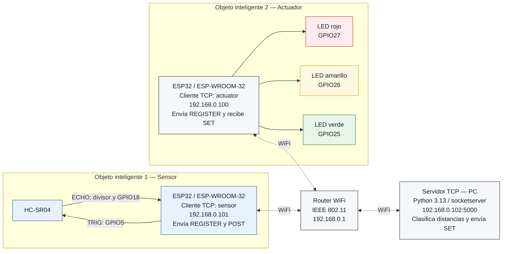
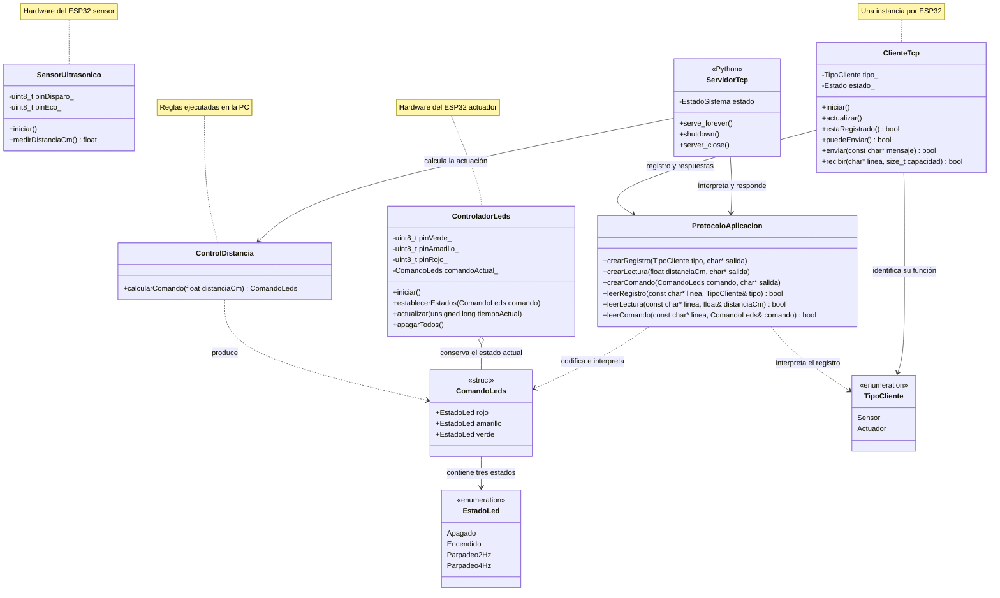
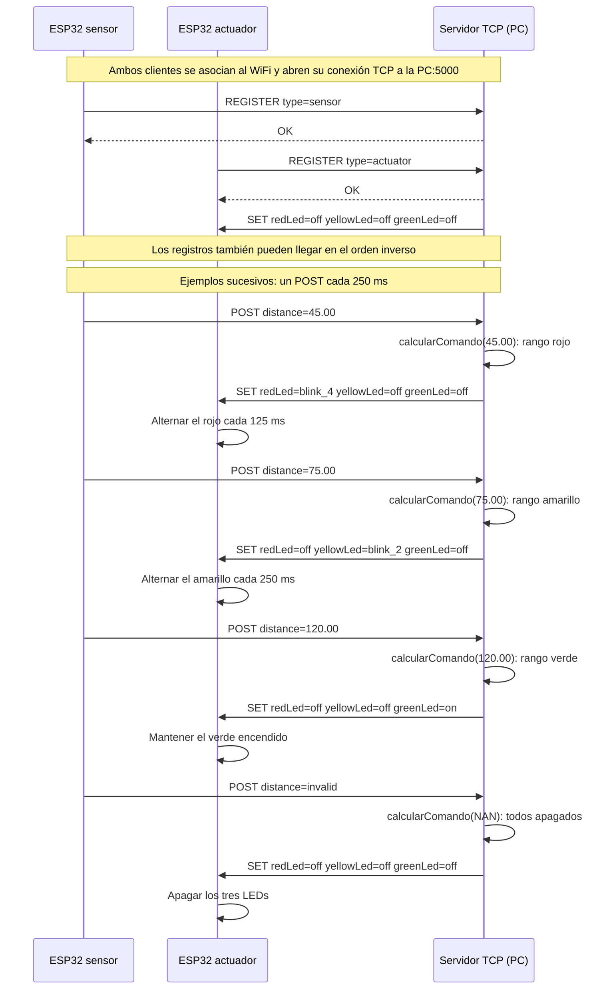
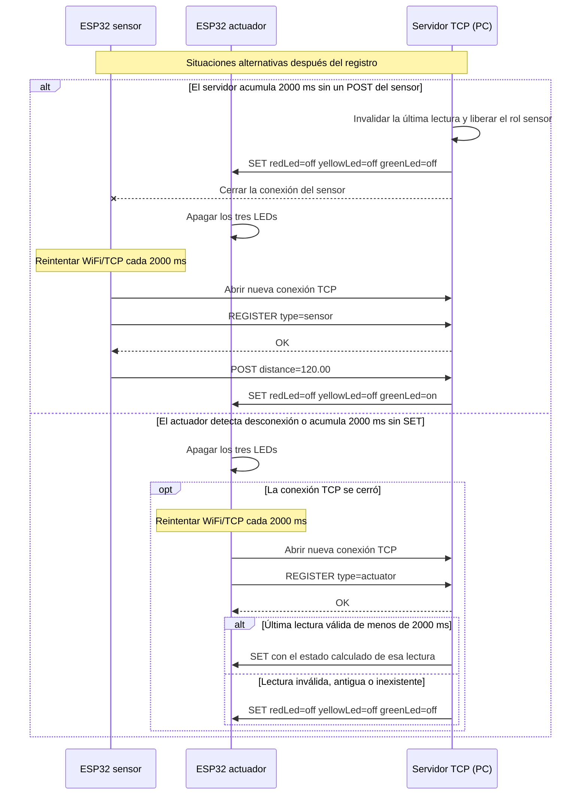

# Diseño del sistema — Práctica 2

**Actividad:** Integración de Objetos Inteligentes con TCP/IP  
**Asignatura:** SIS-234  
**Grupo:** 8  
**Estado:** diseño previo a la implementación

Este documento presenta nuestro diseño del sistema para resolver el [enunciado original del docente](../consigna/Práctica_2.md). Reúne los diagramas y la especificación del protocolo de aplicación. Sigue el ejemplo del docente: un ESP32 con sensor, otro ESP32 con actuadores y una PC que concentra el control. Los comandos `REGISTER`, `POST` y `SET` mantienen los nombres del ejemplo.

El código fuente actual corresponde a la práctica 1. Las clases nuevas y los cambios de interfaz que se muestran aquí son propuestas para la práctica 2. El [informe anterior](../historico/INFORME_P1.md) conserva los resultados y las evidencias del montaje original.

## 1. Arquitectura del sistema

### 1.1 Diagrama de despliegue



Las líneas discontinuas representan enlaces WiFi bidireccionales. Cada ESP32 inicia una conexión TCP persistente hacia el puerto `5000` de la PC. El servidor utiliza esa misma conexión para contestar el registro y, en el caso del actuador, enviar comandos. Toda actuación procede del servidor.

Las direcciones IP reproducen el esquema de referencia del docente y son ilustrativas. En el montaje se configurarán el SSID, la contraseña, la IP real de la PC y el puerto del servicio. Los clientes pueden obtener sus direcciones por DHCP; el servidor identifica su función mediante `REGISTER`.

### 1.2 Distribución de responsabilidades

| Componente | Responsabilidad | Intercambio principal |
|---|---|---|
| ESP32 sensor | Medir la distancia con el HC-SR04 cada 250 ms y comunicar lecturas válidas o inválidas. | `REGISTER type=sensor` y `POST` hacia la PC. |
| Servidor TCP | Registrar los clientes, clasificar cada lectura, producir el comando de LEDs y vigilar la ausencia de datos. | Recibir `POST`; enviar `OK`, `ERROR` y `SET`. |
| ESP32 actuador | Aplicar los estados de los LEDs y mantener el parpadeo mediante `millis()`. | `REGISTER type=actuator` hacia la PC y recepción de `SET`. |
| Router WiFi | Permitir la comunicación IP entre los tres equipos de la red local. | Transportar el tráfico de ambas conexiones TCP. |

### 1.3 Capas de comunicación

| Capa | Elemento utilizado |
|---|---|
| Aplicación | Protocolo de texto definido en la sección 6. |
| Transporte | TCP; servidor escuchando en el puerto `5000`. |
| Internet | IPv4 dentro de la red local. |
| Acceso a la red | WiFi, IEEE 802.11. |

El firmware conserva C++ con Arduino-ESP32 2.0.17 y PlatformIO. El servidor se implementa en Python 3.13 con biblioteca estándar, utilizando [`socketserver.ThreadingTCPServer`](https://docs.python.org/3.13/library/socketserver.html), hilos de conexión y un bloqueo para roles y lectura. El [plan revisado](../PLAN_IMPLEMENTACION.md) detalla las etapas del firmware y sus filtros de compilación.

## 2. Rangos y lógica de control

El servidor aplica tres rangos contiguos y sin solapamiento para toda distancia válida mayor que cero. Los límites de 50 y 100 cm pertenecen al rango que comienza en ese valor.

| Distancia recibida | LED rojo | LED amarillo | LED verde | Significado |
|---|---|---|---|---|
| Lectura inválida | `off` | `off` | `off` | Apagado de los actuadores. |
| 0 < distancia < 50 cm | `blink_4` | `off` | `off` | Cercanía: rojo a 4 Hz. |
| 50 ≤ distancia < 100 cm | `off` | `blink_2` | `off` | Distancia intermedia: amarillo a 2 Hz. |
| distancia ≥ 100 cm | `off` | `off` | `on` | Distancia mayor: verde fijo. |

| Estado del protocolo | Estado C++ propuesto | Comportamiento |
|---|---|---|
| `off` | `EstadoLed::Apagado` | GPIO en nivel bajo. |
| `on` | `EstadoLed::Encendido` | GPIO en nivel alto. |
| `blink_2` | `EstadoLed::Parpadeo2Hz` | Ciclo completo de 500 ms: 250 ms encendido y 250 ms apagado. |
| `blink_4` | `EstadoLed::Parpadeo4Hz` | Ciclo completo de 250 ms: 125 ms encendido y 125 ms apagado. |

Al cambiar el modo de un LED, el actuador aplica su estado inicial inmediatamente: apagado para `off`, encendido para `on` y encendido para comenzar un parpadeo. Si vuelve a recibir el mismo modo, conserva la fase y la temporización del LED. Esto permite enviar un `SET` por lectura sin reiniciar el parpadeo.

Un timeout de ECHO, una lectura no finita o una distancia menor o igual que cero se comunican como `POST distance=invalid`. Al iniciar el actuador, al detectar una desconexión o al cumplirse los tiempos de ausencia de datos de la sección 6.5, los tres LEDs quedan apagados.

## 3. Circuitos de los objetos inteligentes

Los componentes y los pines proceden del montaje de la práctica 1. Se reparten entre dos ESP32, alimentados por USB. Cada circuito comparte GND entre sus propios componentes; la comunicación entre objetos se realiza por WiFi.

### 3.1 Objeto inteligente con sensor


| Elemento | Conexión |
|---|---|
| Alimentación del ESP32 | USB de 5 V. |
| HC-SR04 VCC | VIN / 5 V del ESP32. |
| HC-SR04 GND | GND del ESP32. |
| HC-SR04 TRIG | GPIO5. |
| HC-SR04 ECHO | R1 de 2.2 kΩ; su salida forma el nodo conectado a GPIO18. |
| Nodo GPIO18 a GND | R2 y R3 de 2.2 kΩ en serie. |

El divisor tiene 2.2 kΩ entre ECHO y el nodo de lectura, y 4.4 kΩ entre el nodo y GND. Conserva la adaptación del montaje anterior:

```text
VGPIO18 = VECHO × (R2 + R3) / (R1 + R2 + R3)
VGPIO18 = 5 V × 4.4 kΩ / 6.6 kΩ ≈ 3.33 V
```

La lectura conserva el pulso TRIG de 10 µs y el timeout de ECHO de 30000 µs definidos en [`SensorUltrasonico.cpp`](../../apps/firmware/src/cliente/SensorUltrasonico.cpp).

### 3.2 Objeto inteligente con actuadores


| Elemento | Conexión |
|---|---|
| Alimentación del ESP32 | USB de 5 V. |
| LED verde | GPIO25 → ánodo del LED → cátodo → resistencia de 220 Ω → GND. |
| LED amarillo | GPIO26 → ánodo del LED → cátodo → resistencia de 220 Ω → GND. |
| LED rojo | GPIO27 → ánodo del LED → cátodo → resistencia de 220 Ω → GND. |

Cada LED tiene su propia resistencia. El controlador alterna los GPIO según el modo recibido; la clasificación de distancia corresponde a la PC.

## 4. Diagrama de clases propuesto



Las firmas representan las interfaces principales previstas. Las salidas de texto disponen de un buffer de 128 bytes: hasta 127 caracteres de contenido y un terminador C `\0`. `ClienteTcp::enviar()` agrega el `\n` al contenido; `recibir()` devuelve una línea completa sin ese delimitador. `ProtocoloAplicacion` trabaja sobre ese contenido. Al interpretar `distance=invalid`, `leerLectura()` entrega `NAN`; `ControlDistancia` lo convierte en los tres estados apagados.

| Ubicación / módulo | Clases y tipos | Responsabilidad |
|---|---|---|
| ESP32 sensor | `SensorUltrasonico`, `ClienteTcp` | Medir y mantener la conexión del sensor. Su programa principal envía las lecturas. |
| ESP32 actuador | `ControladorLeds`, `ClienteTcp` | Recibir órdenes y actualizar los GPIO. Su programa principal entrega los comandos al controlador. |
| PC Python | `ServidorTcp`, `EstadoSistema`, `ControlDistancia` de Python | Atender ambos clientes y convertir cada lectura en un comando. |
| Dominio compartido | `EstadoLed`, `ComandoLeds` | Representar la actuación sin depender de GPIO o sockets. |
| Protocolo compartido | `ProtocoloAplicacion`, `TipoCliente` | Traducir entre mensajes de texto y datos C++. |

Los tipos y el protocolo C++ pertenecen al firmware; Python tiene sus equivalentes en `apps/servidor`. Las relaciones del diagrama representan responsabilidades y el contrato, cuya compatibilidad se verifica en `tests/contratos`. `ControlDistancia` C++ permanece como referencia de prueba y la versión Python ejecuta las reglas en la PC. Se conserva `SensorUltrasonico` y se adapta `ControladorLeds`: su futura entrada será un comando de estados, reemplazando la clasificación local que actualmente realiza `establecerDistancia()`.

## 5. Diagramas de secuencia

### 5.1 Registro y funcionamiento normal



Cada mensaje de aplicación del diagrama termina en `\n`. `OK` confirma exclusivamente el registro. Cada `POST` produce un `SET` si el actuador está registrado. El actuador aplica los comandos sin enviar una confirmación por cada lectura.

### 5.2 Ausencia de datos y recuperación



El primer caso presupone un actuador registrado. Una desconexión del sensor detectada por el servidor produce el mismo apagado inmediatamente, sin esperar el timeout. Si únicamente faltan comandos y el socket del actuador sigue abierto, este permanece conectado y apagado hasta recibir un nuevo `SET` válido.

## 6. Especificación del protocolo de aplicación

### 6.1 Transporte y formato general

| Propiedad | Definición |
|---|---|
| Transporte | Una conexión TCP persistente por cliente, sobre la red WiFi local. |
| Punto de conexión | IPv4 de la PC y puerto TCP `5000`, configurables. |
| Codificación | ASCII, con nombres de comandos y argumentos sensibles a mayúsculas. |
| Delimitador | Un byte LF (`0x0A`, `\n`) al final de cada mensaje. |
| Longitud máxima | 128 bytes incluyendo LF: hasta 127 bytes de contenido. |
| Separación | Un espacio entre comando y argumentos y entre argumentos. |
| Argumentos | Formato `clave=valor`, con nombres y orden exactos de la tabla siguiente. |
| Distancia válida | Número decimal finito mayor que cero, en centímetros, con punto decimal. |

Los mensajes se envían sin espacios iniciales o finales y sin `\r`. Los valores decimales admiten una parte entera y una parte fraccionaria opcional; por ejemplo, `45` y `45.00`. El sensor emite dos cifras decimales. La coma decimal, los signos, la notación científica, `NaN` e `Infinity` no forman parte del formato; una lectura inválida utiliza el token `invalid`.

En los ejemplos escritos, `\n` representa el byte de salto de línea, no los dos caracteres barra invertida y letra `n`. El terminador C `\0` pertenece al buffer local y no se transmite.

TCP transporta un flujo ordenado de bytes. Una lectura del socket puede contener parte de un mensaje o varios mensajes; la delimitación corresponde a este protocolo de aplicación. Véase [RFC 9293, sección 2.2](https://www.rfc-editor.org/rfc/rfc9293.html#section-2.2).

Cada conexión mantiene su propio buffer de entrada. El receptor acumula bytes hasta LF, valida la línea completa y procesa las líneas en orden. Conserva cualquier fragmento restante para la próxima lectura. Si se exceden los 127 bytes de contenido antes de LF, rechaza la conexión como mensaje inválido. Al enviar, conserva el progreso de escrituras parciales hasta completar la línea; ante un fallo del socket aplica la política de desconexión. La atención de sockets y temporizadores continúa mientras una línea está incompleta.

### 6.2 Comandos y respuestas

| Mensaje | Dirección | Argumentos / valores | Condición |
|---|---|---|---|
| `REGISTER type=<tipo>` | Cliente → servidor | `type`: `sensor` o `actuator`. | Primer mensaje de aplicación de una conexión nueva. |
| `OK` | Servidor → cliente | Sin argumentos. | Registro aceptado. |
| `POST distance=<distancia>` | Sensor → servidor | `distance`: decimal positivo en cm o `invalid`. | Sensor registrado. |
| `SET redLed=<estado> yellowLed=<estado> greenLed=<estado>` | Servidor → actuador | Cada estado: `off`, `on`, `blink_2` o `blink_4`. | Actuador registrado. |
| `ERROR reason=<motivo>` | Servidor → cliente | `invalid_message`, `not_registered` o `role_busy`. | Mensaje o registro rechazado; luego se cierra esa conexión. |

`SET` siempre incluye los tres LEDs. El actuador valida toda la línea antes de modificar cualquier salida. Todos los estados de un comando se aplican juntos; no se aplica una parte de un mensaje inválido.

#### Ejemplos de líneas completas

```text
REGISTER type=sensor\n
REGISTER type=actuator\n
OK\n
POST distance=45.00\n
POST distance=invalid\n
SET redLed=blink_4 yellowLed=off greenLed=off\n
SET redLed=off yellowLed=blink_2 greenLed=off\n
SET redLed=off yellowLed=off greenLed=on\n
SET redLed=off yellowLed=off greenLed=off\n
ERROR reason=role_busy\n
```

### 6.3 Registro y secuencia permitida

1. El cliente obtiene conectividad WiFi/IP y abre un socket hacia la PC.
2. Envía `REGISTER` con su función. El servidor admite simultáneamente un sensor y un actuador, asociados a sockets distintos.
3. El servidor responde `OK` cuando reserva el rol. El cliente espera esa respuesta antes de iniciar su intercambio operativo.
4. Al registrar el actuador, el servidor envía inmediatamente un `SET`: el comando de la última lectura si tiene menos de 2000 ms, o todos apagados si no existe una lectura reciente. Una lectura reciente marcada como inválida también produce todos apagados.
5. El sensor registrado envía un `POST` cada 250 ms. El servidor registra su recepción, calcula los tres estados y envía un `SET` al actuador registrado, incluso si el comando coincide con el anterior.
6. Si todavía no hay actuador, el servidor conserva solamente la última lectura y su tiempo de recepción. Al incorporarse el actuador, aplica la regla del punto 4.
7. Después de perder la conexión, el cliente crea un socket nuevo y repite el registro. La conexión anterior libera su rol y descarta sus fragmentos de mensajes.

Los registros pueden llegar en cualquier orden. Los clientes completan el registro dentro de 2000 ms desde la apertura TCP. Si el servidor no recibe `REGISTER` completo dentro de ese plazo, responde `ERROR reason=not_registered` y cierra. Si el cliente no recibe `OK` dentro de ese plazo, cierra su socket y reintenta después de 2000 ms.

### 6.4 Errores y validación

| Situación | Respuesta del servidor | Acción |
|---|---|---|
| Comando, argumentos, estado de LED, distancia o longitud no válidos. | `ERROR reason=invalid_message` | Cerrar la conexión que originó el error. |
| Mensaje operativo antes de registrar el cliente. | `ERROR reason=not_registered` | Cerrar la conexión no registrada. |
| `REGISTER` correcto para un rol que ya tiene otro cliente registrado. | `ERROR reason=role_busy` | Cerrar la conexión nueva y conservar la existente. |
| Segundo `REGISTER` en una conexión ya registrada, o un comando incompatible con el rol. | `ERROR reason=invalid_message` | Cerrar la conexión que originó el error. |

Un `POST distance=invalid` es un mensaje válido y produce el apagado; no genera `ERROR`. Distancias numéricas iguales a cero o negativas no son lecturas válidas del protocolo y se rechazan. El sensor las normaliza a `invalid` antes de transmitirlas.

Si se cierra la conexión del sensor, el servidor libera el rol, invalida su lectura almacenada y envía todos apagados al actuador registrado. Una conexión nueva rechazada por rol ocupado no modifica el estado del sensor o actuador existentes.

Los clientes que reciben `ERROR` cierran la conexión y reintentan. El actuador también apaga los LEDs si recibe un mensaje del servidor no permitido o un `SET` inválido, y cierra el socket. Un mensaje incompleto espera su delimitador, sujeto a los tiempos de registro o ausencia de comandos, sin alterar parcialmente las salidas.

### 6.5 Temporización y recuperación

| Parámetro | Valor | Comportamiento |
|---|---|---|
| Intervalo de medición y envío | 250 ms | Cuatro lecturas/s nominales mientras el sensor está registrado. |
| Timeout de ECHO | 30000 µs | El sensor produce una lectura inválida si no recibe un eco. |
| Alternancia de `blink_2` | 250 ms | Dos ciclos completos por segundo. |
| Alternancia de `blink_4` | 125 ms | Cuatro ciclos completos por segundo. |
| Plazo de registro | 2000 ms | Cerrar y reintentar si no se completa `REGISTER` / `OK`. |
| Ausencia de lecturas en el servidor | 2000 ms | Invalidar la lectura, enviar todos apagados y cerrar/liberar el sensor. |
| Ausencia de comandos en el actuador | 2000 ms | Apagar localmente; mantener el socket si todavía está abierto. |
| Intervalo entre reintentos | 2000 ms | Reintentar conexión WiFi/TCP cuando el cliente está desconectado. |

El servidor mide la ausencia de lecturas desde el último `POST` completo y válido, incluido `distance=invalid`. Si el sensor acaba de registrarse y aún no envió un `POST`, cuenta desde la aceptación de su registro. La antigüedad de la lectura se calcula con el tiempo de recepción de la PC.

El actuador mide la ausencia de comandos desde el último `SET` completo y válido; al terminar el registro inicia ese plazo mientras espera el primer comando. Una desconexión detectada provoca el apagado inmediatamente. Tras un apagado por ausencia de datos, un `SET` válido vuelve a establecer los modos y comienza los parpadeos desde encendido.

Los temporizadores utilizan tiempo monótono local. En los ESP32, la medición, el parpadeo, la recepción y los reintentos se atienden desde el ciclo principal mediante `millis()`, manteniendo la resta sin signo para soportar su desbordamiento. Los buffers, roles y temporizadores de conexión se reinician al abrir un socket nuevo.

## 7. Trazabilidad y validaciones previstas

### 7.1 Requerimientos funcionales

| Requisito de la consigna | Elementos del diseño | Validación prevista |
|---|---|---|
| RF1: medir distancia. | Circuito del sensor, `SensorUltrasonico` y `POST`. | Comparar lecturas con una regla o cinta métrica. |
| RF2: clasificar al menos tres rangos. | Tabla de la sección 2 y `ControlDistancia` en la PC. | Probar valores interiores y límites de 50 y 100 cm. |
| RF3: actuar según el rango. | Circuito del actuador, `ControladorLeds` y `SET`. | Observar color, frecuencia y apagado de los demás LEDs. |
| RF4: comunicar mediante TCP sobre WiFi. | Arquitectura, `ClienteTcp`, `ServidorTcp`, secuencias y protocolo. | Registrar ambos objetos y comprobar `POST` → clasificación → `SET`. |

### 7.2 Casos para validar durante la implementación

Estos casos definen los resultados esperados. Su ejecución y sus evidencias se documentarán cuando esté implementado el sistema distribuido.

| Caso | Entrada o situación | Resultado esperado |
|---|---|---|
| PV-01 | 45 cm y 49.99 cm. | Solo rojo a 4 Hz. |
| PV-02 | 50 cm, 75 cm y 99.99 cm. | Solo amarillo a 2 Hz. |
| PV-03 | 100 cm y 120 cm. | Solo verde fijo. |
| PV-04 | Timeout de ECHO o lectura inválida. | `POST distance=invalid`; `SET` con todos apagados. |
| PV-05 | Comandos idénticos cada 250 ms. | Conservar la fase del parpadeo; ciclos de 500 o 250 ms. |
| PV-06 | Registro sensor primero y actuador primero. | Ambos órdenes funcionan; el actuador recibe estado reciente o apagado inicial. |
| PV-07 | Cliente nuevo solicita un rol ocupado. | `ERROR reason=role_busy`; el cliente original sigue registrado. |
| PV-08 | Un `POST` o `SET` llega en varios fragmentos TCP. | Procesarlo una sola vez, después de recibir LF. |
| PV-09 | Varios mensajes llegan en una lectura TCP. | Procesarlos completos y en orden, conservando el fragmento final. |
| PV-10 | Línea de 127 bytes de contenido; línea de 128 bytes antes de LF. | La primera cumple el límite de longitud, pero debe pasar la validación de sintaxis; la segunda se rechaza por longitud. |
| PV-11 | Comando desconocido, argumentos incompletos, decimal con coma, valor cero o mensaje incompatible con el rol. | Rechazo sin actuación parcial; aplicar el cierre y el apagado que correspondan. |
| PV-12 | Socket abierto sin completar el registro durante 2000 ms. | Cierre por plazo de registro y posterior reintento del cliente. |
| PV-13 | Sensor deja de enviar; servidor activo. | A los 2000 ms se invalidan los datos, se apagan los LEDs y se libera el rol sensor. |
| PV-14 | Actuador deja de recibir; desconexión del servidor no detectada todavía. | Apagado local a los 2000 ms sin `SET`. |
| PV-15 | Desconexión detectada y posterior recuperación. | Apagado, reintentos cada 2000 ms, nuevo registro y restauración mediante un comando válido. |
| PV-16 | Actuador se conecta con lectura reciente, inválida, antigua o inexistente. | Recibir el último estado reciente o todos apagados, según la sección 6.3. |

### 7.3 Requerimientos no funcionales previstos

| Atributo | Criterio de aceptación | Método previsto |
|---|---|---|
| Estabilidad | Al menos 10 minutos continuos sin reinicios ni bloqueos. | Observación del sistema completo y registro de eventos de los tres equipos. |
| Exactitud | Error absoluto máximo ≤ 3 cm en el intervalo de trabajo previsto de 3 a 150 cm. | Comparar mediciones físicas que cubran los tres rangos, usando una referencia graduada. |
| Tiempo de respuesta | Cambio visible del actuador en ≤ 1 s desde el cambio de distancia. | Medir de extremo a extremo: sensor → servidor → actuador, con una grabación o un instrumento de tiempo común. |
| Frecuencia de muestreo | Al menos 2 lecturas/s; intervalo nominal de 250 ms. | Contar lecturas obtenidas y `POST` recibidos por el servidor durante una ventana de tiempo. |
| Calidad del código | C++ simple, modular, orientado a objetos y con comentarios útiles. | Revisar responsabilidades, nombres y dependencia de las reglas respecto del hardware y la red. |

El intervalo de 3 a 150 cm y los criterios anteriores quedan pendientes de verificación física para la práctica 2. Los resultados de la práctica 1 corresponden al montaje anterior y no acreditan todavía el funcionamiento distribuido.
